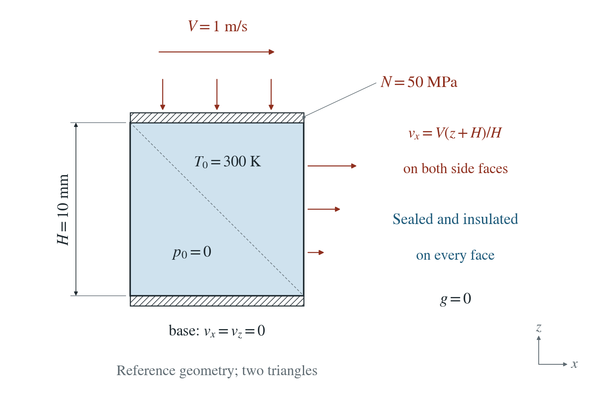
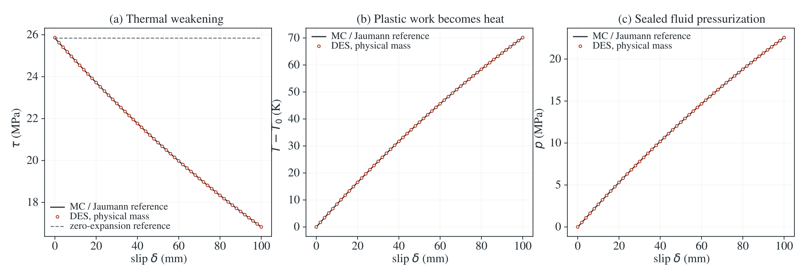

# Fault-zone heating at fixed normal traction

A prestressed, sealed fault patch slips at 1 m/s under 50 MPa normal compression. Plastic dissipation heats the mixture; expanding water raises pore pressure and reduces shear resistance.

**At 100 mm slip, shear resistance falls 34.9%, temperature rises 70.15 K and pore pressure reaches 22.56 MPa. Saved-frame shear errors are 0.0011% of the initial resistance against the differential reference.**

:::info At a glance

| | |
| --- | --- |
| Dimension | 2D |
| Build | `make ndims=2` from the poromechanics source |
| Inputs | [fault-heat.zip](/downloads/poromechanics/fault-heat.zip) |
| Reproduce with | DynEarthSol [`3774df0`](https://github.com/GeoFLAC/DynEarthSol/tree/3774df00ba1708a4f70a836d2073f845653aac64) |

:::

## Problem setup



**Geometry and motion.** 10 mm square, four nodes and two triangles; plane strain and fixed reference mesh. The base is fixed; both sides impose a linear horizontal velocity from zero at the base to 1 m/s at the top. The top normal platen is free under 50 MPa compression.

**Initial material.** Normal stresses −50 MPa, shear stress 25.866 MPa at yield; T=300 K, p=0. Mohr–Coulomb: K=20 GPa, G=10 GPa, cohesion 1 MPa, friction 30°, dilation zero. Physical mixture density 2360 kg/m³; damping and PT off.

**Water and heat.** All faces sealed and insulated, gravity zero. Porosity 0.2, Biot coefficient 0.8, grain/fluid moduli 100/2.2 GPa. Fixed mixture heat capacity C=2,996,000 J/(m³ K), β=4×10⁻⁵/K; permeability, conductivity and solid expansion zero.

## Input and how to run

Every file this example needs is in [fault-heat.zip](/downloads/poromechanics/fault-heat.zip). Run from that folder:

```bash
# Slides at 1 m/s to 0.1 s (100 mm). Saves 600 time intervals; physical timestep is selected from the mixture mass.
dynearthsol2d input.cfg
```

### Settings that define this example

| Setting | Value | What it does here |
| --- | --- | --- |
| `control.has_shear_heating` | `true` | converts accepted plastic work to heat, with unit heat fraction |
| `control.has_thermal_pressurization` | `true` | expanding sealed water raises pressure |
| `control.has_fluid_thermal_advection` | `true` | selects mixture heat capacity; this sealed case has zero Darcy flux |
| `control.is_quasi_static` | `false` | false: use physical saturated mixture mass |
| `control.has_PT` | `false` | false: ordinary explicit mechanics, with no PT solve |
| `control.damping_option` | `0` | zero: no damping in the physical case |
| `control.fixed_dt` | `0.0` | zero: automatic physical wave timestep |
| `control.dt_fraction` | `0.2` | 0.2: fraction of the mechanical stability bound |
| `bc.vbc_z1` | `8` | 8: the top has a uniform free normal velocity under its applied load |
| `bc.stress_val_z1` | `-50000000.0` | −50 MPa total normal traction |
| `bc.vbc_val_x1` | `1.0` | top horizontal velocity; the configured ratios give a linear profile on both sides |
| `mat.rheology_type` | `elasto-plastic` | constant-friction Mohr–Coulomb plasticity, zero dilation |

[input.cfg](/downloads/poromechanics/fault-heat/input.cfg) holds all 80 settings that differ from DES’s defaults; `dynearthsol2d -h` lists every option with its default.

## Output

DES writes `cell.info` (one line per saved frame: frame, step, time in seconds), `cell.save.NNNNNN` (the fields of each saved frame) and `cell.chkpt.NNNNNN` (checkpoints to restart from). `sim.output_step_interval` and `sim.output_time_interval_in_yr` set how often a frame is saved.

Set `DES_SOURCE` and `PYTHONPATH` as described in [Running the examples](../poromechanics/running.md) before using the Python reader or converter.

| Field | What to look at |
| --- | --- |
| `stress` | σxz is shear resistance; σzz checks departure from imposed normal equilibrium |
| `temperature` | mixture temperature minus the initial 300 K |
| `pore pressure` | sealed thermal pressurization with normal compliance |
| `shear heating` | last accepted plastic power density, W/m³ |
| `pending shear heat` | accepted heat awaiting its thermal update, J/m per element in 2D |
| `strain` | trace gives the normal volume change in the fluid-content ledger |

Read a frame in Python:

```python
from Dynearthsol import Dynearthsol      # in the DES source folder
model = Dynearthsol('cell')
frame = model.frames[-1]                 # model.time[i] is the time of frame i, in seconds
x = model.read_field(frame, 'coordinate')
value = model.read_field(frame, 'stress')
```

View it in ParaView after `python3 "$DES_SOURCE/2vtk.py" cell`.

## Result: DES and the analytical solution



(a) Shear resistance under fixed total normal traction; the dashed line is the zero-water-expansion reference. (b) Temperature rise from plastic work. (c) Sealed pore pressure. Black curves solve the independent continuous MC/Jaumann equations; markers are ordinary explicit DES with physical mass and zero damping.

Ordinary explicit mechanics with physical mixture inertia and zero damping follows the thermal weakening path. Companion GVS runs and slow-to-fast physical restarts check the mass/timestep transition and retain pending plastic heat separately from kinetic energy.

Reference, method and transition checks

[Every saved state and reference](/downloads/poromechanics/fault-heat/history.csv) · `Time convergence` · `First physical intervals after GVS`

To reproduce the whole study behind this figure, from the DES source folder:

```bash
python3 benchmarks/poromechanics/fault_heat.py --exe ./dynearthsol2d --output OUT --mode physical --strain 10 --samples 600
python3 benchmarks/poromechanics/fault_heat.py --exe ./dynearthsol2d --output OUT-switch --mode gvs --scaling 1e5 --velocity 1e-5 --strain .02 --physical-transition
```

The study’s full numbers: [record.json](/downloads/poromechanics/fault-heat/record.json).

## Analytical reference

$$
\gamma=Vt/H,\quad \sigma_{zz}=-N,\quad \ell=K-2G/3
$$

$$
d=(\sigma_{xx}+N)/2,\quad m=(\sigma_{xx}-N)/2,\quad q=\sqrt{d^2+\tau^2}
$$

$$
q+\sin\phi(m+\alpha p)-c\cos\phi=0
$$

$$
Sp\prime+\alpha e=\beta T\prime,\quad CT\prime=rq
$$

$$
(\ell+2G+\alpha^2/S)e+(Ga-\alpha\beta q/(SC))r=\tau
$$

$$
[\sin\phi(\ell+G)-Ga]e-Gr=-Gb
$$

$$
\sigma_{xx}\prime=\ell e-Gra+\tau-\alpha p\prime
$$

$$
\tau\prime=G-Grb-d,\quad W^p{}\prime=rq
$$

Prime means differentiation with respect to γ, a=d/q, b=τ/q, e=εv′, and r is the plastic multiplier with engineering plastic shear rb and plastic work rq. S=ϕ/Kf+(α−ϕ)/Ks. The reference imposes normal equilibrium and checks that σyy=−N+ℓεv−αp stays the intermediate principal.

### Derivation

The independent continuous reference solves normal equilibrium and yield consistency for the volume strain rate and plastic multiplier. It integrates total stress, fluid content, temperature and work; it does not call or duplicate the DES return algorithm.

Zero dilation gives opposite plastic normal strains. The stress equations include the Jaumann spin from simple shear; the sealed fluid law retains normal compliance.

$$
\epsilon^p_{xx}{}\prime=ra/2,\quad \epsilon^p_{zz}{}\prime=-ra/2,\quad \gamma^p{}\prime=rb
$$

A closed-form stiff-skeleton limit takes q≈τ, r≈1 and εv≈αp/(ℓ+G). It explains exponential thermal weakening; the plotted reference retains the finite-modulus equations above.

$$
\Lambda=\beta/[S+\alpha^2/(\ell+G)],\quad \tau\simeq\tau_0e^{-\alpha\sin\phi\Lambda\gamma/C}
$$

Pending heat is included in accepted work. Exact power integration is checked only for cases saving every physical interval, including the first 20 intervals after switching slow GVS to physical mass.

$$
E_T+E_{\rm pending}=\sum_n V\Delta t_n q_n
$$

Independent differential Mohr–Coulomb/Jaumann and sealed fluid/energy solution in fault_heat.py; a tighter integrator tolerance changes normalized stress by less than 1.6×10⁻¹⁰. Thermal-pressurization motivation: Rice (2006), doi:10.1029/2005JB004006. Full derivation and controls are in the supporting note.

## Validity and limits

A uniform two-triangle local patch with one normal mechanical mode, constant friction and fixed capacity. Saved-frame stress errors do not bound every wave peak. Fast GVS controls all reach the speed cap; they do not prove arbitrary scaling independence. Manual slow-to-fast restart does not establish automatic events, long tectonic clock handling, a spatial rupture or a full earthquake cycle.

## Reproduction

[Commands, solver hashes and portable inputs](../poromechanics/running.md).
