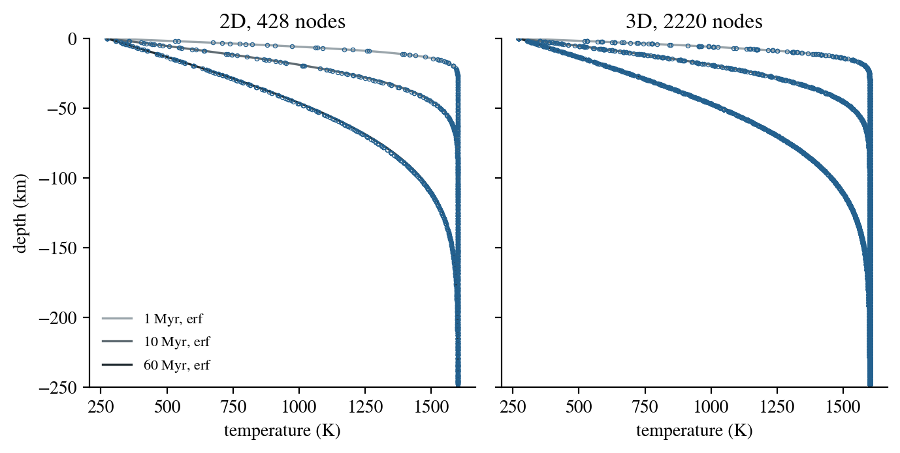

# Cooling of a half-space

A half-space whose surface is suddenly held cold cools by conduction along
the error-function profile

$$
T(z, t) = T_s + (T_m - T_s)\,\mathrm{erf}\!\left(\frac{|z|}{2\sqrt{\kappa t}}\right),
$$

the classic model for the cooling of oceanic lithosphere with age. This
benchmark starts DES from the profile of a 1-million-year-old plate and lets
it cool to 100 million years.

:::info At a glance

| | |
| --- | --- |
| Dimension | 2D and 3D, same input |
| Build | `make ndims=2` and `make ndims=3` |
| Run time | 6 s (2D) and 41 s (3D) on 8 threads |
| Inputs | `benchmarks/heat/half-space-cooling/diffusion.cfg` in the DynEarthSol repository |
| Checked with | DynEarthSol `68cc2a0` |

:::

## Setup

| Setting | Value |
| --- | --- |
| Domain | 10 km wide (and 10 km long in 3D), 250 km deep; element size about 2 km |
| Temperature | $T_s$ = 273 K held at the top; insulated sides and base; initial profile of a plate 1 Myr old with $T_m$ = 1600 K (`ic.temperature_option = 0`) |
| Thermal properties | $k$ = 3 W/m/K, $c_p$ = 1000 J/kg/K, $\rho_0$ = 3000 kg/m³, so $\kappa = k/(\rho_0 c_p) = 10^{-6}$ m²/s |
| Mechanics | elastic, no gravity, a very small characteristic speed so that the thermal time step controls |
| Output | a frame every 1 Myr to 100 Myr |

At 100 Myr the cooling front, $2\sqrt{\kappa t}$, is 112 km deep, well above
the insulated base at 250 km, so the half-space solution applies.

## Input and how to run

```bash
cd benchmarks/heat/half-space-cooling
../../../dynearthsol2d diffusion.cfg
../../../dynearthsol3d diffusion.cfg
```

Each run writes `diffusion.save.*`. Frame $n$ is the plate at age $1 + n$ Myr.
`benchmarks/heat/half-space-cooling/diffusion-plot.py` plots frames 0, 9 and 59 against the
error function; it was written for Python 2 and the earlier output reader.

## What to look for



| Plate age | Largest difference, 2D | Largest difference, 3D | With `mat.alpha = [0]`, 2D | With `mat.alpha = [0]`, 3D |
| --- | ---: | ---: | ---: | ---: |
| 1 Myr (initial) | 2.6 K | 2.6 K | 0.0 K | 0.0 K |
| 10 Myr | 8.3 K | 9.1 K | 1.2 K | 1.1 K |
| 60 Myr | 9.6 K | 9.7 K | 0.21 K | 0.26 K |

DES follows the error function in both dimensions, within 10 K of a
1327 K range. Most of that difference is not numerical. The input does not
set `mat.alpha`, so the default thermal expansion, $3\times10^{-5}$ K⁻¹,
makes the density, and so the diffusivity, depend on temperature, while the
error function assumes a constant diffusivity. The same input with
`alpha = [ 0 ]` in `[mat]` comes within 1.2 K at 10 Myr and 0.3 K at
60 Myr. Even the initial profile differs by up to 2.6 K, because DES
evaluates it with the density of the first element.

## Limits

- **Conduction only.** There is no advection, heat source or shear
  heating.
- **One resolution.** The element size is fixed at about 2 km; the near-
  surface gradient at 1 Myr is resolved by about five elements.
