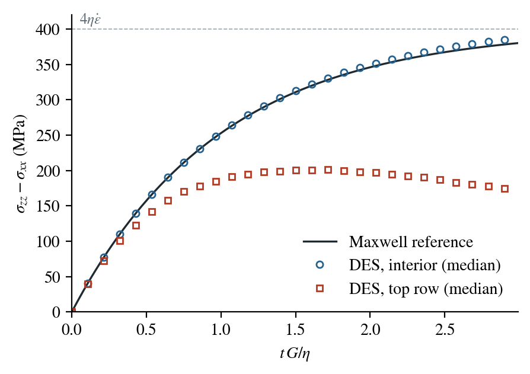

# Maxwell stress build-up in pure shear

A Maxwell material loaded at a constant strain rate first responds
elastically, then its stress approaches the viscous value
$2\eta\dot\varepsilon$ over the Maxwell time $\eta/G$. This benchmark
shortens a square of Maxwell material in pure shear and compares the stress
with that response. It uses DES's explicit mechanics with mass scaling, not
the PT solver; for PT see [Maxwell creep under a held
load](../../tutorial/fundamentals/maxwell.md).

:::info At a glance

| | |
| --- | --- |
| Dimension | 2D |
| Build | `make ndims=2` |
| Run time | about 7 minutes, 8 threads (2.2 million steps) |
| Inputs | `benchmarks/mechanics/maxwell/maxwell.cfg` in the DynEarthSol repository |
| Checked with | DynEarthSol `68cc2a0` |

:::

## Setup

| Setting | Value |
| --- | --- |
| Domain | 1 m × 1 m, element size 0.05 m (441 elements) |
| Loading | the right side moves inward and the base moves down, each at $v = 10^{-14}$ m/s; the left side and the top cannot move normal to themselves |
| Material | `rheology_type = maxwell`, $G$ = 10 GPa, $K$ = 1000 GPa (nearly incompressible), $\eta = 10^{22}$ Pa s, so $\eta/G = 10^{12}$ s |
| Mechanics | explicit, `inertial_scaling = 1e6`, `characteristic_speed = 1e-14` |
| Duration | $3\times10^{12}$ s, three Maxwell times, a frame every $10^4$ steps |

The input uses standard velocity conditions (`vbc_x1 = 1`,
`vbc_val_x1 = -1e-14`, `vbc_z0 = 1`, `vbc_val_z0 = -1e-14`) and stops at
`max_time_in_yr = 95000`. Earlier versions of this input used a boundary
type that needed a source patch.

With the side lengths $L_x = 1 - vt$ and $L_z = 1 + vt$, the strain rates
are $-v/L_x$ and $+v/L_z$, and the stress difference
$D = \sigma_{xx} - \sigma_{zz}$ of a Maxwell material obeys

$$
\frac{dD}{dt} = 2G\left(-\frac{v}{L_x} - \frac{v}{L_z}\right) - \frac{G}{\eta}\,D .
$$

The reference integrates this equation. Its limit is
$4\eta v = 400$ MPa in magnitude.

## Input and how to run

```bash
cd benchmarks/mechanics/maxwell
../../../dynearthsol2d maxwell.cfg
```

## What to look for



| | DES | Reference |
| --- | ---: | ---: |
| Interior elements (median), after $3\eta/G$ | 387 MPa | 380 MPa |
| Largest relative difference after $\eta/G$, interior median | 1.9 % | |
| Top element row (median), after $3\eta/G$ | 172 MPa | 380 MPa |

The elements below the top row follow the Maxwell response: the stress rises
elastically, bends over after about one Maxwell time and approaches
$4\eta v$. Their median stays within 2 % of the reference; individual
interior elements scatter by up to about ±15 % at the end.

The 29 elements that touch the top surface do not. Their stress stops
rising after about 1.5 Maxwell times and then falls; they shorten by about
40 % of the imposed strain. Exchanging the roles of top and base, holding the
base and moving the top up, gives the same result: only the row at the top
surface lags. The cause is not identified; the behaviour is reported here as
found.

## Limits

- **Top surface.** As described above, the top element row departs from the
  homogeneous solution; compare the interior only.
- **Explicit mechanics only.** The PT solver is checked separately in
  [Maxwell creep under a held load](../../tutorial/fundamentals/maxwell.md).
