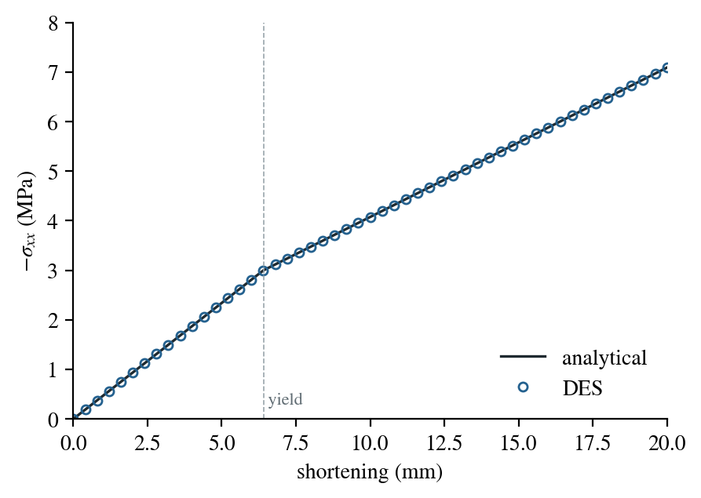

# Elastoplastic oedometer test

An oedometer shortens a sample in one direction while its other sides cannot
move. The strain is uniaxial, so the stress follows a closed-form path:
elastic up to yield, then a straight plastic branch whose slope depends on the
friction and dilation angles. This benchmark checks DES's Mohr–Coulomb return
on that path.

:::info At a glance

| | |
| --- | --- |
| Dimension | 2D, plane strain |
| Build | `make ndims=2` |
| Run time | about 1 s |
| Inputs | `benchmarks/mechanics/oedometer/oedometer-2d.cfg` in the DynEarthSol repository |
| Checked with | DynEarthSol `68cc2a0` |

:::

## Setup

| Setting | Value |
| --- | --- |
| Cell | 1 m × 1 m, two triangles, plane strain (`is_plane_strain = yes`) |
| Loading | the right side moves inward at $10^{-5}$ m/s; the left, top and bottom sides cannot move normal to themselves |
| Elasticity | $K = G = 200$ MPa |
| Strength | cohesion $c$ = 1 MPa, friction angle $\phi$ = 10°, dilation angle $\psi$ = 10°, no softening, tension cut-off 5.67 MPa |
| Other | no gravity; fixed time step 1 s, 2000 steps (20 mm of shortening) |

With $E_1 = K + 4G/3$ and $E_2 = K - 2G/3$, the axial stress rises
elastically as $\Delta\sigma_{xx} = E_1\,\Delta\varepsilon$ and the lateral
stresses as $E_2\,\Delta\varepsilon$. With
$N_\phi = (1+\sin\phi)/(1-\sin\phi)$, the cell yields at

$$
|\sigma_{xx}| = \frac{2c\sqrt{N_\phi}\,E_1}{E_1 - E_2 N_\phi},
$$

here after 6.41 mm of shortening. Both lateral stresses are equal, so the
return lies on the edge of two Mohr–Coulomb faces. With
$N_\psi = (1+\sin\psi)/(1-\sin\psi)$ the plastic branch has slope

$$
\frac{d|\sigma_{xx}|}{d\varepsilon} = E_1 + 2r\,(E_2 N_\psi - E_1),
\qquad
r = \frac{E_1 - E_2 N_\phi}{(E_1 + E_2) N_\phi N_\psi - 2E_2(N_\phi + N_\psi) + 2E_1}.
$$

The reference integrates both branches in true-strain increments,
$\Delta\varepsilon = v\,\Delta t/(1 - u)$ for shortening $u$, because DES
updates the cell's geometry every step.

## Input and how to run

```bash
cd benchmarks/mechanics/oedometer
../../../dynearthsol2d oedometer-2d.cfg
```

The run writes 51 frames, `result.save.*`, one every 40 steps.
`benchmarks/mechanics/oedometer/oedometer-2d-plot.py` plots the shortening of the right side
against $\sigma_{xx}$ with the reference path; it was written for an older
Matplotlib and needs small changes to run with a current one.

## What to look for



| | DES | Reference |
| --- | ---: | ---: |
| Axial stress after 20 mm | 7.0868 MPa | 7.0887 MPa |
| Largest relative difference, elastic branch | 0.057 % | |
| Largest relative difference, plastic branch | 0.058 % | |

DES follows the path on both branches. The two elements carry the same
stress, so the cell deforms uniformly, as the reference assumes.

## Limits

- **One stress path.** Uniaxial strain tests the two-face edge return and
  the dilation angle, but not the apex or the tension cut-off.
- **No softening.** Cohesion and friction stay constant; see the
  [shear-band benchmark](../geodynamics/localization.md) for softening.
