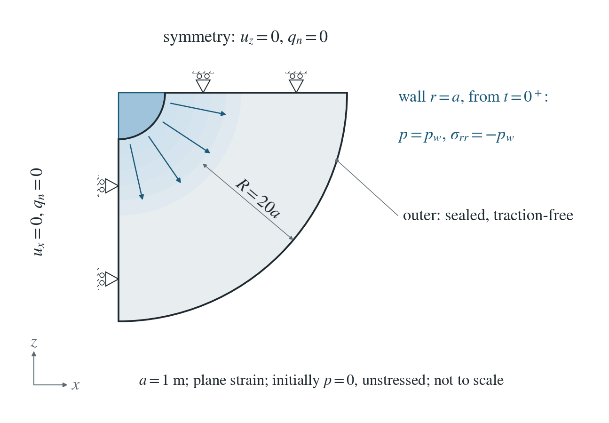
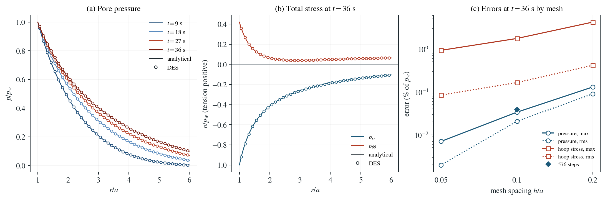

# Fluid injection into a poroelastic borehole

Fluid at pressure $p_w$ enters a borehole wall: it loads the wall and diffuses into the rock, which changes the stresses around the hole as it goes. The axisymmetric part of Detournay and Cheng’s borehole problem, on a finite annulus.

**On the 0.05 a mesh: pressure within 0.06% of $p_w$ at every node for 1.05 a ≤ r ≤ 4 a and all four times; total stress rms 0.16% (hoop) with a largest element error of 1.06%.**

:::info At a glance

| | |
| --- | --- |
| Dimension | 2D |
| Build | `make ndims=2` from the poromechanics source |
| Inputs | [borehole.zip](/downloads/poromechanics/borehole.zip) |
| Checked with | DynEarthSol `97f9794` (poromechanics branch) |

:::

## Problem setup



**Geometry.** A quarter annulus $a=1$ m, $R=20a$, plane strain, with symmetry rollers on both cuts; meshes refined out to $5a$.

**Loading.** At $t=0^+$ the wall takes fluid at $p_w=1$ MPa: pore pressure $p_w$ (a 1 ms ramp) and normal traction $-p_w$. The outer arc is sealed and traction-free. The rock starts unstressed at $p=0$; gravity is off.

**Material.** $K=200$ MPa, $G=100$ MPa, $\alpha=1$, $1/M=\phi/K_f=10^{-9}\ \mathrm{Pa^{-1}}$, $k/\mu=10^{-9}\ \mathrm{m^2/(Pa\,s)}$; diffusivity $c=0.25\ \mathrm{m^2/s}$.

**What is compared.** Nodal pressure and element total radial and hoop stress for $1.05a\leq r\leq4a$ at 9, 18, 27 and 36 s, relative to $p_w$.

## Input and how to run

Every file this example needs is in [borehole.zip](/downloads/poromechanics/borehole.zip). Run from that folder:

```bash
# Meshes the quarter annulus from annulus.poly (shipped alongside) at 0.05 m inner spacing and runs 144 steps of 0.25 s (36 s), saving hole.save.* every 36 steps (9, 18, 27 and 36 s) with hole.info listing the frames.
dynearthsol2d input.cfg
```

### Settings that define this example

| Setting | Value | What it does here |
| --- | --- | --- |
| `mesh.meshing_option` | `90` | 90: mesh the polygon read from poly_filename |
| `mesh.poly_filename` | `annulus.poly` | annulus.poly: quarter annulus a = 1 m to R = 20 m with a refined ring to 5a; flags: vertical cut x0, borehole wall x1, horizontal cut z0, outer arc z1 |
| `mesh.resolution` | `0.05` | 0.05 m element size near the wall, the finest mesh of the study |
| `bc.hbc_x1` | `2` | type 2: pore pressure prescribed on the borehole wall from hbc_pressure |
| `bc.hbc_pressure` | `[0,1000000.0,0,0,0,0]` | the x1 (wall) entry is the fluid pressure p_w = 1 MPa |
| `bc.stress_bc_x1` | `4` | type 4: normal stress on the curved wall |
| `bc.stress_val_x1` | `-1000000.0` | −p_w: the wall fluid pushes on the rock (tension positive) |
| `bc.num_hbc_schedule` | `2` | two schedule points for the wall pressure |
| `bc.hbc_schedule_time_in_yr` | `[0, 3.168876453507857e-11] yr = [0, 0.001] s` | 0 and 1 ms: the wall pressure ramps on almost instantly |
| `bc.hbc_schedule_ratio` | `[0, 1]` | 0 to 1, then held at p_w |
| `mat.hydraulic_perm` | `[1e-12]` | k = 1e-12 m²; with water viscosity 1e-3 Pa s the mobility k/μ is 1e-9 m²/(Pa s) |
| `mat.fluid_bulk_modulus` | `[200000000.0]` | K_f = 200 MPa; with porosity 0.2 the storage 1/M = φ/K_f is 1e-9 /Pa |
| `mat.bulk_modulus` | `[200000000.0]` | K = 200 MPa (shear modulus 100 MPa); together they give diffusivity c = 0.25 m²/s |
| `sim.output_step_interval` | `36` | 36 steps: frames at 9, 18, 27 and 36 s, the four compared times |

[input.cfg](/downloads/poromechanics/borehole/input.cfg) holds all 57 settings that differ from DES’s defaults; `dynearthsol2d -h` lists every option with its default.

## Output

DES writes `hole.info` (one line per saved frame: frame, step, time in seconds), `hole.save.NNNNNN` (the fields of each saved frame) and `hole.chkpt.NNNNNN` (checkpoints to restart from). `sim.output_step_interval` and `sim.output_time_interval_in_yr` set how often a frame is saved.

Set `DES_SOURCE` and `PYTHONPATH` as described in [Running the examples](../running.md) before using the Python reader or converter.

| Field | What to look at |
| --- | --- |
| `pore pressure` | nodal pressure, binned by radius and compared with the reference in panel (a) |
| `stress` | element total stress, rotated to radial and hoop components in panel (b) |

Read a frame in Python:

```python
from Dynearthsol import Dynearthsol      # in the DES source folder
model = Dynearthsol('hole')
frame = model.frames[-1]                 # model.time[i] is the time of frame i, in seconds
x = model.read_field(frame, 'coordinate')
value = model.read_field(frame, 'pore pressure')
```

View it in ParaView after `python3 "$DES_SOURCE/2vtk.py" hole`.

## Result: DES and the analytical solution



(a) Pore pressure, scaled by the wall pressure p_w, against distance from the borehole centre at the four saved times: lines, the finite-annulus poroelastic solution; symbols, DES. (b) Total radial and hoop stress, scaled by p_w, at the last saved time. (c) Largest pressure and stress errors against mesh spacing.

This checks the coupled poroelastic response around an opening: diffusion from a curved boundary, the pressure-driven hoop stress and the wall load together.

To reproduce the whole study behind this figure, from the DES source folder:

```bash
python3 benchmarks/hydromechanics/borehole_reference.py
python3 tests/functional/hydromechanics/check_borehole.py dynearthsol2d OUT/mesh --spacings 0.2 0.1 0.05
python3 tests/functional/hydromechanics/check_borehole.py dynearthsol2d OUT/steps --spacings 0.1 --steps 576
```

The study’s full numbers: [record.json](/downloads/poromechanics/borehole/record.json).

## Analytical reference

$$
S\,p_t+2\alpha\,\dot C_1=\frac{k}{\mu}\frac{1}{r}\frac{\partial}{\partial r}\left(r\frac{\partial p}{\partial r}\right)
$$

$$
S=\frac{1}{M}+\alpha m,\quad m=\frac{\alpha}{\lambda+2G}
$$

$$
\sigma_{rr}=-2Gm\frac{J}{r^2}+2(\lambda+G)C_1-2G\frac{C_2}{r^2}
$$

$$
\sigma_{\theta\theta}=2Gm\left(\frac{J}{r^2}-p\right)+2(\lambda+G)C_1+2G\frac{C_2}{r^2}
$$

$$
J(r)=\int_a^r p\,r'\,dr'
$$

$$
\sigma_{rr}(a)=-p_w,\quad \sigma_{rr}(R)=0
$$

Tension positive. The radial displacement is $u=mJ/r+C_1r+C_2/r$, so the volumetric strain is $mp+2C_1$; $C_1(t)$ and $C_2(t)$ follow from the two traction conditions and are linear in $p_w$ and $J(R)$.

### Derivation

Radial symmetry makes the displacement irrotational, so equilibrium integrates once: the volumetric strain is $mp$ plus a uniform term $2C_1$. Fluid mass, $\alpha\dot\varepsilon_v+\dot p/M=\nabla\cdot(k\nabla p/\mu)$, then gives the diffusion equation above.

On a finite annulus $C_1\neq0$ and depends on $J(R)$, which couples the pressure to its own integral; it moves the pressure by about 1% of $p_w$ here. In Laplace space the pressure is a Bessel ($I_0$, $K_0$, $I_1$, $K_1$) solution plus a uniform part $-2\alpha\bar C_1/S$, with $\bar C_1$ from one scalar equation; Stehfest inversion agrees with an independent Crank–Nicolson solution to $5\times10^{-6}$ of $p_w$.

Detournay and Cheng (1988), International Journal of Rock Mechanics and Mining Sciences 25(3), 171–182, axisymmetric loading modes; the finite annulus is solved in borehole_reference.py.

[Original reference](https://experts.umn.edu/en/publications/poroelastic-response-of-a-borehole-in-a-non-hydrostatic-stress-fi/).

## Validity and limits

Axisymmetric loading only (no deviatoric in-situ stress), linear poroelasticity, small strain. The finite annulus is part of the reference; the infinite-medium Detournay–Cheng solution is its $R\to\infty$ limit.

## Reproduction

[Commands, solver hashes and portable inputs](../running.md).
