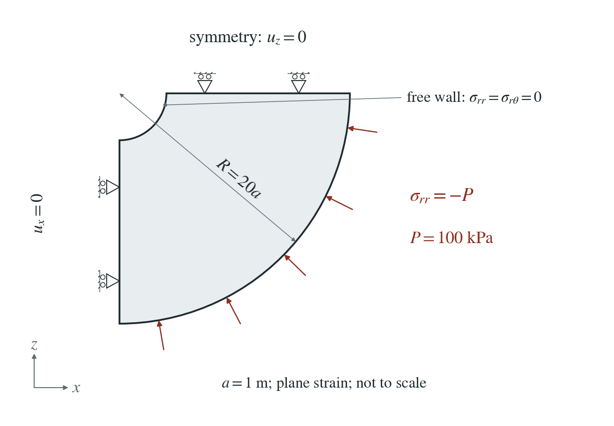
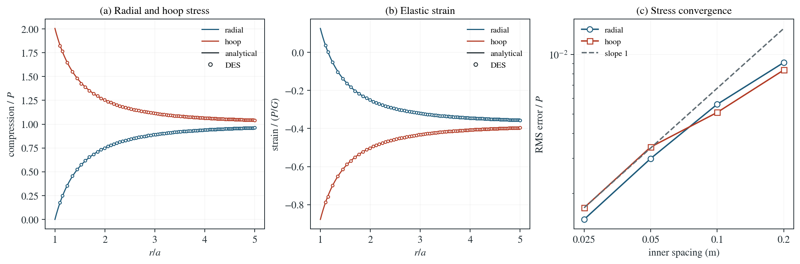

# Elastic circular opening: Kirsch limit

A circular opening concentrates stress in an elastic solid under isotropic compression.

**Radial/hoop stress RMS errors: 0.148% / 0.169% of $P$; largest local error 2.15%.**

:::info At a glance

| | |
| --- | --- |
| Dimension | 2D |
| Build | `make ndims=2` from the poromechanics source |
| Inputs | [kirsch.zip](/downloads/poromechanics/kirsch.zip) |
| Checked with | DynEarthSol `97f9794` (poromechanics branch) |

:::

## Problem setup



**Geometry and load.** A quarter annulus has opening radius a = 1 m and outer radius R = 20a. The opening is free; the outer curved face carries isotropic compressive traction P = 100 kPa.

**Constraints.** The two straight symmetry cuts have zero normal displacement. This is a dry plane-strain problem with gravity and transport disabled.

**Material and comparison.** K = G = 1 GPa. Stress and strain are compared over $1.1a\le r\le5a$ with the finite-annulus reference; the analytical curve remains visible and DES markers are thinned for display.

## Input and how to run

Every file this example needs is in [kirsch.zip](/downloads/poromechanics/kirsch.zip). Run from that folder:

```bash
# Meshes the quarter annulus from annulus.poly (shipped alongside) at 0.025 m inner spacing, solves one quasi-static step to equilibrium and writes kirsch.save.* and kirsch.chkpt.*, with kirsch.info listing the frames.
dynearthsol2d input.cfg
```

### Settings that define this example

| Setting | Value | What it does here |
| --- | --- | --- |
| `mesh.meshing_option` | `90` | 90: mesh the polygon read from poly_filename |
| `mesh.poly_filename` | `annulus.poly` | annulus.poly: quarter annulus a = 1 m to R = 20 m; its boundary flags make the vertical cut x0, the opening x1, the horizontal cut z0 and the outer arc z1 |
| `mesh.resolution` | `0.025` | 0.025 m element size, the finest mesh of the study |
| `mesh.min_angle` | `28` | 28°, keeps triangles well shaped along the curved boundaries |
| `bc.stress_bc_z1` | `4` | type 4: normal stress on facets of any orientation, here the curved outer arc |
| `bc.stress_val_z1` | `-100000.0` | P = 100 kPa isotropic compression on the outer arc (tension positive, so negative) |
| `bc.vbc_x1` | `0` | 0: the opening (flag x1) is free |
| `bc.vbc_z0` | `1` | 1: zero normal displacement on the horizontal symmetry cut (the vertical cut x0 uses the default 1) |
| `mat.rheology_type` | `elastic` | elastic |
| `mat.bulk_modulus` | `[1e9]` | K = 1 GPa |
| `mat.shear_modulus` | `[1e9]` | G = 1 GPa |
| `mat.is_plane_strain` | `true` | 2D plane strain; the out-of-plane stress σyy is not zero |
| `control.gravity` | `0` | no gravity: the outer traction is the only load |
| `sim.max_steps` | `1` | 1: one step solved to equilibrium by PT is the static answer |

[input.cfg](/downloads/poromechanics/kirsch/input.cfg) holds all 46 settings that differ from DES’s defaults; `dynearthsol2d -h` lists every option with its default.

## Output

DES writes `kirsch.info` (one line per saved frame: frame, step, time in seconds), `kirsch.save.NNNNNN` (the fields of each saved frame) and `kirsch.chkpt.NNNNNN` (checkpoints to restart from). `sim.output_step_interval` and `sim.output_time_interval_in_yr` set how often a frame is saved.

Set `DES_SOURCE` and `PYTHONPATH` as described in [Running the examples](../running.md) before using the Python reader or converter.

| Field | What to look at |
| --- | --- |
| `stress` | element stress, rotated to radial and hoop components and compared over 1.1a ≤ r ≤ 5a in panel (a) |
| `strain` | element strain, rotated to radial and hoop components in panel (b) |

Read a frame in Python:

```python
from Dynearthsol import Dynearthsol      # in the DES source folder
model = Dynearthsol('kirsch')
frame = model.frames[-1]                 # model.time[i] is the time of frame i, in seconds
x = model.read_field(frame, 'coordinate')
value = model.read_field(frame, 'stress')
```

View it in ParaView after `python3 "$DES_SOURCE/2vtk.py" kirsch`.

## Result: DES and the analytical solution



(a) Radial and hoop compression, scaled by P, against distance from the opening centre: lines, the finite-annulus solution; symbols, DES elements (thinned for display). (b) Radial and hoop elastic strain, scaled by P/G. (c) RMS stress error, scaled by P, against the inner mesh spacing.

This checks dry elastic stress, strain, curved-surface traction and symmetry constraints. Plasticity and excavation history remain separate checks; poroelastic injection is on the borehole page.

To reproduce the whole study behind this figure, from the DES source folder:

```bash
python3 benchmarks/hydromechanics/kirsch_reference.py
python3 tests/functional/hydromechanics/check_kirsch.py dynearthsol2d OUT --spacings .2 .1 .05 .025
```

The study’s full numbers: [record.json](/downloads/poromechanics/kirsch/record.json).

## Analytical reference

$$
A_0=-PR^2/(R^2-a^2)
$$

$$
B_0=-Pa^2R^2/(R^2-a^2)
$$

$$
\sigma_{rr}=A_0-B_0/r^2
$$

$$
\sigma_{\theta\theta}=A_0+B_0/r^2
$$

$$
u_r=\frac{A_0r}{2(\lambda+G)}+\frac{B_0}{2Gr}
$$

$$
\lambda=K-2G/3
$$

$$
\epsilon_{rr}=u_r^\prime
$$

$$
\epsilon_{\theta\theta}=u_r/r
$$

$$
\sigma_{yy}=\nu(\sigma_{rr}+\sigma_{\theta\theta})
$$

Stress and displacement are tension/outward positive; $\sigma_{yy}$ is the out-of-plane stress. $\nu=\lambda/[2(\lambda+G)]$. Displacement is measured from an unloaded annulus, rather than from a precompressed excavation state.

### Derivation

Radial equilibrium and the isotropic plane-strain Hooke law give the displacement $Cr+D/r$. The boundary stresses determine the two integration constants.

$$
d\sigma_{rr}/dr+(\sigma_{rr}-\sigma_{\theta\theta})/r=0
$$

Substitute zero radial stress at the opening and -P at the outer wall. As the wall moves to infinity, the finite solution approaches the isotropically loaded Kirsch limit.

$$
\sigma_{rr}(a)=0
$$

$$
\sigma_{rr}(R)=-P
$$

Finite-annulus solution derived from radial equilibrium; evaluated and checked in kirsch_reference.py and check_kirsch.py.

## Validity and limits

Isotropic, small-strain, dry elasticity. The finite outer wall changes the opening hoop stress by 0.251% relative to infinite-domain Kirsch. Anisotropic loading, plasticity, excavation history and poroelastic injection remain separate tests.

## Reproduction

[Commands, solver hashes and portable inputs](../running.md).
