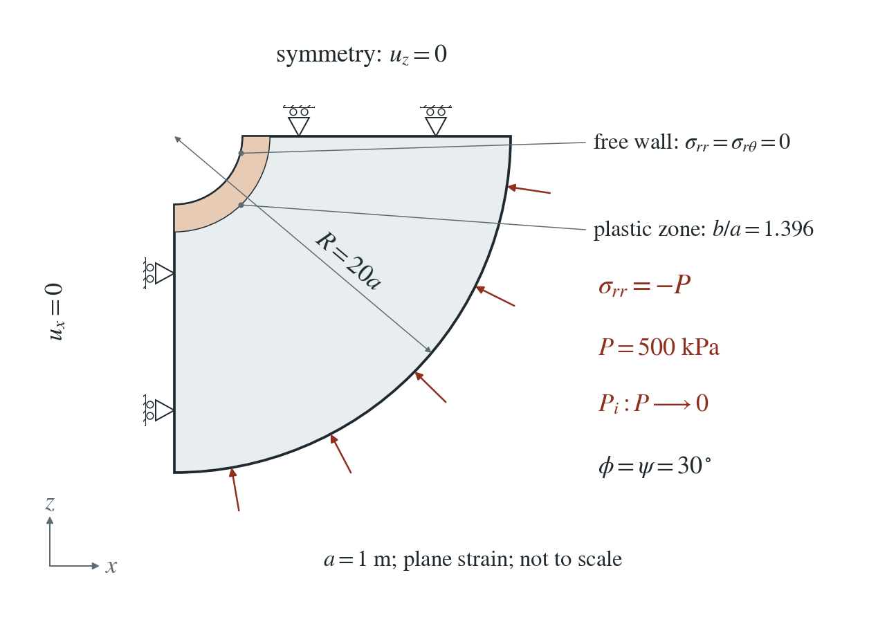
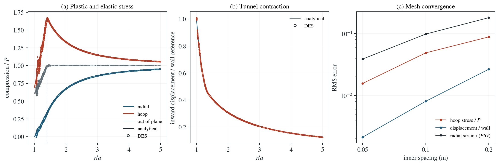

# Plastic tunnel: Salençon solution

A circular tunnel is excavated in rock under uniform in-situ stress: the support pressure on its wall is lowered to zero, and a ring of rock around the opening yields. Salençon’s solution gives the stresses, the plastic radius and the wall convergence for a perfectly plastic Mohr–Coulomb material.

**On the 0.05 m mesh the hoop stress is within 1.57% of $P$ (RMS), the displacement within 0.21% of the wall convergence, and the plastic radius within 0.34%. The radial strain error, 3.88% of $P/G$, is concentrated within half a radius of the wall.**

:::info At a glance

| | |
| --- | --- |
| Dimension | 2D |
| Build | `make ndims=2` from the poromechanics source |
| Inputs | [salencon.zip](/downloads/poromechanics/salencon.zip) |
| Checked with | DynEarthSol `97f9794` (poromechanics branch) |

:::

## Problem setup



**Geometry and load.** A quarter annulus with opening radius $a=1$ m and outer radius $R=20a$, in plane strain. The rock starts under uniform compression $P=500$ kPa in all three directions. The support pressure on the opening wall is lowered from $P$ to zero in 16 equal steps, while the outer boundary keeps the pressure $P$.

**Constraints.** The two straight symmetry cuts have zero normal displacement. Gravity, fluid flow and heat are off, and the mesh does not move.

**Material.** Perfectly plastic Mohr–Coulomb: $c=100$ kPa, $\phi=30^\circ$, associated flow ($\psi=30^\circ$), $G=10$ GPa, $K=21.7$ GPa ($\nu=0.3$). No softening and no weak zone.

**What is compared.** Radial, hoop and out-of-plane stress, radial and hoop strain, and radial displacement for $1.05a\le r\le5a$ after the support is removed, on meshes refined near the opening to 0.2, 0.1 and 0.05 m, against the finite-annulus Salençon solution.

## Input and how to run

Every file this example needs is in [salencon.zip](/downloads/poromechanics/salencon.zip). Run from that folder:

```bash
# Meshes annulus.poly (0.05 m near the opening, coarser outward) and writes the initial state: uniform 500 kPa compression, the wall still supported at 500 kPa, frame 0 with a checkpoint.
dynearthsol2d seed.cfg
# Fifteen unloading steps, load-001.cfg to load-015.cfg in order. Each restarts from the previous one and lowers the wall support pressure by P/16 (load-path.json lists them); one PT step per file brings the rock to equilibrium.
ls load-0*.cfg | xargs -n 1 dynearthsol2d
# The last step removes the support completely; this is the state compared with Salençon. input.cfg is the same file, and the shipped load-015 frame lets you run it without the earlier steps (but the displacement in the figure sums the velocities of every step).
dynearthsol2d salencon.cfg
```

### Settings that define this example

| Setting | Value | What it does here |
| --- | --- | --- |
| `ic.initial_stress` | `[-500000.0,-500000.0,0]` | uniform in-situ compression of 500 kPa in x and z (the out-of-plane stress starts equal) |
| `bc.stress_bc_x1` | `4` | normal traction on the opening wall: the support pressure |
| `bc.stress_val_x1` | `-0.0` | support pressure in this step, negative in compression; it is −500 kPa in seed.cfg, steps down by 31.25 kPa per load file, and is zero here |
| `bc.stress_bc_z1` | `4` | normal traction on the outer boundary |
| `bc.stress_val_z1` | `-500000.0` | the outer boundary keeps the in-situ 500 kPa compression throughout |
| `bc.vbc_z0` | `1` | the straight cut along x has zero normal velocity (symmetry); vbc_x0 does the same for the other cut |
| `mat.rheology_type` | `elasto-plastic` | Mohr–Coulomb elasto-plasticity |
| `mat.cohesion0` | `[100000.0]` | cohesion 100 kPa; cohesion1 is the same, so there is no softening |
| `mat.dilation_angle0` | `[30.0]` | dilation 30°, equal to the friction angle: associated flow |
| `control.has_PT` | `true` | each step is solved to equilibrium by PT; the material is rate independent, so the 1 s step has no physical meaning |
| `control.PT_relative_tolerance` | `1e-9` | tight equilibrium tolerance for every unloading step |
| `control.is_using_mixed_stress` | `true` | smooths element pressure after the plastic return; needed here, because without it the plastic ring next to the wall develops an alternating pressure between neighbouring elements and diverges |
| `control.has_moving_mesh` | `false` | small strain: the mesh stays in its original position |
| `mesh.poly_filename` | `annulus.poly` | the quarter-annulus outline, with a finer region within 3a of the centre |

[input.cfg](/downloads/poromechanics/salencon/input.cfg) holds all 57 settings that differ from DES’s defaults; `dynearthsol2d -h` lists every option with its default.

## Output

DES writes `salencon.info` (one line per saved frame: frame, step, time in seconds), `salencon.save.NNNNNN` (the fields of each saved frame) and `salencon.chkpt.NNNNNN` (checkpoints to restart from). `sim.output_step_interval` and `sim.output_time_interval_in_yr` set how often a frame is saved.

Set `DES_SOURCE` and `PYTHONPATH` as described in [Running the examples](../running.md) before using the Python reader or converter.

| Field | What to look at |
| --- | --- |
| `stress` | radial and hoop stress at element centres, rotated to polar components (panel a) |
| `stressyy` | out-of-plane stress; written in the checkpoint (salencon.chkpt.*), not the .save frame (panel a) |
| `velocity` | times the 1 s step and summed over every step, it gives the radial displacement (panel b) |
| `strain` | total strain from the initially compressed state, compared as radial and hoop strain |
| `plastic strain` | marks the yielded ring; its outer edge is the plastic radius |

Read a frame in Python:

```python
from Dynearthsol import Dynearthsol      # in the DES source folder
model = Dynearthsol('salencon')
frame = model.frames[-1]                 # model.time[i] is the time of frame i, in seconds
x = model.read_field(frame, 'coordinate')
value = model.read_field(frame, 'stress')
```

View it in ParaView after `python3 "$DES_SOURCE/2vtk.py" -g salencon`.

## Result: DES and the analytical solution



(a) Radial, hoop and out-of-plane stress against $r/a$ after the support is removed, finest mesh: DES at element centres (dots) and Salençon (lines); the dashed line marks the analytical plastic radius. (b) Inward radial displacement of the nodes, scaled by the analytical wall convergence, with the analytical curve. (c) RMS errors of hoop stress, displacement and radial strain over $1.05a\le r\le5a$ against the inner mesh spacing.

This checks Mohr–Coulomb plasticity with dilation around an opening: the stress redistribution, the extent of the plastic zone and the wall convergence that support design relies on.

To reproduce the whole study behind this figure, from the DES source folder:

```bash
python3 tests/functional/hydromechanics/check_salencon.py dynearthsol2d OUT --spacings .2 .1 .05 --dilation 30 --mixed --refined --load-steps 16
python3 benchmarks/hydromechanics/qualify_salencon.py OUT FIGURES
```

The study’s full numbers: [record.json](/downloads/poromechanics/salencon/record.json).

## Analytical reference

$$
N=\frac{1+\sin\phi}{1-\sin\phi}
$$

$$
q=2c\sqrt{N}
$$

$$
s_r=Cr^{N-1}-\frac{q}{N-1},\quad s_\theta=Ns_r+q\quad(a\leq r\leq b)
$$

$$
C=\frac{P_i+q/(N-1)}{a^{N-1}}
$$

$$
s_r=A-B/r^2,\quad s_\theta=A+B/r^2\quad(b\leq r\leq R)
$$

$$
Cb^{N-1}-\frac{q}{N-1}=\frac{(2P-q)R^2+qb^2}{(N+1)R^2-(N-1)b^2}
$$

$s_r$ and $s_\theta$ are radial and hoop stress, compression positive (DES output is tension positive). $P_i$ is the support pressure on the wall, here zero at the end, and $b$ the plastic radius: 1.39575 m for $R=20a$ (1.39405 m for an infinite domain). $A$ and $B$ follow from continuity of $s_r$ at $b$ and $s_r=P$ at $R$. The displacement integrates the plastic flow rule inside $b$ and the elastic solution outside it; the derivation gives it.

### Derivation

Inside the plastic zone, radial equilibrium $s_r^\prime+(s_r-s_\theta)/r=0$ with the yield condition $s_\theta=Ns_r+q$ gives a power law in $r$; the wall pressure $P_i$ fixes $C$. Outside it the Lamé solution holds. Requiring the elastic stress at $b$ to reach yield gives the scalar equation for $b$, solved numerically.

$$
s_r^\prime+(s_r-s_\theta)/r=0
$$

For the displacement, the plastic strains follow the flow rule $\epsilon_r^p=-M\epsilon_\theta^p$ with $M=(1+\sin\psi)/(1-\sin\psi)$, and the out-of-plane plastic strain is zero. Adding the elastic strains of plane-strain Hooke’s law gives $u^\prime+Mu/r$ as a known function of $r$; integrating from $b$, where $u$ matches the elastic solution, gives $u$ in the plastic zone. Strain and displacement are measured from the initially compressed state.

$$
u^\prime+\frac{M}{r}u=e_r^e+Me_\theta^e
$$

Salençon (1969), Contraction quasi-statique d’une cavité à symétrie sphérique ou cylindrique dans un milieu élastoplastique, Annales des Ponts et Chaussées 4, 231–236; the solution as given in the Itasca verification example for a cylindrical hole in a Mohr–Coulomb material.

[Original reference](https://docs.itascacg.com/itasca940/3dec/docproject/source/examples/CylindricalHoleInAnIMCM.html).

## Validity and limits

Dry, isotropic loading, small strain, perfectly plastic. The radial strain misses a 3% target (3.88% of $P/G$ on the finest mesh), almost all of it within half a radius of the wall. With mixed stress (needed here) the stored stress readjusts slightly at every step, so the result depends on the number of unloading steps: on the 0.05 m mesh, 16, 32 and 64 steps give hoop errors of 1.57%, 3.09% and 6.71%. Use the 16 steps shipped here, and do not hold the final load for many extra steps. Without mixed stress the coarse mesh diverges near the wall. Zero dilation is not covered.

## Reproduction

[Commands, solver hashes and portable inputs](../running.md).
