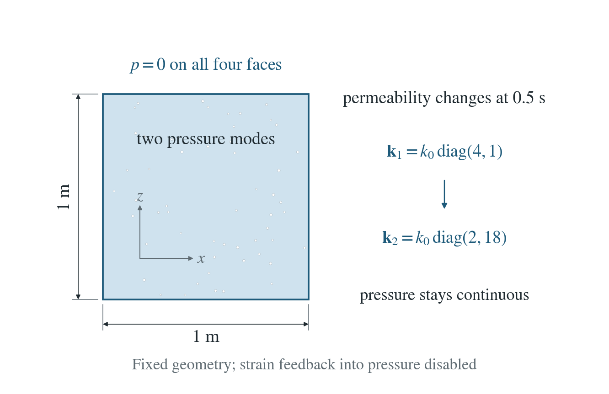
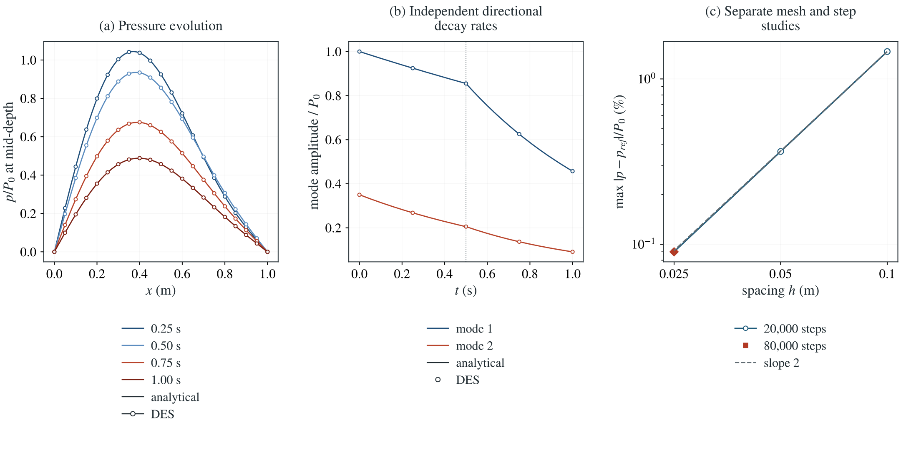

# Anisotropic flow with changing permeability

Two pressure modes drain from a square; scalar permeability and directional anisotropy change together at 0.5 s.

**Maximum pressure error 0.0900% of P₀; spatial orders 2.008 and 2.014 between successive meshes. Halving the time step halves the change in the solution (ratio 2.00004): first order in time. A restart inside the second phase reproduces the uninterrupted run exactly.**

:::info At a glance

| | |
| --- | --- |
| Dimension | 2D |
| Build | `make ndims=2` from the poromechanics source |
| Inputs | [anisotropic-time.zip](/downloads/poromechanics/anisotropic-time.zip) |
| Reproduce with | DynEarthSol [`3774df0`](https://github.com/GeoFLAC/DynEarthSol/tree/3774df00ba1708a4f70a836d2073f845653aac64) |

:::

## Problem setup



**Domain and drainage.** A 1 m square, $0<x<1$, $-1<z<0$; all four sides hold $p=0$. Gravity, heat and mesh motion are off.

**Initial pressure.** Two sine modes have relative amplitudes 1 and 0.35. Their different horizontal wave numbers distinguish the two directional diffusivities.

**Coefficient change.** At $t_s=0.5$ s, scalar permeability doubles and the axis-aligned tensor changes. Pressure and storage are continuous. The second phase is a restart at $t_s$ with the new coefficients; a further restart part-way through it reproduces the uninterrupted run.

## Input and how to run

Every file this example needs is in [anisotropic-time.zip](/downloads/poromechanics/anisotropic-time.zip). Run from that folder:

```bash
# First phase: restarts from the shipped seed.save.000000, seed.chkpt.000000 and seed.info, whose frame 0 holds the two-mode initial pressure, and runs 40,000 steps of 1.25e-5 s to t_s = 0.5 s with the first permeability tensor. DES writes first.* frames and checkpoints at 0.25 and 0.5 s.
dynearthsol2d input.cfg
# Second phase: restarts from frame 2 of the first run (0.5 s) with doubled scalar permeability and the new tensor, and runs to 1 s. DES writes second.* frames at 0.75 and 1 s. It needs the first.* checkpoint written by the previous command.
dynearthsol2d continuation.cfg
```

### Settings that define this example

| Setting | Value | What it does here |
| --- | --- | --- |
| `sim.is_restarting` | `true` | starts from a saved state instead of the built-in initial condition |
| `sim.restarting_from_modelname` | `seed` | the shipped seed files, which hold the two sine modes; continuation.cfg restarts from first instead |
| `sim.max_steps` | `40000` | 40,000 steps of 1.25e-5 s end the first phase at 0.5 s; continuation.cfg counts on to 80,000 steps (1 s) |
| `sim.output_step_interval` | `20000` | a frame every 20,000 steps (0.25 s), each with a checkpoint for the restart |
| `control.fixed_dt` | `1.25e-05` | physical step of 1.25e-5 s, inside the elastic stability limit |
| `control.is_quasi_static` | `false` | off: mechanics runs with its physical inertia, without mass scaling |
| `control.has_poroelastic_pressure_feedback` | `false` | off: deformation does not change the pressure, so pressure obeys pure diffusion |
| `control.gravity` | `0` | no gravity |
| `bc.hbc_x0` | `2` | type 2: the side x = 0 is held at the pressure in bc.hbc_pressure, here 0; x = 1 m, top and bottom are the same, so every side drains |
| `bc.hbc_z0` | `2` | type 2: the bottom is held at p = 0 |
| `mat.hydraulic_perm` | `[1e-15]` | scalar permeability k_0 = 1e-15 m² in the first phase; continuation.cfg doubles it |
| `mat.permeability_tensor` | `[4, 1, 1, 0, 0, 0]` | dimensionless tensor multiplying hydraulic_perm, [xx, yy, zz, xy, xz, yz]; in 2D xx is horizontal and zz vertical. [4, 1, 1] gives k_x = 4k_0, k_z = k_0; continuation.cfg uses [1, 1, 9] with 2k_0, i.e. k_x = 2k_0, k_z = 18k_0 |
| `mat.porosity` | `[0.3]` | with the fluid and grain moduli, sets the storage S_0 |
| `mat.bulk_modulus` | `[1e7]` | soft skeleton (1e7 Pa, as the shear modulus), which sets the elastic step limit |

[input.cfg](/downloads/poromechanics/anisotropic-time/input.cfg) holds all 58 settings that differ from DES’s defaults; `dynearthsol2d -h` lists every option with its default.

## Output

See [Running the examples](../running.md) for output files, the Python reader and ParaView conversion.

| Field | What to look at |
| --- | --- |
| `pore pressure` | pressure along mid-depth, compared with the two-mode solution; the two mode amplitudes are projected from it |
| `coordinate` | node positions for the mid-depth profile |


## Result: DES and the analytical solution



(a) Pressure p/P_0 along mid-depth (z = −0.5 m) at the four saved times of the two phases: DES nodes (circles) and the two-mode solution (lines). (b) Amplitudes of the two sine modes, projected from the DES pressure (circles), against their exponential decay (lines); the dotted line marks the permeability change at 0.5 s. (c) Maximum pressure error relative to P_0, in percent, against mesh spacing for the mesh study at 20,000 steps, the finest mesh at 80,000 steps (diamond), and a slope-2 guide.

This checks directional diffusion, a prescribed change of permeability during a run, and a restart after that change. Permeability that evolves with the state, rotated tensors that change in time and coupled fluid-content budgets are not covered.

To reproduce the whole study behind this figure, from the DES source folder:

```bash
python3 tests/functional/hydromechanics/check_anisotropic_flow.py dynearthsol2d OUT-mesh
python3 tests/functional/hydromechanics/check_anisotropic_flow.py dynearthsol2d OUT-steps40k --spacings .025 --steps 40000
python3 tests/functional/hydromechanics/check_anisotropic_flow.py dynearthsol2d OUT-steps80k --spacings .025 --steps 80000
```

The study’s full numbers: [record.json](/downloads/poromechanics/anisotropic-time/record.json).

## Analytical reference

$$
S_0\,\partial_t p=\mu^{-1}\nabla\!\cdot[\mathbf{k}(t)\nabla p]
$$

$$
S_0=\phi/K_f+(\alpha-\phi)/K_s
$$

$$
p=P_0\sum_{n=1}^{2}a_n(t)\sin(n\pi x)\sin[\pi(z+1)]
$$

$$
\lambda_{n,j}=\frac{\pi^2}{\mu S_0}(n^2 k_{x,j}+k_{z,j})
$$

$$
\tau_1=\min(t,t_s)
$$

$$
\tau_2=\max(0,t-t_s)
$$

$$
a_n(t)=a_n(0)\exp[-\lambda_{n,1}\tau_1-\lambda_{n,2}\tau_2]
$$

$$
\mathbf{k}_1=k_0\,\mathrm{diag}(4,1)
$$

$$
\mathbf{k}_2=k_0\,\mathrm{diag}(2,18)
$$

Lengths in the modes are divided by the 1 m side. $P_0=1000$ Pa, $a_1(0)=1$, $a_2(0)=0.35$, $k_0=10^{-15}$ m², $\mu=1.002\times10^{-3}$ Pa s, $\phi=0.3$, $\alpha=1$, $K_f=2.17$ GPa and $K_s=37$ GPa. 

### Derivation

Each sine mode vanishes on the drained faces. Substitution into the diffusion equation gives its scalar decay rate; the different horizontal wave numbers make both tensor components observable.

Integrate the decay rate in each time interval and carry the amplitude continuously through the coefficient jump. This gives the exponential formula without fitted parameters.

The reference stored fluid volume (pressure storage only) is $S_0\int p\,dV=4S_0P_0a_1/\pi^2$: the second horizontal mode integrates to zero. This excludes deformation storage because its feedback is disabled.

Separation of variables for the stated linear diffusion equation; the independent reference is implemented in check_anisotropic_flow.py.

## Validity and limits

Prescribed, homogeneous, axis-aligned tensors; fixed storage and geometry. Mechanical pressure feedback is off, so deformation does not change the pressure; pressure still loads the solid, so the time step must stay within the elastic stability limit. This tests the flow equation, not coupled deformation or a general fluid-content budget.
