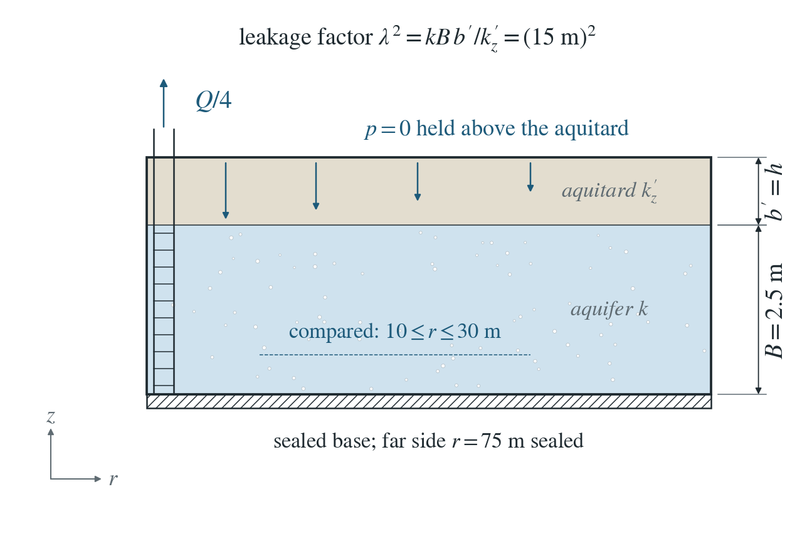
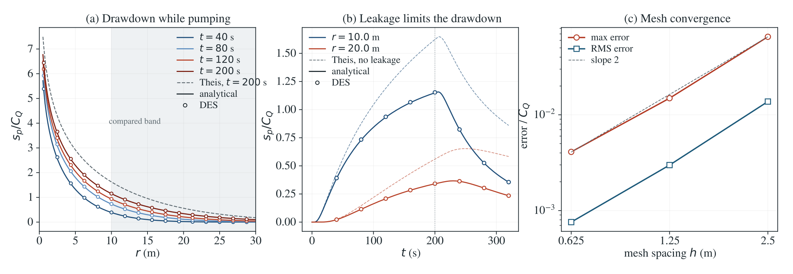

# Hantush–Jacob pumping from a leaky aquifer

A well pumps a confined aquifer covered by a leaky aquitard. Water drawn down through the aquitard limits the drawdown, which approaches a steady cone.

**Largest drawdown error: 0.410% of $C_Q$, over $10\le r\le30$ m and eight times through pumping and recovery. Leakage changes the drawdown by up to 53% of $C_Q$ from Theis.**

:::info At a glance

| | |
| --- | --- |
| Dimension | 3D |
| Build | `make ndims=3` from the poromechanics source |
| Inputs | [hantush.zip](/downloads/poromechanics/hantush.zip) |
| Reproduce with | DynEarthSol [`3774df0`](https://github.com/GeoFLAC/DynEarthSol/tree/3774df00ba1708a4f70a836d2073f845653aac64) |

:::

## Problem setup



**Geometry and well.** A quarter box, $0\le x,y\le75$ m. An aquifer $B=2.5$ m thick lies under an aquitard one element thick ($b^\prime=h$) whose top is held at $p=0$. A well on the corner edge, screened through the aquifer only, pumps $Q/4$ ($Q=10^{-4}\ \mathrm{m^3/s}$) for 200 s and then shuts in.

**Layers.** The aquitard is a second material whose vertical leakance $k_z^\prime/(\mu b^\prime)$ is the same on every mesh, so $\lambda=15$ m throughout; it stores a thousandth of the aquifer water per volume. Vertical permeability is ten times horizontal in both layers, so the aquifer has negligible vertical resistance, as the theory assumes.

**What is compared.** The pressure drawdown at the aquifer nodes with $10\le r\le30$ m, at eight times through pumping and recovery, against the superposed Hantush–Jacob solution. The skeleton is stiff and pressure feedback is off.

## Input and how to run

Every file this example needs is in [hantush.zip](/downloads/poromechanics/hantush.zip). Run from that folder:

```bash
# Runs the 3D quarter box with the one-element aquitard on top: 160 steps of 2 s, pumping for 200 s, then recovery to 320 s. DES writes hantush.save.* frames every 20 steps (40 s). On one thread this mesh takes about 45 minutes.
dynearthsol3d input.cfg
```

### Settings that define this example

| Setting | Value | What it does here |
| --- | --- | --- |
| `control.has_hydraulic_diffusion` | `true` | turns on Darcy flow of pore pressure; wells need it |
| `control.has_poroelastic_pressure_feedback` | `false` | off: deformation does not change the pressure, so only flow is tested |
| `control.gravity` | `0` | no gravity, so the drawdown is compared directly in pressure |
| `sim.max_steps` | `160` | 160 steps of 2 s end the run at 320 s: 200 s of pumping and 120 s of recovery |
| `bc.hbc_z1` | `2` | type 2: the top of the aquitard is held at the pressure given in bc.hbc_pressure, here 0, so water leaks down through the aquitard |
| `bc.well_rate` | `[2.5e-05]` | extraction rate of the quarter well, Q/4 with Q = 1e-4 m³/s |
| `bc.well_z_top` | `[-0.625]` | the screen starts one element below the top, so the well draws from the aquifer only, not the aquitard |
| `bc.well_schedule_ratio` | `[1, 1, 0]` | rate multipliers 1, 1, 0 at 0, 200 s, 200 s: full rate, then shut in |
| `ic.layer_mattypes` | `[1, 0]` | material 1 (the aquitard) on top of material 0 (the aquifer) |
| `ic.mattype_layer_depths` | `[0.2]` | the aquitard is the top 0.2 of the 3.125 m height, i.e. one 0.625 m element |
| `mat.hydraulic_perm` | `[1.1463636364386364e-13, 7.96085858637942e-17]` | aquifer and aquitard permeabilities; the aquitard value is set so that the leakage factor λ is 15 m |
| `mat.permeability_tensor` | `[1, 1, 10.0, 0, 0, 0]` | vertical permeability ten times horizontal in both layers, so the aquifer has negligible vertical resistance |
| `mat.porosity` | `[0.25, 0.0001]` | aquifer 0.25 and aquitard 1e-4 (with Biot coefficient 0.3), so the aquitard stores almost no water, as Hantush–Jacob assume |
| `mat.bulk_modulus` | `[1000000000000.0, 1000000000000.0]` | very stiff skeleton (1e12 Pa) in both layers, so the solid barely moves |

[input.cfg](/downloads/poromechanics/hantush/input.cfg) holds all 60 settings that differ from DES’s defaults; `dynearthsol3d -h` lists every option with its default.

## Output

DES writes `hantush.info` (one line per saved frame: frame, step, time in seconds), `hantush.save.NNNNNN` (the fields of each saved frame) and `hantush.chkpt.NNNNNN` (checkpoints to restart from). `sim.output_step_interval` and `sim.output_time_interval_in_yr` set how often a frame is saved.

Set `DES_SOURCE` and `PYTHONPATH` as described in [Running the examples](../running.md) before using the Python reader or converter.

| Field | What to look at |
| --- | --- |
| `pore pressure` | drawdown s_p = p(frame 0) − p at the aquifer nodes 10–30 m from the well, compared with Hantush–Jacob |
| `coordinate` | gives the radius from the well and selects the nodes on the aquifer base |

Read a frame in Python:

```python
from Dynearthsol import Dynearthsol      # in the DES source folder
model = Dynearthsol('hantush')
frame = model.frames[-1]                 # model.time[i] is the time of frame i, in seconds
x = model.read_field(frame, 'coordinate')
value = model.read_field(frame, 'pore pressure')
```

View it in ParaView after `python3 "$DES_SOURCE/2vtk.py" hantush`.

## Result: DES and the analytical solution



(a) Drawdown s_p/C_Q along the aquifer base on the y = 0 plane at four times during pumping: DES nodes (circles) and the Hantush–Jacob solution (lines). The dashed grey curve is the Theis solution without leakage at the last of these times, and the band marks the compared range 10–30 m. (b) Drawdown history at r ≈ 10 m and r ≈ 20 m: Hantush–Jacob (solid), Theis without leakage (dashed) and DES (circles); the dotted line marks shut-in. (c) Maximum and RMS drawdown error against mesh spacing, with a slope-2 guide.

This checks a layered aquifer system: an aquitard of a second material leaking from a fixed-pressure top, with the well, storage and radial diffusion of the Theis case. On the finest mesh the aquitard stores 0.03% of the aquifer's water, close to the no-storage assumption. Mechanical pressure feedback is disabled in this flow-isolation test.

To reproduce the whole study behind this figure, from the DES source folder:

```bash
python3 benchmarks/poromechanics/hantush_reference.py
python3 tests/functional/hydromechanics/check_hantush.py dynearthsol3d OUT --spacings 2.5 1.25 0.625
```

The study’s full numbers: [record.json](/downloads/poromechanics/hantush/record.json).

## Analytical reference

$$
\mathcal{T}_p=\kappa B/\mu,\quad S_p=BS_B,\quad \lambda^2=\frac{\kappa B\,b^\prime}{\kappa_z^\prime}
$$

$$
S_p\,\partial_ts_p=\mathcal{T}_p\left(\partial_r^2s_p+\frac{1}{r}\partial_rs_p\right)-\frac{\mathcal{T}_p}{\lambda^2}\,s_p
$$

$$
s_p(r,t)=\frac{Q}{4\pi\mathcal{T}_p}\,W\!\left(\frac{r^2S_p}{4\mathcal{T}_pt},\frac{r}{\lambda}\right)
$$

$$
W(u,\beta)=\int_u^\infty\frac{1}{y}\exp\!\left(-y-\frac{\beta^2}{4y}\right)dy
$$

$$
W(u,0)=E_1(u)
$$

$$
W(0,\beta)=2K_0(\beta)
$$

$s_p=p_{\rm initial}-p$ is the pressure drawdown, $\kappa$ and $\kappa_z^\prime$ the horizontal aquifer and vertical aquitard permeabilities, and $S_B$ the fixed-stress storage of the Theis page. Shut-in is superposed as in Theis. Errors are fractions of $C_Q=Q/(4\pi\mathcal{T}_p)$.

### Derivation

With no aquitard storage the aquitard pressure is linear in $z$, so it leaks a flux $(\kappa_z^\prime/\mu b^\prime)\,s_p$ into the aquifer. Integrating over the aquifer thickness adds this sink to the Theis equation.

$$
q_{\rm leak}=\frac{\kappa_z^\prime}{\mu\,b^\prime}\,s_p=\frac{\mathcal{T}_p}{\lambda^2}\,s_p
$$

The Laplace transform in time and the line-sink limit at $r\to0$ give the leaky well function $W$, which tends to Theis at early time and to the steady cone $2K_0(r/\lambda)$ at late time. hantush_reference.py checks both limits, the identity $W(u,\beta)+W(\beta^2/4u,\beta)=2K_0(\beta)$ and the equation itself.

Hantush and Jacob (1955), Non-steady radial flow in an infinite leaky aquifer, Trans. AGU 36, 95-100. Evaluated in hantush_reference.py by quadrature.

[Original reference](https://doi.org/10.1029/TR036i001p00095).

## Validity and limits

Hantush and Jacob neglect aquitard storage, horizontal aquitard flow and vertical resistance in the aquifer. Their dimensionless measures here are $S^\prime_B b^\prime/S_p\le0.12\%$, $(b^\prime/\lambda)^2/10\le0.28\%$ and $B^2/(20\lambda^2)=0.14\%$, the first two falling with $h$. $S^\prime_B$ is aquitard storage per volume and $S_p=BS_B$ aquifer storage per area. Line well, no wellbore storage; the axis $r<10$ m is excluded.

## Reproduction

[Commands, solver hashes and portable inputs](../running.md).
