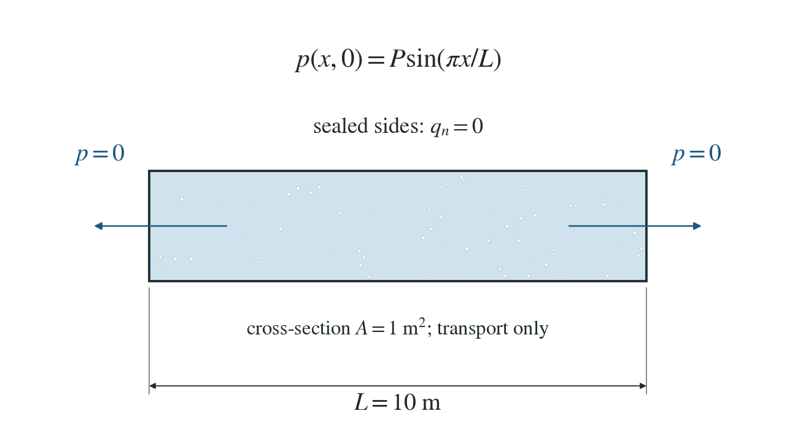
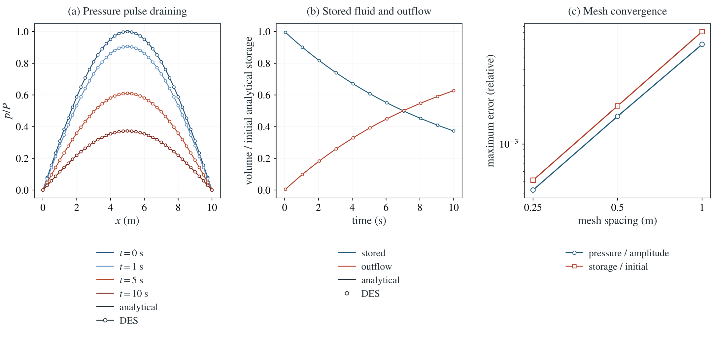

# Open boundaries: a draining pressure pulse

A smooth pressure pulse drains through two zero-pressure ends while the side faces remain sealed.

**Maximum pressure error: 0.0424% of the initial amplitude; storage error 0.0509%. Stored fluid plus outflow equals the initial volume within 1.19e-21 m³ (independent integration).**

:::info At a glance

| | |
| --- | --- |
| Dimension | 3D |
| Build | `make ndims=3` from the poromechanics source |
| Inputs | [open-flow.zip](/downloads/poromechanics/open-flow.zip) |
| Reproduce with | DynEarthSol [`3774df0`](https://github.com/GeoFLAC/DynEarthSol/tree/3774df00ba1708a4f70a836d2073f845653aac64) |

:::

## Problem setup



**Geometry.** A 10 m column has a 1 m² cross-section. Both end faces hold zero pressure; the lateral faces are sealed.

**Initial condition.** Pressure is $P\sin(\pi x/L)$, with $P=1000$ Pa and $L=10$ m. The run restarts from the shipped seed checkpoint, whose frame 0 holds this field.

**Material and mechanics.** Diffusivity is 1 m²/s and pressure capacity is constant. Mechanical pressure feedback, gravity and heat are disabled.

## Input and how to run

Every file this example needs is in [open-flow.zip](/downloads/poromechanics/open-flow.zip). Run from that folder:

```bash
# Restarts from the shipped seed.save.000000, seed.chkpt.000000 and seed.info, whose frame 0 holds the initial sine pulse, and runs 200 steps of 0.05 s to 10 s. DES writes a pulse.save.* frame at every step. To build the seed yourself, run the study command: it runs one step, then writes the pulse into frame 0.
dynearthsol3d input.cfg
```

### Settings that define this example

| Setting | Value | What it does here |
| --- | --- | --- |
| `sim.is_restarting` | `true` | starts from a saved state instead of the built-in initial condition |
| `sim.restarting_from_modelname` | `seed` | the shipped seed files, which hold the sine pulse |
| `sim.restarting_from_frame` | `0` | frame 0 of the seed, the initial pulse |
| `sim.max_steps` | `200` | 200 steps of 0.05 s, to 10 s |
| `sim.output_step_interval` | `1` | a frame at every step, so every step enters the pressure, storage and budget checks |
| `control.has_hydraulic_diffusion` | `true` | turns on Darcy flow of pore pressure |
| `control.has_poroelastic_pressure_feedback` | `false` | off: deformation does not change the pressure, so storage stays constant |
| `control.gravity` | `0` | no gravity, so the pulse drains by diffusion alone |
| `control.fixed_dt` | `0.05` | outer step of 0.05 s; DES splits it into stable flow substeps by itself |
| `bc.hbc_x0` | `2` | type 2: the end face x = 0 is held at the pressure in bc.hbc_pressure, here 0 |
| `bc.hbc_x1` | `2` | type 2: the end face x = 10 m is also held at 0; the other faces are sealed (type 0) |
| `mat.porosity` | `[0.25]` | with the fluid bulk modulus, sets the constant storage |
| `mat.hydraulic_perm` | `[1.1463636364386364e-13]` | chosen so that the diffusivity is 1 m²/s |
| `mat.bulk_modulus` | `[1000000000000.0]` | very stiff skeleton (1e12 Pa), so the solid barely moves |

[input.cfg](/downloads/poromechanics/open-flow/input.cfg) holds all 46 settings that differ from DES’s defaults; `dynearthsol3d -h` lists every option with its default.

## Output

See [Running the examples](../running.md) for output files, the Python reader and ParaView conversion.

| Field | What to look at |
| --- | --- |
| `pore pressure` | pressure along the column axis, compared with the decaying sine, and summed with element volumes for the stored fluid |
| `coordinate` | x position of each node and element volumes for the stored fluid |
| `fluid balance` | five numbers per frame for the last step, in m³: storage, mechanics, wells, boundary exchange and residual; the boundary entry, summed over steps, is the outflow in (b) |


## Result: DES and the analytical solution



(a) Pressure p/P along the column axis at 0, 1, 5 and 10 s: DES nodes (circles) and the decaying sine (lines). (b) Stored fluid and cumulative outflow, each divided by the initial analytical storage M_0: DES (circles; stored fluid from pressure and element volumes, outflow from the boundary term of the fluid balance) against the exponential reference (lines). (c) Maximum pressure error relative to P and stored-volume error relative to M_0 against mesh spacing.

This checks drainage through open boundaries and the global water budget: stored water plus outflow stays equal to the initial volume. Storage is constant here; unsaturated coupling, changing storage and remeshing are not covered.

To reproduce the whole study behind this figure, from the DES source folder:

```bash
python3 tests/functional/hydromechanics/check_open_flow.py dynearthsol3d OUT --spacings 1 0.5 0.25
```

The study’s full numbers: [record.json](/downloads/poromechanics/open-flow/record.json).

## Analytical reference

$$
p(x,t)=P\sin(\pi x/L)e^{-\lambda t}
$$

$$
\lambda=D\pi^2/L^2
$$

$$
M(t)=S_B A\int_0^L p\,dx=M_0e^{-\lambda t}
$$

$$
M_0=2S_BPAL/\pi
$$

$$
V_{\rm out}(t)=M_0(1-e^{-\lambda t})
$$

$$
M(t)+V_{\rm out}(t)=M_0
$$

$M$ and $V_{\rm out}$ are fluid volumes, in m³. $V_{\rm out}$ is positive for outward drainage. Stored fluid is computed from the element volumes and nodal pressures, independently of DES’s own fluid balance.

### Derivation

The sine is the first eigenfunction of the diffusion equation with zero pressure at each end. Separation of variables supplies its exponential decay.

$$
p_t=Dp_{xx}
$$

$$
p(0,t)=p(L,t)=0
$$

Integrating the sine over the column gives the stored volume. Darcy outflow at the two ends supplies its equal and opposite loss.

$$
dM/dt=-\lambda M
$$

$$
dV_{\rm out}/dt=\lambda M
$$

Separation-of-variables solution of the stated diffusion problem; pressure, storage and the boundary budget of every time step are checked in check_open_flow.py.

## Validity and limits

Constant-capacity saturated flow on a fixed mesh. Variable storage, unsaturated coupling, deforming volume and remapping need separate open-system fluid budgets.
