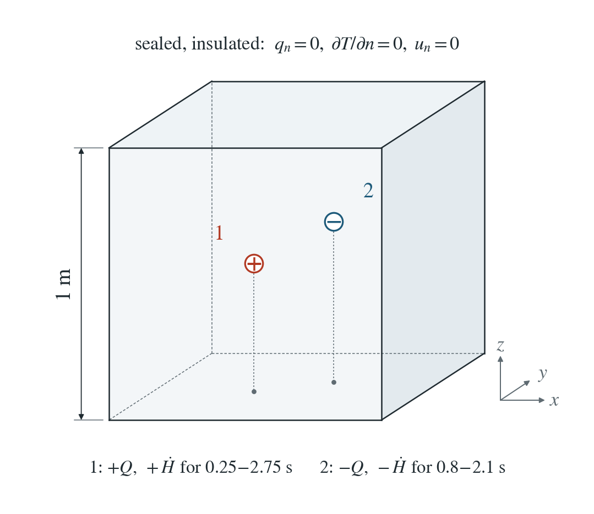
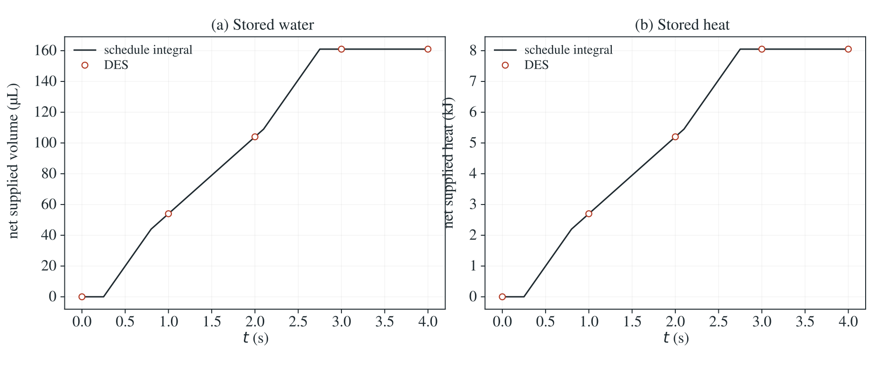

# Scheduled water and heat sources in a closed box

One point supplies water and heat while another extracts them, over time windows that end inside time steps.

**Largest stored-volume error: $1.6\times10^{-16}$ and largest stored-heat error: $4.5\times10^{-13}$ of the final net supply.**

:::info At a glance

| | |
| --- | --- |
| Dimension | 3D |
| Build | `make ndims=3` from the poromechanics source |
| Inputs | [sources.zip](/downloads/poromechanics/sources.zip) |
| Reproduce with | DynEarthSol [`3774df0`](https://github.com/GeoFLAC/DynEarthSol/tree/3774df00ba1708a4f70a836d2073f845653aac64) |

:::

## Problem setup



**Closed domain.** Unit 3D box; all water and conductive-heat boundaries sealed. Normal motion fixed on every face. Initial pressure 0 Pa, temperature 300 K.

**Two signed sources.** Point 1: (0.37, 0.43, −0.53) m, fluid +8×10⁻⁸ m³/s and heat +4000 W, active 0.25–2.75 s. Point 2: (0.61, 0.57, −0.41) m, fluid −3×10⁻⁸ m³/s and heat −1500 W, active 0.8–2.1 s.

**Isolated balance.** κ = λ = 0; mechanical pressure feedback and thermal expansion disabled. This case compares integrated volume and heat; it does not claim a spatial point-source solution.

## Input and how to run

Every file this example needs is in [sources.zip](/downloads/poromechanics/sources.zip). Run from that folder:

```bash
# Runs the closed 3D box for 4 steps of 1 s with the two scheduled water and heat sources. DES writes fresh.save.* frames at every step.
dynearthsol3d input.cfg
```

### Settings that define this example

| Setting | Value | What it does here |
| --- | --- | --- |
| `control.has_hydraulic_diffusion` | `true` | turns on the pore-pressure equation that receives the water sources |
| `control.has_poroelastic_pressure_feedback` | `false` | off: deformation does not change the pressure, so stored water is storage times pressure change |
| `control.has_fluid_thermal_advection` | `true` | turns on groundwater heat transport with the combined rock and water heat capacity, which receives the heat sources |
| `control.fixed_dt` | `1` | steps of 1 s, so the source windows start and end inside steps |
| `sim.max_steps` | `4` | 4 steps of 1 s, to 4 s |
| `mat.hydraulic_perm` | `[0]` | zero permeability: water stays where it is supplied, so only the totals are tested |
| `mat.therm_cond` | `[0]` | zero conductivity: heat stays where it is supplied |
| `mat.alpha` | `[0]` | no thermal expansion of the solid (mat.fluid_alpha is also 0), so heat does not change the pressure |
| `mat.fluid_heat_capacity` | `[4000]` | 4000 J/(kg K); with the rock values it gives C = 2.95e6 J/(m³ K) |
| `injection.points_x` | `[0.37,0.61]` | x of the two source points; points_y and points_z complete their positions (heat_injection uses the same points) |
| `injection.rate` | `[8e-08, -3e-08]` | water rates +8e-8 and −3e-8 m³/s: the first point supplies, the second extracts |
| `injection.start_time_in_yr` | `[7.922191133769641e-09, 2.5351011628062857e-08] yr = [0.25, 0.8] s` | start times 0.25 s and 0.8 s, in years (also used by heat_injection) |
| `injection.end_time_in_yr` | `[8.714410247146606e-08, 6.6546405523665e-08] yr = [2.75, 2.1] s` | end times 2.75 s and 2.1 s, in years |
| `heat_injection.rate` | `[4000, -1500]` | heat rates +4000 W and −1500 W at the same points and times |

[input.cfg](/downloads/poromechanics/sources/input.cfg) holds all 68 settings that differ from DES’s defaults; `dynearthsol3d -h` lists every option with its default.

## Output

DES writes `fresh.info` (one line per saved frame: frame, step, time in seconds), `fresh.save.NNNNNN` (the fields of each saved frame) and `fresh.chkpt.NNNNNN` (checkpoints to restart from). `sim.output_step_interval` and `sim.output_time_interval_in_yr` set how often a frame is saved.

Set `DES_SOURCE` and `PYTHONPATH` as described in [Running the examples](../running.md) before using the Python reader or converter.

| Field | What to look at |
| --- | --- |
| `pore pressure` | change since frame 0, times the nodal storage, gives the stored water |
| `temperature` | change since frame 0, times the nodal heat capacity, gives the stored heat |
| `coordinate` | with connectivity, gives the element volumes shared out to the nodes |
| `connectivity` | element-to-node map for the nodal volumes |

Read a frame in Python:

```python
from Dynearthsol import Dynearthsol      # in the DES source folder
model = Dynearthsol('fresh')
frame = model.frames[-1]                 # model.time[i] is the time of frame i, in seconds
x = model.read_field(frame, 'coordinate')
value = model.read_field(frame, 'pore pressure')
```

View it in ParaView after `python3 "$DES_SOURCE/2vtk.py" fresh`.

## Result: DES and the analytical solution



(a) Net water supplied to the closed box, in µL: the DES storage change from the saved pore pressure (circles) against the time integral of the two signed source schedules (line). (b) The same for heat, in kJ, from the saved temperature and the combined heat capacity.

This checks that every source acts exactly once over each integration interval. It does not test the spatial point-source solution.

To reproduce the whole study behind this figure, from the DES source folder:

```bash
python3 tests/functional/hydromechanics/check_point_sources.py dynearthsol3d OUT3D --dimension 3
python3 tests/functional/hydromechanics/check_point_sources.py dynearthsol2d OUT2D --dimension 2
```

The study’s full numbers: [record.json](/downloads/poromechanics/sources/record.json).

## Analytical reference

$$
\ell_i(t)=\max[0,\min(t,b_i)-a_i],\quad \Delta V_f(t)=\sum_i R_i[\ell_i(t)-\ell_i(0)],\quad \Delta E(t)=\sum_i Q_i[\ell_i(t)-\ell_i(0)]
$$

$$
\sum_n m_{h,n}[p_n(t)-p_n(0)]=\Delta V_f(t),\quad \sum_n m_{T,n}[T_n(t)-T_n(0)]=\Delta E(t)
$$

$$
m_{h,n}=\sum_{e\ni n}V_e S_B/N_e,\quad m_{T,n}=\sum_{e\ni n}V_e C/N_e,\quad S_B=S_0+\alpha^2/K_*
$$

$R_i$ and $Q_i$ are signed fluid-volume and heat rates, positive for supply; $a_i$ and $b_i$ are start and end times in seconds. The plotted run has $C=(1-\phi)\rho_sc_s+\phi\rho_fc_f=2.95\times10^6$ J/(m³ K), $K_*=K$ in 3D. In 2D the in-plane mean-stress split uses $K_*=K+G/3$ and rates are per unit out-of-plane thickness. At 4 s the exact net supply is 1.61×10⁻⁷ m³ and 8050 J.

### Derivation

A point rate is shared among the nodes of the element that contains it by the element shape functions. They sum to one, so the nodal loads add up to the requested signed rate. A source window that starts or ends inside a time step is integrated over its exact overlap with the step, so every source acts exactly once.

$$
f_n^{(i)}=R_iN_n(\mathbf{x}_i),\quad \sum_nN_n(\mathbf{x}_i)=1,\quad \int_0^t r_i(\tau)\,d\tau=R_i[\ell_i(t)-\ell_i(0)]
$$

Summing the lumped nodal update cancels internal transport contributions. With sealed boundaries, fixed capacities and the mechanical source disabled, only the prescribed source integrals remain. Apply the same argument to thermal mass and heat rate. A total-amount schedule uses rate equal to amount divided by (bi−ai).

Direct time integral of the supplied schedules plus the assembled closed-domain storage/heat balances; independently evaluated from simplex volumes and saved fields in check_point_sources.py.

## Validity and limits

This is an exact integral balance for an isolated component test with fixed capacity and mechanical pressure feedback disabled. It does not qualify the spatial singular solution, nonlinear storage, the enthalpy of injected fluid (see the injection-temperature page) or conservative remesh transfer. Fluid volume and heat sources are independent inputs. Separate forced-remesh runs check source relocation and continuation.

## Reproduction

[Commands, solver hashes and portable inputs](../running.md).
