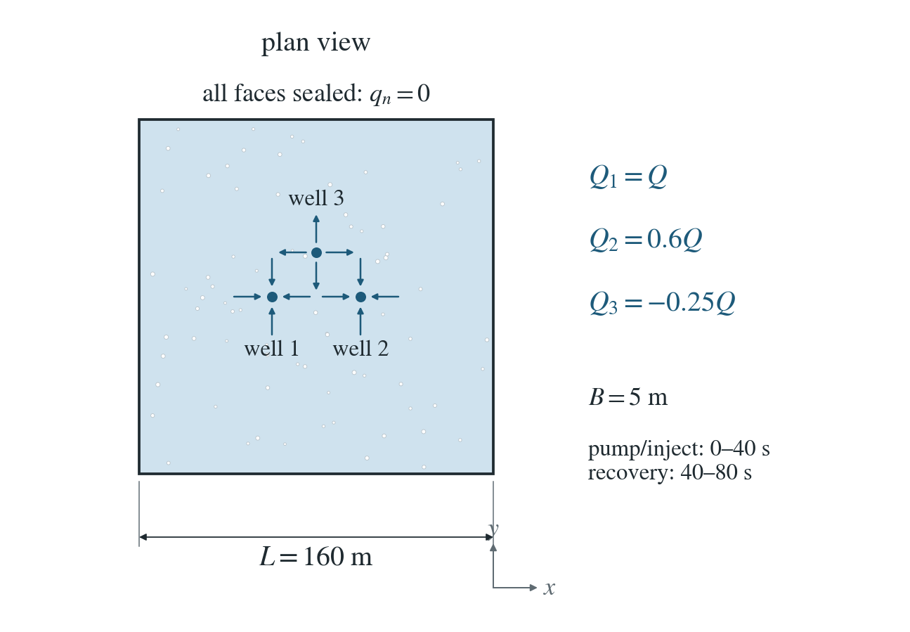
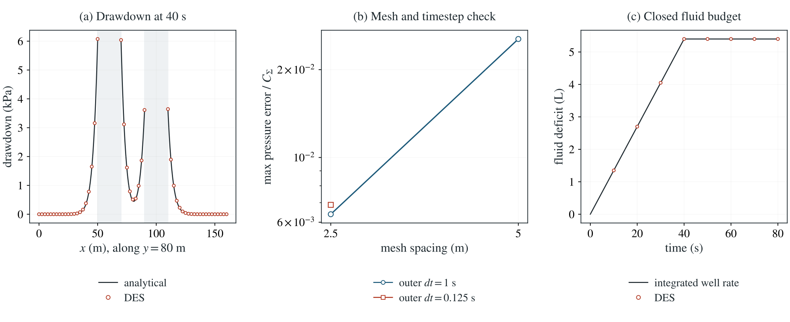

# Several wells: pumping, injection and recovery

Two wells extract water and one injects it into a confined slab; all stop after 40 s and the pressure recovers.

**Maximum pressure error: 0.688% of $C_\Sigma$; independent fluid-budget error below 1.13e-17 m³.**

:::info At a glance

| | |
| --- | --- |
| Dimension | 3D |
| Build | `make ndims=3` from the poromechanics source |
| Inputs | [theis-wells.zip](/downloads/poromechanics/theis-wells.zip) |
| Reproduce with | DynEarthSol [`3774df0`](https://github.com/GeoFLAC/DynEarthSol/tree/3774df00ba1708a4f70a836d2073f845653aac64) |

:::

## Problem setup



**Geometry and wells.** A 160 by 160 by 5 m confined slab contains full-height wells at (60,80), (100,80) and (80,100) m. Their rates are Q, 0.6Q and -0.25Q, with $Q=10^{-4}$ m³/s.

**Water boundaries and initial state.** All faces are sealed, initial pressure is zero, and every well stops at 40 s. The comparison ends at 80 s, before the pressure front reaches the far walls.

**Mechanical and material assumptions.** Constant permeability and pressure capacity; mechanical feedback, gravity and heat are disabled. Observations remain 10–30 m from the nearest well axis.

## Input and how to run

Every file this example needs is in [theis-wells.zip](/downloads/poromechanics/theis-wells.zip). Run from that folder:

```bash
# Runs the 3D slab with three wells: 640 steps of 0.125 s to 80 s, all wells stopping at 40 s. DES writes multiwell.save.* frames every 80 steps (10 s).
dynearthsol3d input.cfg
```

### Settings that define this example

| Setting | Value | What it does here |
| --- | --- | --- |
| `control.has_hydraulic_diffusion` | `true` | turns on Darcy flow of pore pressure; wells need it |
| `control.has_poroelastic_pressure_feedback` | `false` | off: deformation does not change the pressure, so the flow equation is linear and responses superpose |
| `control.gravity` | `0` | no gravity, so drawdown is compared directly in pressure |
| `control.fixed_dt` | `0.125` | outer step of 0.125 s; DES splits it into stable flow substeps by itself |
| `sim.max_steps` | `640` | 640 steps of 0.125 s end the run at 80 s, before the pressure front reaches the far walls |
| `sim.output_step_interval` | `80` | a frame every 80 steps (10 s) |
| `bc.num_wells` | `3` | three vertical rate-controlled wells, each screened through the full 5 m |
| `bc.well_x` | `[60.0, 100.0, 80.0]` | x positions 60, 100 and 80 m |
| `bc.well_y` | `[80.0, 80.0, 100.0]` | y positions 80, 80 and 100 m |
| `bc.well_rate` | `[0.0001, 6e-05, -2.5e-05]` | rates Q, 0.6Q and −0.25Q (Q = 1e-4 m³/s): two wells extract and the negative rate injects |
| `bc.well_schedule_time_in_yr` | `[0.0, 1.2675505814031427e-06, 1.2675505814031427e-06] yr = [0, 40, 40] s` | schedule times 0, 40 s, 40 s (in years); the repeated time makes a step at 40 s |
| `bc.well_schedule_ratio` | `[1, 1, 0]` | multipliers 1, 1, 0: every well runs at its full rate until 40 s and then stops |
| `mat.bulk_modulus` | `[1000000000000.0]` | very stiff skeleton (1e12 Pa), so the solid barely moves |
| `mat.hydraulic_perm` | `[1.1463636364386364e-13]` | chosen so that the pressure diffusivity is 1 m²/s |

[input.cfg](/downloads/poromechanics/theis-wells/input.cfg) holds all 50 settings that differ from DES’s defaults; `dynearthsol3d -h` lists every option with its default.

## Output

See [Running the examples](../running.md) for output files, the Python reader and ParaView conversion.

| Field | What to look at |
| --- | --- |
| `pore pressure` | drawdown p(frame 0) − p, compared with superposed Theis at nodes 10–30 m from the nearest well, and summed with element volumes for the fluid budget |
| `coordinate` | node positions, for the distance to each well and the y = 80 m profile |
| `connectivity` | with the coordinates, gives element volumes for the stored-fluid budget |


## Result: DES and the analytical solution



(a) Drawdown in kPa along the line y = 80 m at the end of pumping (40 s): DES nodes (circles) and the superposed Theis solution of the three wells (line). The shaded bands within 10 m of the two wells on this line are excluded from the comparison. (b) Maximum pressure error relative to C_Σ against mesh spacing, for an outer step of 1 s and, on the finer mesh, 0.125 s. (c) Closed fluid budget: the fluid deficit in litres, computed from the DES pressure and element volumes (circles), against the time integral of the net well rate (line).

This checks linear saturated flow, signed pumping/injection, recovery and the closed volume budget. Mechanical feedback and nonlinear property changes are outside this comparison.

To reproduce the whole study behind this figure, from the DES source folder:

```bash
python3 tests/functional/hydromechanics/check_theis_wells.py dynearthsol3d OUT --spacings 5 2.5
```

The study’s full numbers: [record.json](/downloads/poromechanics/theis-wells/record.json).

## Analytical reference

$$
\mathcal{T}_p=\kappa B/\mu
$$

$$
S_p=BS_B
$$

$$
D=\mathcal{T}_p/S_p
$$

$$
W(r,t)=E_1[r^2/(4Dt)]\ (t>0)
$$

$$
W(r,t)=0\ (t\leq0)
$$

$$
s_p(\mathbf{x},t)=\sum_i\frac{Q_i}{4\pi\mathcal{T}_p}[W(r_i,t)-W(r_i,t-40)]
$$

$$
S_B\int_V[p(t)-p(0)]\,dV=-\sum_i Q_i\min(t,40)
$$

$s_p=p(0)-p(t)$ is drawdown in Pa; extraction has positive $Q_i$. $E_1(u)=\int_u^\infty e^{-s}ds/s$. The fixed comparison scale is $C_\Sigma=\sum_i|Q_i|/(4\pi\mathcal{T}_p)$.

### Derivation

The pressure diffusion equation is linear in both pressure and well rate. A well switched off at 40 s is the sum of a positive step at zero and its negative at 40 s.

Summing those responses over the three well locations gives the pressure reference. Integrating the pressure equation over sealed boundaries gives the signed volume budget independently of the pointwise solution.

Theis superposition, evaluated in theis_reference.py and check_theis_wells.py; the saved combined run is also compared with three independent single-well DES runs.

[Original reference](https://doi.org/10.1029/TR016i002p00519).

## Validity and limits

Infinite-aquifer reference, compared inside a sealed finite slab before its walls matter. Linear storage and constant properties; this does not establish superposition for nonlinear or evolving-property flow.
