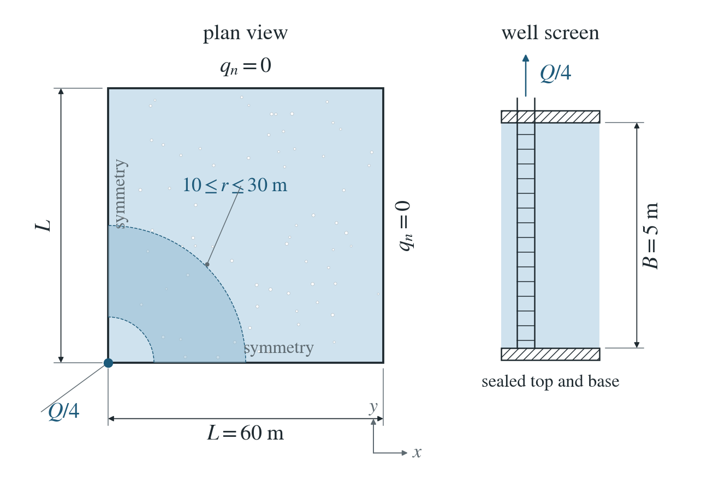
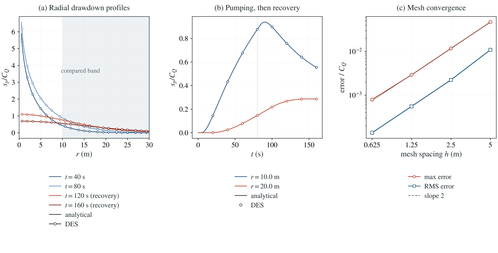

# Theis pumping and recovery in a confined aquifer

A well pumps a confined aquifer and then shuts in. The drawdown spreads radially and recovers.

**Largest drawdown error: 0.079% of $C_Q$, over $10\le r\le30$ m and eight times through pumping and recovery.**

:::info At a glance

| | |
| --- | --- |
| Dimension | 3D |
| Build | `make ndims=3` from the poromechanics source |
| Inputs | [theis.zip](/downloads/poromechanics/theis.zip) |
| Reproduce with | DynEarthSol [`3774df0`](https://github.com/GeoFLAC/DynEarthSol/tree/3774df00ba1708a4f70a836d2073f845653aac64) |

:::

## Problem setup



**Geometry and well.** A quarter box, $0\le x,y\le 60$ m, of thickness $B=5$ m. A fully penetrating well on the corner edge pumps $Q/4$, a quarter of the total rate $Q=10^{-4}\ \mathrm{m^3/s}$, for 80 s and then shuts in for 80 s.

**Boundaries and mechanics.** All faces are sealed; the symmetry planes $x=0$, $y=0$ make the corner well radial. The far sides stay beyond the drawdown: its reference value there is below $10^{-3}$ of the pressure scale. The skeleton is stiff and mechanical pressure feedback is off, so the storage is the fixed-stress value $S_B$.

**What is compared.** The pressure drawdown $s_p=p_{\rm initial}-p$ at every node with $10\le r\le 30$ m, at eight times through pumping and recovery, against the superposed Theis solution. Errors are fractions of $C_Q=Q/(4\pi\mathcal{T}_p)$.

## Input and how to run

Every file this example needs is in [theis.zip](/downloads/poromechanics/theis.zip). Run from that folder:

```bash
# Runs the 3D quarter box: 80 steps of 2 s, the well pumping for the first 80 s and shut in for the last 80 s. DES writes theis.save.* frames every 10 steps (20 s); frame 0 is the initial state.
dynearthsol3d input.cfg
```

### Settings that define this example

| Setting | Value | What it does here |
| --- | --- | --- |
| `control.has_hydraulic_diffusion` | `true` | turns on Darcy flow of pore pressure; wells need it |
| `control.has_poroelastic_pressure_feedback` | `false` | off: deformation does not change the pressure, so the storage stays at the fixed-stress value S_B and pressure obeys the Theis diffusion equation |
| `control.gravity` | `0` | no gravity, so there is no hydrostatic gradient and the drawdown is compared directly in pressure |
| `control.fixed_dt` | `2.0` | physical step of 2 s; DES splits it into stable flow substeps by itself |
| `sim.max_steps` | `80` | 80 steps of 2 s end the run at 160 s: 80 s of pumping and 80 s of recovery |
| `sim.output_step_interval` | `10` | a frame every 10 steps (20 s), so eight frames are compared with Theis |
| `bc.num_wells` | `1` | one rate-controlled vertical well |
| `bc.well_x` | `[0.0]` | with bc.well_y, puts the well on the corner edge x = y = 0; the sealed symmetry planes make it one quarter of a full well |
| `bc.well_rate` | `[2.5e-05]` | extraction rate of the quarter well, Q/4 with Q = 1e-4 m³/s, spread uniformly over the 5 m screen |
| `bc.well_schedule_time_in_yr` | `[0.0, 2.5351011628062854e-06, 2.5351011628062854e-06] yr = [0, 80, 80] s` | schedule times 0, 80 s, 80 s (in years); the repeated time makes a step change at 80 s |
| `bc.well_schedule_ratio` | `[1, 1, 0]` | rate multipliers 1, 1, 0: full rate until 80 s, then shut in |
| `mat.bulk_modulus` | `[1000000000000.0]` | very stiff skeleton (1e12 Pa), so the mechanical storage α²/K is negligible and the solid barely moves |
| `mat.porosity` | `[0.25]` | with the fluid bulk modulus, sets the pressure storage φ/K_f of the aquifer |
| `mat.hydraulic_perm` | `[1.1463636364386364e-13]` | chosen so that the pressure diffusivity κ/(μS_B) is 1 m²/s |

[input.cfg](/downloads/poromechanics/theis/input.cfg) holds all 50 settings that differ from DES’s defaults; `dynearthsol3d -h` lists every option with its default.

## Output

See [Running the examples](../running.md) for output files, the Python reader and ParaView conversion.

| Field | What to look at |
| --- | --- |
| `pore pressure` | drawdown s_p = p(frame 0) − p at every node, compared with Theis at nodes 10–30 m from the well |
| `coordinate` | gives the radius r = √(x²+y²) of each node from the well axis |
| `connectivity` | with the coordinates, gives element volumes for the closed-box water budget against the pumped volume |


## Result: DES and the analytical solution



(a) Radial drawdown profiles s_p/C_Q on the y = 0 symmetry plane at four saved times, two during pumping and two during recovery: DES nodes (circles) and the Theis solution with the shut-in superposed (lines). The shaded band is the compared range 10 ≤ r ≤ 30 m. (b) Drawdown history at r ≈ 10 m and r ≈ 20 m through pumping and recovery; the dotted line marks shut-in. (c) Maximum and RMS drawdown error over the compared nodes and times against mesh spacing, with a slope-2 guide.

The closed-box water budget differs from the prescribed pumping integral by at most 2.34e-17 m³. This checks the rate-controlled well, hydraulic storage and radial diffusion, including shut-in superposition. Mechanical pressure feedback is disabled in this flow-isolation test.

To reproduce the whole study behind this figure, from the DES source folder:

```bash
python3 tests/functional/hydromechanics/check_theis.py dynearthsol3d OUT --spacings 5 2.5 1.25 0.625
```

The study’s full numbers: [record.json](/downloads/poromechanics/theis/record.json).

## Analytical reference

$$
\mathcal{T}_p=\kappa B/\mu,\quad S_p=B S_B,\quad S_B=S_0+\alpha^2/K
$$

$$
C_Q=Q/(4\pi\mathcal{T}_p),\quad u=r^2S_p/(4\mathcal{T}_p t),\quad s_p(r,t)=Q E_1(u)/(4\pi\mathcal{T}_p)
$$

$$
E_1(u)=\int_u^\infty e^{-v}/v\,dv,\quad s_p(r,0)=0\quad(r>0)
$$

$$
s_p(r,t)=\sum_{t>t_k}\Delta Q_k\,\mathcal{G}(r,t-t_k)
$$

$$
s_p(\mathbf{x},t)=\sum_j\sum_k\frac{\Delta Q_{jk}}{4\pi\mathcal{T}_p}E_1(u_{jk})
$$

$$
u_{jk}=|\mathbf{x}-\mathbf{x}_j|^2S_p/[4\mathcal{T}_p(t-t_{jk})],\quad t>t_{jk}
$$

$s_p=p_{\rm initial}-p$ is pressure drawdown in Pa and $\mathcal{G}=E_1(u)/(4\pi\mathcal{T}_p)$ the drawdown of a unit-rate well. $\mathcal{T}_p$ has units $\mathrm{m^3/(Pa\,s)}$, $S_p$ has units $\mathrm{m/Pa}$, and $Q$ is total discharge in $\mathrm{m^3/s}$. Here $S_0=\phi/K_f+(\alpha-\phi)/K_s$. Disabling mechanical pressure feedback retains the selected fixed-stress storage $S_B$. Terms are zero before each rate change $\Delta Q_k$ at time $t_k$. This pressure formulation remains valid at zero gravity; it uses no conversion from pressure to head.

### Derivation

Away from the well, integrate pressure diffusion through thickness $B$ and use zero initial drawdown. The inward discharge at $r\to0$ supplies the line-sink boundary. Integrating the radial diffusion Green function in time gives $E_1$.

$$
S_p\,\partial_t s_p=\mathcal{T}_p\,r^{-1}\partial_r(r\partial_r s_p),\quad -2\pi r\mathcal{T}_p\,\partial_r s_p\longrightarrow Q
$$

Differentiate the solution to check the well limit. Storage inside an observation circle supplies the remaining discharge; linearity permits pumping/shut-in and multiwell superposition.

$$
-2\pi r\mathcal{T}_p\,\partial_r s_p=Qe^{-u}
$$

Theis (1935), evaluated with the exponential integral in theis_reference.py; the same module superposes changes of rate.

[Original reference](https://water.usgs.gov/ogw/pubs/Theis-1935.pdf).

## Validity and limits

Confined, homogeneous, isotropic aquifer with constant properties; a line well without wellbore storage; the singular axis $r<10$ m is excluded. Pressure only: the stiff skeleton removes poroelastic coupling, which the averaged-aquifer page addresses.
