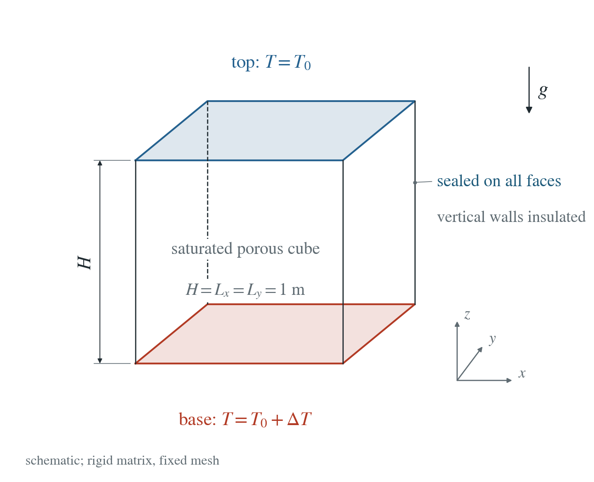
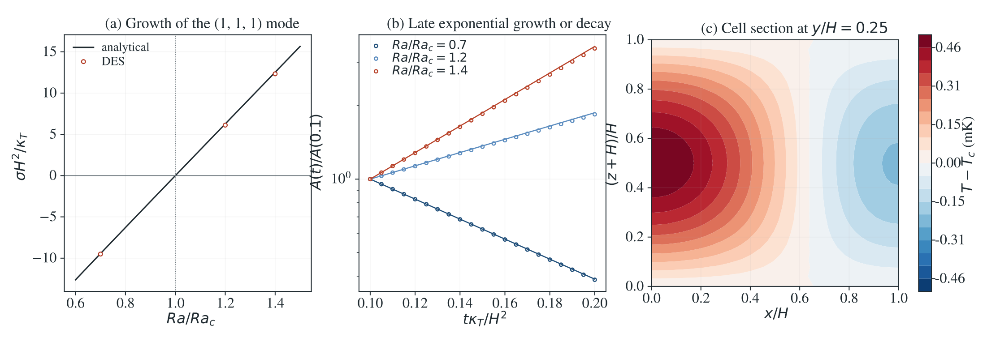

[All problems](../index.md)

# Three-dimensional porous convection cells

:::info At a glance

| | |
| --- | --- |
| Dimension | 3D |
| Inputs | [convection-3d.zip](/downloads/poromechanics/convection-3d.zip) |
| Reproduce with | DynEarthSol [`3774df0`](https://github.com/GeoFLAC/DynEarthSol/tree/3774df00ba1708a4f70a836d2073f845653aac64) |

:::


A unit porous cube heated from below supports a temperature mode that varies in all three directions. Its growth changes sign at a known Rayleigh number.

**At 1/32 m spacing, growth-rate errors are 0.62%, 2.44%, 1.55% below and above onset. Halving the physical timestep changes the selected growth rate by 0.0067%. The unseeded cube stays exactly at conduction.**

## Problem setup



**Geometry.** Unit cube, rigid saturated matrix and fixed tetrahedral mesh. All faces are impermeable; vertical faces are thermally insulated.

**Temperature.** The base is at 283 K and top at 273 K. A 0.1 mK Gaussian perturbs the conductive profile; its projection onto the (1,1,1) mode measures growth or decay.

**Pressure storage.** The fluid bulk modulus is deliberately scaled to 10 Pa for an economical explicit test. The analytical solution retains this finite storage; this is not a realistic water-property application.

**Comparison.** Three meshes, three Rayleigh numbers, an unseeded rest case and a separate halved physical timestep. No material or seed fitting.

## Input and how to run

Every file this example needs is in [data/convection-3d/](/downloads/poromechanics/convection-3d/input.cfg). Run from that folder:

```bash
# Runs the selected cube for 200,000 s in 400 explicit physical steps. DES subcycles transport within those intervals.
dynearthsol3d input.cfg
```

### Settings that define this example

| Setting | Value | What it does here |
| --- | --- | --- |
| `control.has_hydraulic_diffusion` | `true` | enables Darcy pressure transport |
| `control.has_fluid_thermal_advection` | `true` | carries heat with the Darcy flux |
| `control.has_poroelastic_pressure_feedback` | `false` | off: the stiff matrix supplies no deformation feedback |
| `control.fixed_dt` | `500.0` | 500 s physical interval; the temporal control uses 250 s |
| `mat.fluid_bulk_modulus` | `[10.0]` | 10 Pa: deliberately scaled storage, retained in the analytical reference |
| `mat.hydraulic_perm` | `[6.217850772686295e-10]` | sets the Rayleigh number; held fixed through each run |
| `mat.fluid_alpha` | `[0.001]` | Boussinesq buoyancy coefficient |
| `ic.temp_anomaly_amplitude` | `0.0001` | 0.1 mK seed, kept small for the linear reference |
| `bc.tbc_z0` | `1` | fixed hot base; tbc_z1 fixes the cold top |
| `mesh.meshing_elem_shape` | `1` | structured tetrahedral cube |

[input.cfg](/downloads/poromechanics/convection-3d/input.cfg) holds all 64 settings that differ from DES’s defaults; `dynearthsol3d -h` lists every option with its default.

## Output

DES writes `box.info` (one line per saved frame: frame, step, time in seconds), `box.save.NNNNNN` (the fields of each saved frame) and `box.chkpt.NNNNNN` (checkpoints to restart from). `sim.output_step_interval` and `sim.output_time_interval_in_yr` set how often a frame is saved.

Set `DES_SOURCE` and `PYTHONPATH` as described in [Running the examples](../running.md) before using the Python reader or converter.

| Field | What to look at |
| --- | --- |
| `temperature` | departure from the conductive profile, projected onto the (1,1,1) mode |
| `pore pressure` | pressure disturbance driving Darcy flux |
| `coordinate` | positions for the three-dimensional mode and y/H=0.25 section |
| `connectivity` | tetrahedral volumes for the mode projection |

Read a frame in Python:

```python
from Dynearthsol import Dynearthsol      # in the DES source folder
model = Dynearthsol('box')
frame = model.frames[-1]                 # model.time[i] is the time of frame i, in seconds
x = model.read_field(frame, 'coordinate')
value = model.read_field(frame, 'temperature')
```

View it in ParaView after `python3 "$DES_SOURCE/2vtk.py" box`.

## Result: DES and the analytical solution



(a) Late growth rate against the finite-storage analytical eigenvalue. (b) DES amplitudes normalized at dimensionless time 0.1; lines use the analytical slope with that one amplitude anchor. (c) Temperature departure at y/H=0.25 and dimensionless time 0.2 on the selected mesh. Rates and all refinement controls are in the accompanying table.

This checks three-dimensional buoyancy and heat advection, growth and decay, a rest state, and separate spatial/time controls. The amplitude in panel (b) is normalized at dimensionless time 0.1; only the analytical growth slope is compared. It does not qualify nonlinear steady planforms or realistic water compressibility.

[Spatial and temporal rates](/downloads/poromechanics/convection-3d/rates.csv) · [Raw-field replay and source hashes](/downloads/poromechanics/convection-3d/summary.json)

To reproduce the whole study behind this figure, from the DES source folder:

```bash
python3 tests/functional/hydromechanics/check_convection_3d.py dynearthsol3d OUT --spacing .03125 --ratio 1.4 --fluid-bulk 10 --steps 400 --dt 500
Repeat with spacings .125 and .0625, ratios .7 and 1.2, and --seed 0 for the rest control. Use 800 steps of 250 s for the separate time control.
```

The study’s full numbers: [record.json](/downloads/poromechanics/convection-3d/record.json).

## Analytical reference

$$
\tau=\kappa_Tt/H^2,\quad \kappa_T=\lambda/C,\quad D=D_p/\kappa_T
$$

$$
a^2=\pi^2(m^2+n^2),\quad K_m^2=a^2+\ell^2\pi^2
$$

$$
Ra_c=K_m^4/a^2=9\pi^2/2\quad(m=n=\ell=1)
$$

$$
\delta T=A(\tau)\cos(\pi x/H)\cos(\pi y/H)\sin[\pi(z/H+1)]
$$

$$
\dot P=-DK_m^2P-D\pi A
$$

$$
\dot A=Ra\pi P+(Ra-K_m^2)A
$$

$$
b_1=(D+1)K_m^2-Ra,\quad b_0=D(K_m^4-Ra\,a^2)
$$

$$
\lambda_+=\frac{-b_1+\sqrt{b_1^2-4b_0}}{2}
$$

$$
\sigma=\kappa_T\lambda_+/H^2
$$

Dots mean derivatives with respect to $\tau$. $P$ is pressure-mode amplitude divided by $\rho_fg\alpha_fH$, with temperature units. $D_p=k/(\mu S_B)$, $S_B=\phi/K_f+(\alpha-\phi)/K_s+\alpha^2/K$. $Ra=\rho_f^2c_fg\alpha_f\Delta T kH/(\mu\lambda)$. The cube uses $\kappa_T=10^{-6}$ m²/s; $D$ varies with the prescribed permeability.

### Derivation

Linearize Darcy flow about the conductive hydrostatic state. The pressure disturbance has the same horizontal cosines and a vertical cosine. Its diffusion equation couples to the vertical derivative of the temperature mode, giving the first amplitude equation.

The background vertical temperature gradient converts the perturbed vertical Darcy flux into heat advection. Adding thermal diffusion gives the second amplitude equation.

Set the determinant of the two-mode system to zero for its eigenvalues. Its positive or least negative root gives the late growth rate. At zero growth the storage cancels, so onset is the same as in incompressible Darcy convection.

$$
\lambda^2+b_1\lambda+b_0=0
$$

As pressure diffusion becomes infinitely fast, eliminate P to recover the incompressible result. The implementation checks this limit, zero-Rayleigh diffusion and the exact neutral point independently.

$$
\lambda_+\longrightarrow Ra\,a^2/K_m^2-K_m^2\quad(D\to\infty)
$$

Separation of the linear Darcy–Boussinesq pressure and heat equations, evaluated in convection_reference.py. The (1,1,1) mode extends the Horton–Rogers–Lapwood layer reference to a cube with finite pressure storage.

## Validity and limits

Linear 3D cell growth and decay with deliberately scaled storage, fixed properties and a rigid matrix. The reference retains finite storage; it must not be replaced by the incompressible expression at D around 10. This does not establish nonlinear steady cells, realistic compressibility or mechanical coupling.
