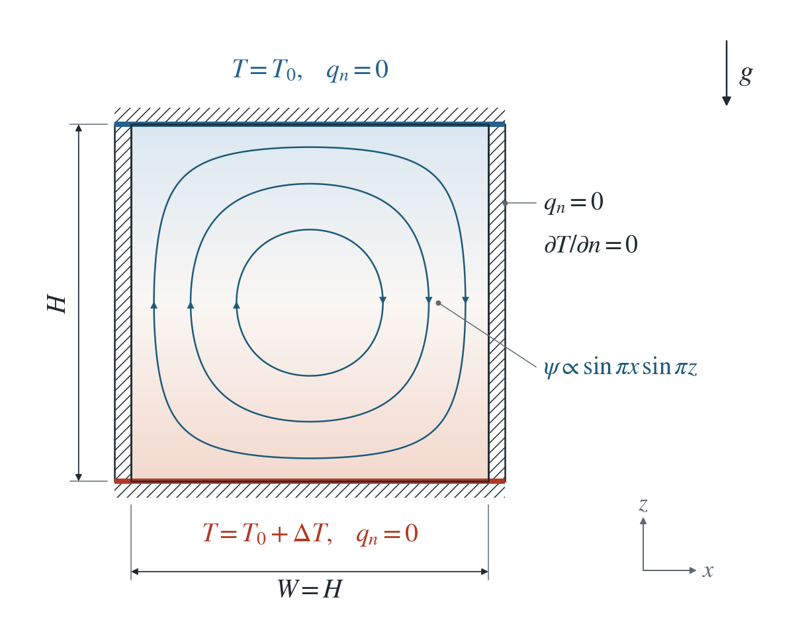
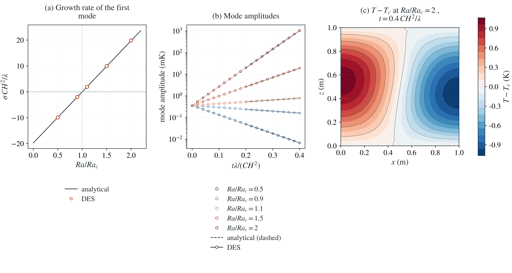

# Onset of hydrothermal convection: Horton–Rogers–Lapwood

Water in a porous box heated from below becomes lighter at the base. Above a critical Rayleigh number buoyancy overturns it into a convection cell; below it, a disturbance decays.

**Fitted onset: $Ra=39.54$ against $4\pi^2=39.48$, 0.14% apart; largest growth-rate error: $0.105\,\lambda/(CH^2)$ over 5 Rayleigh numbers. The unseeded box stays at rest to round-off: $|T-T_c|\le5.7\times10^{-15}\,\Delta T$.**

:::info At a glance

| | |
| --- | --- |
| Dimension | 2D |
| Build | `make ndims=2` from the poromechanics source |
| Inputs | [convection.zip](/downloads/poromechanics/convection.zip) |
| Reproduce with | DynEarthSol [`3774df0`](https://github.com/GeoFLAC/DynEarthSol/tree/3774df00ba1708a4f70a836d2073f845653aac64) |

:::

## Problem setup



**Heating and water boundaries.** A square porous box is heated from below: $T=T_0+\Delta T$ at the base and $T=T_0$ at the top. All four sides are sealed, $q_n=0$; the sides are insulated, $\partial T/\partial n=0$.

**Initial state.** Steady conduction $T_c$ with the hydrostatic pressure of the temperature-dependent water density, plus a 1 mK Gaussian seed centred at $x=0.25$ m, mid-depth.

**What is compared.** The amplitude of the temperature mode $\cos(\pi x/W)\sin(\pi z/H)$. Its growth or decay rate $\sigma$ is fitted over the second half of each run and compared with linear stability theory. A seed-free run must stay at rest.

## Input and how to run

Every file this example needs is in [convection.zip](/downloads/poromechanics/convection.zip). Run from that folder:

```bash
# Runs the seeded 2D box at Ra = 2 Ra_c for 400 steps of 1000 s and writes box.save.* and box.chkpt.* every 10 steps, with box.info listing the frames.
dynearthsol2d input.cfg
```

### Settings that define this example

| Setting | Value | What it does here |
| --- | --- | --- |
| `control.has_fluid_thermal_advection` | `true` | turns on heat transport by the Darcy flux |
| `mat.fluid_alpha` | `[0.001]` | water thermal expansion α_f = 1e-3 /K; with the default gravity it makes warm water buoyant |
| `mat.hydraulic_perm` | `[7.895683520871486e-10]` | permeability κ, chosen to give Ra = 2 Ra_c in this input; the study varies it from 0.5 to 2 Ra_c |
| `bc.tbc_z0` | `1` | 1: fixed temperature at the base |
| `bc.tbc_val_z0` | `283.0` | base temperature T_0 + ΔT = 283 K |
| `bc.tbc_val_z1` | `273.0` | top temperature T_0 = 273 K; the sides keep the default insulated condition |
| `ic.temperature_option` | `5` | 5: linear conduction profile between the top and base, plus a Gaussian seed |
| `ic.temp_anomaly_amplitude` | `0.001` | seed amplitude 1 mK, small enough for linear growth |
| `ic.temp_anomaly_xcenter` | `0.25` | seed centred at x = 0.25 m, off the box centre, so it projects on the first mode |
| `ic.temp_anomaly_zcenter` | `-0.5` | seed at mid-depth |
| `mat.fluid_bulk_modulus` | `[1e3]` | a compressible pore fluid; pressure still diffuses about 1000 times faster than heat |
| `control.has_poroelastic_pressure_feedback` | `false` | off: a rigid matrix, as the reference assumes |
| `mat.therm_cond` | `[1.0]` | λ = 1 W/(m K); with C = 1 MJ/(m³ K) the conductive time CH²/λ is 1e6 s |
| `control.fixed_dt` | `1000.0` | 1000 s; 400 steps cover 0.4 conductive times |

[input.cfg](/downloads/poromechanics/convection/input.cfg) holds all 59 settings that differ from DES’s defaults; `dynearthsol2d -h` lists every option with its default.

## Output

See [Running the examples](../running.md) for output files, the Python reader and ParaView conversion.

| Field | What to look at |
| --- | --- |
| `temperature` | nodal temperature; its departure from the conductive profile, projected on cos(πx/W) sin(πz/H), is the mode amplitude in panel (b), and is mapped in panel (c) |


## Result: DES and the analytical solution



(a) Fitted growth rate of the first convective mode against Ra/Ra_c: line, linear stability theory; symbols, DES. (b) Mode amplitude against time for each Rayleigh number: symbols, DES; dashed lines, the theoretical rate over the second half of each run. (c) Temperature departure from conduction at the end of the most supercritical run, showing the single convection cell.

This checks Boussinesq buoyancy in Darcy flow together with heat advection, and that the conductive state stays at rest. It does not test finite-amplitude convection (see the Nusselt-number page) or 3D cells; the fastest run reaches a temperature departure of 10.7% of $\Delta T$, so its late growth is only approximately linear.

To reproduce the whole study behind this figure, from the DES source folder:

```bash
python3 tests/functional/hydromechanics/check_convection.py dynearthsol2d OUT/h0.05 --spacing 0.05 --ratios 0.5 0.9 1.1 1.5 2
python3 tests/functional/hydromechanics/check_convection.py dynearthsol2d OUT/h0.025 --spacing 0.025 --ratios 0.5 0.9 1.1 1.5 2
```

The study’s full numbers: [record.json](/downloads/poromechanics/convection/record.json).

## Analytical reference

$$
\rho_f=\rho_{f0}[1-\alpha_f(T-T_0)],\quad \mathbf{q}=-(\kappa/\mu)(\nabla p+\rho_fg\mathbf{e}_z)
$$

$$
C\,\partial_tT+\rho_{f0}c_f\,\mathbf{q}\cdot\nabla T=\lambda\nabla^2T,\quad \nabla\cdot\mathbf{q}=0
$$

$$
Ra=\rho_{f0}^2c_fg\alpha_f\Delta T\kappa H/(\mu\lambda),\quad a=\pi H/W
$$

$$
\theta\propto\cos(\pi x/W)\sin(\pi z/H)e^{\sigma t}
$$

$$
\sigma=\frac{\lambda}{CH^2}\left(\frac{Ra\,a^2}{a^2+\pi^2}-a^2-\pi^2\right),\quad Ra_c=\frac{(a^2+\pi^2)^2}{a^2}=4\pi^2
$$

Here $z$ is height above the base, and $T_0$ is the temperature at which the water density is $\rho_{f0}$. $\kappa$ is intrinsic permeability, $\mu$ viscosity, $\alpha_f$ the thermal expansivity of water, $c_f$ its specific heat, $\lambda$ the bulk conductivity and $C$ the bulk heat capacity. The runs use $W=H=1$ m, $\Delta T=10$ K, $C=10^6\ \mathrm{J\,m^{-3}K^{-1}}$ and $\lambda=1\ \mathrm{W\,m^{-1}K^{-1}}$, so the conductive time $CH^2/\lambda$ is $10^6$ s; $\kappa$ sets $Ra$.

### Derivation

Conduction with no flow is the base state, $T_c=T_0+\Delta T(1-z/H)$, with the hydrostatic pressure of $\rho_f(T_c)$. Perturb it by $\theta$ and $\mathbf{q}$. Taking the curl of Darcy’s law twice removes the pressure: the vertical Darcy flux $w$ is driven only by horizontal buoyancy gradients. The heat balance couples $\theta$ back to $w$ through the base gradient $-\Delta T/H$.

$$
\nabla^2w=\frac{\kappa\rho_{f0}g\alpha_f}{\mu}\nabla_h^2\theta\quad C\theta_t-\rho_{f0}c_f\frac{\Delta T}{H}w=\lambda\nabla^2\theta
$$

Impermeable isothermal top and base, and sealed insulated sides, admit $\theta,w\propto\cos(ax/H)\sin(\pi z/H)\,e^{\sigma t}$. With $K^2=a^2+\pi^2$, substitution gives the growth rate above. The square box ($a=\pi$) has the smallest single-cell onset, $Ra_c=4\pi^2\approx39.48$.

$$
\hat{w}=\frac{\kappa\rho_{f0}g\alpha_f}{\mu}\frac{a^2}{K^2}\hat\theta\quad C\sigma=\frac{\lambda}{H^2}\left(Ra\frac{a^2}{K^2}-K^2\right)
$$

Horton and Rogers (1945); Lapwood (1948); Nield and Bejan, Convection in Porous Media, section 6.2. Evaluated in convection_reference.py; no DES output or fitted parameter enters the reference.

[Original reference](https://empslocal.ex.ac.uk/people/staff/tej202/docs/teaching/Lapwood48.pdf).

## Validity and limits

Linear stability of the incompressible Boussinesq limit: small disturbances, constant properties, and a rigid matrix without pore-pressure feedback. DES keeps a small water storage; pressure diffuses about $10^3$ times faster than heat, so the incompressible reference applies. 3D cells, temperature-dependent viscosity and the Elder transient-plume problem are not yet verified.
