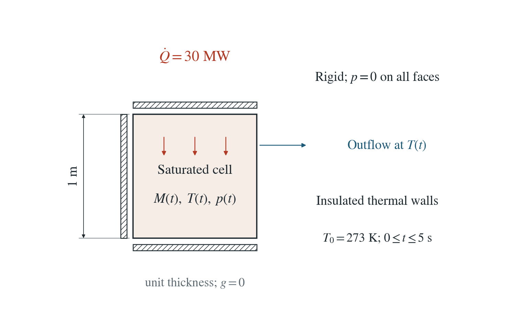
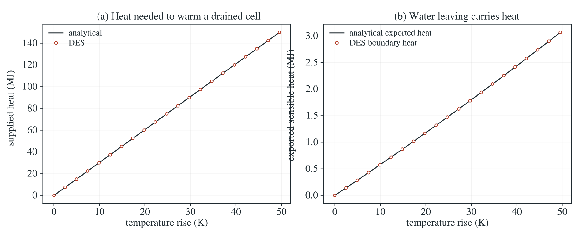

[All problems](../index.md)

# Heating a drained cell with changing water mass

:::info At a glance

| | |
| --- | --- |
| Dimension | 2D |
| Inputs | [drained-heat.zip](/downloads/poromechanics/drained-heat.zip) |
| Reproduce with | DynEarthSol [`3774df0`](https://github.com/GeoFLAC/DynEarthSol/tree/3774df00ba1708a4f70a836d2073f845653aac64) |

:::


A rigid saturated cell receives uniform heat while every face holds zero pore pressure. Thermal expansion expels water, reducing retained heat capacity and exporting sensible heat.

**Temperature errors at 100 and 200 steps are 0.000845 and 0.000422 K. Retained energy plus measured boundary export closes against supplied heat within 20 microjoules.**

## Problem setup



**Geometry and constraints.** Rigid unit cell, every face at p=0, no gravity or solid thermal expansion. All thermal faces are insulated.

**Heat source.** Uniform supplied power 30 MW per metre thickness for 5 s; no conduction or fluid point injection.

**Exchange.** Expanded water leaves the pressure-controlled boundary at the current cell temperature. The original solid inventory and its heat capacity stay fixed.

## Input and how to run

Every file this example needs is in [data/drained-heat/](/downloads/poromechanics/drained-heat/input.cfg). Run from that folder:

```bash
# Supplies 30 MW of heat for 5 s in 200 steps while the pressure-controlled boundary exports expanding water.
dynearthsol2d input.cfg
```

### Settings that define this example

| Setting | Value | What it does here |
| --- | --- | --- |
| `control.hydraulic_content_model` | `1` | selects the finite-density saturated inventory law |
| `mat.porosity_model` | `1` | evolves Eulerian Biot porosity from the accepted strain and pressure |
| `control.fixed_dt` | `0.025` | physical coupling interval; transport can subcycle within it |
| `mat.fluid_bulk_modulus` | `[1e8]` | constant fluid compressibility in the exponential density law |
| `mat.bulk_modulus_s` | `[1e9]` | grain compressibility in the porosity law |
| `mat.fluid_alpha` | `[.0002]` | volumetric fluid thermal expansivity |
| `sim.output_step_interval` | `1` | saved-frame interval; ledger entries belong to individual physical steps |

[input.cfg](/downloads/poromechanics/drained-heat/input.cfg) holds all 78 settings that differ from DES’s defaults; `dynearthsol2d -h` lists every option with its default.

## Output

DES writes `column.info` (one line per saved frame: frame, step, time in seconds), `column.save.NNNNNN` (the fields of each saved frame) and `column.chkpt.NNNNNN` (checkpoints to restart from). `sim.output_step_interval` and `sim.output_time_interval_in_yr` set how often a frame is saved.

Set `DES_SOURCE` and `PYTHONPATH` as described in [Running the examples](../running.md) before using the Python reader or converter.

| Field | What to look at |
| --- | --- |
| `pore pressure` | physical nodal pressure in Pa |
| `fluid mass` | retained physical nodal water mass in kg |
| `hydraulic split buffer` | numerical fixed-stress mass increment, excluded from density and heat |
| `solid heat capacity` | material heat-capacity inventory, unchanged by fluid drainage |
| `temperature` | temperature in K |
| `fluid mass balance` | physical and numerical mass changes, measured boundary/source exchange and residual |

Read a frame in Python:

```python
from Dynearthsol import Dynearthsol      # in the DES source folder
model = Dynearthsol('column')
frame = model.frames[-1]                 # model.time[i] is the time of frame i, in seconds
x = model.read_field(frame, 'coordinate')
value = model.read_field(frame, 'pore pressure')
```

View it in ParaView after `python3 "$DES_SOURCE/2vtk.py" column`.

## Result: DES and the analytical solution



2D unit volume per metre thickness, 30 MW supplied for 5 s, 200 steps, no gravity, solid expansion or conduction. (a) total supplied heat; (b) exported sensible heat. The reference uses the actual exponential water density.

At zero pressure and zero bulk strain this isolates open-system sensible heat without mechanical boundary work. Owned solid heat capacity stays fixed while fluid mass changes. It does not qualify full thermodynamic pressure work or a thermal plume.

[Water and energy history](/downloads/poromechanics/drained-heat/history.csv) · [Cell controls](/downloads/poromechanics/drained-heat/summary.json)

To reproduce the whole study behind this figure, from the DES source folder:

```bash
python3 tests/functional/hydromechanics/check_mass.py dynearthsol2d OUT --cases heat
```

The study’s full numbers: [record.json](/downloads/poromechanics/drained-heat/record.json).

## Analytical reference

$$
\theta=T-T_0
$$

$$
M=M_0e^{-\alpha_f\theta}
$$

$$
C_s=(1-\phi_0)\rho_sc_sV_0
$$

$$
E=(C_s+c_fM)T
$$

$$
dM_o=-dM
$$

$$
dQ=dE+c_fT\,dM_o=(C_s+c_fM)\,dT
$$

$$
Q=C_s\theta+\frac{c_fM_0}{\alpha_f}(1-e^{-\alpha_f\theta})
$$

$$
H_o=Q-[E(T)-E(T_0)]
$$

$M_o$ and $H_o$ are cumulative exported water mass and sensible heat. $T_0=273$ K, $M_0=250$ kg, $C_s=1.9875$ MJ/K, $c_f=4180$ J/(kg K) and $\alpha_f=2\times10^{-4}$ K$^{-1}$. Values refer to unit volume per metre thickness.

### Derivation

At fixed zero pressure, zero bulk strain and zero solid expansion, porosity stays fixed. Exponential thermal expansion gives the retained fluid mass directly.

Differentiate retained sensible energy. Its c_f T dM term cancels the outflow enthalpy, leaving a temperature-dependent heat capacity. Integrating from the initial temperature gives Q(T); invert Q=power times time for the temperature history.

The independent reference accounts for water leaving at the changing cell temperature. Subtracting retained energy gain from supplied heat gives its cumulative export. No pressure or strain boundary work occurs in this control.

Direct integration of the declared exponential-density sensible-heat model in mass_reference.py.

## Validity and limits

A rigid zero-pressure open-system control. Sensible heat is measured from the stated temperature origin. Pressure work, thermoelastic caloric energy, phase changes and recovery energy are outside this model; spatial thermal-plume accuracy is not established here.
