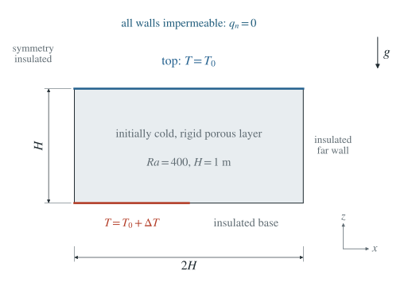
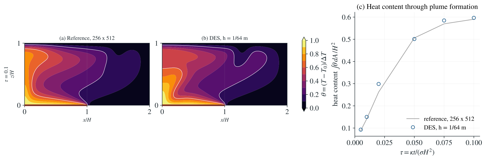

# Transient plumes: Elder's heater problem

A porous layer heated from below over part of its base grows plumes that
rise, merge and spread under the cold top. Elder (1967) studied this
problem in a Hele-Shaw cell; Voss and Souza (1987) later made its saline
version a standard test of variable-density flow codes. It has no closed-
form solution, and van Reeuwijk et al. (2009) showed that at its Rayleigh
number of 400 several flow patterns are possible, so solutions depend on
the grid. This page therefore compares DES with an independent solution
of the same equations on several grids and shows both as they come out;
nothing is tuned to make them agree.

**The two finest reference grids follow the same plume branch. Against it, the
finest DES mesh reaches the same plume pattern at $\tau$ = 0.05 and 0.1, with
the heat content of the layer differing by about 1 %. Early, while the first plumes
form, DES grows more of them and its heat content is up to 14 % higher.**

:::info At a glance

| | |
| --- | --- |
| Dimension | 2D |
| Build | `make ndims=2` from the poromechanics source |
| Inputs | [elder.zip](/downloads/poromechanics/elder.zip); reference `benchmarks/poromechanics/elder_reference.py` |
| Run time | 33 s, 6 min and 1 h 45 min on 8 threads for the three meshes |
| Reproduce with | DynEarthSol [`3774df0`](https://github.com/GeoFLAC/DynEarthSol/tree/3774df00ba1708a4f70a836d2073f845653aac64) |

:::

## Run the selected case

Extract `elder.zip` and run from its folder with `OMP_NUM_THREADS=8 dynearthsol2d input.cfg`. It contains the selected 1/64 m input and `elder.poly`; the source commands below reproduce the full grid study.

## Problem setup

[PDF schematic](../img/elder/setup.pdf) · [PNG schematic](../img/elder/setup.png)

**Box.** The symmetric half of Elder's box: 2 m wide and 1 m high, with the
symmetry axis at $x = 0$. The base is held 10 K above the top over
$0 \le x \le 1$ m (the heater, `bc.tbc_z0` on its own boundary flag in a
`.poly` mesh) and insulated beyond it (a slant boundary `n0`). The top is
held at $T_0$; the axis and the far wall are insulated; every boundary is
impermeable. The fluid starts at $T_0$.

**Equations.** Boussinesq Darcy flow with heat conduction and advection,
with the material constants of the
[onset benchmark](./convection.md), so that $\kappa = 10^{-6}$ m²/s,
$\sigma = 1$ and $\tau = \kappa t/(\sigma H^2) = 10^{-6}\,t/\text{s}$. The
permeability gives

$$
\mathrm{Ra} = \frac{\rho_0 g\,\alpha\,\Delta T\,k H}{\mu\,\kappa} = 400 .
$$

The matrix is rigid and does not feed back on the pressure; a fluid bulk
modulus of 100 Pa makes pressure diffuse about 800 times faster than heat,
close to the incompressible limit of the reference.

**Runs.** Three DES meshes ($h$ = 1/16, 1/32 and 1/64 m; 1028, 3992 and
15692 nodes) with a fixed step of 50 s, to $\tau$ = 0.1. Voss and Souza's
times of 1, 2, 4, 10, 15 and 20 years correspond to
$\tau$ = 0.005, 0.01, 0.02, 0.05, 0.075 and 0.1.

**Reference.** `elder_reference.py` solves the same equations, written for
the stream function, with central differences on uniform grids of
32 × 64, 64 × 128, 128 × 256 and 256 × 512 cells and third-order
Runge–Kutta steps.
It checks its own heat budget without buoyancy and that plumes form with
it.

For dimensionless upward $z$, temperature
$\theta=(T-T_0)/\Delta T$ and stream function $\psi$, the reference solves

$$
\nabla^2\psi=-\mathrm{Ra}\,\partial_x\theta,
\qquad (u,w)=(\partial_z\psi,-\partial_x\psi),
$$

$$
\partial_\tau\theta+u\,\partial_x\theta+w\,\partial_z\theta
=\nabla^2\theta.
$$

Impermeable walls have $\psi=0$. The heater has $\theta=1$, the top
$\theta=0$, and the remaining thermal boundaries have zero normal
temperature gradient. This is an independent numerical reference, not an
analytical solution.

## Results

[PDF result](../img/elder/result.pdf)

The selected comparison uses DES $h=1/64$ m and the 256 × 512 reference:

| $\tau$ | Heat content, finest DES mesh | Reference |
| --- | ---: | ---: |
| 0.005 | 0.093 | 0.089 |
| 0.02 | 0.299 | 0.262 |
| 0.05 | 0.501 | 0.506 |
| 0.1 | 0.597 | 0.590 |

Supporting mesh and reference-grid comparisons

| $\tau$ | Heat content, DES $h$ = 1/16 | 1/32 | 1/64 | Reference 256 × 512 |
| --- | ---: | ---: | ---: | ---: |
| 0.005 | 0.110 | 0.094 | 0.093 | 0.089 |
| 0.02 | 0.386 | 0.314 | 0.299 | 0.262 |
| 0.05 | 0.628 | 0.523 | 0.501 | 0.506 |
| 0.1 | 0.758 | 0.617 | 0.597 | 0.590 |

- **Convergence.** DES approaches the reference as the mesh is refined;
  the coarsest mesh carries too much heat at every time.
- **Late times.** At $\tau$ = 0.05 and 0.1 the finest DES mesh and the two
  finest reference grids show the same pattern: at $\tau$ = 0.05 a plume on
  the axis, a second plume over the heater and the outer plume bent out
  under the top, which by $\tau$ = 0.1 have become one broad plume on the
  axis spreading under the top. The two
  coarsest reference grids and the coarsest DES mesh show a plume away from
  the axis instead: the pattern itself depends on resolution, in both
  codes. The largest temperature difference from the finest grid is 0.14
  at $\tau$ = 0.05 and 0.23 at $\tau$ = 0.1 (RMS 0.03 and 0.05).
- **Early times.** At $\tau$ = 0.01–0.02 DES grows more and narrower
  plumes along the heater, and its heat content is 4–14 % higher. Where
  the first plumes start depends on small disturbances; an unstructured
  triangle mesh and a regular grid seed them differently.
- **The reference itself.** Its 64 × 128 and 128 × 256 grids differ by up
  to 0.6 in temperature after $\tau$ = 0.05, where their plume patterns
  differ; its 128 × 256 and 256 × 512 grids differ by at most 0.12 at every
  time, and their heat contents agree within 0.5 %.

## Limits

- **Other branches.** The two finest reference grids agree on one branch within
  $\tau \le 0.1$, but at this Rayleigh number other flow patterns exist,
  and coarser grids of both codes fall onto them; later times were not
  compared.
- **Half box.** The symmetric half excludes asymmetric patterns of the
  full box.
- **Slightly compressible fluid.** The reference is incompressible; DES
  uses a fluid bulk modulus of 100 Pa so that the runs finish in hours.

## References

Elder, J. W. (1967). Transient convection in a porous medium. *Journal of
Fluid Mechanics*, 27(3), 609–623.

van Reeuwijk, M., Mathias, S. A., Simmons, C. T., & Ward, J. D. (2009).
Insights from a pseudospectral approach to the Elder problem. *Water
Resources Research*, 45, W04416.

Voss, C. I., & Souza, W. R. (1987). Variable density flow and solute
transport simulation of regional aquifers containing a narrow
freshwater-saltwater transition zone. *Water Resources Research*, 23(10),
1851–1866.
