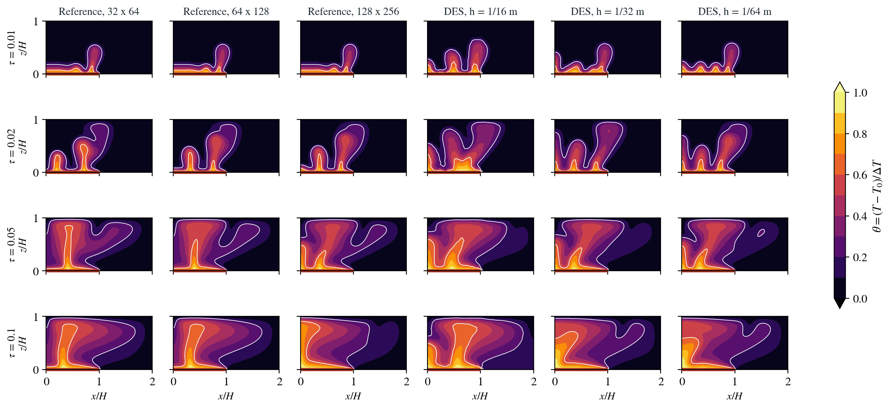
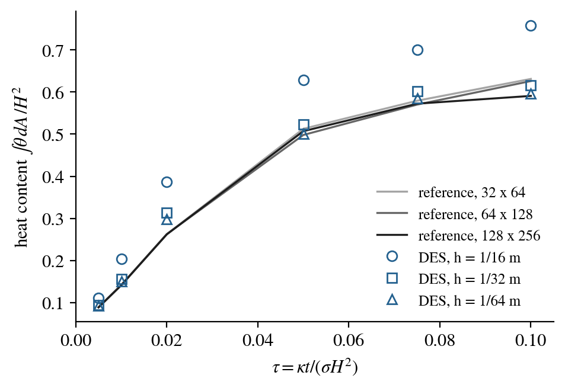

# Transient plumes: Elder's heater problem

A porous layer heated from below over part of its base grows plumes that
rise, merge and spread under the cold top. Elder (1967) studied this
problem in a Hele-Shaw cell; Voss and Souza (1987) later made its saline
version a standard test of variable-density flow codes. It has no closed-
form solution, and van Reeuwijk et al. (2009) showed that at its Rayleigh
number of 400 several flow patterns are possible, so solutions depend on
the grid. This page therefore compares DES with an independent solution
of the same equations on several grids and shows both as they come out;
nothing is tuned to make them agree.

**At $\tau$ = 0.1 the finest DES mesh and the finest reference grid reach
the same pattern, one plume on the axis spreading under the top, and the
heat content of the layer agrees within 1 %. Early, while the first plumes
form, DES grows more of them and its heat content is up to 14 % higher.**

:::info At a glance

| | |
| --- | --- |
| Dimension | 2D |
| Build | `make ndims=2` from the poromechanics source |
| Inputs | generated by `tests/functional/hydromechanics/check_elder.py`; reference `benchmarks/poromechanics/elder_reference.py` |
| Run time | 33 s, 6 min and 1 h 45 min on 8 threads for the three meshes |
| Checked with | DynEarthSol `4ec082f` (poromechanics branch) |

:::

## Problem setup

**Box.** The symmetric half of Elder's box: 2 m wide and 1 m high, with the
symmetry axis at $x = 0$. The base is held 10 K above the top over
$0 \le x \le 1$ m (the heater, `bc.tbc_z0` on its own boundary flag in a
`.poly` mesh) and insulated beyond it (a slant boundary `n0`). The top is
held at $T_0$; the axis and the far wall are insulated; every boundary is
impermeable. The fluid starts at $T_0$.

**Equations.** Boussinesq Darcy flow with heat conduction and advection,
with the material constants of the
[onset benchmark](./convection.md), so that $\kappa = 10^{-6}$ m²/s,
$\sigma = 1$ and $\tau = \kappa t/(\sigma H^2) = 10^{-6}\,t/\text{s}$. The
permeability gives

$$
\mathrm{Ra} = \frac{\rho_0 g\,\alpha\,\Delta T\,k H}{\mu\,\kappa} = 400 .
$$

The matrix is rigid and does not feed back on the pressure; a fluid bulk
modulus of 100 Pa makes pressure diffuse about 800 times faster than heat,
close to the incompressible limit of the reference.

**Runs.** Three DES meshes ($h$ = 1/16, 1/32 and 1/64 m; 1028, 3992 and
15692 nodes) with a fixed step of 50 s, to $\tau$ = 0.1. Voss and Souza's
times of 1, 2, 4, 10, 15 and 20 years correspond to
$\tau$ = 0.005, 0.01, 0.02, 0.05, 0.075 and 0.1.

**Reference.** `elder_reference.py` solves the same equations, written for
the stream function, with central differences on uniform grids of
32 × 64, 64 × 128 and 128 × 256 cells and third-order Runge–Kutta steps.
It checks its own heat budget without buoyancy and that plumes form with
it.

## Results

| $\tau$ | Heat content, DES $h$ = 1/16 | 1/32 | 1/64 | Reference 128 × 256 |
| --- | ---: | ---: | ---: | ---: |
| 0.005 | 0.110 | 0.094 | 0.093 | 0.089 |
| 0.02 | 0.386 | 0.314 | 0.299 | 0.262 |
| 0.05 | 0.628 | 0.523 | 0.501 | 0.507 |
| 0.1 | 0.758 | 0.617 | 0.597 | 0.591 |

- **Convergence.** DES approaches the reference as the mesh is refined;
  the coarsest mesh carries too much heat at every time.
- **Late times.** At $\tau$ = 0.1 the finest DES mesh and the finest
  reference grid both show one plume on the axis that spreads under the
  top. The coarser reference grids and the coarsest DES mesh show a plume
  away from the axis: the pattern itself depends on resolution, in both
  codes.
- **Early times.** At $\tau$ = 0.01–0.02 DES grows more and narrower
  plumes along the heater, and its heat content is 4–14 % higher. Where
  the first plumes start depends on small disturbances; an unstructured
  triangle mesh and a regular grid seed them differently.
- **The reference itself.** Its finest two grids differ by up to 0.08 in
  temperature through $\tau$ = 0.01, and by up to 0.6 after $\tau$ = 0.05,
  where their plume patterns differ.

## Limits

- **No unique answer.** Beyond the first plumes the solution is not
  unique at this Rayleigh number; agreement of the pattern at
  $\tau$ = 0.1 is not proof of convergence.
- **Half box.** The symmetric half excludes asymmetric patterns of the
  full box.
- **Slightly compressible fluid.** The reference is incompressible; DES
  uses a fluid bulk modulus of 100 Pa so that the runs finish in hours.

## References

Elder, J. W. (1967). Transient convection in a porous medium. *Journal of
Fluid Mechanics*, 27(3), 609–623.

van Reeuwijk, M., Mathias, S. A., Simmons, C. T., & Ward, J. D. (2009).
Insights from a pseudospectral approach to the Elder problem. *Water
Resources Research*, 45, W04416.

Voss, C. I., & Souza, W. R. (1987). Variable density flow and solute
transport simulation of regional aquifers containing a narrow
freshwater-saltwater transition zone. *Water Resources Research*, 23(10),
1851–1866.
