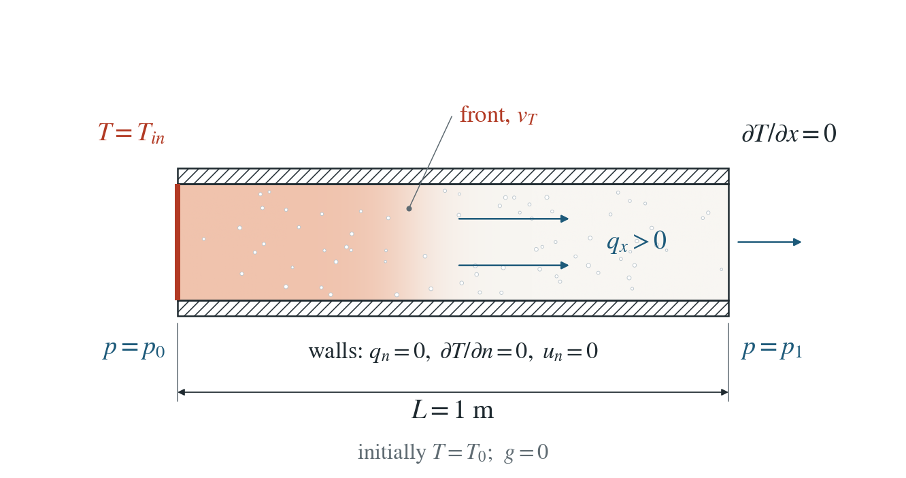
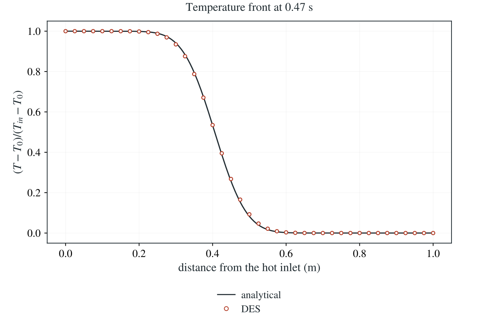

# Groundwater heat transport: Ogata–Banks

Steady groundwater carries heat from a hot inlet along a saturated column while conduction spreads the front.

**Largest temperature error: 1.306% of the imposed 1 K jump, over all nodes and five saved times; the pressure stays exactly steady.**

:::info At a glance

| | |
| --- | --- |
| Dimension | 3D |
| Build | `make ndims=3` from the poromechanics source |
| Inputs | [heat.zip](/downloads/poromechanics/heat.zip) |
| Reproduce with | DynEarthSol [`3774df0`](https://github.com/GeoFLAC/DynEarthSol/tree/3774df00ba1708a4f70a836d2073f845653aac64) |

:::

## Problem setup



**Steady groundwater flow.** $p(x)=2-x$ Pa, $\kappa/\mu=1$ m²/(Pa s), $q_x=1$ m/s; gravity zero. Pressure is prescribed at both ends.

**Temperature and mechanical conditions.** Initially $T_0=273.15$ K. At $t=0$ the left end is set to $T_{in}=274.15$ K. Sides and right end have zero conductive heat flux; heat can advect out. Normal motion is fixed on every face.

**Reference regime.** Constant properties and steady Darcy flux; fixed mesh, no mechanical pressure feedback. Deliberately scaled coefficients isolate transport; this is not an aquifer application.

## Input and how to run

Every file this example needs is in [heat.zip](/downloads/poromechanics/heat.zip). Run from that folder:

```bash
# Runs the 3D column (1 m long, 2×2 elements across) for 8192 steps to 0.47 s and writes column.save.* and column.chkpt.* every 2048 steps, with column.info listing the five frames.
dynearthsol3d input.cfg
```

### Settings that define this example

| Setting | Value | What it does here |
| --- | --- | --- |
| `control.has_fluid_thermal_advection` | `true` | turns on heat transport by the Darcy flux, with the combined rock–water heat capacity |
| `bc.hbc_x0` | `2` | type 2: pressure prescribed at the inlet end |
| `bc.hbc_x1` | `2` | type 2: pressure prescribed at the outlet end |
| `bc.hbc_pressure` | `[2,1,0,0,0,0]` | 2 Pa at x = 0 and 1 Pa at x = 1 m: a steady pressure drop that drives q_x = 1 m/s |
| `ic.pore_pressure_option` | `1` | 1: start from the linear pressure profile between the two prescribed ends, so the flow is steady from the start |
| `bc.tbc_x0` | `1` | 1: fixed temperature at the inlet |
| `bc.tbc_val_x0` | `274.15` | inlet temperature T_in = T_0 + 1 K |
| `bc.tbc_z1` | `0` | 0: the top is insulated, like the other sides and the outlet |
| `ic.temp_background` | `273.15` | initial temperature T_0 = 273.15 K |
| `mat.hydraulic_perm` | `[1]` | 1 m², with fluid_visc = 1 Pa s: mobility κ/μ = 1 m²/(Pa s) |
| `mat.fluid_bulk_modulus` | `[1e-6]` | deliberately tiny, which makes the hydraulic storage large without changing the steady flux |
| `mat.therm_cond` | `[23500.0]` | λ chosen with the capacities to give thermal diffusivity D = 0.005 m²/s |
| `mat.heat_capacity` | `[2000.0]` | solid specific heat; with rho0, porosity and fluid_heat_capacity it sets the bulk capacity C = 4.7 MJ/(m³ K) |
| `mat.fluid_heat_capacity` | `[4000.0]` | water specific heat; ρ_f c_f q_x / C sets the front speed v_T |

[input.cfg](/downloads/poromechanics/heat/input.cfg) holds all 60 settings that differ from DES’s defaults; `dynearthsol3d -h` lists every option with its default.

## Output

See [Running the examples](../running.md) for output files, the Python reader and ParaView conversion.

| Field | What to look at |
| --- | --- |
| `temperature` | nodal temperature, normalized as (T − T_0)/(T_in − T_0) and plotted along the column |
| `pore pressure` | checked to stay on the steady linear profile at every saved time |


## Result: DES and the analytical solution



Normalized temperature along the column at the last saved time: line, the Ogata–Banks solution moving at the bulk-capacity speed v_T; symbols, DES nodes (about 40 shown).

This checks Darcy heat advection and the mixed solid–fluid heat capacity: the front moves at the bulk-capacity speed, not the pore-water velocity. It does not test enthalpy conservation with evolving storage.

To reproduce the whole study behind this figure, from the DES source folder:

```bash
python3 tests/functional/hydromechanics/check_heat_transport.py dynearthsol3d OUT/3d --spacings 0.0125 0.00625 0.003125 --steps 8192 --restart
python3 tests/functional/hydromechanics/check_heat_transport.py dynearthsol2d OUT/2d --spacings 0.025 0.0125 0.00625 0.003125 --steps 8192 --restart
python3 tests/functional/hydromechanics/check_heat_transport.py dynearthsol2d OUT/2d-steps --spacings 0.0125 --steps 512 1024 2048 4096 --restart
```

The study’s full numbers: [record.json](/downloads/poromechanics/heat/record.json).

## Analytical reference

$$
C=(1-\phi)\rho_sc_s+\phi\rho_fc_f,\quad v_T=\rho_fc_fq_x/C,\quad D=\lambda/C
$$

$$
\theta=(T-T_0)/(T_{\rm in}-T_0)
$$

$$
\theta_t+v_T\theta_x=D\theta_{xx}
$$

$$
a=(x-v_Tt)/(2\sqrt{Dt}),\quad b=(x+v_Tt)/(2\sqrt{Dt})
$$

$$
\theta=\frac{1}{2}[\operatorname{erfc}(a)+e^{v_Tx/D}\operatorname{erfc}(b)]
$$

$C$ is bulk volumetric heat capacity, $c_f$ and $c_s$ fluid and solid specific heat capacities, $\lambda$ thermal conductivity and $q_x$ Darcy flux. Here $\phi=0.3$, $C=4.7\times10^6\ \mathrm{J/(m^3\,K)}$, $v_T=0.851064\ \mathrm{m/s}$ and $D=0.005\ \mathrm{m^2/s}$; the final front position is $v_Tt=0.4\ \mathrm{m}$.

### Derivation

For constant C and divergence-free steady flux, the bulk sensible-heat balance reduces to the equation above. Dividing by C shows that the thermal front travels at vT, rather than at qx or qx/φ.

$$
C T_t+\rho_fc_fq_xT_x=\lambda T_{xx}
$$

Laplace-transform the normalized equation in time with its zero initial condition. Reject the growing spatial root and impose the unit step at x = 0. Inverting this transform gives the two complementary-error-function terms above.

$$
\widehat\theta(x,s)=s^{-1}\exp\left[\frac{v_T-\sqrt{v_T^2+4Ds}}{2D}x\right]
$$

Ogata and Banks (1961), USGS Professional Paper 411-A; the transport solution is applied here to normalized temperature. Evaluated stably using erfcx in check_heat_transport.py.

[Original reference](https://pubs.usgs.gov/publication/pp411A).

## Validity and limits

The analytical solution is semi-infinite: $\theta(0,t)=1$, $\theta(x,0)=0$ for $x>0$ and $\theta(\infty,t)=0$. The numerical domain ends at $x=1$ m with zero conductive flux, so the comparison uses early times before the front reaches that boundary. Constant-capacity, divergence-free flow is tested; general evolving-storage enthalpy conservation is not established. The intentionally tiny fluid modulus makes the hydraulic storage large without changing the steady flux.
