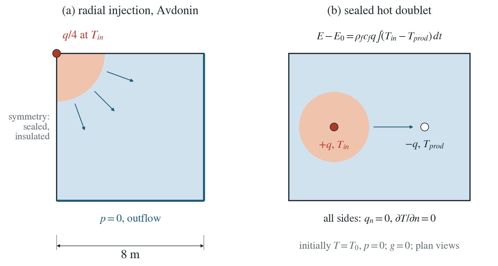
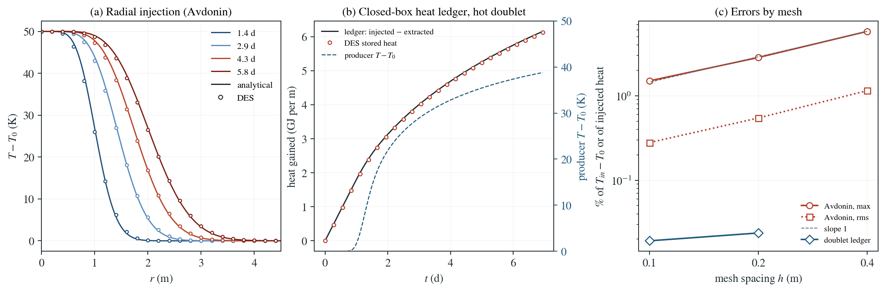

# Hot-water injection: Avdonin solution and heat ledger

Injected water carries its temperature. DES adds the injected enthalpy relative to the local temperature, which with fluid mass conservation makes its advective heat equation conserve energy. Two checks: radial hot-water injection against Avdonin’s solution, and a sealed doublet against an independent heat ledger.

**Avdonin on the 0.1 m mesh: largest nodal error 1.50% of $T_{in}-T_0$ at 5.8 d (rms 0.28%). Doublet: stored heat follows the ledger within 0.019% after the first step, through breakthrough (producer at 78% of $T_{in}-T_0$).**

:::info At a glance

| | |
| --- | --- |
| Dimension | 2D |
| Build | `make ndims=2` from the poromechanics source |
| Inputs | [injection-temperature.zip](/downloads/poromechanics/injection-temperature.zip) |
| Checked with | DynEarthSol `97f9794` (poromechanics branch) |

:::

## Problem setup



**Option.** injection.temperature gives the temperature $T_{in}$ of the fluid of each point source; it requires fluid thermal advection. Unset, the injected fluid carries no heat, and any heat source must be given separately.

**(a) Avdonin.** A line source injects $q=2\times10^{-5}\ \mathrm{m^2/s}$ at $T_{in}=333$ K into a layer at $T_0=283$ K. DES models a quarter plane, 8 m square, with the source at its corner, sealed and insulated symmetry sides, drained far sides and a stiff skeleton without pressure feedback.

**(b) Doublet.** An 8 m sealed, insulated box with an injector at $T_{in}$ and a producer 4 m away at the same rate $q=10^{-4}\ \mathrm{m^2/s}$. The hot front reaches the producer, so heat leaves at a changing temperature.

**What is compared.** (a) Nodal temperature against the similarity solution at four times; stored against injected heat. (b) Stored heat against the independent ledger of injected minus extracted heat at every step.

## Input and how to run

Every file this example needs is in [injection-temperature.zip](/downloads/poromechanics/injection-temperature.zip). Run from that folder:

```bash
# Avdonin case: injects hot water at the corner of the 8 m quarter plane (0.1 m mesh) for 500 steps of 1000 s (5.8 d), saving hot.save.* every 125 steps (four times) with hot.info listing the frames.
dynearthsol2d input.cfg
# Doublet case, run in its own directory because both inputs write files named hot.*: 400 steps of 1500 s in the sealed 8 m box, saving every step.
mkdir -p doublet && cp input-doublet.cfg doublet/ && (cd doublet && dynearthsol2d input-doublet.cfg)
```

### Settings that define this example

| Setting | Value | What it does here |
| --- | --- | --- |
| `injection.enabled` | `true` | turns on scheduled point sources of fluid |
| `injection.points_x` | `[0]` | source at x = 0, the corner of the quarter plane (points_z = 0, the top) |
| `injection.rate` | `[5e-06]` | a quarter of the line-source rate q = 2e-5 m²/s, since the model is a quarter plane (input-doublet.cfg: +1e-4 injector, −1e-4 producer) |
| `injection.temperature` | `[333.0]` | T_in = 333 K, the temperature of the injected water; the injecting node gains ρ_f c_f Q (T_in − T) |
| `control.has_fluid_thermal_advection` | `true` | turns on heat transport by the Darcy flux, required by injection.temperature |
| `bc.hbc_x1` | `2` | type 2: the far side x = 8 m is drained (pressure from hbc_pressure, 0 Pa), so water and heat can leave |
| `bc.hbc_z0` | `2` | type 2: the bottom is drained in the same way; the two symmetry sides stay sealed (input-doublet.cfg seals all four) |
| `bc.tbc_z1` | `0` | 0: insulated top; all boundaries are insulated, and heat leaves only with the outflowing water |
| `ic.temp_background` | `283.0` | initial temperature T_0 = 283 K |
| `mat.hydraulic_perm` | `[1e-13]` | k = 1e-13 m² |
| `mat.bulk_modulus` | `[1000000000000.0]` | 1e12 Pa (shear modulus too): a nearly rigid skeleton |
| `control.has_poroelastic_pressure_feedback` | `false` | off: deformation does not change the pressure |
| `mat.heat_capacity` | `[900.0]` | rock specific heat; with the water's it sets the bulk capacity C |
| `mat.therm_cond` | `[2.0]` | λ = 2 W/(m K) |

[input.cfg](/downloads/poromechanics/injection-temperature/input.cfg) holds all 66 settings that differ from DES’s defaults; `dynearthsol2d -h` lists every option with its default.

## Output

DES writes `hot.info` (one line per saved frame: frame, step, time in seconds), `hot.save.NNNNNN` (the fields of each saved frame) and `hot.chkpt.NNNNNN` (checkpoints to restart from). `sim.output_step_interval` and `sim.output_time_interval_in_yr` set how often a frame is saved.

Set `DES_SOURCE` and `PYTHONPATH` as described in [Running the examples](../running.md) before using the Python reader or converter.

| Field | What to look at |
| --- | --- |
| `temperature` | nodal temperature: along the symmetry edge against the Avdonin solution in panel (a), and summed with the heat capacity into the stored heat in panel (b) |

Read a frame in Python:

```python
from Dynearthsol import Dynearthsol      # in the DES source folder
model = Dynearthsol('hot')
frame = model.frames[-1]                 # model.time[i] is the time of frame i, in seconds
x = model.read_field(frame, 'coordinate')
value = model.read_field(frame, 'temperature')
```

View it in ParaView after `python3 "$DES_SOURCE/2vtk.py" hot`.

## Result: DES and the analytical solution



(a) Temperature rise against distance from the injection point along a symmetry side at four times: lines, Avdonin's solution; symbols, DES. (b) Hot doublet: heat gained by the box (DES) against the ledger of injected minus extracted heat. (c) Errors against mesh spacing: largest Avdonin temperature error, as a percentage of T_in − T_0, and doublet heat-ledger error, as a percentage of injected heat.

This checks the injected-enthalpy term with open outflow (Avdonin) and with outflow at a changing temperature (doublet), measured against energy conservation rather than inferred from the equation.

To reproduce the whole study behind this figure, from the DES source folder:

```bash
python3 benchmarks/hydromechanics/avdonin_reference.py
python3 tests/functional/hydromechanics/check_injection_temperature.py dynearthsol2d OUT/mesh --spacings 0.2 0.1
python3 tests/functional/hydromechanics/check_injection_temperature.py dynearthsol2d OUT/mesh-coarse --spacings 0.4
python3 tests/functional/hydromechanics/check_injection_temperature.py dynearthsol2d OUT/steps200 --spacings 0.2 --steps 200
python3 tests/functional/hydromechanics/check_injection_temperature.py dynearthsol2d OUT/steps1000 --spacings 0.2 --steps 1000
python3 tests/functional/hydromechanics/check_injection_energy.py dynearthsol2d OUT/doublet --spacings 0.2 0.1 --steps 400
```

The study’s full numbers: [record.json](/downloads/poromechanics/injection-temperature/record.json).

## Analytical reference

$$
C\,T_t+\rho_fc_f\,\mathbf{q}\cdot\nabla T=\nabla\cdot(\lambda\nabla T)+\rho_fc_f\,Q\,(T_{in}-T)
$$

$$
\frac{T-T_0}{T_{in}-T_0}=\frac{\Gamma(\nu,u)}{\Gamma(\nu)}
$$

$$
u=\frac{r^2C}{4\lambda t},\quad \nu=\frac{\rho_fc_f\,q}{4\pi\lambda}
$$

$$
E(t)-E(0)=\rho_fc_f\,q\int_0^t\left(T_{in}-T_{prod}\right)ds
$$

$C$ is the bulk heat capacity, $Q$ the injected volume rate per unit volume, $\Gamma(\nu,u)$ the upper incomplete gamma function and $E=\sum_nC A_nT_n$ the stored sensible heat. $T_{prod}$ is the temperature at the producer, interpolated with the element's shape functions.

### Derivation

The conservative balance $\partial_t(CT)+\nabla\cdot(\rho_fc_f\mathbf qT)=\nabla\cdot(\lambda\nabla T)+\rho_fc_fQT_{in}$ gives the advective form above once fluid mass conservation, $\nabla\cdot\mathbf q=Q$, removes $\rho_fc_fT\,\nabla\cdot\mathbf q$. Extraction removes fluid at the local temperature, which the advective term already carries, so extracting points add nothing.

For radial flow $\mathbf q=q\,\hat r/(2\pi r)$ the equation has a similarity solution in $u$; the injected heat $\rho_fc_fq(T_{in}-T_0)t$ is all stored, since none leaves. avdonin_reference.py checks both.

Avdonin’s radial thermal-injection problem (1964). The similarity solution is derived here and checked against the equation and the heat balance in avdonin_reference.py; the ledger follows from energy conservation alone.

## Validity and limits

Fixed heat capacity: heat carried by fluid that goes into storage is not tracked, so a sealed cell storing all its injection is outside the scope. No pressure work, dissipation or thermal expansion. Thermal advection uses the Darcy flux at the start of each step, which loses part of the first step of heat when a source starts from rest and that step needs several thermal substeps.

## Reproduction

[Commands, solver hashes and portable inputs](../running.md).
