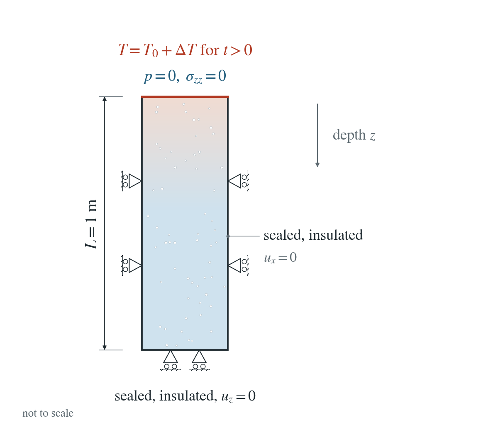
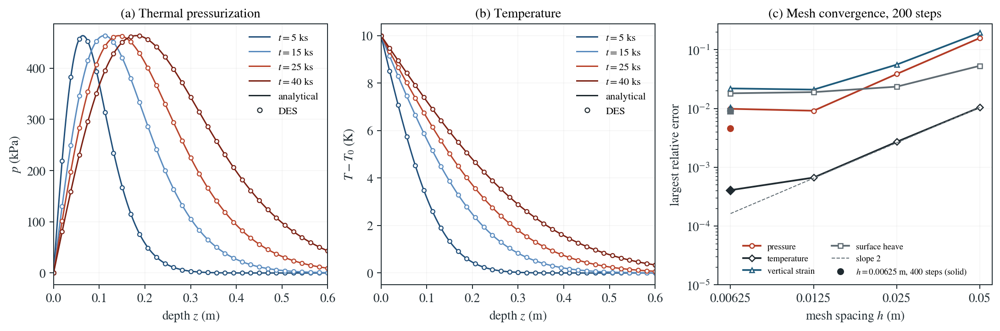

# Thermal pressurization: McTigue surface heating

The drained surface of a fluid-saturated half-space is suddenly heated. Pore water expands more than the grains, so pressure rises below the surface while it drains upward, and the solid heaves.

**Largest errors over all saved times on the 0.00625 m mesh with 400 steps: pressure 0.46% of its peak, temperature 0.04% of $\Delta T$, vertical strain 1.03% and surface heave 0.91%.**

:::info At a glance

| | |
| --- | --- |
| Dimension | 2D |
| Build | `make ndims=2` from the poromechanics source |
| Inputs | [mctigue.zip](/downloads/poromechanics/mctigue.zip) |
| Checked with | DynEarthSol `97f9794` (poromechanics branch) |

:::

## Problem setup



**Column and heating.** A laterally confined column $0\le z\le1$ m (depth $z$) of fluid-saturated rock starts at $T_0$. At $t=0^+$ its top is raised to $T_0+\Delta T$, $\Delta T=10$ K, and held there; the top is drained ($p=0$) and traction-free.

**Other boundaries.** Sides and base are sealed, insulated and fixed normally. Heat conducts without advection and gravity is off. Both diffusion lengths stay well inside the column, so it behaves as a half-space.

**What is compared.** Pressure and temperature at the nodes, vertical strain in each element layer and the surface heave, at eight times to 40 ks. DES applies a boundary temperature present at initialization as part of the initial state, so the run restarts from a checkpoint at $T_0$ with the hot surface.

## Input and how to run

Every file this example needs is in [mctigue.zip](/downloads/poromechanics/mctigue.zip). Run from that folder:

```bash
# Zero-step run of the column at the uniform initial temperature T_0; it writes start.save.000000, start.chkpt.000000 and start.info. These three files are shipped, so this stage can be skipped.
dynearthsol2d start.cfg
# Restarts from start frame 0 with the surface held at T_0 + 10 K and runs 400 steps of 100 s (40 ks), saving mctigue.save.* every 50 steps (eight times).
dynearthsol2d input.cfg
```

### Settings that define this example

| Setting | Value | What it does here |
| --- | --- | --- |
| `sim.is_restarting` | `yes` | starts from the checkpoint written by start.cfg rather than from a fresh initial state |
| `sim.restarting_from_modelname` | `start` | start: the zero-step run at T_0 |
| `bc.tbc_val_z1` | `283.0` | surface temperature T_0 + ΔT = 283 K (273 K in start.cfg). A boundary temperature present at initialization becomes part of the initial state, so the step is applied through the restart |
| `control.has_thermal_pressurization` | `true` | couples thermal expansion of water and solid to the fluid content and stress |
| `bc.hbc_z1` | `2` | type 2: the top is drained, pore pressure held at its hbc_pressure entry (0 Pa) |
| `mat.hydraulic_perm` | `[1e-19]` | k = 1e-19 m²: a tight rock, so pressure diffuses about five times slower than heat (c/κ = 0.21) |
| `mat.therm_cond` | `[2.65]` | λ = 2.65 W/(m K); with the default rock heat capacity and density it gives κ = 1e-6 m²/s |
| `mat.biot_coeff` | `[0.8]` | α = 0.8 |
| `mat.bulk_modulus_s` | `[5000000000.0]` | grain modulus K_s = 5 GPa, part of the storage S_0 |
| `mat.porosity` | `[0.2]` | φ = 0.2 |
| `mat.bulk_modulus` | `[1000000000.0]` | K = 1 GPa (shear modulus also 1 GPa) |
| `control.fixed_dt` | `100.0` | 100 s; 400 steps reach 40 ks |
| `sim.output_step_interval` | `50` | 50 steps: eight saved times compared with the solution |
| `control.gravity` | `0` | no gravity: only heating drives pressure and strain |

[input.cfg](/downloads/poromechanics/mctigue/input.cfg) holds all 55 settings that differ from DES’s defaults; `dynearthsol2d -h` lists every option with its default.

## Output

DES writes `mctigue.info` (one line per saved frame: frame, step, time in seconds), `mctigue.save.NNNNNN` (the fields of each saved frame) and `mctigue.chkpt.NNNNNN` (checkpoints to restart from). `sim.output_step_interval` and `sim.output_time_interval_in_yr` set how often a frame is saved.

Set `DES_SOURCE` and `PYTHONPATH` as described in [Running the examples](../running.md) before using the Python reader or converter.

| Field | What to look at |
| --- | --- |
| `pore pressure` | nodal pressure along the column, panel (a) |
| `temperature` | nodal temperature along the column, panel (b); also integrated for the heat ledger |
| `strain` | element vertical strain by layer; integrated over depth it gives the surface heave |

Read a frame in Python:

```python
from Dynearthsol import Dynearthsol      # in the DES source folder
model = Dynearthsol('mctigue')
frame = model.frames[-1]                 # model.time[i] is the time of frame i, in seconds
x = model.read_field(frame, 'coordinate')
value = model.read_field(frame, 'pore pressure')
```

View it in ParaView after `python3 "$DES_SOURCE/2vtk.py" -g mctigue`.

## Result: DES and the analytical solution



(a) Pore pressure against depth at the saved times: lines, McTigue's solution; symbols, DES. (b) Temperature rise against depth. (c) Largest relative errors of pressure, temperature, vertical strain and surface heave against mesh spacing.

This checks the thermal pressurization source, the thermal stress and their two-way coupling with drainage and deformation. Heat advection is off.

To reproduce the whole study behind this figure, from the DES source folder:

```bash
python3 benchmarks/hydromechanics/mctigue_reference.py
python3 tests/functional/hydromechanics/check_mctigue.py dynearthsol2d OUT/mesh --spacings 0.05 0.025 0.0125 0.00625
python3 tests/functional/hydromechanics/check_mctigue.py dynearthsol2d OUT/steps400 --spacings 0.00625 --steps 400
python3 tests/functional/hydromechanics/check_mctigue.py dynearthsol3d OUT/3d --ndims 3 --spacings 0.025 0.0125
```

The study’s full numbers: [record.json](/downloads/poromechanics/mctigue/record.json).

## Analytical reference

$$
\varepsilon=\frac{\alpha p+K\alpha_sT}{H}
$$

$$
H=K+\frac{4}{3}G
$$

$$
\zeta=\alpha\varepsilon+S_0p-\beta T
$$

$$
\beta=\phi\alpha_f+(\alpha-\phi)\alpha_s
$$

$$
S\,p_t-\frac{k}{\mu}p_{zz}=S\gamma\,T_t,\quad S=S_0+\frac{\alpha^2}{H},\quad \gamma=\frac{\beta-\alpha K\alpha_s/H}{S},\quad c=\frac{k}{\mu S}
$$

$$
T=\Delta T\,\operatorname{erfc}\frac{z}{2\sqrt{\kappa t}}
$$

$$
p=\frac{\gamma\Delta T}{1-c/\kappa}\left[\operatorname{erfc}\frac{z}{2\sqrt{\kappa t}}-\operatorname{erfc}\frac{z}{2\sqrt{ct}}\right]
$$

$$
w(t)=\frac{2}{\sqrt{\pi}}\left[\frac{K\alpha_s\Delta T}{H}\sqrt{\kappa t}+\frac{\alpha\gamma\Delta T}{H(1-c/\kappa)}\left(\sqrt{\kappa t}-\sqrt{ct}\right)\right]
$$

Stress is tension positive and $p$ compression positive. $\alpha_s$ and $\alpha_f$ are volumetric thermal expansions, $\kappa$ the thermal diffusivity, $S_0=\phi/K_f+(\alpha-\phi)/K_s$ and $w$ the upward surface heave. The runs use $K=G=1$ GPa, $\alpha=0.8$, $\phi=0.2$, $K_f=2.2$ GPa, $K_s=5$ GPa, $k=10^{-19}\ \mathrm{m^2}$, $\mu=10^{-3}$ Pa s, $\alpha_s=3\times10^{-5}$ K$^{-1}$, $\alpha_f=2.07\times10^{-4}$ K$^{-1}$ and $\kappa=10^{-6}\ \mathrm{m^2/s}$, so $\gamma=101$ kPa/K and $c/\kappa=0.21$.

### Derivation

Uniaxial strain with a traction-free surface keeps the vertical total stress zero, which fixes the strain from $p$ and $T$. Substituting it into the fluid content and Darcy flow gives a pressure diffusion equation forced by the heating rate.

$$
\sigma_{zz}=H\varepsilon-\alpha p-K\alpha_sT=0
$$

Each erfc term solves its own diffusion equation, so a difference of the thermal and hydraulic erfc solves the forced equation and vanishes at the drained surface and at $t=0$. Integrating the strain over depth gives the heave. mctigue_reference.py checks the equation, the conditions, the heave integral and an independent Crank–Nicolson solution.

McTigue (1986), Thermoelastic response of fluid-saturated porous rock, J. Geophys. Res. 91(B9), 9533-9542. Evaluated in mctigue_reference.py.

[Original reference](https://doi.org/10.1029/JB091iB09p09533).

## Validity and limits

Linear thermo-poroelasticity with constant properties, small strain and conduction only (no Darcy heat advection, no temperature-dependent fluid properties). A finite column stands for the half-space while both diffusion lengths stay well inside it. DES couples pressure and mechanics sequentially, so the earliest frames carry the one-step lag.

## Reproduction

[Commands, solver hashes and portable inputs](../running.md).
