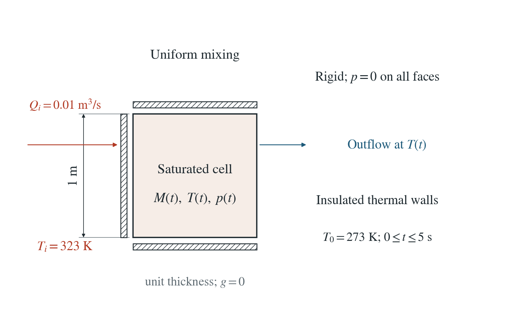
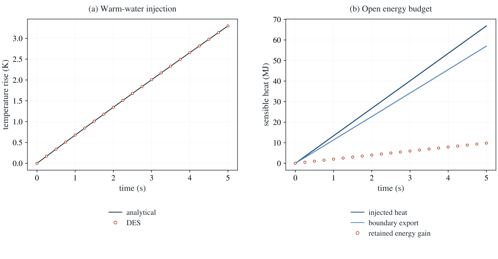

[All problems](../index.md)

# Warm-water mixing in a drained cell

:::info At a glance

| | |
| --- | --- |
| Dimension | 2D |
| Inputs | [mixing.zip](/downloads/poromechanics/mixing.zip) |
| Reproduce with | DynEarthSol [`3774df0`](https://github.com/GeoFLAC/DynEarthSol/tree/3774df00ba1708a4f70a836d2073f845653aac64) |

:::


Warm water enters a pressure-controlled, well-mixed saturated cell. Natural outflow removes water at the cell temperature; inlet and retained water have different EOS densities.

**Maximum temperature error is 0.000545 K at 200 steps and falls with timestep refinement. Retained energy equals injected sensible heat minus boundary export within 20 microjoules.**

## Problem setup



**Cell.** Rigid unit cell at p=0, initially 273 K, insulated and without gravity. Uniform distributed sources keep the temperature spatially uniform.

**Injection.** 0.01 m³/s enters at 323 K for 5 s. Its mass rate uses density at the inlet temperature.

**Outflow.** Natural boundary reaction carries water at the changing cell temperature; it balances injection and the loss of retained mass from thermal expansion.

## Input and how to run

Every file this example needs is in [data/mixing/](/downloads/poromechanics/mixing/input.cfg). Run from that folder:

```bash
# Injects 323 K water for 5 s in 200 steps into a drained, initially 273 K unit cell.
dynearthsol2d input.cfg
```

### Settings that define this example

| Setting | Value | What it does here |
| --- | --- | --- |
| `control.hydraulic_content_model` | `1` | selects the finite-density saturated inventory law |
| `mat.porosity_model` | `1` | evolves Eulerian Biot porosity from the accepted strain and pressure |
| `control.fixed_dt` | `0.025` | physical coupling interval; transport can subcycle within it |
| `mat.fluid_bulk_modulus` | `[1e8]` | constant fluid compressibility in the exponential density law |
| `mat.bulk_modulus_s` | `[1e9]` | grain compressibility in the porosity law |
| `mat.fluid_alpha` | `[0.0002]` | volumetric fluid thermal expansivity |
| `sim.output_step_interval` | `1` | saved-frame interval; ledger entries belong to individual physical steps |

[input.cfg](/downloads/poromechanics/mixing/input.cfg) holds all 79 settings that differ from DES’s defaults; `dynearthsol2d -h` lists every option with its default.

## Output

See [Running the examples](../running.md) for output files, the Python reader and ParaView conversion.

| Field | What to look at |
| --- | --- |
| `pore pressure` | physical nodal pressure in Pa |
| `fluid mass` | retained physical nodal water mass in kg |
| `hydraulic split buffer` | numerical fixed-stress mass increment, excluded from density and heat |
| `solid heat capacity` | material heat-capacity inventory, unchanged by fluid drainage |
| `temperature` | temperature in K |
| `fluid mass balance` | physical and numerical mass changes, measured boundary/source exchange and residual |


## Result: DES and the analytical solution



2D unit cell, 0.01 m³/s inlet at 323 K, initial 273 K, 0–5 s, 200 steps. (a) temperature and the independent integral solution; (b) injected, exported and retained sensible heat.

This checks inlet-temperature ownership, injection density, outflow enthalpy and changing retained fluid storage together. Sources are distributed uniformly by nodal volume, so it is a mixing control rather than a spatial plume benchmark.

[Water and energy history](/downloads/poromechanics/mixing/history.csv) · [Cell controls](/downloads/poromechanics/mixing/summary.json)

To reproduce the whole study behind this figure, from the DES source folder:

```bash
python3 tests/functional/hydromechanics/check_mass.py dynearthsol2d OUT --cases heat
```

The study’s full numbers: [record.json](/downloads/poromechanics/mixing/record.json).

## Analytical reference

$$
\dot M_i=\rho(0,T_i)Q_i
$$

$$
M(T)=M_0e^{-\alpha_f(T-T_0)}
$$

$$
\dot M_o=\dot M_i-\dot M
$$

$$
E=(C_s+c_fM)T
$$

$$
(C_s+c_fM)\dot T=c_f\dot M_i(T_i-T)
$$

$$
t=\int_{T_0}^{T}\frac{C_s+c_fM(u)}{c_f\dot M_i(T_i-u)}\,du
$$

$$
E-E_0=\int c_fT_i\,dM_i-\int c_fT\,dM_o
$$

$Q_i$ is inlet volume rate, $\dot M_i$ inlet mass rate and $\dot M_o$ the outward boundary mass rate. $C_s=1.9875$ MJ/K, $c_f=4180$ J/(kg K), $M_0=250$ kg and $\alpha_f=2\times10^{-4}$ K$^{-1}$. The inlet density is lower than the initial cell density.

### Derivation

Water balance sets the outward mass rate. In the sensible-energy balance, the retained c_f T dM term cancels the matching part of boundary export, giving the displayed temperature equation.

Separate variables to obtain the independent integral solution. Its integrand is evaluated after a logarithmic distance-to-inlet-temperature substitution, avoiding an endpoint pole. With zero expansivity the solution reduces to an exponential.

$$
T=T_i-(T_i-T_0)e^{-c_f\dot M_it/(C_s+c_fM_0)}
$$

The reported budget uses actual inlet density, actual retained fluid mass and boundary enthalpy at cell temperature. It includes no numerical fixed-stress buffer in the heat capacity.

Independent integral solution and constant-density exponential limit in mass_reference.py.

## Validity and limits

Uniform well-mixed sensible heat at zero pressure and zero strain. This control does not resolve a local well singularity, a thermal front or a buoyant plume.
