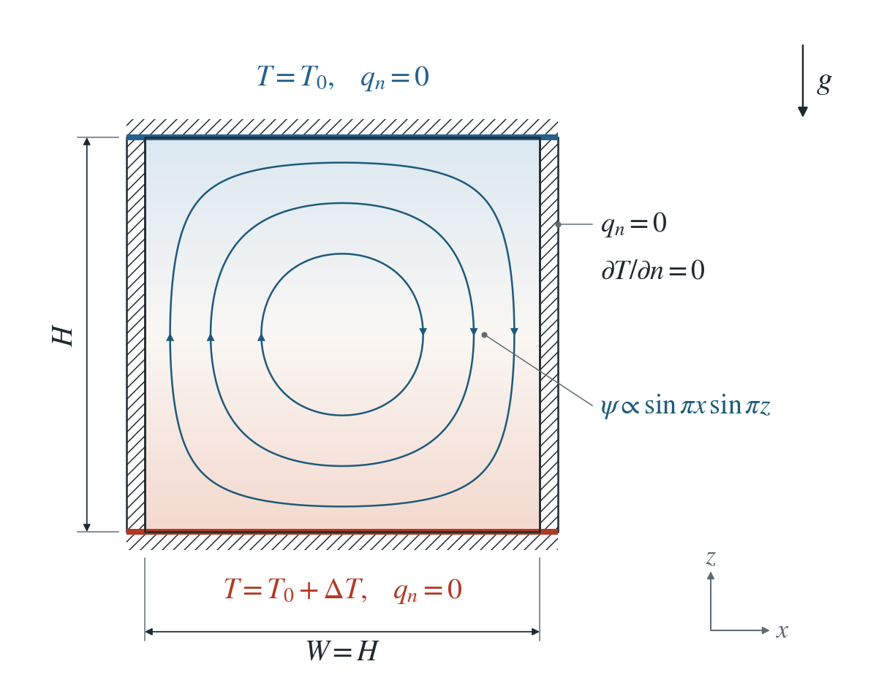
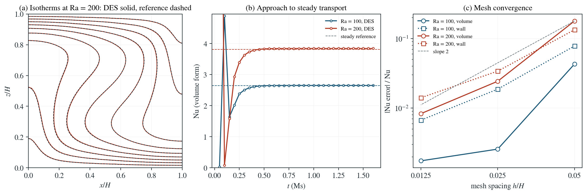

# Steady hydrothermal convection: Nusselt number

Above onset the heated porous cell settles into a steady convection roll that carries several times the conductive heat flow. Its Nusselt number has no closed form; an independent fine-grid solution supplies it.

**DES Nusselt numbers on the 0.0125 H mesh: Ra = 100: 2.6506 against 2.6459 (0.17%); Ra = 200: 3.8415 against 3.8098 (0.83%).**

:::info At a glance

| | |
| --- | --- |
| Dimension | 2D |
| Build | `make ndims=2` from the poromechanics source |
| Inputs | [nusselt.zip](/downloads/poromechanics/nusselt.zip) |
| Reproduce with | DynEarthSol [`3774df0`](https://github.com/GeoFLAC/DynEarthSol/tree/3774df00ba1708a4f70a836d2073f845653aac64) |

:::

## Problem setup



**Cell.** The Horton–Rogers–Lapwood square cell of the onset page, $0\le x,z\le H$: impermeable walls, base at $T_0+\Delta T$, top at $T_0$, insulated sides, Boussinesq Darcy flow with heat conduction and advection.

**Run.** Each run starts from conduction with a seeded roll at $\mathrm{Ra}=100$ or $200$ and continues until the heat transport stops changing. Storage does not enter the steady state, so a compressible pore fluid shortens the transient.

**What is compared.** The steady Nusselt number, from the volume form below and from the temperature gradient at the top, against an independent steady solution on three fine grids, extrapolated.

## Input and how to run

Every file this example needs is in [nusselt.zip](/downloads/poromechanics/nusselt.zip). Run from that folder:

```bash
# Runs the 2D cell at Ra = 200 on the 0.0125 m mesh for 1600 steps of 1000 s, until the heat transport is steady, saving box.save.* every 50 steps with box.info listing the frames.
dynearthsol2d input.cfg
```

### Settings that define this example

| Setting | Value | What it does here |
| --- | --- | --- |
| `control.has_fluid_thermal_advection` | `true` | turns on heat transport by the Darcy flux |
| `mat.fluid_alpha` | `[0.001]` | water thermal expansion α_f = 1e-3 /K; with the default gravity it drives buoyancy |
| `mat.hydraulic_perm` | `[2e-09]` | permeability chosen to give Ra = 200 (the study also runs Ra = 100) |
| `bc.tbc_z0` | `1` | 1: fixed temperature at the base |
| `bc.tbc_val_z0` | `283.0` | base temperature T_0 + ΔT = 283 K |
| `bc.tbc_val_z1` | `273.0` | top temperature T_0 = 273 K; the sides are insulated |
| `ic.temperature_option` | `5` | 5: linear conduction profile plus a Gaussian seed |
| `ic.temp_anomaly_amplitude` | `0.5` | 0.5 K seed, large enough to start a single roll quickly |
| `mat.fluid_bulk_modulus` | `[10.0]` | a very compressible pore fluid; storage only sets the transient, so this shortens the run without changing the steady state |
| `control.has_poroelastic_pressure_feedback` | `false` | off: a rigid matrix |
| `mesh.resolution` | `0.0125` | 0.0125 m, the finest mesh of the study |
| `sim.max_steps` | `1600` | 1600 steps of 1000 s, long enough for Nu to stop changing |
| `sim.output_step_interval` | `50` | 50 steps: the Nu history in panel (b) |

[input.cfg](/downloads/poromechanics/nusselt/input.cfg) holds all 60 settings that differ from DES’s defaults; `dynearthsol2d -h` lists every option with its default.

## Output

DES writes `box.info` (one line per saved frame: frame, step, time in seconds), `box.save.NNNNNN` (the fields of each saved frame) and `box.chkpt.NNNNNN` (checkpoints to restart from). `sim.output_step_interval` and `sim.output_time_interval_in_yr` set how often a frame is saved.

Set `DES_SOURCE` and `PYTHONPATH` as described in [Running the examples](../running.md) before using the Python reader or converter.

| Field | What to look at |
| --- | --- |
| `temperature` | nodal temperature; isotherms in panel (a) and the heat transport in the Nusselt number |
| `pore pressure` | with the temperature, rebuilds the Darcy flux used in the volume form of Nu |

Read a frame in Python:

```python
from Dynearthsol import Dynearthsol      # in the DES source folder
model = Dynearthsol('box')
frame = model.frames[-1]                 # model.time[i] is the time of frame i, in seconds
x = model.read_field(frame, 'coordinate')
value = model.read_field(frame, 'temperature')
```

View it in ParaView after `python3 "$DES_SOURCE/2vtk.py" box`.

## Result: DES and the reference



(a) Isotherms of the steady roll at Ra = 200: solid, DES; dashed, the independent fine-grid solution. (b) Nusselt number (volume form) against time as the cell approaches steady transport. (c) Nusselt-number error against mesh spacing for both Rayleigh numbers.

This checks finite-amplitude Darcy convection: buoyancy, heat advection by the Darcy flux and conduction together, through the heat they carry. Storage only sets the transient, so a compressible pore fluid shortens the runs; the transient itself is not compared.

To reproduce the whole study behind this figure, from the DES source folder:

```bash
python3 benchmarks/poromechanics/convection_steady.py
python3 tests/functional/hydromechanics/check_convection_nusselt.py dynearthsol2d OUT --spacings 0.05 0.025 0.0125
```

The study’s full numbers: [record.json](/downloads/poromechanics/nusselt/record.json).

## Reference solution (numerical)

$$
\nabla^2\psi=-\mathrm{Ra}\,\theta_x
$$

$$
u\,\theta_x+w\,\theta_z=\nabla^2\theta
$$

$$
u=\psi_z,\ w=-\psi_x
$$

$$
\mathrm{Ra}=\frac{\rho_f^2c_f\,g\,\alpha_f\,\Delta T\,k\,H}{\mu\,\lambda}
$$

$$
\mathrm{Nu}=-\frac{1}{H}\int_0^H\left.\frac{\partial\theta}{\partial z}\right|_{z=H}dx=1+\frac{\rho_fc_fH}{\lambda\,\Delta T}\langle q_zT\rangle
$$

$\theta=(T-T_0)/\Delta T$, lengths are scaled by $H$ and $\psi$ is the dimensionless streamfunction; $q_z$ is the vertical Darcy flux and $\langle\cdot\rangle$ the volume mean. The second form of Nu follows from the steady heat balance at every height, averaged over the cell; it is the one evaluated on DES fields, with $q$ rebuilt from the saved pressure and temperature.

### Derivation

Taking the curl of Darcy’s law with Boussinesq buoyancy removes the pressure and gives the streamfunction equation; the energy balance is steady advection–diffusion.

convection_steady.py solves both with second-order central differences on $32^2$, $64^2$ and $128^2$ grids by relaxed Picard iteration and extrapolates Nu (observed order 1.99). Below onset it returns the conductive $\mathrm{Nu}=1$; at Ra = 100 it gives 2.6459, matching published values near 2.65.

Horton and Rogers (1945); Lapwood (1948); steady values as in Caltagirone (1975). Computed independently in convection_steady.py.

[Original reference](https://doi.org/10.1017/S0022112075000936).

## Validity and limits

Steady state only: the transient depends on storage, which is chosen for speed. Single-roll solution, as seeded; Boussinesq, constant properties, no mechanical coupling.

## Reproduction

[Commands, solver hashes and portable inputs](../running.md).
