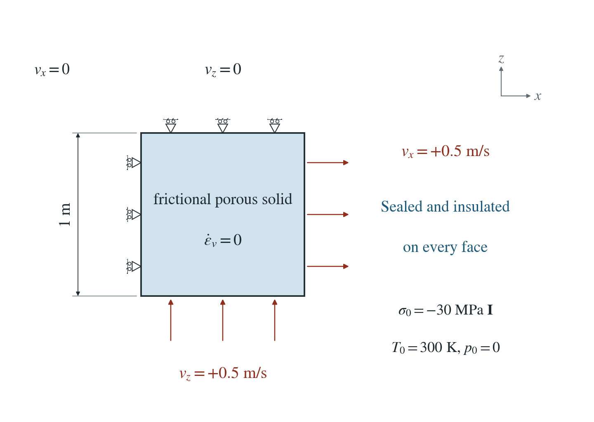
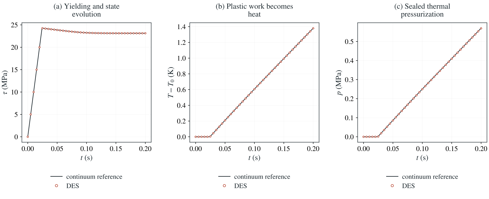

# Plastic shear heating and sealed pressurization

A porous cell deforms at a prescribed pure-shear rate. Plastic work in aging rate-and-state plasticity heats the cell and expands the sealed fluid.

**At Δt = 0.0002 s, temperature and pressure differ from the continuum reference by at most 0.124% and 0.161% of their final reference rises. Both errors converge at first order. Heat plus pending energy matches accepted plastic work to round-off.**

:::info At a glance

| | |
| --- | --- |
| Dimension | 2D |
| Build | `make ndims=2` from the poromechanics source |
| Inputs | [plastic-heat.zip](/downloads/poromechanics/plastic-heat.zip) |
| Reproduce with | DynEarthSol [`3774df0`](https://github.com/GeoFLAC/DynEarthSol/tree/3774df00ba1708a4f70a836d2073f845653aac64) |

:::

## Problem setup



**Geometry and loading.** Unit square, −1 ≤ z ≤ 0; plane strain. Prescribed normal velocities give ε̇xx=0.5/s, ε̇zz=−0.5/s, zero spin and zero volume strain. Four nodes and two triangles; mesh motion disabled.

**Initial state.** T=300 K, p=0, isotropic compression 30 MPa; K=20 GPa, G=1 GPa, cohesion 10 MPa. Aging EP-RSF: a=0.01, b=0.015, Dc=0.01 m, V0=0.001 m/s, θ0=Dc/V0.

**Water and heat.** Every face sealed and insulated. Porosity 0.2, Biot coefficient 0.8, zero permeability/conductivity, grain/fluid moduli 100/2.2 GPa. Fixed mixture capacity C=2,996,000 J/(m³ K); β=4×10⁻⁵/K.

**Numerical method.** PT option 1; mixed stress disabled; 1000 physical steps of 0.0002 s. Heat is deposited on the following physical interval; pending energy and pressure are separate numerical reservoirs.

## Input and how to run

Every file this example needs is in [plastic-heat.zip](/downloads/poromechanics/plastic-heat.zip). Run from that folder:

```bash
# Runs 1000 steps to 0.2 s; every physical step is saved under cell.
dynearthsol2d input.cfg
```

### Settings that define this example

| Setting | Value | What it does here |
| --- | --- | --- |
| `control.has_shear_heating` | `true` | converts accepted nonelastic work into heat; unit heat fraction |
| `control.has_thermal_pressurization` | `true` | couples fluid thermal expansion to sealed pore pressure |
| `control.has_fluid_thermal_advection` | `true` | uses the combined solid and water heat capacity; zero flux here |
| `control.has_hydraulic_diffusion` | `true` | enables pressure evolution; zero permeability prevents drainage |
| `control.fixed_dt` | `0.0002` | 0.0002 s, the finest of three separately checked physical steps |
| `control.is_using_mixed_stress` | `false` | off, so this reference checks the constitutive work before mixed-stress projection |
| `mat.rheology_type` | `elasto-plastic-rate-state-friction` | plasticity with evolving aging rate-and-state friction |
| `mat.direct_a` | `[.01]` | direct velocity dependence; b is larger, giving velocity weakening |
| `mat.evolution_b` | `[.015]` | state-dependent friction evolution |
| `mat.characteristic_distance` | `[.01]` | sets the state relaxation distance |
| `bc.vbc_val_x1` | `0.5` | right-face extension velocity; bottom velocity provides matching compression |

[input.cfg](/downloads/poromechanics/plastic-heat/input.cfg) holds all 77 settings that differ from DES’s defaults; `dynearthsol2d -h` lists every option with its default.

## Output

See [Running the examples](../running.md) for output files, the Python reader and ParaView conversion.

| Field | What to look at |
| --- | --- |
| `temperature` | physical temperature rise from 300 K, compared with integrated plastic work divided by mixture capacity |
| `pore pressure` | sealed thermal pressurization; compared with βΔT/S0 |
| `stress` | principal half-span τ=(σxx−σzz)/2 |
| `shear heating` | last accepted nonelastic power density in W/m³ |
| `pending shear heat` | accepted energy awaiting the next thermal update, J/m per element in 2D |
| `friction state variable` | aging state θ, advanced once per physical step |


## Result: DES and the analytical solution



(a) Principal shear stress during elastic loading and aging plastic flow. (b) Physical temperature rise. (c) Sealed pore pressure. Lines evaluate the continuum aging solution and work integral; circles are the finest DES run. The physical fields retain the measured first-order lag.

This checks plastic earthquake heating, including evolving EP-RSF strength, without introducing inertia or a rupture-front error. The plotted temperature and pressure are the physical fields; the pending numerical reservoirs are accounted for separately.

See [accepted work and pending heat](../../../theory/thermalevolution.md#heat-sources) for implementation ownership across PT trials, restart and changed timesteps.

[Every-step history and reference](/downloads/poromechanics/plastic-heat/history.csv) · `Time convergence`

To reproduce the whole study behind this figure, from the DES source folder:

```bash
python3 tests/functional/hydromechanics/check_heat_restart.py dynearthsol2d OUT --ndims 2 --study --coupled --dt 0.0002 --steps 1000
python3 benchmarks/poromechanics/plastic_heat.py --exe dynearthsol2d --dimensions 2 --output OUT-ep
```

The study’s full numbers: [record.json](/downloads/poromechanics/plastic-heat/record.json).

## Analytical reference

$$
\gamma=2\dot\epsilon t,\quad \tau_{\rm EP}=\min(G\gamma,c),\quad Q_{\rm EP}=c(\gamma-c/G)_+
$$

$$
\theta(t)=D_c/V+(\theta_0-D_c/V)e^{-Vt/D_c}
$$

$$
\mu(t)=\tan30^\circ+a\ln(V/V_0)+b\ln(V_0\theta/D_c)
$$

$$
\tau_y(t)=\frac{c+P\mu(t)}{\sqrt{1+\mu(t)^2}},\quad G\gamma(t_y)=\tau_y(t_y)
$$

$$
Q(t)=\dot\gamma\int_{t_y}^t\tau_y(s)\,ds-\frac{\tau_y(t)^2-\tau_y(t_y)^2}{2G}\quad(t>t_y)
$$

$$
\Delta T=Q/C,\quad p=\beta\Delta T/S_0,\quad S_0=\phi/K_f+(\alpha-\phi)/K_s
$$

$$
E_T+E_{\rm pending}=\sum_n V_e\Delta W^p_e,\quad \Delta W^p=\bar\sigma^{\prime}:\Delta\epsilon^p
$$

$\tau=(\sigma_{xx}-\sigma_{zz})/2$ is the principal half-span, conjugate to $\gamma$, not a prescribed fault traction. $P=30$ MPa is effective confinement, $Q$ heat per volume, and $V=2w\dot\epsilon$ with $w=1/\sqrt2$ m. The integral reference uses tight numerical quadrature of the analytical aging solution; $Q=0$ before first yield.

### Derivation

Solve the aging ODE at constant slip rate. The decreasing yield strength intersects the elastic predictor once; after this point the cell stays at yield.

$$
\dot\theta=1-V\theta/D_c,\quad \tau=\min(G\gamma,\tau_y)
$$

Boundary work is τ dγ. Subtract the change in elastic shear energy τ²/(2G) to obtain plastic heat; unit heat fraction is assumed.

$$
dQ=\tau\,d\gamma-d(\tau^2/2G)
$$

Fixed volume and sealed fluid give zero content. With constant capacity and no heat loss, temperature follows Q/C. DES’s pending-pressure reservoir vanishes under time refinement.

$$
\zeta=S_0p-\beta\Delta T=0
$$

Direct boundary-work/elastic-storage identity and analytical aging law, evaluated in plastic_heat.py. Integration of the nonelastic work proposed in Eh Tan’s PR #88; thermal fault weakening motivates further fault-scale models (Rice, 2006, doi:10.1029/2005JB004006).

## Validity and limits

A material-level earthquake-heating qualification with constant effective confinement. It does not demonstrate thermal weakening at fixed total normal stress, a propagating rupture, general enthalpy conservation with changing storage, or a complete earthquake cycle.
