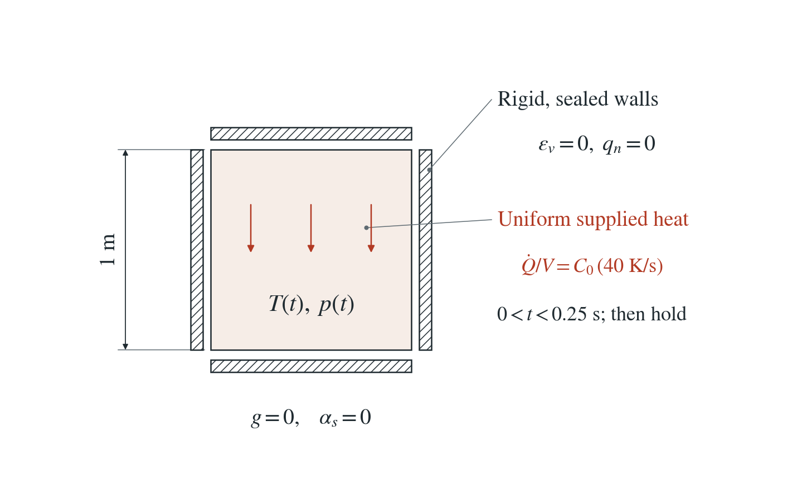
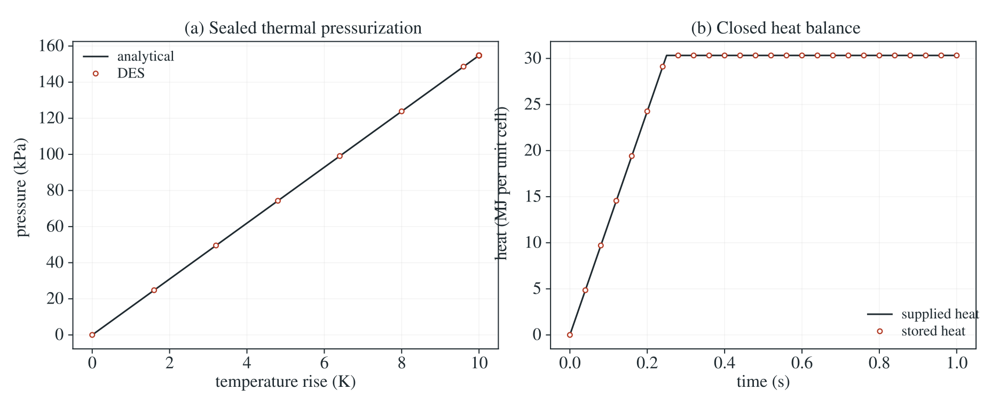

# Thermal pressurization in a sealed cell

Uniform supplied heat warms a rigid, sealed porous material. The temperature rise and fluid expansion give independent heat and pressure references.

**The 10 K pulse raises the pore pressure to 154.799 kPa. Pressure and stored heat match their references to round-off.**

:::info At a glance

| | |
| --- | --- |
| Dimension | 2D |
| Build | `make ndims=2` from the poromechanics source |
| Inputs | [thermal-cell.zip](/downloads/poromechanics/thermal-cell.zip) |
| Reproduce with | DynEarthSol [`3774df0`](https://github.com/GeoFLAC/DynEarthSol/tree/3774df00ba1708a4f70a836d2073f845653aac64) |

:::

## Problem setup



**Geometry.** Rigid unit material cell, zero gravity, fixed mesh and constant porosity. Every water boundary is sealed in the selected result.

**Heating.** Temperature starts at 273 K. A uniform supplied power raises it at 40 K/s for 0.25 s, followed by a hold through 1 s.

**Coefficients.** No conduction, Darcy permeability or solid thermal expansion. The heat is supplied by one point source per node, each proportional to the volume that node represents.

## Input and how to run

Every file this example needs is in [thermal-cell.zip](/downloads/poromechanics/thermal-cell.zip). Run from that folder:

```bash
# Heats the 2D cell for 100 steps of 0.01 s (1 s) with ordinary explicit mechanics and writes heated.save.* and heated.chkpt.* at every step, with heated.info listing the frames.
dynearthsol2d input.cfg
```

### Settings that define this example

| Setting | Value | What it does here |
| --- | --- | --- |
| `control.has_thermal_pressurization` | `true` | couples thermal expansion of water and solid to the fluid content and stress |
| `control.has_fluid_thermal_advection` | `true` | uses the combined rock–water heat capacity C_0 (there is no flow to advect heat here) |
| `heat_injection.enabled` | `true` | turns on scheduled point heat sources |
| `heat_injection.num_points` | `9` | nine sources, one at each node of the 3×3-node mesh |
| `heat_injection.points_x` | `[0.0, 0.0, 0.0, 0.5, 0.5, 0.5, 1.0, 1.0, 1.0]` | x coordinates of the nine nodes |
| `heat_injection.points_z` | `[-1.0, -0.5, -0.0, -1.0, -0.5, -0.0, -1.0, -0.5, -0.0]` | z coordinates of the nine nodes |
| `heat_injection.rate` | `[10108333.333333332, 10108333.333333332, 10108333.333333332, 10108333.333333332, 40433333.33333333, 10108333.333333332, 10108333.333333332, 10108333.333333332, 10108333.333333332]` | heat supplied at each node (W per metre of thickness in 2D), proportional to the volume the node represents, so the cell warms uniformly at 40 K/s |
| `heat_injection.duration_in_yr` | `[7.922191133769641e-09, 7.922191133769641e-09, 7.922191133769641e-09, 7.922191133769641e-09, 7.922191133769641e-09, 7.922191133769641e-09, 7.922191133769641e-09, 7.922191133769641e-09, 7.922191133769641e-09] yr = [0.25, 0.25, 0.25, 0.25, 0.25, 0.25, 0.25, 0.25, 0.25] s` | 0.25 s of heating (in years), followed by a hold to 1 s |
| `bc.vbc_x0` | `3` | type 3: every velocity component fixed; with the other faces also 3 the cell is rigid |
| `mat.therm_cond` | `[0]` | 0: no conduction, so the temperature stays uniform |
| `mat.fluid_alpha` | `[0.0002]` | water thermal expansion α_f = 2e-4 /K, the source of the pressure |
| `mat.alpha` | `[0]` | 0: no solid thermal expansion |
| `mat.biot_coeff` | `[0.98]` | α = 0.98 = 1 − K/K_s |
| `mat.fluid_bulk_modulus` | `[100000000.0]` | K_f = 100 MPa; with porosity and K_s it sets the storage S |

[input.cfg](/downloads/poromechanics/thermal-cell/input.cfg) holds all 67 settings that differ from DES’s defaults; `dynearthsol2d -h` lists every option with its default.

## Output

DES writes `heated.info` (one line per saved frame: frame, step, time in seconds), `heated.save.NNNNNN` (the fields of each saved frame) and `heated.chkpt.NNNNNN` (checkpoints to restart from). `sim.output_step_interval` and `sim.output_time_interval_in_yr` set how often a frame is saved.

Set `DES_SOURCE` and `PYTHONPATH` as described in [Running the examples](../running.md) before using the Python reader or converter.

| Field | What to look at |
| --- | --- |
| `temperature` | nodal temperature; its volume-weighted mean is the temperature rise in panel (a) and gives the stored heat in panel (b) |
| `pore pressure` | nodal pressure; its volume average is the sealed pressure in panel (a) |

Read a frame in Python:

```python
from Dynearthsol import Dynearthsol      # in the DES source folder
model = Dynearthsol('heated')
frame = model.frames[-1]                 # model.time[i] is the time of frame i, in seconds
x = model.read_field(frame, 'coordinate')
value = model.read_field(frame, 'temperature')
```

View it in ParaView after `python3 "$DES_SOURCE/2vtk.py" heated`.

## Result: DES and the analytical solution



(a) Pore pressure of the sealed, rigid cell against its temperature rise: line, the sealed linear reference βθ/S; symbols, DES. (b) Heat stored in the cell (symbols, DES) and heat supplied by the sources (line) against time.

This checks thermal pressurization of pore water and the heat equation with a supplied heat source. The same comparison holds in 2D and 3D, for several time steps and across restarts. With PT the pressure lags the heating by a first-order amount. A drained version of the cell misses 10,450 J (0.03446% of the supplied heat) because the heat capacity stays fixed while water leaves, so the energy balance of open systems such as thermal plumes is not covered.

[History CSV](/downloads/poromechanics/thermal-cell/history.csv) · `Control tables`

To reproduce the whole study behind this figure, from the DES source folder:

```bash
python3 benchmarks/poromechanics/thermal_cell.py dynearthsol2d OUT/2d --dt .01 --figures
python3 benchmarks/poromechanics/thermal_cell.py dynearthsol2d OUT/2d-fine --methods pt --boundaries fixed --dt .000625
python3 benchmarks/poromechanics/thermal_cell.py dynearthsol3d OUT/3d --ndims 3 --dt .01
```

The study’s full numbers: [record.json](/downloads/poromechanics/thermal-cell/record.json).

## Analytical reference

$$
\theta=T-T_0
$$

$$
S=\phi/K_f+(\alpha-\phi)/K_s
$$

$$
\beta=\phi\alpha_f
$$

$$
C_0=(1-\phi)\rho_sc_s+\phi\rho_fc_f
$$

$$
\theta=40\min(t,0.25)\ {\rm K}
$$

$$
p=\beta\theta/S
$$

$$
\Delta\sigma_{ii}=-\alpha p
$$

$$
E-E_0=Q_{\rm supplied}=VC_0\theta
$$

$$
(S+L)p_n=\beta\theta_n+Lp_{n-1}
$$

$$
a=\rho_fc_f\beta
$$

$$
R_E=-Va\theta^2/2
$$

$K=20$ MPa, $G=10$ MPa, $K_s=1$ GPa, $K_f=100$ MPa, $\alpha=0.98$, $\phi=0.25$ and $\alpha_f=2\times10^{-4}$ K$^{-1}$. $C_0=3.0325$ MJ/(m³ K). $L=\alpha^2/B$ is the PT stabilizer, with $B=K+G/3$ in 2D and $B=K$ in 3D. $R_E$ is the separate drained control’s retained-fluid enthalpy residual.

### Derivation

For a sealed rigid cell, total volumetric strain and fluid-content change vanish. This gives the physical pressure directly.

$$
\zeta=Sp+\alpha\varepsilon_v-\beta\theta=0
$$

The fixed-capacity heat equation integrates the supplied pulse exactly. The selected explicit pressure follows the physical content equation. PT instead retains its pending increment; the displayed recurrence is exact for that split, and its physical-pressure error is first order for small timesteps.

For the additional drained rigid cell, all vertices hold zero pressure. Fluid expansion must leave through the boundary reaction.

$$
V_o=V\beta\theta
$$

The retained fluid mass changes the heat capacity. Outflow carries enthalpy at the changing cell temperature.

$$
C(\theta)=C_0-a\theta
$$

$$
H_o=Va(T_0\theta+\theta^2/2)
$$

Use retained mass in the energy change, rather than integrating the original fixed capacity.

$$
\Delta E_{\rm ret}=V[(C_0-a\theta)(T_0+\theta)-C_0T_0]
$$

Adding outflow enthalpy and subtracting the supplied heat produces the displayed negative half-quadratic deficit. At 10 K it is −10,450 J, or 0.03446% of supplied heat, independent of timestep. There is no strain work or pressure-boundary work in this rigid, zero-pressure control.

Linear Biot thermal expansion and integration of the stated heat pulse; the retained-fluid deficit is derived for the implemented linear fluid-content law.

## Validity and limits

This sealed cell checks thermal pressurization and the fixed-capacity heat equation. With PT the pressure can lag noticeably during rapid heating even when the force balance converges. In a drained cell a small, persistent energy deficit remains, so open systems such as thermal plumes are not covered; shear heating is not included.

## Reproduction

[Commands, solver hashes and portable inputs](../running.md).
