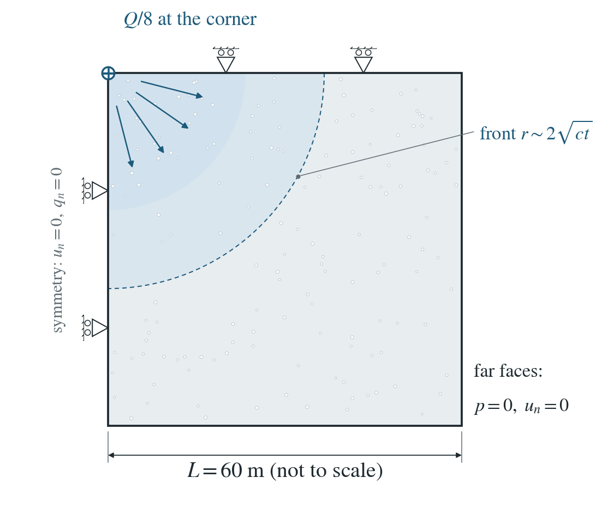
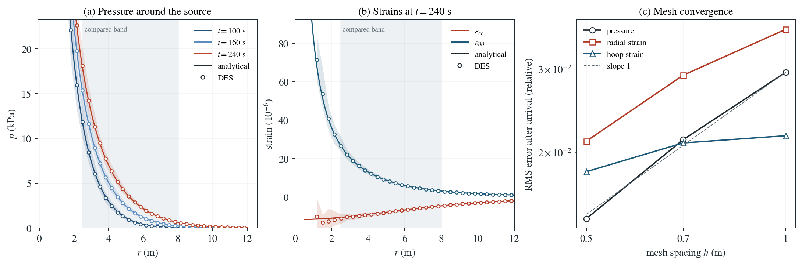

# Fluid injection into a poroelastic solid: Rudnicki

Water is injected at a constant rate at a point. Pressure diffuses outward and the solid swells, changing the stress that a nearby fault would feel.

**Largest RMS errors once the front reaches the band ($t>40$ s): 1.45% in pressure, 2.11% in radial strain and 1.82% in hoop strain, over $2.5\le r\le8$ m.**

:::info At a glance

| | |
| --- | --- |
| Dimension | 3D |
| Build | `make ndims=3` from the poromechanics source |
| Inputs | [rudnicki.zip](/downloads/poromechanics/rudnicki.zip) |
| Checked with | DynEarthSol `97f9794` (poromechanics branch) |

:::

## Problem setup



**Source.** Water is injected at a constant volume rate $Q$ from $t=0$ at a point in an unbounded poroelastic solid. DES uses one octant with the scheduled point source at its corner node, injecting $Q/8$.

**Boundaries.** The planes $x=0$, $y=0$ and $z=0$ are symmetry planes (normal displacement zero, sealed). The far faces of the 60 m box hold $p=0$ and zero normal displacement; the mesh is refined within 10 m of the source.

**What is compared.** Pressure at the nodes and the radial and hoop strains at the elements for $2.5\le r\le8$ m, at all saved times while the diffusion front stays well inside the box.

## Input and how to run

Every file this example needs is in [rudnicki.zip](/downloads/poromechanics/rudnicki.zip). Run from that folder:

```bash
# 3D. DES builds the box mesh itself, refined near the source (no mesh file needed), injects at the corner node and runs 48 steps of 5 s to 240 s, saving every fourth step as rudnicki.*.
dynearthsol3d input.cfg
```

### Settings that define this example

| Setting | Value | What it does here |
| --- | --- | --- |
| `injection.enabled` | `true` | turns on scheduled point sources |
| `injection.points_x` | `[0]` | with points_y and points_z: the source at the origin, the corner node shared by the three symmetry planes |
| `injection.rate` | `[1.25e-05]` | injected volume rate: Q/8 for one octant of the full-space source, in m^3/s |
| `mesh.meshing_option` | `2` | box mesh with a refined zone |
| `mesh.refined_zonex` | `[0, 0.16666666666666666]` | with refined_zoney and refined_zonez: the refined zone is the first 10 m from the source along each axis (refined_zonez is measured downward from the top, z = 0) |
| `mesh.largest_size` | `1000` | lets the elements grow large away from the refined zone, toward the far faces of the 60 m box |
| `bc.vbc_z0` | `1` | with vbc_z1, vbc_y0 and vbc_y1 (and the default vbc_x0, vbc_x1): zero normal displacement on every face; symmetry on x = 0, y = 0, z = 0 |
| `bc.hbc_x1` | `2` | with hbc_y1 and hbc_z0: the far faces hold p = 0; the symmetry planes keep the default, sealed |
| `control.gravity` | `0` | no gravity: pressure and stress are changes caused by the injection only |
| `control.has_PT` | `true` | PT keeps mechanical equilibrium at every step (quasi-static poroelasticity) |
| `mat.hydraulic_perm` | `[1e-13]` | intrinsic permeability; with the storage it sets the coupled diffusivity c |
| `mat.biot_coeff` | `[0.8]` | Biot coefficient 0.8: couples swelling to pressure |
| `mat.bulk_modulus_s` | `[1000000000.0]` | grain bulk modulus, entering the storage 1/M |
| `control.fixed_dt` | `5.0` | 5 s time step |

[input.cfg](/downloads/poromechanics/rudnicki/input.cfg) holds all 57 settings that differ from DES’s defaults; `dynearthsol3d -h` lists every option with its default.

## Output

DES writes `rudnicki.info` (one line per saved frame: frame, step, time in seconds), `rudnicki.save.NNNNNN` (the fields of each saved frame) and `rudnicki.chkpt.NNNNNN` (checkpoints to restart from). `sim.output_step_interval` and `sim.output_time_interval_in_yr` set how often a frame is saved.

Set `DES_SOURCE` and `PYTHONPATH` as described in [Running the examples](../running.md) before using the Python reader or converter.

| Field | What to look at |
| --- | --- |
| `pore pressure` | nodal pressure against distance from the source, averaged in radial bins, in (a); RMS error over 2.5 ≤ r ≤ 8 m in (c) |
| `strain` | element strain tensor, rotated to radial and hoop components about the source, in (b); RMS errors in (c) |

Read a frame in Python:

```python
from Dynearthsol import Dynearthsol      # in the DES source folder
model = Dynearthsol('rudnicki')
frame = model.frames[-1]                 # model.time[i] is the time of frame i, in seconds
x = model.read_field(frame, 'coordinate')
value = model.read_field(frame, 'pore pressure')
```

View it in ParaView after `python3 "$DES_SOURCE/2vtk.py" rudnicki`.

## Result: DES and the analytical solution



(a) Pore pressure against distance from the source at four times: lines are the Rudnicki solution, symbols DES nodal pressures averaged in radial bins; the shaded band is the compared range 2.5 ≤ r ≤ 8 m. (b) Radial and hoop strain at the last saved time, DES element values binned by radius, against the solution. (c) RMS error of pressure, radial and hoop strain after the front reaches the band, against mesh spacing, with a first-order slope for reference.

This checks two-way poroelastic coupling around a fluid source: the coupled diffusivity and the irrotational strain field that sets injection-induced stress on faults. It does not test the fault itself, frictional slip or the singular region next to the source.

To reproduce the whole study behind this figure, from the DES source folder:

```bash
python3 tests/functional/hydromechanics/check_rudnicki.py dynearthsol3d OUT --spacings 1 0.7 0.5 --steps 48
python3 tests/functional/hydromechanics/check_rudnicki.py dynearthsol3d OUT-96 --spacings 0.7 --steps 96
```

The study’s full numbers: [record.json](/downloads/poromechanics/rudnicki/record.json).

## Analytical reference

$$
S=\frac{1}{M}+\frac{\alpha^2}{K+4G/3},\quad c=\frac{\kappa}{\mu S},\quad a=2\sqrt{ct}
$$

$$
p(r,t)=\frac{Q\mu}{4\pi\kappa r}\,\operatorname{erfc}\frac{r}{a}
$$

$$
u_r=\frac{A}{r^2}\left[\frac{r^2}{2}\operatorname{erfc}\frac{r}{a}+\frac{a^2}{4}\operatorname{erf}\frac{r}{a}-\frac{ar}{2\sqrt{\pi}}e^{-r^2/a^2}\right],\quad A=\frac{\alpha Q\mu}{4\pi\kappa(K+4G/3)}
$$

$$
\varepsilon_{\theta\theta}=\frac{u_r}{r},\quad \varepsilon_{rr}=\frac{\alpha p}{K+4G/3}-\frac{2u_r}{r}
$$

$$
\sigma_{rr}=-4G\,\frac{u_r}{r},\quad \sigma_{\theta\theta}=2G\left(\frac{u_r}{r}-\frac{\alpha p}{K+4G/3}\right)
$$

Here $r$ is the distance from the source, $K$ and $G$ are drained moduli, $\alpha$ the Biot coefficient, $1/M=\phi/K_f+(\alpha-\phi)/K_s$, $\kappa$ the intrinsic permeability and $\mu$ the viscosity; stresses are total changes, tension positive. The runs use $Q=10^{-4}\ \mathrm{m^3/s}$, $K=2\times10^8$ Pa, $G=10^8$ Pa, $\alpha=0.8$, $\phi=0.25$, $K_f=2.2$ GPa, $K_s=1$ GPa and $\kappa=10^{-13}\ \mathrm{m^2}$, so $c=0.0387\ \mathrm{m^2/s}$.

### Derivation

For a point source in an unbounded solid the displacement is irrotational and vanishes at infinity, so the volumetric strain follows the pressure, $(K+4G/3)\,\varepsilon=\alpha p$. The fluid content $\alpha\varepsilon+p/M$ is then $Sp$, and the pressure obeys a diffusion equation with the coupled coefficient $c$.

$$
S\,p_t=\frac{\kappa}{\mu}\nabla^2p+Q\,\delta(\mathbf{x})
$$

Its continuous point-source solution is the erfc profile above. The radial displacement is $u_r=r^{-2}\int_0^r\varepsilon s^2ds$, which integrates in closed form; the strains and total stresses follow from $u_r$ and $p$.

$$
\sigma_{ij}=2G\,(u_{i,j}-\delta_{ij}\,\varepsilon),\ u_i=\phi_{,i}
$$

Rudnicki (1986), Fluid mass sources and point forces in linear elastic diffusive solids, Mechanics of Materials 5, 383-393. Evaluated in rudnicki_reference.py, whose closed-form displacement is checked against direct integration.

## Validity and limits

Linear isotropic poroelasticity with constant properties and small strain; an unbounded solid approximated by a 60 m box, whose fixed far faces perturb the strain by about $(r/L)^3$, with $L=60$ m (under 0.3% at $r=8$ m). The singular region $r<2.5$ m is excluded. No fault or friction is modelled: the stresses are those a fault would feel.

## Reproduction

[Commands, solver hashes and portable inputs](../running.md).
