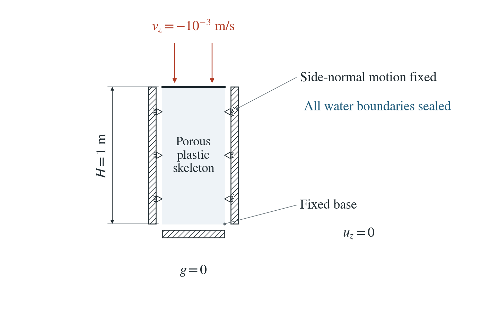
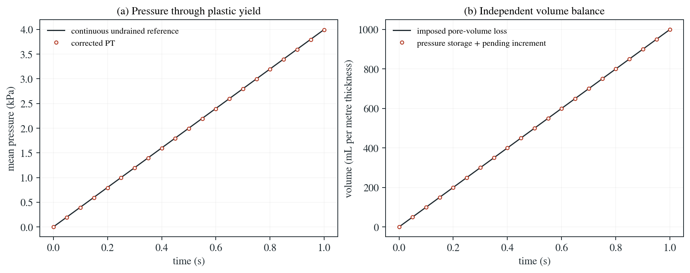

# Water balance through plastic yielding

A sealed porous column is compressed through Mohr–Coulomb yield. Total volume change fixes its mean pressure independently of the plastic stress return.

**Through yield, the stored fluid content plus the pressure increment still pending in the PT step equals the imposed volume loss to round-off, and the mean pressure follows its reference recurrence to round-off.**

:::info At a glance

| | |
| --- | --- |
| Dimension | 2D |
| Build | `make ndims=2` from the poromechanics source |
| Inputs | [plastic-content.zip](/downloads/poromechanics/plastic-content.zip) |
| Checked with | DynEarthSol `97f9794` (poromechanics branch) |

:::

## Problem setup



**Geometry and motion.** Unit column with a fixed base and fixed side-normal motion. The top moves down at 0.001 m/s for 1 s. Plane strain in 2D; zero gravity and a fixed mesh.

**Water boundaries.** All boundaries are sealed in the selected case. Initial pressure is zero; porosity and pressure capacity remain fixed.

**Yield law.** Mohr–Coulomb: cohesion 100 Pa, friction 20° and selected dilation 10°. Other controls use zero and negative dilation.

## Input and how to run

Every file this example needs is in [plastic-content.zip](/downloads/poromechanics/plastic-content.zip). Run from that folder:

```bash
# Compresses the 2D column for 100 steps of 0.01 s (1 s) and writes column.save.* and column.chkpt.* at every step, with column.info listing the frames.
dynearthsol2d input.cfg
```

### Settings that define this example

| Setting | Value | What it does here |
| --- | --- | --- |
| `mat.rheology_type` | `elasto-plastic` | elasto-plastic: Mohr–Coulomb plasticity |
| `mat.cohesion0` | `[100]` | cohesion 100 Pa (equal to cohesion1: no weakening), small so the column yields early |
| `mat.friction_angle0` | `[20]` | friction angle 20° (friction_angle1 is the same) |
| `mat.dilation_angle0` | `[10]` | dilation angle 10° (dilation_angle1 is the same): yielding makes the skeleton dilate |
| `bc.vbc_val_z1` | `-0.001` | the top moves down at 1 mm/s; base and sides are held normally, so the volume loss is fixed by this velocity |
| `mat.hydraulic_perm` | `[0]` | zero permeability, and every hbc is 0 (no flow): the column is sealed |
| `mat.fluid_bulk_modulus` | `[1000000.0]` | K_f = 1 MPa, a soft fluid, so the pressure stays small (4 kPa at 1 s) |
| `mat.porosity` | `[0.25]` | φ = 0.25; with K_f it gives the storage φ/K_f |
| `mat.bulk_modulus_s` | `[1e+20]` | grain modulus 1e20 Pa: incompressible grains, Biot coefficient 1 |
| `mat.bulk_modulus` | `[20000000.0]` | K = 20 MPa |
| `mat.shear_modulus` | `[10000000.0]` | G = 10 MPa |
| `control.has_PT` | `true` | PT solves the mechanics to equilibrium every step; the pressure increment it carries to the next step is counted separately |
| `control.fixed_dt` | `0.01` | 0.01 s step; 100 steps to 1 s |
| `mat.is_plane_strain` | `true` | 2D plane strain, including the out-of-plane plastic strain |

[input.cfg](/downloads/poromechanics/plastic-content/input.cfg) holds all 62 settings that differ from DES’s defaults; `dynearthsol2d -h` lists every option with its default.

## Output

DES writes `column.info` (one line per saved frame: frame, step, time in seconds), `column.save.NNNNNN` (the fields of each saved frame) and `column.chkpt.NNNNNN` (checkpoints to restart from). `sim.output_step_interval` and `sim.output_time_interval_in_yr` set how often a frame is saved.

Set `DES_SOURCE` and `PYTHONPATH` as described in [Running the examples](../running.md) before using the Python reader or converter.

| Field | What to look at |
| --- | --- |
| `pore pressure` | nodal pressure; its volume average is the mean pressure in panel (a) and gives the pressure part of the stored water |
| `strain` | element strain; its volumetric part integrated over the mesh is the imposed volume loss |
| `plastic strain` | shows that the column has yielded before the balance is checked |
| `fluid balance` | per-step water ledger; its boundary entry stays zero in this sealed column |

Read a frame in Python:

```python
from Dynearthsol import Dynearthsol      # in the DES source folder
model = Dynearthsol('column')
frame = model.frames[-1]                 # model.time[i] is the time of frame i, in seconds
x = model.read_field(frame, 'coordinate')
value = model.read_field(frame, 'pore pressure')
```

View it in ParaView after `python3 "$DES_SOURCE/2vtk.py" column`.

## Result: DES and the analytical solution



(a) Mean pore pressure of the sealed column against time, through yield: line, the undrained reference set by the imposed volume loss; symbols, DES. (b) Volume balance: line, the imposed pore-volume loss; symbols, DES water stored by pressure plus the pressure increment still pending in the PT step.

This checks that plastic yielding neither creates nor destroys pore water: the fluid source uses the accepted volume change, not an elastic estimate. Forty-eight cases cover 2D and 3D, negative, zero and positive dilation, hydraulic substeps, open drainage, Gardner suction, EP-RSF with evolving pressure and thermal expansion. Remeshing, porosity change from plastic strain and the general energy balance are not covered.

[History CSV](/downloads/poromechanics/plastic-content/history.csv) · `Control tables`

To reproduce the whole study behind this figure, from the DES source folder:

```bash
python3 tests/functional/hydromechanics/check_plastic_content.py dynearthsol2d OUT/2d
python3 tests/functional/hydromechanics/check_plastic_content.py dynearthsol3d OUT/3d --ndims 3
```

The study’s full numbers: [record.json](/downloads/poromechanics/plastic-content/record.json).

## Analytical reference

$$
S=\phi_n/K_f+(\alpha-\phi_n)/K_s
$$

$$
Z=\int_V(Sp+\alpha\varepsilon_v)\,dV
$$

$$
\bar p(t)=\alpha vt/(HS)
$$

$$
L=\alpha^2/B
$$

$$
B_{2D}=K+G/3
$$

$$
B_{3D}=K
$$

$$
Z_{\rm split}=Z+VL(\bar p_n-\bar p_{n-1})
$$

$$
\bar p_n=\frac{\alpha vt_n/H+L\bar p_{n-1}}{S+L}
$$

$$
(S+L)\Delta p+\alpha\Delta\varepsilon_v-LD=0
$$

$K=20$ MPa, $G=10$ MPa, $\alpha=1$, $\phi_n=0.25$, $K_f=1$ MPa and $K_s=10^{20}$ Pa. $v=10^{-3}$ m/s and $H=1$ m. $D$ is the previous raw pressure increase consumed by mechanics. The physical pressure reaches 4 kPa at 1 s; the 0.01 s PT step leaves about 0.17% pending lag.

### Derivation

Integrate total volumetric strain over the actual mesh. The imposed boundary velocity fixes the volume loss even after the stress return becomes plastic.

$$
\int_V\varepsilon_v\,dV=-Avt
$$

Sealed linear Biot conservation gives the physical mean pressure. Adding the separately recorded pending-pressure contribution gives the exact PT recurrence shown above.

Converting the stress change back to volume with the elastic moduli fails after a plastic return, including the out-of-plane plastic strain in plane strain. DES’s fixed-stress source therefore uses the accepted volumetric strain of the step and the previous raw pressure increment; pressure substeps reuse the same accepted mechanical history.

With thermal expansion the direct strain source uses the full thermal fluid coefficient, without an additional elastic stress conversion.

$$
\beta=\phi_n\alpha_f+(\alpha-\phi_n)\alpha_s
$$

The partly saturated homogeneous Gardner control has an independent scalar content inversion at each accepted step. It checks the implemented retention-rate law; it does not establish a finite-strain porosity law.

$$
(S+L)\Delta p+\phi_n\Delta S_e+\alpha S_{e,\rm old}\Delta\varepsilon_v-LD=0
$$

Additional EP-RSF controls check the independent aging update and effective-stress return while pressure evolves. Open drains include measured boundary exchange; they check material content, rather than a separate spatial Darcy-flux solution.

Integral Biot conservation with prescribed boundary motion; independent scalar pressure recurrence and local effective-stress/thermal controls in check_plastic_content.py.

## Validity and limits

Fixed porosity and geometry. The pending PT term is a numerical coupling lag, not physical water. Porosity change from plastic strain (including enhancement and healing), remeshing, the energy balance of open systems and shear heating are not covered.

## Reproduction

[Commands, solver hashes and portable inputs](../running.md).
