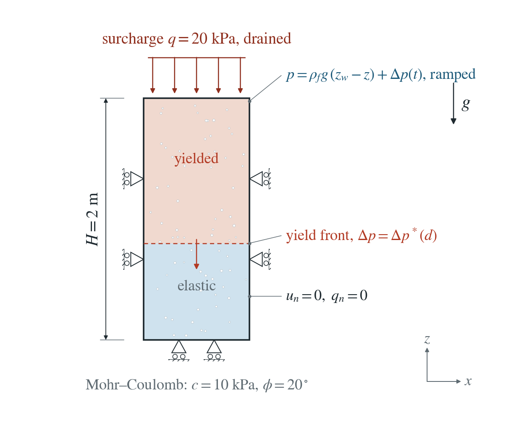
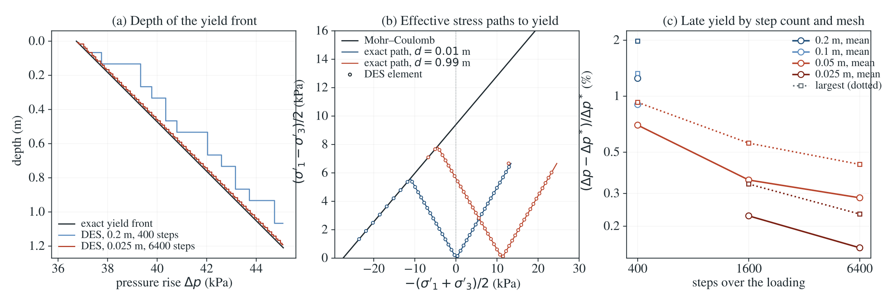

# Pressure-driven yielding of a confined layer

Rising pore pressure lowers the effective stress until the ground yields, the mechanism of injection- and rainfall-induced failure. In a laterally confined layer the yield pressure at each depth is exact, so a yield front moving down can be compared element by element.

**On the 0.025 m mesh with 6400 steps every element yields within 0.23% (mean 0.15%) of its exact pressure, and 96 of 160 elements yield, as predicted. DES always yields slightly late; the delay falls with both the step and the mesh.**

:::info At a glance

| | |
| --- | --- |
| Dimension | 2D |
| Build | `make ndims=2` from the poromechanics source |
| Inputs | [pressure-yield.zip](/downloads/poromechanics/pressure-yield.zip) |
| Reproduce with | DynEarthSol [`3774df0`](https://github.com/GeoFLAC/DynEarthSol/tree/3774df00ba1708a4f70a836d2073f845653aac64) |

:::

## Problem setup



**Layer.** A saturated layer $H=2$ m deep under a drained surcharge $q=20$ kPa, water table at the top, an isotropic lithostatic initial stress with hydrostatic pressure. Sides and base are fixed normally and sealed.

**Loading.** The top pressure rises linearly over 2000 s to 95% of the apex pressure; permeability is high, so the whole layer follows. Gravity acts; pressure feedback is on.

**Material.** Elastic–perfectly plastic Mohr–Coulomb: $K=100$ MPa, $G=60$ MPa, $c=10$ kPa, $\phi=20^\circ$, no dilation, $\alpha=1$, $\phi_n=0.3$.

**What is compared.** For each element, the pressure rise at the first step with plastic strain against the exact onset $\Delta p^*$ at its centroid depth.

## Input and how to run

Every file this example needs is in [pressure-yield.zip](/downloads/poromechanics/pressure-yield.zip). Run from that folder:

```bash
# Runs the 2D layer (one 0.025 m element wide, 2 m deep) for 6400 steps of 0.3125 s (2000 s) and saves every step to layer.save.*, with layer.info listing the frames; it first brings the layer to gravitational equilibrium.
dynearthsol2d input.cfg
```

### Settings that define this example

| Setting | Value | What it does here |
| --- | --- | --- |
| `mat.rheology_type` | `elasto-plastic` | elasto-plastic: elastic–perfectly plastic Mohr–Coulomb (dilation stays at its default of zero) |
| `mat.cohesion0` | `[10000.0]` | cohesion c = 10 kPa (cohesion1 equal: no weakening) |
| `mat.friction_angle0` | `[20.0]` | friction angle φ = 20° (friction_angle1 equal) |
| `bc.stress_bc_z1` | `3` | type 3: vertical traction on the top surface |
| `bc.stress_val_z1` | `-20000.0` | the surcharge q = 20 kPa (compression negative), which keeps the yielded top in compression |
| `bc.hbc_z1` | `2` | type 2: the top pore pressure is prescribed from hbc_pressure |
| `bc.hbc_pressure` | `[0,0,0,0,0,45101.03548481891]` | the z1 (top) entry is the final top pore pressure, 95% of the pressure that would bring the surface to the apex of the yield cone |
| `bc.num_hbc_schedule` | `2` | two schedule points for the prescribed pressure |
| `bc.hbc_schedule_time_in_yr` | `[0, 6.337752907015714e-05] yr = [0, 2000] s` | 0 and 2000 s: the top pressure ramps linearly over the run |
| `bc.hbc_schedule_ratio` | `[0, 1]` | 0 to 1: the ramp starts from the hydrostatic state |
| `mat.hydraulic_perm` | `[1e-11]` | high permeability, so the whole layer follows the top pressure rise almost at once |
| `control.gravity` | `9.81` | 9.81 m/s²: lithostatic stress and hydrostatic pressure set the depth dependence of the yield pressure |
| `ic.has_body_force_adjustment` | `true` | brings the initial stress into equilibrium with gravity before loading |
| `control.fixed_dt` | `0.3125` | 0.3125 s; 6400 steps reach 2000 s |

[input.cfg](/downloads/poromechanics/pressure-yield/input.cfg) holds all 62 settings that differ from DES’s defaults; `dynearthsol2d -h` lists every option with its default.

## Output

DES writes `layer.info` (one line per saved frame: frame, step, time in seconds), `layer.save.NNNNNN` (the fields of each saved frame) and `layer.chkpt.NNNNNN` (checkpoints to restart from). `sim.output_step_interval` and `sim.output_time_interval_in_yr` set how often a frame is saved.

Set `DES_SOURCE` and `PYTHONPATH` as described in [Running the examples](../running.md) before using the Python reader or converter.

| Field | What to look at |
| --- | --- |
| `pore pressure` | element-averaged pressure; its rise since the start, read at the first saved step with plastic strain, is each element's yield pressure |
| `plastic strain` | marks the first saved step at which an element has yielded |
| `stress` | element total stress; with the pore pressure it gives the effective-stress paths in panel (b) |

Read a frame in Python:

```python
from Dynearthsol import Dynearthsol      # in the DES source folder
model = Dynearthsol('layer')
frame = model.frames[-1]                 # model.time[i] is the time of frame i, in seconds
x = model.read_field(frame, 'coordinate')
value = model.read_field(frame, 'pore pressure')
```

View it in ParaView after `python3 "$DES_SOURCE/2vtk.py" layer`.

## Result: DES and the analytical solution



(a) Depth of the yield front against the pressure rise: line, the exact onset depth; stepped lines, DES on the coarsest mesh and on the finest mesh with the most steps. (b) Effective-stress paths to yield at two depths: lines, the exact paths up to the Mohr–Coulomb line; symbols, DES elements. (c) Mean error of the yield pressure for each mesh and number of steps.

This checks effective-stress plasticity in a boundary-value problem driven by pore pressure: the Biot coefficient in the effective stress, the Mohr–Coulomb return and the pressure coupling together.

To reproduce the whole study behind this figure, from the DES source folder:

```bash
python3 benchmarks/poromechanics/pressure_yield_reference.py
python3 tests/functional/hydromechanics/check_pressure_yield.py dynearthsol2d OUT/mesh --spacings 0.2 0.1 0.05 --steps 400
python3 tests/functional/hydromechanics/check_pressure_yield.py dynearthsol2d OUT/steps1600 --spacings 0.05 --steps 1600
python3 tests/functional/hydromechanics/check_pressure_yield.py dynearthsol2d OUT/pt1-steps1600 --spacings 0.05 0.025 --steps 1600 --pt-option 1
python3 tests/functional/hydromechanics/check_pressure_yield.py dynearthsol2d OUT/pt1-steps6400 --spacings 0.025 --steps 6400 --pt-option 1
```

The study’s full numbers: [record.json](/downloads/poromechanics/pressure-yield/record.json).

## Analytical reference

$$
\sigma'_v=-(\gamma'd+q)+\alpha\Delta p
$$

$$
\sigma'_h=-(\gamma'd+\kappa q)+\kappa\alpha\Delta p
$$

$$
\frac{\sigma'_1-\sigma'_3}{2}+\frac{\sigma'_1+\sigma'_3}{2}\sin\phi=c\cos\phi\ \mathrm{at}\ \Delta p=\Delta p^*(d)
$$

$$
\Delta p_{\mathrm{apex}}=\frac{c\cot\phi+q}{\alpha}
$$

Tension positive; $d$ is depth, $\kappa=\nu/(1-\nu)$, $\gamma'=(\rho_b-\alpha\rho_f)g$ and $\sigma'_1\geq\sigma'_3$ are the principal effective stresses. $\Delta p^*(d)$ is the first root of the yield function of the elastic trial state.

### Derivation

Under uniaxial strain the horizontal stresses stay equal and change by $\kappa$ times the vertical change; the total vertical stress is fixed by the weight and the surcharge, so a uniform pressure rise moves only the effective stresses, as above.

$\Delta p^*$ increases with depth, so a yield front moves down. Each depth is independent under uniaxial strain, so the front stays exact after the layer above yields; the yielded state follows the cone until its apex.

The surcharge keeps the top in compression: without it the yielded top reaches the apex within a few kPa of the onset. pressure_yield_reference.py checks the onset on the yield surface, the elastic state just below it, the surcharge-free closed form and the ordering of onset and apex.

Terzaghi effective stress with Mohr–Coulomb yield; the uniaxial-strain stress path as in Jaeger, Cook and Zimmerman, Fundamentals of Rock Mechanics (2007). Computed in pressure_yield_reference.py.

## Validity and limits

Uniaxial strain, a uniform pressure rise, no dilation, fully saturated. The test stops short of the apex, beyond which no equilibrium exists. 3D is checked only to onset; an inclined (infinite-slope) version needs an initial-stress option DES does not have.

## Reproduction

[Commands, solver hashes and portable inputs](../running.md).
