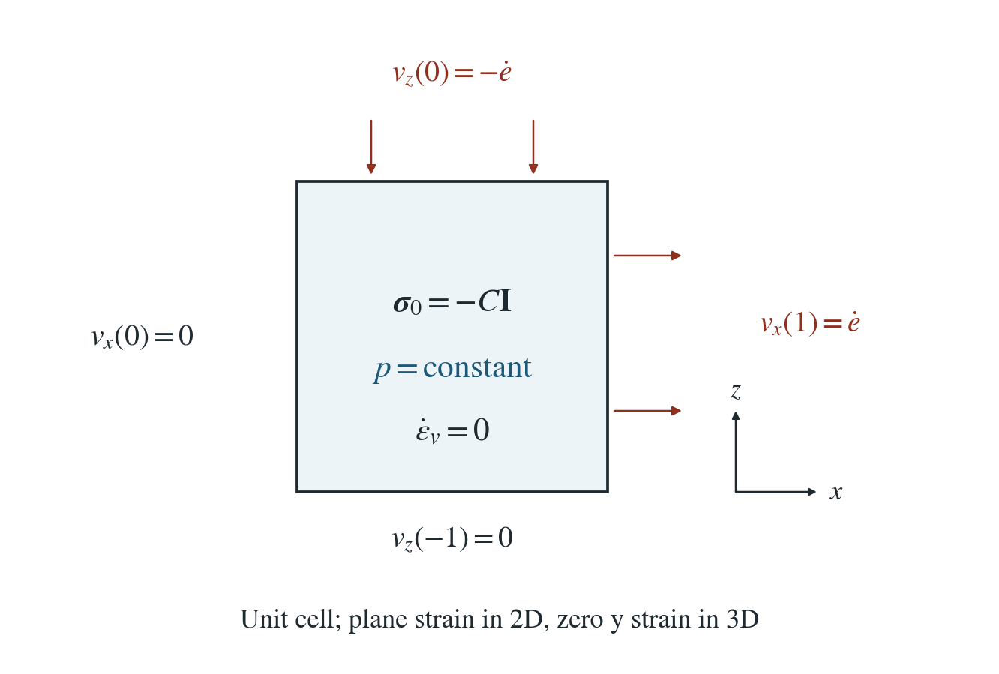
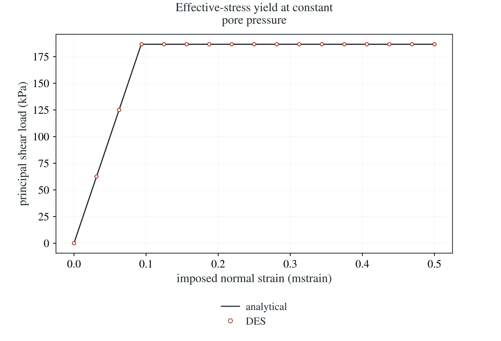

# Pore pressure and material strength

An affine material cell is extended in one direction and compressed equally in another, at fixed pore pressure. Effective stress must control its shear yield load.

**The pressurized 3D case yields at 186.603 kPa, matching the analytical load. The largest stress/plastic-strain error over 20 load paths (EP, and EP-RSF at constant friction) is 1.28e-14 of the yield load.**

:::info At a glance

| | |
| --- | --- |
| Dimension | 3D |
| Build | `make ndims=3` from the poromechanics source |
| Inputs | [strength.zip](/downloads/poromechanics/strength.zip) |
| Reproduce with | DynEarthSol [`3774df0`](https://github.com/GeoFLAC/DynEarthSol/tree/3774df00ba1708a4f70a836d2073f845653aac64) |

:::

## Problem setup



**Material cell.** Every normal velocity component is prescribed on the unit cell. Normal strains are $e$ in $x$ and $-e$ in $z$, with zero $y$ strain in 3D; 2D uses plane strain.

**Pressure and initial stress.** Initial total stress is $-C\mathbf{I}$. Pressure is uniform and constant; permeability and mechanical pressure feedback are zero. Gravity, mesh motion and heat are disabled.

**Strength law.** $K=G=1$ GPa, cohesion $c=100$ kPa, friction angle $30^\circ$ and dilation angle zero. EP-RSF is checked in the constant-friction limit $a=b=0$.

## Input and how to run

Every file this example needs is in [strength.zip](/downloads/poromechanics/strength.zip). Run from that folder:

```bash
# Runs the 3D unit cell for 64 steps of 1 s (the input is 3D: six initial-stress components) and writes cell.save.* and cell.chkpt.* every 4 steps, with cell.info listing the frames.
dynearthsol3d input.cfg
```

### Settings that define this example

| Setting | Value | What it does here |
| --- | --- | --- |
| `mat.rheology_type` | `elasto-plastic` | elasto-plastic: Mohr–Coulomb plasticity, whose strength DES evaluates with the effective stress |
| `mat.cohesion0` | `[1e5]` | cohesion c = 100 kPa; equal to cohesion1, so there is no strain weakening |
| `mat.cohesion1` | `[1e5]` | same as cohesion0: no weakening |
| `mat.friction_angle1` | `[30]` | 30°, equal to friction_angle0, so the friction angle stays fixed (dilation stays at its default of zero) |
| `mat.bulk_modulus` | `[1e9]` | K = 1 GPa |
| `mat.shear_modulus` | `[1e9]` | G = 1 GPa; the elastic branch of the load path is t = 2Ge |
| `ic.initial_stress_option` | `1` | 1: start from the homogeneous total stress given in initial_stress |
| `ic.initial_stress` | `[-1000000.0, -1000000.0, -1000000.0, 0.0, 0.0, 0.0]` | isotropic total stress −C with C = 1 MPa (compression negative) |
| `ic.pore_pressure_option` | `2` | 2: uniform initial pore pressure |
| `ic.pore_pressure_value` | `800000.0` | pore pressure p = 0.8 MPa; with Biot coefficient 1 it lowers the effective confinement to 0.2 MPa |
| `control.has_poroelastic_pressure_feedback` | `false` | off: deformation does not change the pore pressure, so p stays fixed |
| `bc.vbc_val_x1` | `7.8125e-06` | the right face moves outward, extending the cell in x at strain rate e-dot |
| `bc.vbc_val_z1` | `-7.8125e-06` | the top moves down at the same rate, shortening the cell in z; the y faces are held (vbc_y0, vbc_y1 = 1), so y strain is zero |
| `control.gravity` | `0` | no gravity: stress and pressure are uniform |

[input.cfg](/downloads/poromechanics/strength/input.cfg) holds all 65 settings that differ from DES’s defaults; `dynearthsol3d -h` lists every option with its default.

## Output

See [Running the examples](../running.md) for output files, the Python reader and ParaView conversion.

| Field | What to look at |
| --- | --- |
| `strain` | element strain; its xx component, averaged over the cell, is the imposed normal strain e on the horizontal axis |
| `stress` | element total stress; half of (σxx − σzz), averaged over the cell, is the principal shear load t on the vertical axis |


## Result: DES and the analytical solution



Principal shear load t (half the difference of the extreme principal stresses) against the imposed normal strain e, for the 3D elasto-plastic cell at 1 MPa total confinement and 0.8 MPa pore pressure. Line: the elastic–perfectly plastic analytical path, which yields at the effective-stress load t_y. Symbols: DES at each saved frame.

This isolates the pressure-dependent strength of the skeleton and its plastic strain. EP-RSF is checked at constant friction here and with evolving friction on the rate-and-state page. Flow, dilation, tensile failure and slope or injection applications are not tested here.

To reproduce the whole study behind this figure, from the DES source folder:

```bash
python3 tests/functional/hydromechanics/check_pore_strength.py dynearthsol2d OUT/2d --ndims 2
python3 tests/functional/hydromechanics/check_pore_strength.py dynearthsol3d OUT/3d --ndims 3
```

The study’s full numbers: [record.json](/downloads/poromechanics/strength/record.json).

## Analytical reference

$$
\boldsymbol{\sigma}^\prime=\boldsymbol{\sigma}+q\mathbf{I}
$$

$$
q=\alpha\langle S_e(p)p\rangle_e
$$

$$
t_y=c\cos\phi+(C-q)\sin\phi
$$

$$
t(e)=\min(2Ge,t_y)
$$

$$
\epsilon_p=\max[0,e-t_y/(2G)]
$$

$$
N_\phi=(1+\sin\phi)/(1-\sin\phi)
$$

$$
A_{\rm total}=2c\sqrt{N_\phi}-(N_\phi-1)q
$$

$$
T_{\rm total}=T-q
$$

$q=\alpha p$ when saturated. $t$ is half the extreme principal-stress difference and $T$ the tensile cap of the skeleton. DES stores total stress, so it applies the effective-stress criterion by shifting the shear intercept and the tensile cap by $q$, as in the last two equations.

### Derivation

The effective principal stresses are -(C-q)-t and -(C-q)+t. Substituting them in Mohr-Coulomb gives the shear yield load.

$$
\sigma_{\min}^\prime-N_\phi\sigma_{\max}^\prime+2c\sqrt{N_\phi}=0
$$

Zero dilation keeps mean stress fixed on this path. Stress first follows 2Ge and then stays at the perfect-plastic yield load; the remaining strain is plastic.

Closed-form Mohr-Coulomb response derived for the stated imposed path; stress and plastic strain are checked at every saved frame in check_pore_strength.py.

## Validity and limits

A uniform-strain, fixed-pressure, zero-dilation material check on the compressive shear branch. Evolving rate-and-state friction is checked on the rate-and-state page. Tensile failure, mixed-material suction, flow, dilation and slope or injection applications are not tested here.
