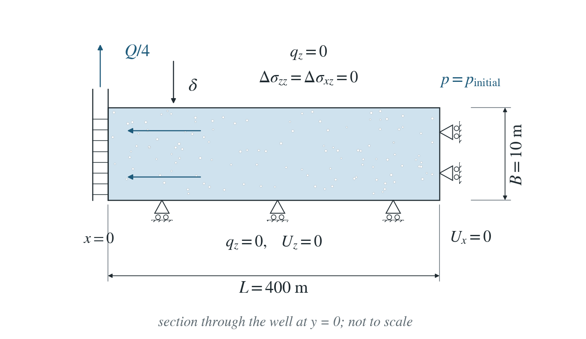
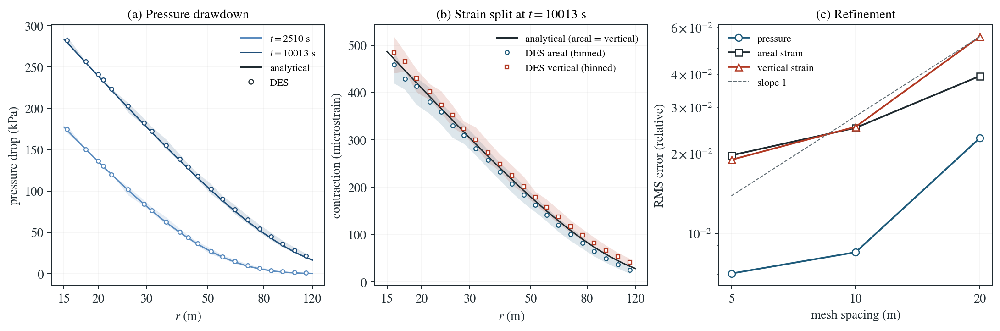

# Pumping subsidence: averaged-aquifer (Bear–Corapcioglu) model

A well pumps a thin poroelastic aquifer. The drawdown spreads radially and the layer contracts, splitting its volume change between areal and vertical strain.

**RMS errors: 0.71% in pressure, 1.97% in areal strain and 1.90% in vertical strain, relative to the largest analytical values.**

:::info At a glance

| | |
| --- | --- |
| Dimension | 3D |
| Build | `make ndims=3` from the poromechanics source |
| Inputs | [aquifer.zip](/downloads/poromechanics/aquifer.zip) |
| Checked with | DynEarthSol `97f9794` (poromechanics branch) |

:::

## Problem setup



**DES slab.** A thin quarter slab, $400\times400$ m and $B=10$ m thick, with a fully penetrating well on its corner edge pumping $Q/4$ ($Q=0.01\ \mathrm{m^3/s}$). Symmetry rollers at $x=0$, $y=0$, a roller base and a traction-free top; the far sides hold the initial pressure and zero normal displacement.

**Reference.** The thickness-averaged (generalised Bear–Corapcioglu) model: vanishing incremental vertical and vertical-shear total stress, horizontal displacement uniform through the thickness. It applies while the slab is thin compared with the radius, up to $O((B/r)^2)$.

**What is compared.** Nodal pressure and element areal and vertical strains for $15\le r\le120$ m at four times, while the pressure front stays inside the slab, on structured meshes.

## Input and how to run

Every file this example needs is in [aquifer.zip](/downloads/poromechanics/aquifer.zip). Run from that folder:

```bash
# Runs the 3D quarter slab on a 5 m hexahedral mesh: the corner well pumps from t = 0 and DES writes frames slab.* at 0, 2500, 5000, 7500 and 10000 s. No mesh or restart file is needed.
dynearthsol3d input.cfg
```

### Settings that define this example

| Setting | Value | What it does here |
| --- | --- | --- |
| `control.has_hydraulic_diffusion` | `true` | turns on Darcy flow, so the drawdown spreads from the well by diffusion |
| `control.has_PT` | `true` | iterates each time step to mechanical equilibrium, so the slab deforms quasi-statically with the pressure (two-way Biot coupling) |
| `control.gravity` | `0` | no gravity: every field is a change from the unstressed, zero-pressure initial state |
| `control.has_moving_mesh` | `false` | keeps the mesh fixed (small strain), as the reference assumes |
| `mesh.meshing_elem_shape` | `1` | structured hexahedra, so the mesh spacing follows mesh.resolution exactly |
| `bc.vbc_y0` | `1` | symmetry plane y = 0: normal displacement fixed (the x = 0 plane is a roller by default) |
| `bc.vbc_z0` | `1` | roller base: vertical displacement fixed, horizontal free; the top is traction-free |
| `bc.hbc_x1` | `1` | far side x = 400 m holds its initial pore pressure (zero change) |
| `bc.hbc_y1` | `1` | far side y = 400 m holds its initial pore pressure (zero change) |
| `bc.num_wells` | `1` | one rate-controlled vertical well, placed on the corner edge x = y = 0 |
| `bc.well_rate` | `[0.0025]` | extraction rate of the quarter well: one quarter of the full rate Q, because the model is one quarter of the slab |
| `bc.well_z_bottom` | `[-10.0]` | screens the well over the whole 10 m thickness (fully penetrating) |
| `mat.hydraulic_perm` | `[1e-12]` | permeability; with fluid viscosity and storage it sets the hydraulic diffusivity |
| `mat.biot_coeff` | `[0.8]` | Biot coefficient, the strength of the pressure–deformation coupling |

[input.cfg](/downloads/poromechanics/aquifer/input.cfg) holds all 44 settings that differ from DES’s defaults; `dynearthsol3d -h` lists every option with its default.

## Output

DES writes `slab.info` (one line per saved frame: frame, step, time in seconds), `slab.save.NNNNNN` (the fields of each saved frame) and `slab.chkpt.NNNNNN` (checkpoints to restart from). `sim.output_step_interval` and `sim.output_time_interval_in_yr` set how often a frame is saved.

Set `DES_SOURCE` and `PYTHONPATH` as described in [Running the examples](../running.md) before using the Python reader or converter.

| Field | What to look at |
| --- | --- |
| `pore pressure` | nodal pressure change against radius from the well at each saved time; panel (a) and the pressure error |
| `strain` | element strain tensor: the areal strain is the xx + yy components and the vertical strain the zz component; panel (b) and the strain errors |
| `coordinate` | node positions, used for the radius of nodes and element centres from the well |

Read a frame in Python:

```python
from Dynearthsol import Dynearthsol      # in the DES source folder
model = Dynearthsol('slab')
frame = model.frames[-1]                 # model.time[i] is the time of frame i, in seconds
x = model.read_field(frame, 'coordinate')
value = model.read_field(frame, 'pore pressure')
```

View it in ParaView after `python3 "$DES_SOURCE/2vtk.py" slab`.

## Result: DES and the analytical solution



(a) Pressure drop against distance from the well at the first and last saved times: lines are the averaged-aquifer line-well solution, symbols the mean DES value in radius bins with the spread shaded. (b) Areal and vertical contraction at the last time against the analytical solution, which predicts the two to be equal. (c) RMS errors in pressure, areal strain and vertical strain against mesh spacing, with a first-order slope for reference.

This checks two-way coupled pumping deformation against the thickness-averaged model. It does not remove the $O((B/r)^2)$ slab-model difference, which remains at the finest mesh.

To reproduce the whole study behind this figure, from the DES source folder:

```bash
python3 benchmarks/hydromechanics/slab_refinement.py dynearthsol3d OUT --resolutions 20 10 5
```

The study’s full numbers: [record.json](/downloads/poromechanics/aquifer/record.json).

## Analytical reference

$$
\lambda=K-2G/3,\quad S_a=S_0+\alpha^2/(\lambda+G),\quad D=\kappa/(\mu S_a)
$$

$$
C_Q=Q\mu/(4\pi\kappa B),\quad u=r^2/(4Dt),\quad p(r,t)=-C_QE_1(u)
$$

$$
e_h=\epsilon_{zz}=\frac{\alpha p}{2(\lambda+G)},\quad\delta=-B\epsilon_{zz}
$$

$$
U_r=-\frac{\alpha C_QDt}{(\lambda+G)r}[uE_1(u)-e^{-u}+1]
$$

$p$ is the pressure change (negative during extraction), $S_a$ is pressure storage in $\mathrm{Pa^{-1}}$, $S_0=\phi/K_f+(\alpha-\phi)/K_s$, $e_h=\epsilon_{xx}+\epsilon_{yy}$ is areal strain, and $\delta$ is positive downward subsidence. The plotted reference is the infinite-domain line-well limit. The full finite-annulus Laplace solution, which includes an additional spatially uniform strain function $h(t)$, is derived below and in the theory appendix.

### Derivation

Zero incremental vertical stress gives $\varepsilon_{zz}$. Eliminating it from the horizontal stresses and integrating radial equilibrium gives $e_h=\alpha p/[2(\lambda+G)]+h(t)$. Substitution into $\zeta=\alpha(e_h+\varepsilon_{zz})+S_0p$ gives the storage and $h$ coupling in the equations below.

$$
\epsilon_v=\alpha p/(\lambda+G)+2Gh/(\lambda+2G),\quad \zeta=S_ap+ch
$$

Two hydraulic conditions and the outer radial mechanical condition determine the Laplace-space constants $A$, $B_0$ and $\hat h$ (defined in the theory note) after the inner mechanical boundary eliminates $C_w$. The illustrated fixed inner face sets $C_w=0$; a traction-free inner face instead sets $C_w=r_w^2(\lambda_*+2G)h/(2G)$. At $R$ choose either $U_r=0$ or $\sigma_{rr}=0$.

$$
2\pi r_wB(\kappa/\mu)\widehat p_r(r_w)=Q/s,\quad \widehat p(R)=0,\quad \widehat U_r(R)=0
$$

For the optional traction boundaries, $\lambda_*$ is the plane-stress Lamé coefficient. The integral $J$ of the theory note is evaluated analytically from the Bessel basis. This specifies the small linear system before numerical inverse transformation.

$$
\lambda^*=2G\lambda/(\lambda+2G),\quad \sigma_{rr}=(\lambda^*+2G)h-2GU_r/r
$$

In the infinite-domain line-well limit $h=0$. With $C_Q=Q\mu/(4\pi\kappa B)$ and $u=r^2/(4Dt)$, pressure and displacement reduce to closed forms. This retains fluid/grain compressibility; the published incompressible-grain formulas of Bear and Corapcioglu are a further limit of these.

$$
p=-C_QE_1(u),\quad e_h=\epsilon_{zz}=\frac{\alpha p}{2(\lambda+G)},\quad U_r=-\frac{\alpha C_QDt}{(\lambda+G)r}[uE_1(u)-e^{-u}+1]
$$

Rederived thickness-averaged Biot extension of Bear and Corapcioglu (1981); averaged_aquifer_reference.py. Independent checks cover radial finite-volume comparison, sealed balance, boundary conditions and limiting closed forms. The full theory note is bundled separately.

Full finite-annulus theory note.

## Validity and limits

Linear poroelasticity with constant properties; the thin-slab geometry approaches the averaged model only up to $O((B/r)^2)$, so a small model difference remains at the finest mesh. Two-way coupling with PT; no gravity.

## Reproduction

[Commands, solver hashes and portable inputs](../running.md).
