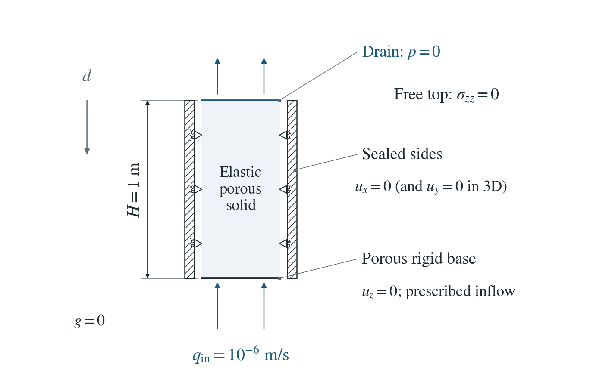
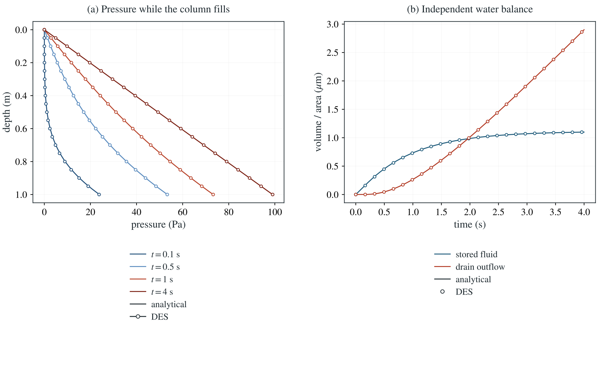

# Water balance in a deforming column

Water enters a laterally confined elastic column through its base and leaves through a pressure-controlled top. Pressure and deformation independently measure its stored fluid.

**Late pressure error is 0.0286% of the steady base pressure. In all 19 runs the stored water, including the small increment the PT solver carries into the next step, equals the net inflow to within 2.4e-15 of the injected volume.**

:::info At a glance

| | |
| --- | --- |
| Dimension | 2D |
| Build | `make ndims=2` from the poromechanics source |
| Inputs | [content.zip](/downloads/poromechanics/content.zip) |
| Checked with | DynEarthSol `97f9794` (poromechanics branch) |

:::

## Problem setup



**Geometry.** A 1 m confined column; 0.1 m wide on the selected 2D mesh. Fixed geometry, zero gravity, elastic skeleton.

**Mechanical boundaries.** Base vertical motion and side-normal motion are fixed. The top has zero total normal traction: $\sigma_{zz}=0$.

**Water boundaries.** Initially $p=0$. The top stays drained; the base supplies $q_i=10^{-6}$ m/s. Sides are sealed.

## Input and how to run

Every file this example needs is in [content.zip](/downloads/poromechanics/content.zip). Run from that folder:

```bash
# Runs the 2D column on a 0.05 m mesh for 800 steps of 0.005 s (4 s) and writes column.save.* and column.chkpt.* at every step, with column.info listing the frames.
dynearthsol2d input.cfg
```

### Settings that define this example

| Setting | Value | What it does here |
| --- | --- | --- |
| `control.has_hydraulic_diffusion` | `true` | turns on Darcy flow, so pore pressure diffuses through the column |
| `control.has_PT` | `true` | solves the mechanics to equilibrium at every step with the pseudo-transient (PT) iteration |
| `control.fixed_dt` | `0.005` | physical time step; with max_steps it sets the 4 s simulated |
| `control.gravity` | `0` | no gravity: all pressure comes from the water pumped in at the base |
| `bc.hbc_z0` | `3` | type 3: the base is a prescribed-flux boundary, taking its value from hbc_flux |
| `bc.hbc_flux` | `[0,0,0,0,-1e-06,0]` | the bottom (z0) entry is an outward flux; its negative value pumps water in through the base |
| `bc.hbc_z1` | `2` | type 2: the top is drained, pore pressure held at its hbc_pressure entry (0 Pa) |
| `bc.stress_bc_z1` | `3` | type 3: vertical traction on the top; with stress_val_z1 = 0 the top is traction-free and can rise as the column swells |
| `sim.output_step_interval` | `1` | saves every step, so stored and drained water can be summed step by step |
| `mat.porosity` | `[0.25]` | pore fraction; with the fluid and grain moduli it sets the pressure storage S |
| `mat.biot_coeff` | `[0.8]` | Biot coefficient alpha: how strongly pore pressure and volume strain are coupled |
| `mat.bulk_modulus_s` | `[1000000000.0]` | grain (solid) bulk modulus K_s, part of the storage S |
| `mat.fluid_bulk_modulus` | `[100000000.0]` | water bulk modulus K_f, part of the storage S |
| `mat.hydraulic_perm` | `[1e-11]` | intrinsic permeability k; with the viscosity it sets the mobility k/mu and the 100 Pa steady base pressure |

[input.cfg](/downloads/poromechanics/content/input.cfg) holds all 58 settings that differ from DES’s defaults; `dynearthsol2d -h` lists every option with its default.

## Output

DES writes `column.info` (one line per saved frame: frame, step, time in seconds), `column.save.NNNNNN` (the fields of each saved frame) and `column.chkpt.NNNNNN` (checkpoints to restart from). `sim.output_step_interval` and `sim.output_time_interval_in_yr` set how often a frame is saved.

Set `DES_SOURCE` and `PYTHONPATH` as described in [Running the examples](../running.md) before using the Python reader or converter.

| Field | What to look at |
| --- | --- |
| `pore pressure` | nodal pressure; the vertical profile on the column centre line is compared with the series in panel (a), and its volume integral gives the pressure part of the stored water |
| `strain` | element strain; its volumetric part times the Biot coefficient gives the deformation part of the stored water in panel (b) |
| `fluid balance` | five numbers per frame for the last step: storage change, mechanical source, wells, boundary exchange and residual; the summed boundary exchange gives the drained water in panel (b) |

Read a frame in Python:

```python
from Dynearthsol import Dynearthsol      # in the DES source folder
model = Dynearthsol('column')
frame = model.frames[-1]                 # model.time[i] is the time of frame i, in seconds
x = model.read_field(frame, 'coordinate')
value = model.read_field(frame, 'pore pressure')
```

View it in ParaView after `python3 "$DES_SOURCE/2vtk.py" column`.

## Result: DES and the analytical solution



(a) Pressure down the centre of the column at several times while it fills: lines are the series solution, symbols are DES. (b) Water stored in the column and water drained through the top, per unit cross-section, against time: lines are the reference, symbols are DES (stored water from pressure and volume strain, drained water from the boundary exchange).

Stored water is computed from the pressure and volume strain integrated over the mesh, and drained water both from the boundary exchange and from the Darcy flux at the top, so the check does not reuse the pressure equation. With PT the stored water lags by about one step; the lag halves when the time step is halved. Explicit, GVS, 3D and restarted runs close the same budget.

[History CSV](/downloads/poromechanics/content/history.csv) · `Control tables`

To reproduce the whole study behind this figure, from the DES source folder:

```bash
python3 benchmarks/poromechanics/fluid_content.py dynearthsol2d OUT/spatial-pt --spacings .2 .1 .05 --dt .005 --duration 4 --figures
python3 benchmarks/poromechanics/fluid_content.py dynearthsol2d OUT/time-coarse --spacings .05 --dt 0.02 --duration 1
python3 benchmarks/poromechanics/fluid_content.py dynearthsol2d OUT/time-medium --spacings .05 --dt 0.01 --duration 1
python3 benchmarks/poromechanics/fluid_content.py dynearthsol2d OUT/time-fine --spacings .05 --dt 0.005 --duration 1
```

The study’s full numbers: [record.json](/downloads/poromechanics/content/record.json).

## Analytical reference

$$
S=\phi/K_f+(\alpha-\phi)/K_s
$$

$$
H_m=K+4G/3
$$

$$
C_o=S+\alpha^2/H_m
$$

$$
m=k/\mu
$$

$$
D=m/C_o
$$

$$
k_n=(2n+1)\pi/(2H)
$$

$$
p(d,t)=\frac{q_i}{m}\left[d-\frac{2}{H}\sum_{n=0}^{\infty}\frac{(-1)^n\sin(k_nd)}{k_n^2}e^{-Dk_n^2t}\right]
$$

$$
\bar p=\frac{q_i}{m}\left[\frac{H}{2}-\frac{2}{H^2}\sum_{n=0}^{\infty}\frac{(-1)^n}{k_n^3}e^{-Dk_n^2t}\right]
$$

$$
V_s=AHC_o\bar p
$$

$$
V_o=Aq_it-V_s
$$

$$
Z=\int_V(Sp+\alpha\varepsilon_v)\,dV
$$

$$
Z_{\rm split}=Z+\sum_eV_eL\overline{(p_n-p_{n-1})}_e
$$

$$
L=\alpha^2/B
$$

$$
B_{2D}=K+G/3
$$

$$
B_{3D}=K
$$

$d$ is depth below the drain, $A$ cross-section and $H=1$ m. Stress and volume strain are tension-positive. $K=20$ MPa, $G=10$ MPa, $\alpha=0.8$, $\phi=0.25$, $K_f=100$ MPa, $K_s=1$ GPa, $k=10^{-11}$ m² and $\mu=10^{-3}$ Pa s. The steady basal pressure is 100 Pa.

### Derivation

Vertical equilibrium of the confined, traction-free column gives strain proportional to pressure. Insert it in physical Biot content to obtain the constrained capacity.

$$
\varepsilon_v=\alpha p/H_m
$$

$$
\zeta=C_op
$$

Mass balance with Darcy mobility gives diffusion and its mixed boundary conditions.

$$
C_op_t=mp_{dd}
$$

$$
p(0,t)=0
$$

$$
mp_d(H,t)=q_i
$$

Subtract the steady profile. The remaining field has zero value at the top and zero derivative at the base, giving the odd half-wave sine eigenfunctions. Projection of the initial negative steady profile yields the pressure series above.

Integrate the pressure series for stored volume; differentiate it at the top for independent outward Darcy flux.

$$
q_o=q_i\left[1-\frac{2}{H}\sum_{n=0}^{\infty}\frac{(-1)^n}{k_n}e^{-Dk_n^2t}\right]
$$

With PT, the mechanics of each step uses the pressure increment of the previous step. The increment not yet passed to the mechanics is a small pending term, and adding it to the stored water closes the budget exactly. It is a numerical lag, not physical water, and it halves when the time step is halved.

Separation of variables and mesh-independent quadrature for the stated mixed-boundary Biot diffusion problem; fluid_content.py also checks the PDE and endpoint derivatives.

## Validity and limits

Fixed geometry, saturated flow and constant material properties. This example does not check storage that changes with deformation, large-strain mass, mass conservation through remeshing, or heat. A closed budget does not by itself mean an accurate equilibrium; the two are checked separately.

## Reproduction

[Commands, solver hashes and portable inputs](../running.md).
