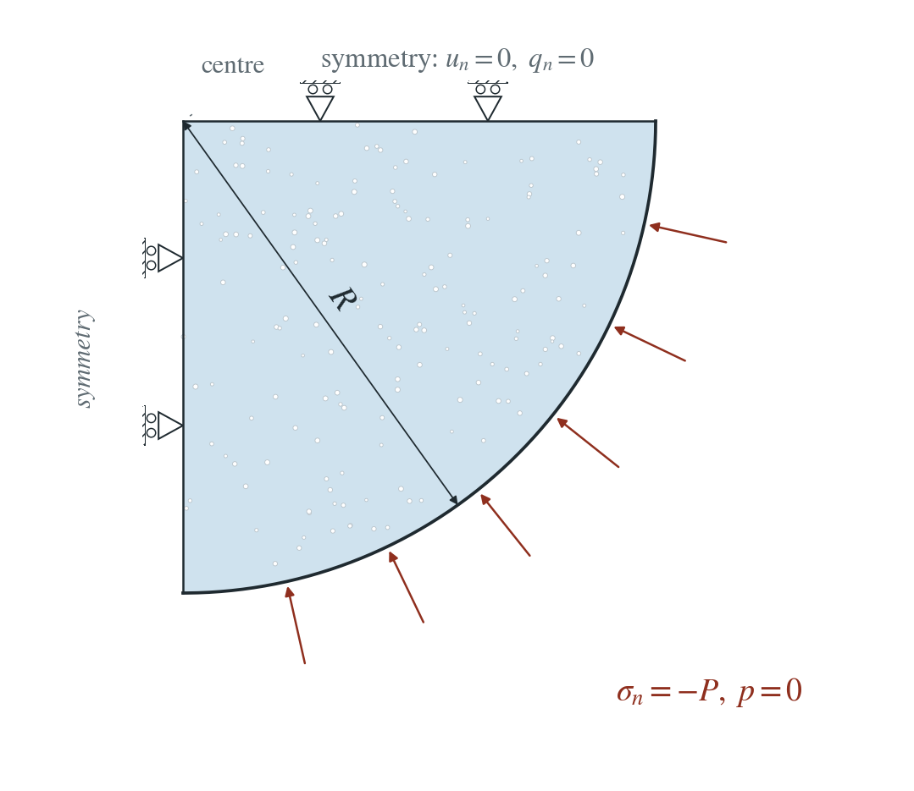
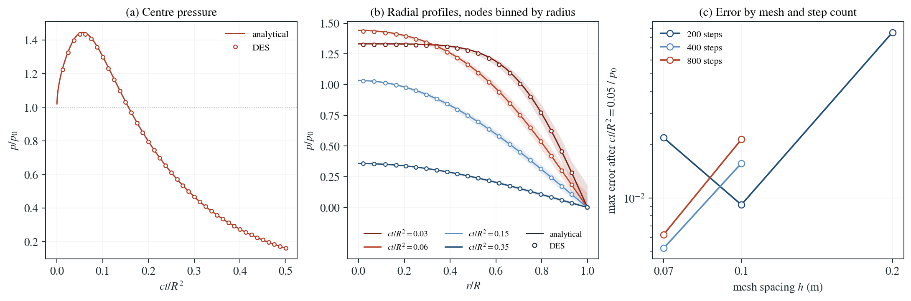

# Cryer consolidation of a sphere

A drained poroelastic sphere is suddenly loaded on its surface. The shell drains and contracts first, squeezing the core, so the centre pressure rises before it decays.

**Largest pressure error after $ct/R^2=0.05$: 0.62% of $p_0$, and 2.12% including the first-step lag. Sampled centre peak: DES $1.4347\,p_0$, analytical $1.4410\,p_0$.**

:::info At a glance

| | |
| --- | --- |
| Dimension | 3D |
| Build | `make ndims=3` from the poromechanics source |
| Inputs | [cryer.zip](/downloads/poromechanics/cryer.zip) |
| Checked with | DynEarthSol `97f9794` (poromechanics branch) |

:::

## Problem setup



**Load and drainage.** A poroelastic sphere of radius $R$ receives a uniform compressive normal stress $P$ at $t=0^+$ on its drained surface ($p=0$). DES applies it as a normal stress on the curved facets.

**Mesh and symmetry.** One octant is meshed: the three flat faces are symmetry planes (normal motion fixed, sealed), the curved surface is subdivided on the sphere.

**What is compared.** Pressure at every node, and especially at the centre, against the series solution. The centre pressure first rises above its undrained value $p_0$ (Mandel–Cryer effect).

## Input and how to run

Every file this example needs is in [cryer.zip](/downloads/poromechanics/cryer.zip). Run from that folder:

```bash
# Meshes the sphere octant from octant.poly (shipped in the same folder) at 0.07 m, runs 800 steps over 0.5 R^2/c (20.9 s) and writes cryer.save.* every 20 steps, with a checkpoint every 10th frame. This is a 3D run and takes much longer than the 2D examples.
dynearthsol3d input.cfg
```

### Settings that define this example

| Setting | Value | What it does here |
| --- | --- | --- |
| `mesh.meshing_option` | `90` | 90: the domain boundary is read from a .poly file instead of a box |
| `mesh.poly_filename` | `octant.poly` | octant.poly: one octant of a unit sphere; the curved surface carries the top (z1) boundary flag, the flat faces x = 0, y = 0 and z = 0 the x0, y0 and z0 flags |
| `mesh.resolution` | `0.07` | target element size used when meshing the octant |
| `control.has_hydraulic_diffusion` | `true` | turns on Darcy flow, so water drains out through the curved surface |
| `control.has_PT` | `true` | solves the mechanics to equilibrium at every step with PT, so the sudden surface load is carried without elastic waves |
| `control.gravity` | `0` | no gravity: only the surface load creates pressure |
| `control.fixed_dt` | `0.026153118474050982` | physical time step, 1/800 of 0.5 R^2/c |
| `sim.max_steps` | `800` | 800 steps; this, not max_time_in_yr, ends the run |
| `bc.vbc_y0` | `1` | fixes normal motion on the symmetry plane y = 0 (x = 0 is fixed by the default vbc_x0) |
| `bc.vbc_z0` | `1` | fixes normal motion on the symmetry plane z = 0, which carries the z0 flag in octant.poly |
| `bc.hbc_z1` | `2` | type 2: the curved surface is drained, pore pressure held at its hbc_pressure entry (0 Pa); the symmetry planes stay sealed |
| `bc.stress_bc_z1` | `4` | type 4: a normal stress on facets of any orientation, here the curved sphere surface |
| `bc.stress_val_z1` | `-100000.0` | the surface pressure; negative is compression (100 kPa) |
| `mat.hydraulic_perm` | `[1.03e-12]` | intrinsic permeability; with storage and stiffness it sets the consolidation coefficient c |

[input.cfg](/downloads/poromechanics/cryer/input.cfg) holds all 41 settings that differ from DES’s defaults; `dynearthsol3d -h` lists every option with its default.

## Output

DES writes `cryer.info` (one line per saved frame: frame, step, time in seconds), `cryer.save.NNNNNN` (the fields of each saved frame) and `cryer.chkpt.NNNNNN` (checkpoints to restart from). `sim.output_step_interval` and `sim.output_time_interval_in_yr` set how often a frame is saved.

Set `DES_SOURCE` and `PYTHONPATH` as described in [Running the examples](../running.md) before using the Python reader or converter.

| Field | What to look at |
| --- | --- |
| `pore pressure` | nodal pressure; the node nearest the centre gives panel (a), all nodes binned by radius give the profiles in panel (b), and the largest nodal error gives panel (c) |

Read a frame in Python:

```python
from Dynearthsol import Dynearthsol      # in the DES source folder
model = Dynearthsol('cryer')
frame = model.frames[-1]                 # model.time[i] is the time of frame i, in seconds
x = model.read_field(frame, 'coordinate')
value = model.read_field(frame, 'pore pressure')
```

View it in ParaView after `python3 "$DES_SOURCE/2vtk.py" cryer`.

## Result: DES and the analytical solution



(a) Pressure at the centre of the sphere, scaled by the undrained pressure p0, against ct/R^2: the line is the series solution, symbols are DES; the dotted line marks p/p0 = 1, which the centre pressure first exceeds. (b) Radial pressure profiles at four times: lines are the series solution, symbols are the mean of the DES nodes in each radius bin and the shaded band their spread. (c) Largest pressure error after ct/R^2 = 0.05 against mesh spacing, one line per number of time steps.

This checks 3D two-way coupling under a sudden load, the Mandel–Cryer pressure and the normal-stress load on a curved surface. It does not remove the one-step lag of the sequential coupling in the earliest frames, which falls with the time step.

To reproduce the whole study behind this figure, from the DES source folder:

```bash
python3 tests/functional/hydromechanics/check_cryer.py dynearthsol3d OUT/cryer-h --spacings 0.2 0.1 0.07 --steps 200
python3 tests/functional/hydromechanics/check_cryer.py dynearthsol3d OUT/cryer-t400 --spacings 0.1 --steps 400
python3 tests/functional/hydromechanics/check_cryer.py dynearthsol3d OUT/cryer-h0.1-t800 --spacings 0.1 --steps 800
python3 tests/functional/hydromechanics/check_cryer.py dynearthsol3d OUT/cryer-h0.07-t400 --spacings 0.07 --steps 400
python3 tests/functional/hydromechanics/check_cryer.py dynearthsol3d OUT/cryer-h0.07-t800 --spacings 0.07 --steps 800
```

The study’s full numbers: [record.json](/downloads/poromechanics/cryer/record.json).

## Analytical reference

$$
S=\frac{1}{M}+\frac{\alpha^2}{K+4G/3},\quad c=\frac{\kappa}{\mu S},\quad \beta=\frac{4G\alpha^2}{3KS(K+4G/3)}
$$

$$
p_0=\frac{\alpha P}{KS(1+\beta)}
$$

$$
3\beta(\sin\xi_n-\xi_n\cos\xi_n)=(1+\beta)\,\xi_n^2\sin\xi_n
$$

$$
\frac{p(r,t)}{p_0}=\sum_n w_n\left(1-\frac{R\sin(\xi_nr/R)}{r\sin\xi_n}\right)e^{-\xi_n^2ct/R^2}
$$

$$
G(\xi)=3(1-\xi\cot\xi)/\xi^2,\quad w_n=-\frac{2(1+\beta)}{\beta\xi_nG^{\prime}(\xi_n)}
$$

Here $K$, $G$ are drained moduli, $\alpha$ the Biot coefficient, $1/M=\phi/K_f+(\alpha-\phi)/K_s$, $\kappa$ the intrinsic permeability and $\mu$ the viscosity. The runs use $R=1$ m, $P=10^5$ Pa and the material of the Mandel page, so $c=0.0239\ \mathrm{m^2/s}$, $R^2/c=41.8$ s and $\beta=1.33$.

### Derivation

Spherical symmetry makes the displacement irrotational, so $(K+4G/3)\,\varepsilon=\alpha p+f(t)$. The surface traction fixes $f$ through the volume-average pressure $\langle p\rangle$, and the fluid balance becomes a diffusion equation forced by $d\langle p\rangle/dt$.

$$
p_t-c\nabla^2p=-\beta\,\frac{d\langle p\rangle}{dt}
$$

With $q=\sqrt{s/c}$, $x=qR$ and $g(x)=3(x\coth x-1)/x^2$, the Laplace transform is closed. Its poles $s_n=-c\xi_n^2/R^2$ give the roots and their residues the weights $w_n$. The series is checked against a numerical (Stehfest) inversion of the transform.

$$
\frac{\hat p}{p_0}=\frac{(1+\beta)\left(1-\frac{R\sinh qr}{r\sinh x}\right)}{s\,(1+\beta(1-g(x)))}
$$

Cryer (1963); Detournay and Cheng (1993). Derived and evaluated in cryer_reference.py with the same material values; the series agrees with a Stehfest inversion to 1.3e-4.

[Original reference](https://academic.oup.com/qjmam/article-abstract/16/4/401/1871972).

## Validity and limits

Small strain, linear isotropic poroelasticity with constant properties; the curved surface is a faceted approximation of the sphere. DES couples pressure and mechanics sequentially, so the earliest frames carry the one-step lag of that split. No gravity.

## Reproduction

[Commands, solver hashes and portable inputs](../running.md).
