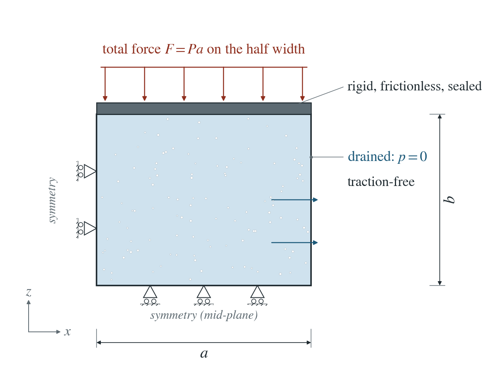
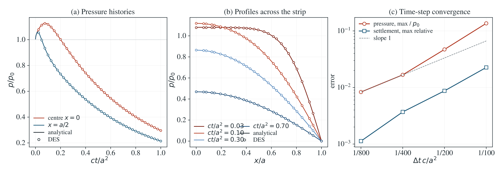

# Mandel consolidation under a rigid plate

Rigid frictionless plates squeeze a drained poroelastic strip. The edges drain first, load shifts to the undrained core, and the centre pressure rises before it decays.

**Largest pressure error: 0.83% of $p_0$, over all nodes and times; largest relative settlement error: 0.11%. Sampled centre peak: DES $1.1257\,p_0$, analytical $1.1265\,p_0$.**

:::info At a glance

| | |
| --- | --- |
| Dimension | 2D |
| Build | `make ndims=2` from the poromechanics source |
| Inputs | [mandel.zip](/downloads/poromechanics/mandel.zip) |
| Reproduce with | DynEarthSol [`3774df0`](https://github.com/GeoFLAC/DynEarthSol/tree/3774df00ba1708a4f70a836d2073f845653aac64) |

:::

## Problem setup



**Load and plates.** Rigid, frictionless, impermeable plates squeeze the strip $-a<x<a$ with a total force $2F$ per unit length, applied at $t=0^+$. DES models the top plate with a rigid platen: every top node shares one vertical velocity and slides freely.

**Drainage and symmetry.** The faces $x=\pm a$ are drained ($p=0$) and traction-free. One quarter is meshed: symmetry at $x=0$ and at the mid-plane, both sealed.

**What is compared.** Pressure at every node and the uniform plate settlement, against the series solution. At the centre the pressure first rises above its undrained value $p_0$: the Mandel–Cryer effect.

## Input and how to run

Every file this example needs is in [mandel.zip](/downloads/poromechanics/mandel.zip). Run from that folder:

```bash
# Runs the quarter strip (a = b = 1 m) on a 0.05 m mesh for 800 steps over one consolidation time a^2/c (41.8 s) and writes mandel.save.* every 20 steps, with a checkpoint every 10th frame.
dynearthsol2d input.cfg
```

### Settings that define this example

| Setting | Value | What it does here |
| --- | --- | --- |
| `control.has_hydraulic_diffusion` | `true` | turns on Darcy flow, so water drains out through the side x = a |
| `control.has_PT` | `true` | solves the mechanics to equilibrium at every step with PT, so the sudden plate load is carried without elastic waves |
| `control.gravity` | `0` | no gravity: only the plate load creates pressure |
| `control.fixed_dt` | `0.05230623694810197` | physical time step, 1/800 of the consolidation time a^2/c |
| `sim.max_steps` | `800` | 800 steps; this, not max_time_in_yr, ends the run |
| `sim.output_step_interval` | `20` | writes a frame every 20 steps |
| `bc.vbc_x1` | `0` | type 0: the drained side x = a is free to move (traction-free) |
| `bc.vbc_z0` | `1` | fixes vertical motion on the bottom edge, the mid-plane of the strip (symmetry) |
| `bc.vbc_z1` | `8` | type 8: rigid frictionless platen; all top nodes share one vertical velocity and slide freely sideways |
| `bc.stress_bc_z1` | `3` | type 3: the platen is pushed by a vertical traction |
| `bc.stress_val_z1` | `-100000.0` | the plate pressure; negative is compression (100 kPa, total force F = Pa) |
| `bc.hbc_x1` | `2` | type 2: the side x = a is drained, pore pressure held at its hbc_pressure entry (0 Pa); the other sides stay sealed |
| `mat.bulk_modulus` | `[10000000.0]` | drained bulk modulus K (with G it sets the Poisson ratio and p0) |
| `mat.hydraulic_perm` | `[1.03e-12]` | intrinsic permeability; with storage and stiffness it sets the consolidation coefficient c |

[input.cfg](/downloads/poromechanics/mandel/input.cfg) holds all 46 settings that differ from DES’s defaults; `dynearthsol2d -h` lists every option with its default.

## Output

DES writes `mandel.info` (one line per saved frame: frame, step, time in seconds), `mandel.save.NNNNNN` (the fields of each saved frame) and `mandel.chkpt.NNNNNN` (checkpoints to restart from). `sim.output_step_interval` and `sim.output_time_interval_in_yr` set how often a frame is saved.

Set `DES_SOURCE` and `PYTHONPATH` as described in [Running the examples](../running.md) before using the Python reader or converter.

| Field | What to look at |
| --- | --- |
| `pore pressure` | nodal pressure; centre and x = a/2 histories in panel (a), profiles across the strip in panel (b), and the error at every node in panel (c) |
| `strain` | element strain; the vertical component averaged over the quarter gives the plate settlement, whose error is in panel (c) |
| `velocity` | nodal velocity; the vertical velocity of the top row should be the same at every node under the rigid platen |

Read a frame in Python:

```python
from Dynearthsol import Dynearthsol      # in the DES source folder
model = Dynearthsol('mandel')
frame = model.frames[-1]                 # model.time[i] is the time of frame i, in seconds
x = model.read_field(frame, 'coordinate')
value = model.read_field(frame, 'pore pressure')
```

View it in ParaView after `python3 "$DES_SOURCE/2vtk.py" mandel`.

## Result: DES and the analytical solution



(a) Pressure history at the centre x = 0 and at x = a/2, scaled by the undrained pressure p0, against ct/a^2: lines are the series solution, symbols are DES; the dotted line marks p/p0 = 1, which the centre pressure first exceeds. (b) Pressure profiles across the strip at four times. (c) Largest pressure error (over all nodes and times, divided by p0) and largest relative settlement error against the time step, on log axes, with a slope-1 guide.

This checks two-way poroelastic coupling under a sudden load, the non-monotonic Mandel–Cryer pressure and the rigid-platen boundary. It does not test large strain or plasticity.

To reproduce the whole study behind this figure, from the DES source folder:

```bash
python3 tests/functional/hydromechanics/check_mandel.py dynearthsol2d OUT/mandel-h --spacings 0.1 0.05 0.025 --steps 200
python3 tests/functional/hydromechanics/check_mandel.py dynearthsol2d OUT/mandel-t100 --spacings 0.05 --steps 100
python3 tests/functional/hydromechanics/check_mandel.py dynearthsol2d OUT/mandel-t400 --spacings 0.05 --steps 400
python3 tests/functional/hydromechanics/check_mandel.py dynearthsol2d OUT/mandel-t800 --spacings 0.05 --steps 800
```

The study’s full numbers: [record.json](/downloads/poromechanics/mandel/record.json).

## Analytical reference

$$
\tan\alpha_n=\frac{1-\nu}{\nu_u-\nu}\alpha_n,\quad A_n=\frac{\sin\alpha_n}{\alpha_n-\sin\alpha_n\cos\alpha_n}
$$

$$
p_0=\frac{FB(1+\nu_u)}{3a},\quad E_n(t)=e^{-\alpha_n^2ct/a^2}
$$

$$
p(x,t)=2p_0\sum_{n=1}^\infty A_n[\cos(\alpha_nx/a)-\cos\alpha_n]E_n(t)
$$

$$
\frac{u_z(b,t)}{b}=-\frac{F(1-\nu)}{2Ga}+\frac{F(1-\nu_u)}{Ga}\sum_{n=1}^\infty A_n\cos\alpha_n E_n(t)
$$

$$
c=\frac{\kappa}{\mu[S_0+\alpha^2/(K+4G/3)]},\quad S_0=\phi/K_f+(\alpha-\phi)/K_s
$$

$$
B=\alpha M/K_u,\quad K_u=K+\alpha^2M,\quad M=1/S_0
$$

$$
\nu=\frac{3K-2G}{2(3K+G)},\quad\nu_u=\frac{3K_u-2G}{2(3K_u+G)}
$$

Here $a$ and $b$ are the half width and half height, $\nu$ and $\nu_u$ the drained and undrained Poisson ratios, $G$ the shear modulus, $\kappa$ the intrinsic permeability and $\mu$ the viscosity. The undrained pressure is $p_0=FB(1+\nu_u)/(3a)$. The runs use $a=b=1$ m, $F=Pa$ with $P=10^5$ Pa, $K=G=10^7$ Pa, $\phi=0.3$, $\alpha=1$, $K_f=2.17$ GPa, $K_s=37$ GPa and $\kappa=1.03\times10^{-12}\ \mathrm{m^2}$, so $c=0.0239\ \mathrm{m^2/s}$ and $a^2/c=41.8$ s.

### Derivation

A rigid frictionless plate makes $\varepsilon_{zz}(t)$ uniform; $\sigma_{xx}=0$ at the drained faces and equilibrium make $\sigma_{xx}=0$ everywhere, so the problem is one-dimensional in $x$. The fluid balance then contains the unknown plate strain rate, and the plate force fixes it through the integral of $\sigma_{zz}$ over the width.

$$
\int_0^a\sigma_{zz}\,dx=-F
$$

Separation of variables with the drained condition $p(a,t)=0$ and this integral constraint gives the roots $\alpha_n$ and the series above; the initial undrained state fixes the coefficients. The same series gives the plate settlement.

Mandel (1953); Abousleiman et al. (1996), Mandel’s problem revisited. Evaluated independently in mandel_reference.py with the same material values.

[Original reference](https://doi.org/10.1680/geot.1996.46.2.187).

## Validity and limits

Plane strain, small strain, linear isotropic poroelasticity with constant properties; ideal rigid frictionless plates. DES couples pressure and mechanics sequentially; the early-time error is the one-step lag of that split and falls with the time step. No gravity.

## Reproduction

[Commands, solver hashes and portable inputs](../running.md).
