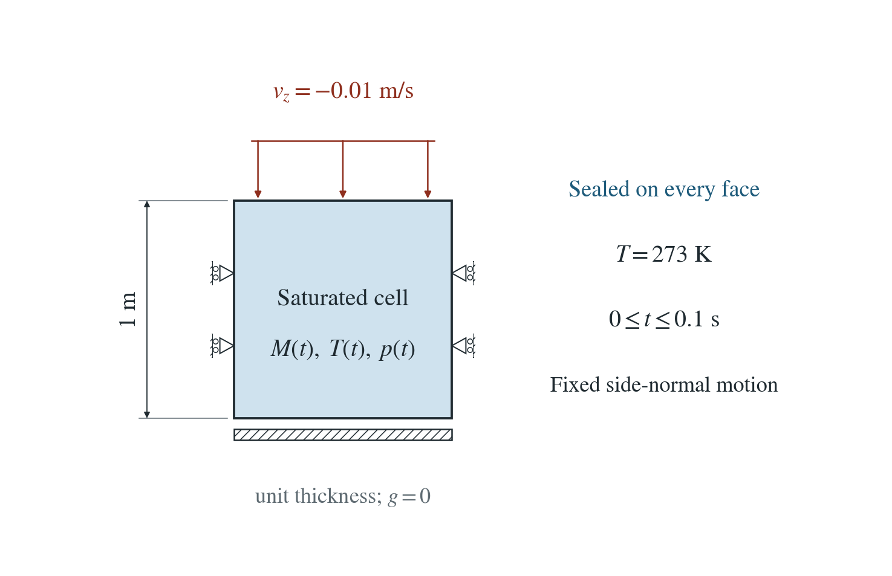
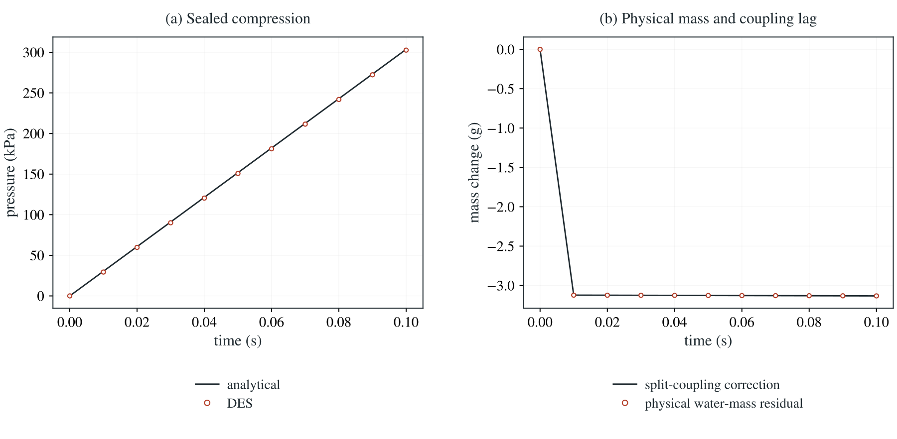

[All problems](../index.md)

# Finite-density water in a sealed cell

:::info At a glance

| | |
| --- | --- |
| Dimension | 2D |
| Inputs | [mass.zip](/downloads/poromechanics/mass.zip) |
| Reproduce with | DynEarthSol [`3774df0`](https://github.com/GeoFLAC/DynEarthSol/tree/3774df00ba1708a4f70a836d2073f845653aac64) |

:::


A sealed saturated cell is compressed at a prescribed rate. The fluid EOS and evolving Biot porosity give an independent pressure and physical water inventory.

**The finest step gives 0.319% pressure error. Halving the step halves both the pressure error and physical mass defect; the separate mass-plus-buffer budget closes within 2 micrograms.**

## Problem setup



**Motion.** Unit cell with fixed side-normal motion and base. The top shortens at 0.01 m/s for 0.1 s; the mesh stays fixed and the inventory uses the implied bulk volume.

**Water and temperature.** Every face is sealed, initial pressure is zero, and temperature stays at 273 K. Gravity is zero.

**Material.** Saturated elasticity with evolving Eulerian Biot porosity and a constant-compressibility fluid EOS; no plasticity or recovery in this selected control.

## Input and how to run

Every file this example needs is in [data/mass/](/downloads/poromechanics/mass/input.cfg). Run from that folder:

```bash
# Compresses the sealed unit cell for 0.1 s in 4,000 steps and saves its pressure, physical water inventory and numerical buffer.
dynearthsol2d input.cfg
```

### Settings that define this example

| Setting | Value | What it does here |
| --- | --- | --- |
| `control.hydraulic_content_model` | `1` | selects the finite-density saturated inventory law |
| `mat.porosity_model` | `1` | evolves Eulerian Biot porosity from the accepted strain and pressure |
| `control.fixed_dt` | `2.5e-05` | physical coupling interval; transport can subcycle within it |
| `mat.fluid_bulk_modulus` | `[1e8]` | constant fluid compressibility in the exponential density law |
| `mat.bulk_modulus_s` | `[1e9]` | grain compressibility in the porosity law |
| `mat.fluid_alpha` | `[.0002]` | volumetric fluid thermal expansivity |
| `sim.output_step_interval` | `400` | saved-frame interval; ledger entries belong to individual physical steps |

[input.cfg](/downloads/poromechanics/mass/input.cfg) holds all 68 settings that differ from DES’s defaults; `dynearthsol2d -h` lists every option with its default.

## Output

DES writes `column.info` (one line per saved frame: frame, step, time in seconds), `column.save.NNNNNN` (the fields of each saved frame) and `column.chkpt.NNNNNN` (checkpoints to restart from). `sim.output_step_interval` and `sim.output_time_interval_in_yr` set how often a frame is saved.

Set `DES_SOURCE` and `PYTHONPATH` as described in [Running the examples](../running.md) before using the Python reader or converter.

| Field | What to look at |
| --- | --- |
| `pore pressure` | physical nodal pressure in Pa |
| `fluid mass` | retained physical nodal water mass in kg |
| `hydraulic split buffer` | numerical fixed-stress mass increment, excluded from density and heat |
| `solid heat capacity` | material heat-capacity inventory, unchanged by fluid drainage |
| `temperature` | temperature in K |
| `fluid mass balance` | physical and numerical mass changes, measured boundary/source exchange and residual |

Read a frame in Python:

```python
from Dynearthsol import Dynearthsol      # in the DES source folder
model = Dynearthsol('column')
frame = model.frames[-1]                 # model.time[i] is the time of frame i, in seconds
x = model.read_field(frame, 'coordinate')
value = model.read_field(frame, 'pore pressure')
```

View it in ParaView after `python3 "$DES_SOURCE/2vtk.py" column`.

## Result: DES and the analytical solution



2D unit cell, 0.01/s logarithmic compression to 0.1 s, 4,000 physical steps. (a) DES and the implicit sealed-cell solution; (b) physical water-mass residual and the split-coupling correction. The temporal table retains 1,000 and 2,000 steps.

The stabilised split conserves M+R. R is a numerical lag, contributes no density or heat capacity, and must not be described as physical water. Native/HDF5, 3D, restart, remap, source and transport controls are supporting evidence.

[History CSV](/downloads/poromechanics/mass/history.csv) · [Temporal convergence](/downloads/poromechanics/mass/summary.json)

To reproduce the whole study behind this figure, from the DES source folder:

```bash
python3 tests/functional/hydromechanics/check_mass.py dynearthsol2d OUT --cases mass lag
```

The study’s full numbers: [record.json](/downloads/poromechanics/mass/record.json).

## Analytical reference

$$
\theta=T-T_0
$$

$$
V=V_0e^{\varepsilon_v}
$$

$$
\rho=\rho_0e^{p/K_f-\alpha_f\theta}
$$

$$
\phi=\alpha-(\alpha-\phi_0)e^{-\varepsilon_v-p/K_s+\alpha_s\theta+h}
$$

$$
M=V\rho\phi
$$

$$
M(p_*,T,\varepsilon_v)=M_0
$$

$$
L_n=\rho_nV_n\alpha^2/B
$$

$$
R_n=L_n(p_{n+1}-p_n)
$$

$$
M_{n+1}+R_n=M_n+R_{n-1}
$$

$$
B_{2D}=K+G/3
$$

$$
B_{3D}=K
$$

$\varepsilon_v$ is the tension-positive bulk strain interpreted as log volume in the inventory law; $h$ is recovered pore dilation (zero here). $\alpha=0.98$, $\phi_0=0.25$, $K_f=100$ MPa, $K_s=1$ GPa, $K=20$ MPa, $G=10$ MPa and $M_0=250$ kg per metre thickness. $R$ is an extensive numerical buffer, never physical mass.

### Derivation

Integrating constant fluid compressibility and expansivity gives the density law. Integrating the Eulerian porosity rate gives the displayed porosity. The sealed continuum reference is the monotone scalar root M=M0, evaluated independently in mass_reference.py.

When fluid and grain moduli are equal, the implicit pressure has a closed form. The unequal-modulus reference shown here uses a bracketed root instead.

$$
p_*=K_f\left\{\ln\frac{\phi_0e^{\alpha_f\theta}+(\alpha-\phi_0)e^{\alpha_s\theta+h}}{\alpha}-\varepsilon_v\right\}
$$

The fixed-stress pressure stabilizer leaves a separately recorded numerical mass increment. With sealed walls, physical M differs from M0 by minus R. Refining the physical timestep reduces this defect at first order; an exact M+R ledger alone does not establish exact physical mass conservation.

Direct EOS and porosity integration; independent scalar root and step-refinement controls in mass_reference.py and check_mass.py.

## Validity and limits

Selected homogeneous isothermal prescribed-motion cell. The broader suite checks remapping and accepted-path spatial transport, but this figure does not establish finite-strain constitutive accuracy, unsaturated finite-density flow, buoyant hydrostatic balance or a full thermal energy equation.
