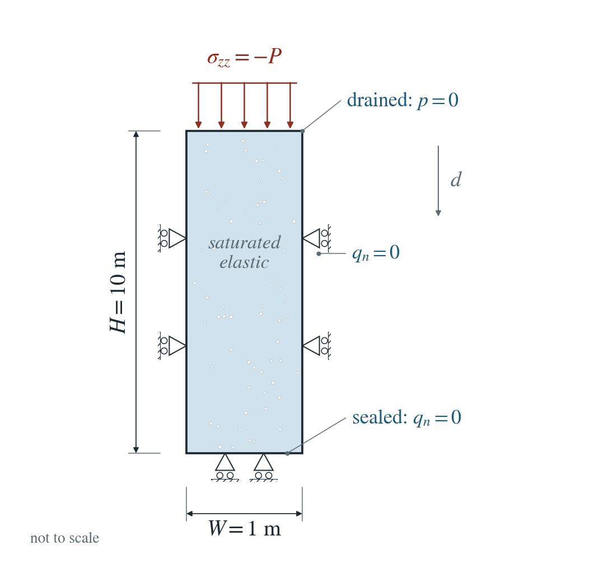
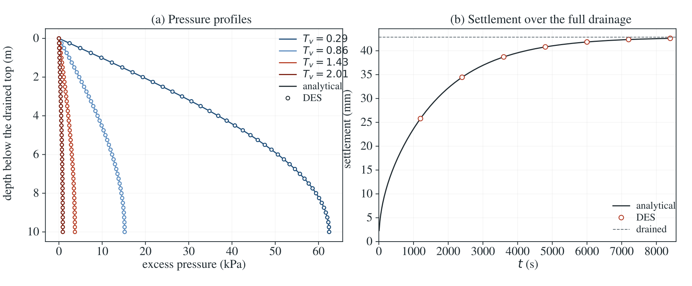

# Terzaghi consolidation of a column

A sudden load compresses a saturated column. Water drains through the top, the pressure falls and the column settles.

**Largest pressure error: 0.011% of the applied load; largest settlement error: 0.007% of the final drained settlement.**

:::info At a glance

| | |
| --- | --- |
| Dimension | 2D |
| Build | `make ndims=2` from the poromechanics source |
| Inputs | [terzaghi.zip](/downloads/poromechanics/terzaghi.zip) |
| Checked with | DynEarthSol `97f9794` (poromechanics branch) |

:::

## Problem setup



**Load and drainage.** At $t=0^+$ a compression $P=100$ kPa is applied; the top is drained, $p=0$.

**Constraints.** Sides: zero normal displacement and zero normal water flux. Base: vertical displacement fixed, water flux zero.

**Initial state and comparison.** Initially unloaded. The reference starts just after the instantaneous undrained load. Compare pressure and downward top settlement.

## Input and how to run

Every file this example needs is in [terzaghi.zip](/downloads/poromechanics/terzaghi.zip). Run from that folder:

```bash
# Runs the 10 m column on a 0.25 m mesh for 33600 steps of 0.25 s (8400 s, about 99% consolidated) and writes terzaghi.save.000000 to terzaghi.save.000007, one frame every 1200 s; frame 0 is the state before the load.
dynearthsol2d input.cfg
```

### Settings that define this example

| Setting | Value | What it does here |
| --- | --- | --- |
| `control.has_hydraulic_diffusion` | `true` | turns on Darcy flow, so the excess pressure drains out through the top |
| `control.has_PT` | `true` | solves the mechanics to equilibrium at every step with PT, so the sudden load is carried without elastic waves |
| `control.has_moving_mesh` | `false` | keeps the mesh fixed (small strain); settlement is computed from the vertical strain, not from moved nodes |
| `control.gravity` | `0` | no gravity: only the applied load creates pressure |
| `control.fixed_dt` | `0.25` | physical time step |
| `sim.max_steps` | `33600` | number of steps; with fixed_dt it sets the 8400 s simulated |
| `sim.output_step_interval` | `4800` | writes a frame every 4800 steps (1200 s) |
| `bc.hbc_z1` | `1` | type 1: the top is drained, pore pressure held at its initial value (0) |
| `bc.stress_bc_z1` | `3` | type 3: a vertical traction is applied on the top |
| `bc.stress_val_z1` | `-1e5` | the top load; negative is compression (100 kPa) |
| `bc.vbc_z0` | `1` | fixes vertical motion of the base |
| `mat.bulk_modulus` | `[1e7]` | drained bulk modulus K of the skeleton |
| `mat.shear_modulus` | `[1e7]` | shear modulus G; with K it sets the constrained modulus K + 4G/3 |
| `mat.hydraulic_perm` | `[1.03e-12]` | intrinsic permeability; with viscosity and storage it sets the consolidation coefficient c_v |

[input.cfg](/downloads/poromechanics/terzaghi/input.cfg) holds all 39 settings that differ from DES’s defaults; `dynearthsol2d -h` lists every option with its default.

## Output

DES writes `terzaghi.info` (one line per saved frame: frame, step, time in seconds), `terzaghi.save.NNNNNN` (the fields of each saved frame) and `terzaghi.chkpt.NNNNNN` (checkpoints to restart from). `sim.output_step_interval` and `sim.output_time_interval_in_yr` set how often a frame is saved.

Set `DES_SOURCE` and `PYTHONPATH` as described in [Running the examples](../running.md) before using the Python reader or converter.

| Field | What to look at |
| --- | --- |
| `pore pressure` | nodal pressure; profiles against depth below the drained top are compared with the series in panel (a) |
| `strain` | element strain; the vertical component integrated over the column gives the top settlement in panel (b) |

Read a frame in Python:

```python
from Dynearthsol import Dynearthsol      # in the DES source folder
model = Dynearthsol('terzaghi')
frame = model.frames[-1]                 # model.time[i] is the time of frame i, in seconds
x = model.read_field(frame, 'coordinate')
value = model.read_field(frame, 'pore pressure')
```

View it in ParaView after `python3 "$DES_SOURCE/2vtk.py" terzaghi`.

## Result: DES and the analytical solution



(a) Pressure profiles against depth below the drained top at several dimensionless times T_v: lines are the series solution, symbols are DES. (b) Settlement of the top against time over the full drainage: the line is the series solution, symbols are DES, and the dashed line is the final drained settlement.

This checks fluid storage and elastic coupling together, through both pressure and settlement. It does not test a sudden load with GVS or large strain.

Partial unloading and material regimes

To reproduce the whole study behind this figure, from the DES source folder:

```bash
python3 benchmarks/poromechanics/consolidation_refinement.py --output OUT/history-2d --dimensions 2 --spacings 1 0.5 0.25 --timesteps 1 0.5 0.25 --spatial-dt 0.25 --temporal-spacing 0.5 --duration 8400 --sample-interval 1200 --timeout 30000
python3 benchmarks/poromechanics/consolidation_refinement.py --output OUT/sanity-3d --dimensions 3 --spacings 1 0.5 0.25 --timesteps 1 0.5 0.25 --spatial-dt 0.25 --temporal-spacing 1 --duration 8400 --sample-interval 1200 --timeout 30000
```

The study’s full numbers: [record.json](/downloads/poromechanics/terzaghi/record.json).

## Analytical reference

$$
S_0=\phi/K_f+(\alpha-\phi)/K_s,\quad H_c=K+4G/3,\quad S_c=S_0+\alpha^2/H_c
$$

$$
c_v=\kappa/(\mu S_c),\quad k_m=(2m+1)\pi/(2H),\quad p_0=\alpha P/(H_cS_c)
$$

$$
p(d,t)=p_0\sum_{m=0}^{\infty}\frac{4\sin(k_md)}{(2m+1)\pi}\exp(-c_vk_m^2t)
$$

$$
\delta(t)=\frac{PH}{H_c}-\frac{\alpha Hp_0}{H_c}\sum_{m=0}^{\infty}\frac{8\exp(-c_vk_m^2t)}{[(2m+1)\pi]^2}
$$

Depth $d$ runs downward from the drained top ($0$) to the base ($H$). $P$ is positive compression and $\delta$ positive downward settlement; $\kappa$ is intrinsic permeability, $\mu$ viscosity, $\phi$ porosity, and $\alpha$ the Biot coefficient. $K$, $G$, $K_f$ and $K_s$ are the drained bulk, shear, fluid and grain moduli.

### Derivation

Equilibrium makes the total vertical stress uniform: $\sigma_{zz}=-P$. With tension-positive strain, $H_c\varepsilon_{zz}-\alpha p=-P$. Substitute this strain into the fluid content $\zeta=\alpha\varepsilon_{zz}+S_0p$.

$$
\zeta=-\alpha P/H_c+S_cp
$$

$$
S_cp_t=(\kappa/\mu)p_{dd}
$$

Zero fluid-content change during the instantaneous load gives $p_0$. Thereafter $p(0,t)=0$ and $\partial_dp(H,t)=0$. The mixed-boundary eigenfunctions are $\sin(k_md)$; expanding the uniform initial pressure gives the coefficients above. Integrating compressive strain gives the settlement, including its instantaneous undrained part.

$$
\delta(t)=-\int_0^H\epsilon_{zz}\,dd=PH/H_c-(\alpha/H_c)\int_0^Hp(d,t)\,dd
$$

The series and settlement follow directly from the stated one-dimensional Biot initial/boundary problem; evaluated in terzaghi_reference.py.

## Validity and limits

Small-strain, homogeneous, saturated, laterally confined elasticity; constant properties, no gravity or heating. Frame 0 is written before the load is applied and is not compared. This example uses the PT solver; a sudden load with GVS is not tested here.

## Reproduction

[Commands, solver hashes and portable inputs](../running.md).
