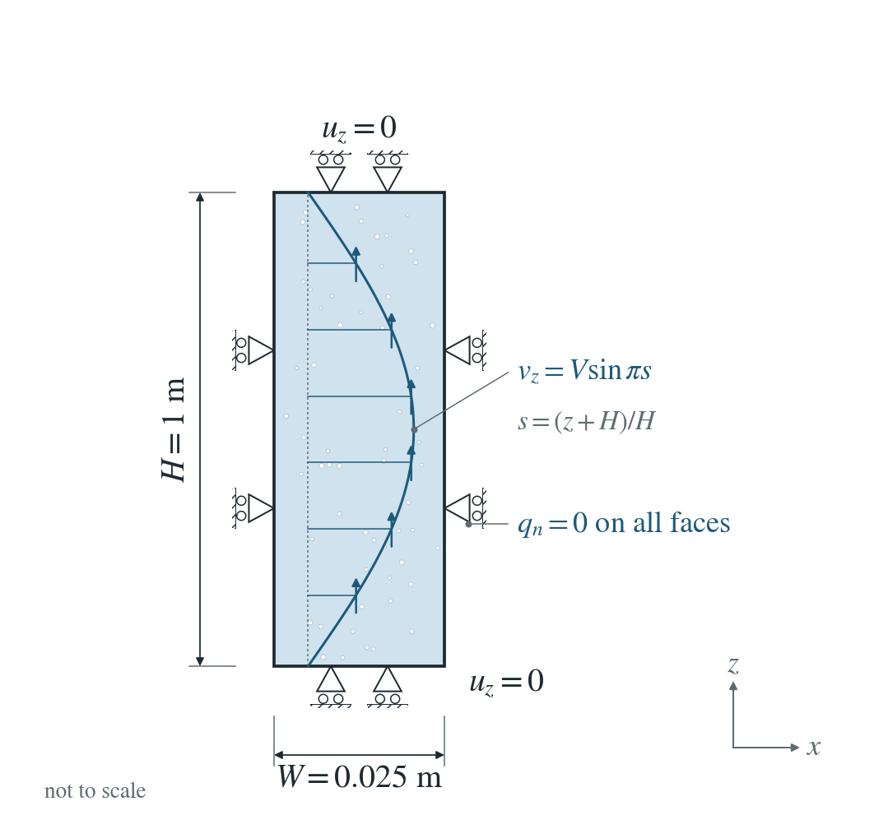
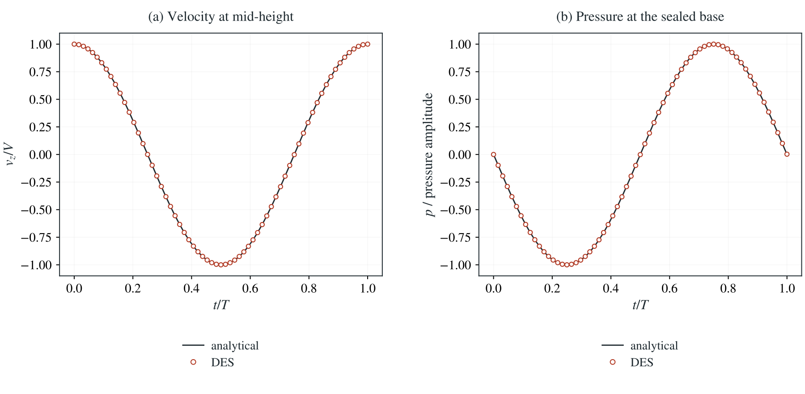

# Undrained wave in a sealed column

A small initial velocity sets a sealed saturated column oscillating; compression raises the pressure and expansion lowers it.

**Largest velocity error: 0.171% and largest pressure error: 0.262% of their amplitudes, over all nodes and 65 saved times.**

:::info At a glance

| | |
| --- | --- |
| Dimension | 3D |
| Build | `make ndims=3` from the poromechanics source |
| Inputs | [wave.zip](/downloads/poromechanics/wave.zip) |
| Reproduce with | DynEarthSol [`3774df0`](https://github.com/GeoFLAC/DynEarthSol/tree/3774df00ba1708a4f70a836d2073f845653aac64) |

:::

## Problem setup



**Water and displacement boundaries.** All water boundaries sealed; κ = 0 throughout. End vertical displacement and side-normal displacement fixed.

**Initial disturbance.** $v_z(z,0)=V\sin[\pi(z+H)/H]$, $V=10^{-6}$ m/s. Initially zero pressure, stress and strain.

**Physical regime and comparison.** Physical mixture density; no gravity, damping, heating, PT or GVS. Compare velocity and pressure over one period.

## Input and how to run

Every file this example needs is in [wave.zip](/downloads/poromechanics/wave.zip). Run from that folder:

```bash
# 3D. Restarts from the shipped checkpoint seed, frame 0: the column mesh with zero stress, strain and pressure and the initial sine velocity (listed in initial-velocity.csv). Runs 8192 explicit steps, one wave period, saving every 128th step as wave.* and writing a checkpoint at every saved frame.
dynearthsol3d input.cfg
```

### Settings that define this example

| Setting | Value | What it does here |
| --- | --- | --- |
| `sim.is_restarting` | `true` | starts from the seed checkpoint, which holds the initial velocity; an input file cannot set an initial velocity, so undrained_wave.py writes it into the seed frame |
| `sim.restarting_from_modelname` | `seed` | the checkpoint to start from: seed (shipped) |
| `control.is_quasi_static` | `false` | dynamic run with physical (unscaled) mass, so inertial_scaling has no effect |
| `control.damping_option` | `0` | no damping: the wave keeps its amplitude |
| `control.fixed_dt` | `1.4182426918901539e-07` | one wave period divided by 8192 |
| `sim.max_steps` | `8192` | 8192 steps: exactly one period |
| `sim.output_step_interval` | `128` | a frame every 128 steps: 65 saved times over the period |
| `mat.hydraulic_perm` | `[0]` | zero permeability: no flow, so each point stays undrained |
| `control.has_hydraulic_diffusion` | `true` | solves the pore-pressure equation; with zero permeability the pressure follows the volume change only |
| `bc.vbc_z0` | `1` | with vbc_z1: the ends cannot move vertically; vbc_y0, vbc_y1 and the default vbc_x0, vbc_x1 fix the side-normal motion |
| `control.gravity` | `0` | no gravity: the column is unstressed apart from the wave |
| `mesh.meshing_elem_shape` | `1` | regular structured mesh of the 0.025 × 0.025 × 1 m column |
| `mat.bulk_modulus` | `[10000000.0]` | with shear_modulus, porosity and the fluid and grain moduli, sets the undrained modulus and the wave speed |
| `control.has_moving_mesh` | `false` | fixed geometry: small-strain wave |

[input.cfg](/downloads/poromechanics/wave/input.cfg) holds all 50 settings that differ from DES’s defaults; `dynearthsol3d -h` lists every option with its default.

## Output

See [Running the examples](../running.md) for output files, the Python reader and ParaView conversion.

| Field | What to look at |
| --- | --- |
| `velocity` | vertical component at the node nearest mid-height, normalized by the initial amplitude V, in (a); maximum error over all nodes in the result |
| `pore pressure` | at the base node, normalized by the pressure amplitude, in (b); maximum error over all nodes in the result |
| `strain` | volumetric strain, combined with the pressure to check that the local fluid content stays zero |


## Result: DES and the analytical solution



(a) Vertical velocity at mid-height over one period, normalized by the initial amplitude V: line, eigenmode solution; symbols, DES saved frames. (b) Pore pressure at the sealed base over the same period, normalized by the pressure amplitude.

This checks fluid storage and elastic wave coupling together; local fluid content is conserved to round-off. It does not test a GVS earthquake cycle.


To reproduce the whole study behind this figure, from the DES source folder:

```bash
python3 benchmarks/poromechanics/undrained_wave.py dynearthsol3d OUT --spacing .0125 --steps 1024 2048 4096 8192 --samples 64 --restart-check
python3 benchmarks/poromechanics/undrained_wave.py dynearthsol3d OUT-h005 --spacing .05 --steps 4096 --samples 32
python3 benchmarks/poromechanics/undrained_wave.py dynearthsol3d OUT-h0025 --spacing .025 --steps 4096 --samples 32
```

The study’s full numbers: [record.json](/downloads/poromechanics/wave/record.json).

## Analytical reference

$$
S_0=\phi/K_f+(\alpha-\phi)/K_s,\quad H_u=K+4G/3+\alpha^2/S_0,\quad \rho_b=(1-\phi)\rho_s+\phi\rho_f
$$

$$
c_u=\sqrt{H_u/\rho_b},\quad k=\pi/H,\quad \omega=kc_u,\quad T=2H/c_u
$$

$$
v_z=V\sin[k(z+H)]\cos(\omega t),\quad \epsilon_{zz}=(V/c_u)\cos[k(z+H)]\sin(\omega t)
$$

$$
p=-\frac{\alpha V}{S_0c_u}\cos[k(z+H)]\sin(\omega t),\quad \sigma_{zz}=H_u\epsilon_{zz}
$$

$z$ is the DES coordinate, $-H$ at the base and $0$ at the top. $V$ is the initial velocity amplitude, $\rho_b$ physical mixture density, $H_u$ the undrained constrained modulus and $T$ the wave period. The selected material gives $T\simeq1.162\ \mathrm{ms}$.

### Derivation

Sealed local fluid content remains zero because it starts at zero. Eliminate pressure from the uniaxial effective-stress relation, giving an undrained modulus in the momentum equation.

$$
\zeta=\alpha\epsilon_{zz}+S_0p=0,\quad \sigma_{zz}=H_u\epsilon_{zz},\quad \rho_b u_{tt}=H_u u_{zz}
$$

The fundamental sine mode vanishes at both fixed ends. Choose its amplitude to match the initial velocity V and differentiate displacement for strain; the zero-content relation then gives pressure.

$$
u_z=(V/\omega)\sin[k(z+H)]\sin(\omega t)
$$

Direct eigenmode solution of the stated sealed one-dimensional Biot wave problem; evaluated in undrained_wave.py.

## Switching from explicit/GVS to physical inertia

A separate restart control switches a nonzero coupled state after 32
accepted steps. The unit column has a fixed base, side-normal rollers,
sealed water boundaries and a constant −1 kPa top traction. Internal Darcy
flow remains active. Ordinary explicit and both GVS ceilings are checked
at scalings $10^4$, $10^5$ and $10^6$, in 2D/3D native and HDF5 output.
Both phases use strain-driven pressure ordering; this does not convert a
nonzero PT pending-pressure history.

The physical phase sets `is_quasi_static=false`,
`use_global_velocity_scaling=false` and the neutral
`mass_scaling_reference_speed=shear`. The independent mixture density
is 2237.5 kg/m³. Minimum-simplex-altitude and undrained-wave calculations
predict first physical intervals of 42.8985 µs (2D) and 35.0265 µs (3D).
Every free velocity component checks the mass actually used:

$$
v_{i,n+1}-v_{i,n}=\frac{\Delta t}{\rho_bV_i}F_{i,n+1}.
$$

Across the recorded 36 cases, the largest relative identity error is
$4.23\times10^{-16}$. Stress, strain, pressure and velocity are preserved
at the switch; the reselected mass and timestep change deliberately.
The closed Biot-content residual is at most $2.27\times10^{-16}$ of its
stored/deformation scale. A further physical restart preserves the
continuation fields exactly.

At unchanged velocity, physical kinetic energy is continuous. Report the
change in artificial kinetic energy separately:

$$
\Delta K_{\rm num}=\frac12\sum_i
(m_{i,\rm physical}-m_{i,\rm artificial})|v_i|^2.
$$

The switch neither rescales velocity nor deposits that numerical energy
change as heat. Full mechanical/thermal work, event-trigger hysteresis,
RSF coseismic paths and complete earthquake-cycle transitions are outside
this control. Reproduce it from the DES checkout with
`python3 tests/functional/check_inertia_switch.py ./dynearthsol2d OUT`;
repeat with the 3D executable and a separate output folder.

## Validity and limits

The standing-wave comparison uses linear small-strain, homogeneous, completely sealed, zero-permeability elasticity. The input file sets inertial_scaling, but with is_quasi_static = false DES uses the physical (unscaled) mass, so the value has no effect. This wave is a dynamic coupling check and does not establish earthquake-cycle or GVS equilibrium accuracy.
