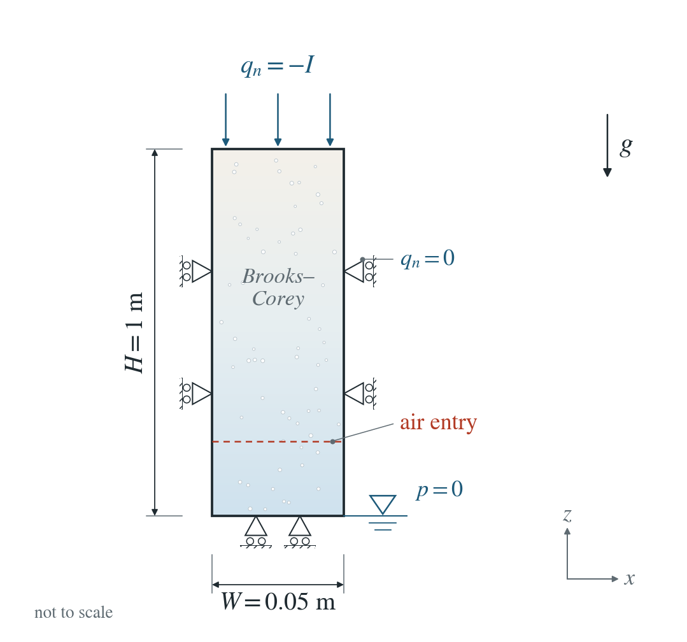
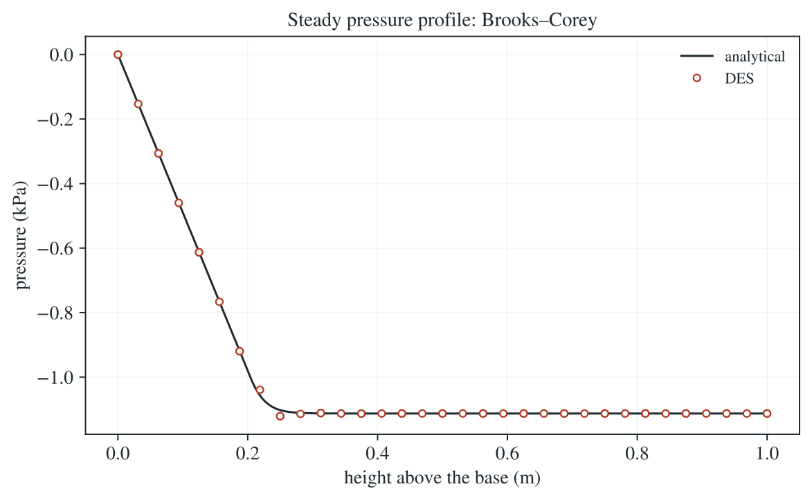

# Steady infiltration: Brooks–Corey law

A constant inflow from the top produces a steady suction profile above a water table at the base. The Brooks–Corey law stays saturated up to its air-entry suction, so the profile has a kink where desaturation begins.

**Largest pressure error: 18.84 Pa, 1.69% of the profile range.**

:::info At a glance

| | |
| --- | --- |
| Dimension | 2D |
| Build | `make ndims=2` from the poromechanics source |
| Inputs | [bc.zip](/downloads/poromechanics/bc.zip) |
| Reproduce with | DynEarthSol [`3774df0`](https://github.com/GeoFLAC/DynEarthSol/tree/3774df00ba1708a4f70a836d2073f845653aac64) |

:::

## Problem setup



**Water boundaries.** Constant downward inflow $I=1.38889\times10^{-6}$ m/s at the top. Base pressure zero; sides sealed.

**Air entry.** Pressure-based $\alpha_p=10^{-3}$ Pa$^{-1}$, $n=1.5$ and $S_r=0.05$. The material stays saturated down to $p=-1/\alpha_p=-1000$ Pa.

**Mechanical conditions and comparison.** Side-normal displacement and base vertical displacement fixed; traction-free top. Start hydrostatic and compare steady pressure, including the air-entry transition.

## Input and how to run

Every file this example needs is in [bc.zip](/downloads/poromechanics/bc.zip). Run from that folder:

```bash
# Runs the 2D column with fixed 300 s steps for about 23 days (2e6 s), long enough to reach the steady profile. DES writes column.save.* at the start, halfway and at the end; the page compares the last frame.
dynearthsol2d input.cfg
```

### Settings that define this example

| Setting | Value | What it does here |
| --- | --- | --- |
| `control.has_hydraulic_diffusion` | `true` | turns on Darcy flow, here partly saturated (Richards) flow |
| `control.has_PT` | `true` | PT solver: mechanical equilibrium is reached by iteration within each step |
| `control.gravity` | `9.81` | gravity drives the downward flow and sets the hydrostatic start |
| `sim.max_time_in_yr` | `0.06337752907015713 yr = 2e+06 s` | about 2e6 s in fixed 300 s steps, long enough for the column to reach steady state |
| `bc.hbc_z0` | `2` | type 2: the base is held at the pressure in bc.hbc_pressure, here 0, the water table |
| `bc.hbc_z1` | `3` | type 3: the top has the prescribed flux in bc.hbc_flux |
| `bc.hbc_flux` | `[0,0,0,0,0,-1.388888888888889e-06]` | outward Darcy flux per face; the top value −1.389e-6 m/s is an inflow of half the saturated conductivity |
| `ic.water_table_z` | `-1.0` | starts hydrostatic with the water table at the base (z = −1 m) |
| `mat.retention_model` | `[2]` | 2: Brooks–Corey retention with Burdine relative permeability |
| `mat.retention_alpha` | `[1e-3]` | α_p = 1e-3 1/Pa: the soil stays saturated down to the air-entry pressure −1/α_p = −1000 Pa |
| `mat.retention_n` | `[1.5]` | Brooks–Corey pore-size index 1.5 |
| `mat.residual_saturation` | `[0.05]` | residual saturation S_r = 0.05 |
| `mat.fluid_bulk_modulus` | `[40000.0]` | deliberately small (4e4 Pa) to allow a larger stable flow step; storage does not affect the steady profile |
| `mat.hydraulic_perm` | `[2.8372409106354064e-13]` | gives saturated conductivity K_s = 2.78e-6 m/s (1 cm/h) |

[input.cfg](/downloads/poromechanics/bc/input.cfg) holds all 54 settings that differ from DES’s defaults; `dynearthsol2d -h` lists every option with its default.

## Output

DES writes `column.info` (one line per saved frame: frame, step, time in seconds), `column.save.NNNNNN` (the fields of each saved frame) and `column.chkpt.NNNNNN` (checkpoints to restart from). `sim.output_step_interval` and `sim.output_time_interval_in_yr` set how often a frame is saved.

Set `DES_SOURCE` and `PYTHONPATH` as described in [Running the examples](../running.md) before using the Python reader or converter.

| Field | What to look at |
| --- | --- |
| `pore pressure` | the steady pressure profile at the last frame, compared with the reference |
| `coordinate` | the height of each node above the base |

Read a frame in Python:

```python
from Dynearthsol import Dynearthsol      # in the DES source folder
model = Dynearthsol('column')
frame = model.frames[-1]                 # model.time[i] is the time of frame i, in seconds
x = model.read_field(frame, 'coordinate')
value = model.read_field(frame, 'pore pressure')
```

View it in ParaView after `python3 "$DES_SOURCE/2vtk.py" column`.

## Result: DES and the analytical solution



Steady pressure (kPa) against height above the water table at the end of the run: DES nodes (circles) and the steady-infiltration reference for the Brooks–Corey law (line). The profile bends where the soil starts to desaturate at the air-entry pressure.

This checks the retention-dependent conductivity and the flux boundary. It does not test transient storage or coupled slope behaviour.

To reproduce the whole study behind this figure, from the DES source folder:

```bash
python3 tests/functional/hydromechanics/check_unsaturated_column.py dynearthsol2d OUT
```

The study’s full numbers: [record.json](/downloads/poromechanics/bc/record.json).

## Analytical reference

$$
s=\max(-p,0),\quad S_e=\min[1,\max(\alpha_p s,1)^{-n}],\quad S=S_r+(1-S_r)S_e
$$

$$
k_r=S_e^{3+2/n}
$$

$$
p_{\rm entry}=-1/\alpha_p
$$

$$
J=I/K_s,\quad \gamma=\rho_fg,\quad \frac{dp}{dz}=\gamma\left(\frac{J}{k_r(p)}-1\right),\quad p(0)=0
$$

$$
z=\frac{1}{\gamma}\int_{p(z)}^0\frac{k_r(\xi)}{k_r(\xi)-J}\,d\xi
$$

Elevation $z$ runs upward from the water-table base. $I$ is positive downward infiltration, $K_s=\kappa\rho_f g/\mu$ saturated hydraulic conductivity and $J=0.5$. In the saturated zone $p=-\gamma(1-J)z$; air entry occurs at $z_{\rm entry}=1/[\alpha_p\gamma(1-J)]\simeq0.204\ \mathrm{m}$.

### Derivation

At steady state $q_z=-I$ is constant. Darcy flow with $z$ upward includes both pressure and gravity. Rearranging and separating variables gives the integral shown above, starting from $p=0$ at $z=0$.

$$
-I=-\frac{\kappa k_r(p)}{\mu}(p_z+\gamma),\quad dz=-\frac{k_r(p)}{\gamma[k_r(p)-J]}\,dp
$$

For $0<J<1$ the pressure decreases with elevation toward the suction at which $k_r=J$. The integral diverges at that limiting pressure. Storage and elastic compressibility do not enter this steady relation. The analytical relation is evaluated with an independent high-accuracy ODE solver; no DES output or fitting parameter is used.

Derived from steady Darcy flow, with the saturated segment treated as part of the same pressure-dependent law; evaluated in unsaturated_reference.py.

## Validity and limits

The steady relation is implicit and its unsaturated part is evaluated numerically, rather than treated as a closed-form profile. This test checks the conductivity and air-entry transition. The fluid modulus is deliberately reduced to shorten the run; it does not alter the steady reference and does not qualify transient storage.

## Reproduction

[Commands, solver hashes and portable inputs](../running.md).
