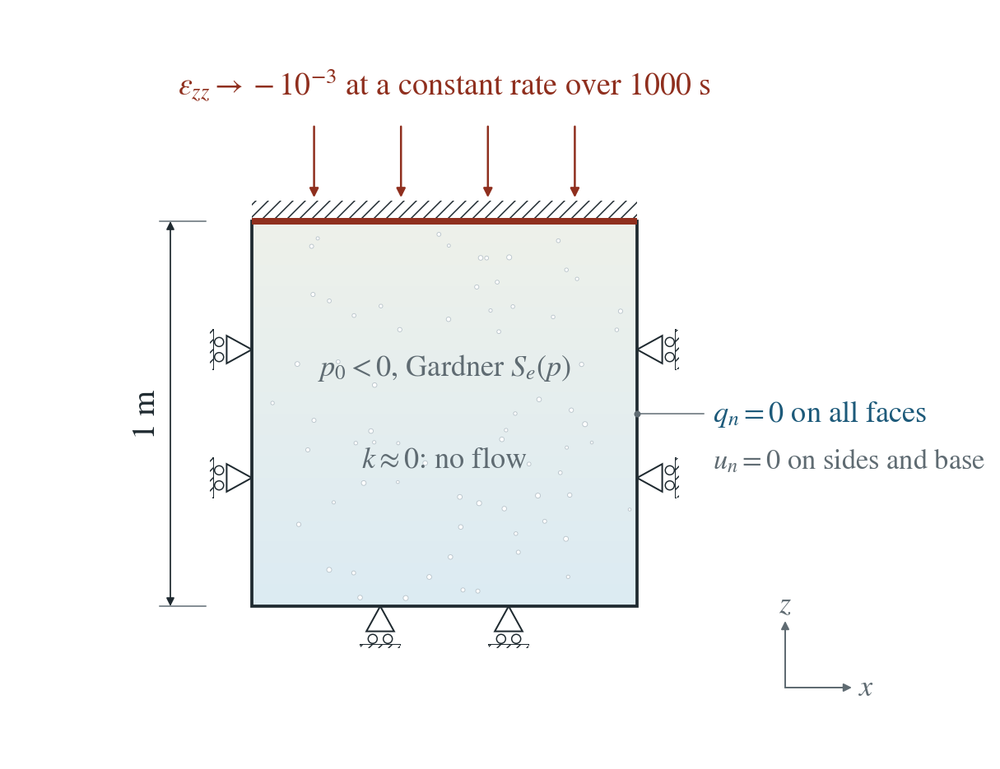
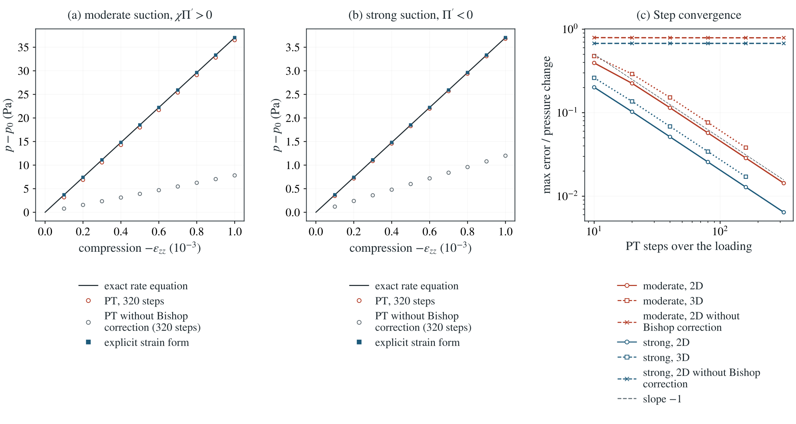

# Bishop coupling in a sealed cell under compression

A sealed, partly saturated soil cell is compressed slowly. Without drainage, the pore pressure follows the strain through the Bishop rate equation. The fixed-stress coupling of the PT solver must recover it as the time step shrinks, including where the Bishop pressure $S_ep$ decreases with suction.

**Largest pressure error at 320 steps: 1.43% (moderate suction) and 0.64% (strong suction) in 2D; the error halves with each halving of the step. Without the Bishop correction of the fixed-stress source the scheme does not converge: the error remains 78.89% and 67.62%.**

:::info At a glance

| | |
| --- | --- |
| Dimension | 2D |
| Build | `make ndims=2` from the poromechanics source |
| Inputs | [bishop-cell.zip](/downloads/poromechanics/bishop-cell.zip) |
| Reproduce with | DynEarthSol [`3774df0`](https://github.com/GeoFLAC/DynEarthSol/tree/3774df00ba1708a4f70a836d2073f845653aac64) |

:::

## Problem setup



**Cell and loading.** A homogeneous block, 1 m high, of partly saturated Gardner soil at uniform suction is compressed uniaxially at a constant rate to a vertical strain of $-10^{-3}$ over 1000 s. All faces are sealed and the permeability is negligible, so no water moves.

**Two states.** Moderate suction, $p_0=-5$ kPa with $\alpha_p=10^{-4}$ Pa$^{-1}$ ($\alpha_ps=0.5$), where $\chi\Pi^\prime>0$; and strong suction, $p_0=-2$ kPa with $\alpha_p=10^{-3}$ Pa$^{-1}$ ($\alpha_ps=2$, strong relative to the retention scale), where the Bishop pressure $\Pi=S_ep$ decreases with suction ($\Pi^\prime<0$). The skeleton is soft, $K=G=10$ kPa, so the stabilising storage is large.

**What is compared.** The mean pore pressure along each run’s own strain path, against the exact solution of the rate equation; PT at 10 to 320 steps and the explicit strain form, in 2D and 3D, and the same scheme without the correction.

## Input and how to run

Every file this example needs is in [bishop-cell.zip](/downloads/poromechanics/bishop-cell.zip). Run from that folder:

```bash
# Runs the moderate-suction cell: 320 PT steps of 3.125 s compress the top by 1 mm over 1000 s. DES writes cell.save.* every 32 steps. For the strong-suction state set ic.pore_pressure_value = -2000 and mat.retention_alpha = [1e-3].
dynearthsol2d input.cfg
```

### Settings that define this example

| Setting | Value | What it does here |
| --- | --- | --- |
| `control.has_PT` | `true` | PT solver with the fixed-stress coupling whose Bishop correction is tested; pressure feedback is on |
| `control.gravity` | `0` | no gravity, so the cell is uniform |
| `control.fixed_dt` | `3.125` | 3.125 s steps: 320 steps over the 1000 s loading |
| `sim.max_steps` | `320` | 320 steps, the finest step count of the study |
| `sim.output_step_interval` | `32` | a frame every 32 steps (100 s) |
| `bc.vbc_z1` | `1` | type 1: the top moves vertically at the velocity bc.vbc_val_z1 |
| `bc.vbc_val_z1` | `-1e-06` | −1e-6 m/s: the top moves down 1 mm in 1000 s, a vertical strain of −1e-3; the other faces are held in their normal direction |
| `ic.pore_pressure_option` | `2` | 2: uniform initial pressure |
| `ic.pore_pressure_value` | `-5000.0` | initial pressure −5000 Pa (5 kPa suction) |
| `mat.retention_model` | `[3]` | 3: Gardner exponential law (retention_alpha 1e-4 1/Pa, the default); Bishop χ = S_e |
| `mat.residual_saturation` | `[0.1]` | residual saturation S_r = 0.1 |
| `mat.hydraulic_perm` | `[1e-30]` | negligible permeability (1e-30 m²): no water moves, so the cell is undrained |
| `mat.bulk_modulus` | `[10000.0]` | soft skeleton, K = 1e4 Pa, so the fixed-stress stabilising storage is large |
| `mat.shear_modulus` | `[10000.0]` | G = 1e4 Pa |

[input.cfg](/downloads/poromechanics/bishop-cell/input.cfg) holds all 53 settings that differ from DES’s defaults; `dynearthsol2d -h` lists every option with its default.

## Output

See [Running the examples](../running.md) for output files, the Python reader and ParaView conversion.

| Field | What to look at |
| --- | --- |
| `pore pressure` | averaged over the cell at each frame and compared with the exact rate equation |
| `strain` | vertical strain averaged over the cell, the path along which the exact equation is integrated |
| `coordinate` | identifies the vertical axis |


## Result: DES and the analytical solution



(a) Moderate and (b) strong suction: change of mean pore pressure p − p_0 against compression −ε_zz. Line: the exact rate equation along the run's own strain path. Circles: PT at the finest step, with the corrected fixed-stress source (coloured) and without the Bishop correction (grey). Squares: the explicit strain form. (c) Maximum error relative to the pressure change against the number of PT steps over the loading, for both states in 2D, in 3D and in 2D without the correction, with a slope −1 guide.

This checks the transient Bishop coupling under PT: the fixed-stress source with its correction $L(\chi E-D)$, built from the increments of the last mechanical step. It does not test flow, which the column pages cover, or large strain.

To reproduce the whole study behind this figure, from the DES source folder:

```bash
python3 tests/functional/hydromechanics/check_bishop_cell.py dynearthsol2d OUT --steps 10 20 40 80 160 320 --explicit
python3 tests/functional/hydromechanics/check_bishop_cell.py dynearthsol3d OUT3D --ndims 3 --steps 10 20 40 80 160
python3 tests/functional/hydromechanics/check_bishop_cell.py dynearthsol2d OUT-restart --restart
```

The study’s full numbers: [record.json](/downloads/poromechanics/bishop-cell/record.json).

## Analytical reference

$$
\left(S_0+\phi(1-S_r)\frac{dS_e}{dp}\right)\dot p=-\alpha\,\chi\,\dot\varepsilon_v
$$

$$
\chi=S_e
$$

$$
\Pi=S_ep
$$

$$
\Pi^\prime=S_e+p\,\frac{dS_e}{dp}
$$

$$
L=\alpha^2/K_b
$$

$$
D=\overline{p-p_{\rm old}}
$$

$$
E=\overline{\Pi(p)-\Pi(p_{\rm old})}
$$

$$
q_{\rm FS}=\frac{\alpha\chi\,\Delta\sigma_m}{K_b\,\Delta t}+\frac{L(\chi E-D)}{\Delta t}
$$

$$
S_0\Delta p+\phi\Delta S=-\alpha\chi\Delta\varepsilon_v+L(D-\Delta p)
$$

$S_0=\phi/K_f+(\alpha-\phi)/K_s$, $K_b$ is the mean-stress modulus of the fixed-stress split, and the overbars are element means of the increments of the last physical step, already applied by the mechanical solve. $q_{\rm FS}$ is the fixed-stress source per unit volume; the mechanical stress change $\Delta\sigma_m$ already contains $-\alpha E$.

### Derivation

Without flow, fluid content changes only by storage, desaturation and the Bishop-weighted skeleton strain, which gives the rate equation above. The fixed-stress source reads the stress change of the last mechanical step, $K_b\Delta\varepsilon-\alpha E$, while the scheme stores $S_0+L$.

$$
(S_0+L)\Delta p+\phi\Delta S=-\alpha\chi\Delta\varepsilon_v+\chi LE\ \mathrm{(uncorrected)}
$$

Adding $L(\chi E-D)$ cancels the Bishop increment inside the stress change and leaves $L(D-\Delta p)$, which vanishes as consecutive increments approach each other. Clipping $\chi\Pi^\prime$ at zero is not used: where $\Pi^\prime<0$ it would converge to a different continuum.

Bishop (1959); Lu, Godt and Wu (2010). The rate equation is integrated with a high-order ODE solver in check_bishop_cell.py; the correction follows the fixed-stress split of Kim, Tchelepi and Juanes (2011) with the Bishop increment.

[Original reference](https://doi.org/10.1016/j.cma.2010.12.022).

## Validity and limits

Sealed and homogeneous, so flow and spatial accuracy are not tested; the column pages cover them. The remaining PT error is the one-step lag $L(D-\Delta p)$, first order in the step and weighted by the soft skeleton’s large $L$. Small strain, linear elasticity, no hysteresis.
