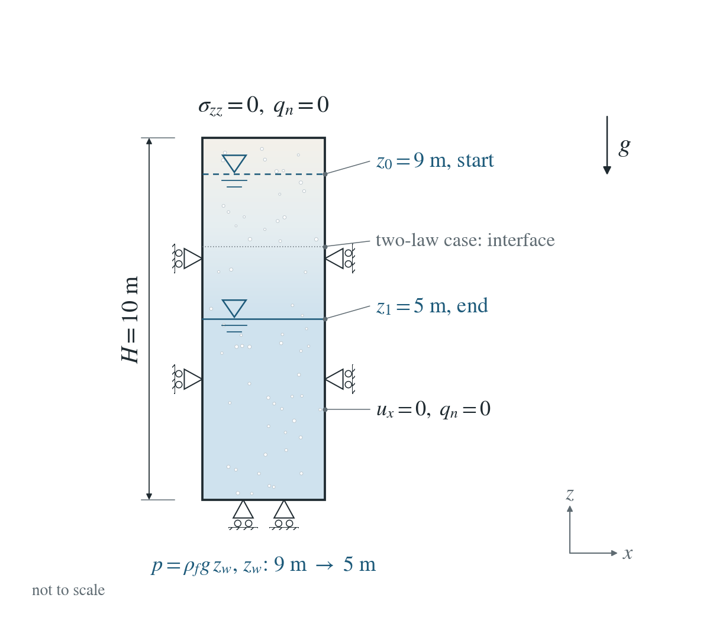
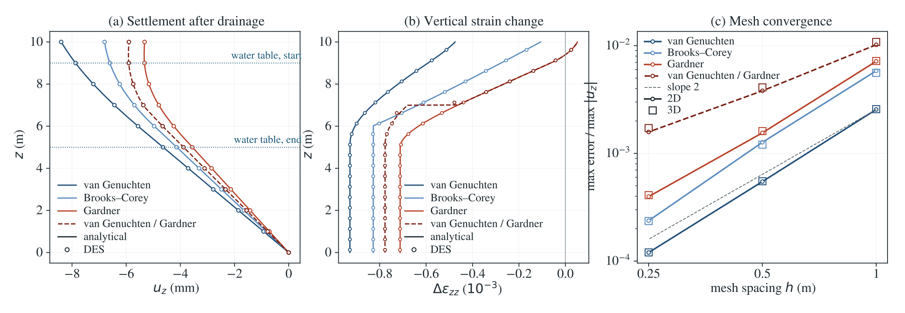

# Bishop effective stress: lowering the water table

The water table under a laterally confined elastic column drops. Above it the soil drains; suction weighted by the effective saturation tightens the skeleton, and the drained soil becomes lighter.

**Largest settlement error on the 0.25 m mesh, relative to the top settlement: 0.040% in 2D and 0.041% in 3D for the van Genuchten, Brooks–Corey and Gardner laws; 0.158% and 0.172% for the column with two laws, where saturation jumps at the shared interface nodes.**

:::info At a glance

| | |
| --- | --- |
| Dimension | 2D |
| Build | `make ndims=2` from the poromechanics source |
| Inputs | [bishop.zip](/downloads/poromechanics/bishop.zip) |
| Reproduce with | DynEarthSol [`3774df0`](https://github.com/GeoFLAC/DynEarthSol/tree/3774df00ba1708a4f70a836d2073f845653aac64) |

:::

## Problem setup



**Column and loading.** A laterally confined elastic column, $0\le z\le H$ with $H=10$ m, starts drained and at rest with a hydrostatic water table at $z_0=9$ m. The base pressure is then lowered to that of a table at $z_1=5$ m; the sealed top and sides let the column drain to the new hydrostatic state.

**Mechanics.** Side-normal and base displacements are fixed; the top is traction-free. Gravity acts on the partly saturated bulk weight. The PT solver keeps mechanical equilibrium, with pressure feedback on.

**What is compared.** The change in vertical displacement between the two drained states, integrated from the element strains, against the exact solution. Three retention laws are run, and a column with van Genuchten below $z=7$ m and Gardner above, so interface nodes are shared by two laws.

## Input and how to run

Every file this example needs is in [bishop.zip](/downloads/poromechanics/bishop.zip). Run from that folder:

```bash
# Runs the 10 m column with the van Genuchten law: 40 steps of 1e4 s. The base pressure is lowered between steps 4 and 5 and the column then drains. DES writes bishop.save.* every 4 steps; the page compares frame 1 (drained start) with the last frame. For the other laws set mat.retention_model to 2 (retention_alpha 1e-4, retention_n 0.8, residual_saturation 0.05) or 3 (retention_alpha 5.097e-5, residual_saturation 0).
dynearthsol2d input.cfg
```

### Settings that define this example

| Setting | Value | What it does here |
| --- | --- | --- |
| `control.has_PT` | `true` | PT solver: mechanical equilibrium is reached by iteration within each step, with pressure feedback on |
| `control.gravity` | `9.81` | gravity acts on the partly saturated bulk weight and sets the hydrostatic water table |
| `control.fixed_dt` | `10000.0` | steps of 1e4 s, long enough for the column to drain to the new state well within the run |
| `sim.output_step_interval` | `4` | a frame every 4 steps; frame 1 is the drained start just before the base pressure drops |
| `bc.hbc_z0` | `2` | type 2: the base pressure is prescribed by bc.hbc_pressure and the schedule; the other faces are sealed |
| `bc.hbc_pressure` | `[0,0,0,0,88290.0,0]` | base pressure 88,290 Pa = ρ_f g × 9 m, a water table 9 m above the base |
| `bc.hbc_schedule_time_in_yr` | `[0, 0.0012675505814031427, 0.0015844382267539284] yr = [0, 40000, 50000] s` | the schedule holds the base pressure until step 4 and changes it by step 5 |
| `bc.hbc_schedule_ratio` | `[1, 1, 0.5555555555555556]` | multipliers 1, 1, 5/9: the base pressure falls to that of a water table at 5 m |
| `ic.water_table_z` | `-1.0` | initial hydrostatic water table 1 m below the top (z = −1 m), i.e. 9 m above the base |
| `mat.bulk_modulus` | `[20000000.0]` | drained bulk modulus K = 2e7 Pa (shear modulus 1e7 Pa) of the elastic skeleton |
| `mat.biot_coeff` | `[0.9]` | Biot coefficient α = 0.9 |
| `mat.retention_model` | `[1]` | 1: van Genuchten with retention_alpha 5e-5 1/Pa, retention_n 1.6 and residual_saturation 0.1; Bishop χ = S_e |
| `mat.fluid_bulk_modulus` | `[100000.0]` | deliberately small (1e5 Pa) to allow a larger stable flow step; the drained end states do not depend on it |
| `mat.hydraulic_perm` | `[1e-10]` | high permeability (1e-10 m²) so that the column drains quickly |

[input.cfg](/downloads/poromechanics/bishop/input.cfg) holds all 61 settings that differ from DES’s defaults; `dynearthsol2d -h` lists every option with its default.

## Output

DES writes `bishop.info` (one line per saved frame: frame, step, time in seconds), `bishop.save.NNNNNN` (the fields of each saved frame) and `bishop.chkpt.NNNNNN` (checkpoints to restart from). `sim.output_step_interval` and `sim.output_time_interval_in_yr` set how often a frame is saved.

Set `DES_SOURCE` and `PYTHONPATH` as described in [Running the examples](../running.md) before using the Python reader or converter.

| Field | What to look at |
| --- | --- |
| `strain` | vertical strain of each element; its change between the two drained frames, integrated up from the fixed base, gives the settlement u_z |
| `pore pressure` | checks that the final state is drained to the new hydrostatic profile |
| `coordinate` | node heights for the profiles |
| `connectivity` | assigns element strains to the layers of the column |

Read a frame in Python:

```python
from Dynearthsol import Dynearthsol      # in the DES source folder
model = Dynearthsol('bishop')
frame = model.frames[-1]                 # model.time[i] is the time of frame i, in seconds
x = model.read_field(frame, 'coordinate')
value = model.read_field(frame, 'strain')
```

View it in ParaView after `python3 "$DES_SOURCE/2vtk.py" bishop`.

## Result: DES and the analytical solution



(a) Settlement u_z (mm) between the two drained states against height z, for the van Genuchten, Brooks–Corey and Gardner laws and the column with two laws: DES (circles, integrated from the element strains) and the exact solution (lines). The dotted lines mark the initial and final water tables. (b) Change of vertical strain against height, same key. (c) Maximum settlement error relative to the largest settlement, against mesh spacing: 2D as lines with circles, 3D as open squares, and a slope-2 guide.

This checks the Bishop coupling: the effective-stress increment from each element's own retention law, including nodes shared by two laws, and gravity on the partly saturated bulk weight. Drained end states do not test the transient or the coupling term in the flow equation.

To reproduce the whole study behind this figure, from the DES source folder:

```bash
python3 tests/functional/hydromechanics/check_bishop_column.py dynearthsol2d OUT --spacings 1 0.5 0.25
python3 tests/functional/hydromechanics/check_bishop_column.py dynearthsol3d OUT3D --ndims 3 --spacings 1 0.5 0.25
```

The study’s full numbers: [record.json](/downloads/poromechanics/bishop/record.json).

## Analytical reference

$$
\sigma'=\sigma+\alpha\,S_e(p)\,p
$$

$$
\chi=S_e
$$

$$
\rho=\rho_s(1-\phi)+\rho_f\,\phi\,S
$$

$$
S=S_r+(1-S_r)\,S_e
$$

$$
p_k(z)=-\rho_fg\,(z-z_k)
$$

$$
\Delta\pi=S_e(p_1)p_1-S_e(p_0)p_0
$$

$$
\Delta\sigma_{zz}(z)=-\rho_fg\,\phi\,(1-S_r)\int_z^H\Delta S_e\,dz^\prime
$$

$$
u_z(z)=\frac{1}{K+4G/3}\left[\alpha\int_0^z\Delta\pi\,dz^\prime-\rho_fg\,\phi\,(1-S_r)\int_0^H\min(z^\prime,z)\,\Delta S_e\,dz^\prime\right]
$$

Pressure $p$ is compression positive and suction is $-p$; stress is tension positive. $S_e$ is the effective saturation of the van Genuchten, Brooks–Corey or Gardner law and $S$ the saturation. The runs use $\phi=0.4$, $\alpha=0.9$, $K=2\times10^7$ Pa, $G=10^7$ Pa, $\rho_f=1000\ \mathrm{kg/m^3}$, and retention $\alpha_p=1/(2\times10^4)$ Pa$^{-1}$, $n=1.6$, $S_r=0.1$ (van Genuchten); $1/10^4$ Pa$^{-1}$, $\lambda=0.8$, $S_r=0.05$ (Brooks–Corey); $0.5/(\rho_fg)$ Pa$^{-1}$ (Gardner).

### Derivation

Laterally confined uniaxial strain gives $\varepsilon_{zz}=(\Delta\sigma_{zz}+\alpha\Delta\pi)/(K+4G/3)$. Vertical equilibrium with the changed bulk weight and a traction-free top gives the total stress change as the weight lost above $z$.

$$
\frac{d\Delta\sigma_{zz}}{dz}=\rho_fg\,\phi\,\Delta S
$$

$$
\Delta\sigma_{zz}(H)=0
$$

Integrating the strain from the fixed base and exchanging the order of integration in the weight term gives $u_z(z)$ above. The saturated limit is the classical $u_z=\alpha\Delta p\,z/(K+4G/3)$.

Bishop (1959); Lu, Godt and Wu (2010), $\chi=S_e$. Evaluated in unsaturated_reference.py, checked against closed forms, an independent double integral and reversibility; the two-law column is integrated numerically in check_bishop_column.py.

[Original reference](https://doi.org/10.1029/2009WR008646).

## Validity and limits

Both states are drained and at rest, so storage and permeability do not enter; the pore fluid is made compressible only to allow a larger stable flow step, which shortens the drainage run. This checks the Bishop stress and the partly saturated weight, not the transient; the transient coupling is checked separately by a sealed cell against its exact ordinary differential equation. Small strain, linear elasticity, no hysteresis.

## Reproduction

[Commands, solver hashes and portable inputs](../running.md).
