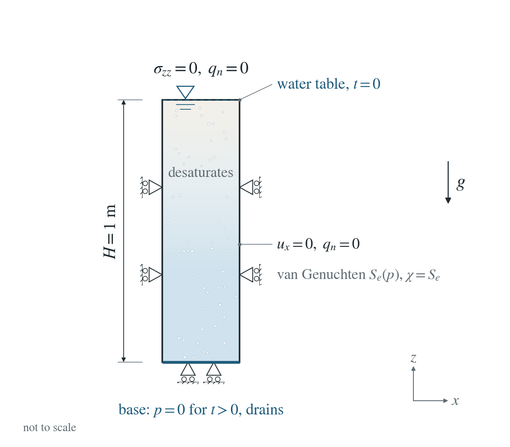
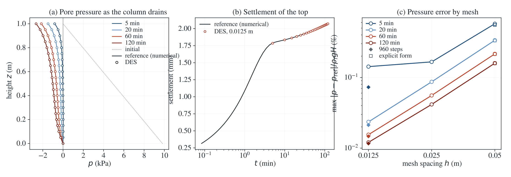

# Drainage of a saturated column into the unsaturated state

A saturated sand column drains through its base: the top desaturates, pore pressure falls below zero and the column settles under the Bishop effective stress and its lighter weight, as in the Liakopoulos experiment. No closed form exists; an independent solver of the same continuum supplies the reference.

**Largest nodal pressure error on the 0.0125 m mesh with 480 steps at 5, 20, 60 and 120 min: 0.14 / 0.02 / 0.02 / 0.01% of $\rho_fgH$; settlement 0.24 / 0.05 / 0.02 / 0.01%. With 960 steps: 0.07 / 0.02 / 0.01 / 0.01% and 0.12 / 0.03 / 0.01 / 0.01%.**

:::info At a glance

| | |
| --- | --- |
| Dimension | 2D |
| Build | `make ndims=2` from the poromechanics source |
| Inputs | [drainage.zip](/downloads/poromechanics/drainage.zip) |
| Reproduce with | DynEarthSol [`3774df0`](https://github.com/GeoFLAC/DynEarthSol/tree/3774df00ba1708a4f70a836d2073f845653aac64) |

:::

## Problem setup



**Column.** A laterally confined sand column $H=1$ m high, saturated and hydrostatic with the water table at its top. Top sealed and traction-free; base fixed.

**Drainage.** At $t=0^+$ the base is opened to $p=0$ (a 1 ms ramp of the scheduled boundary pressure). Water drains out, the top desaturates and suction develops.

**Material.** After Liakopoulos: $E=1.3$ MPa, $\nu=0.4$, $\alpha=1$, $\phi=0.2975$, $k=4.5\times10^{-13}\ \mathrm{m^2}$; van Genuchten $\alpha_{vG}=1/3000\ \mathrm{Pa^{-1}}$, $n=1.8$, $S_r=0.1$, Mualem permeability; Bishop $\chi=S_e$. Gravity and pressure feedback (two-way coupling) are on.

**What is compared.** Nodal pressure and the settlement of the top at 5, 20, 60 and 120 min against an independent solution of the same continuum.

## Input and how to run

Every file this example needs is in [drainage.zip](/downloads/poromechanics/drainage.zip). Run from that folder:

```bash
# Runs the 1 m column on the 0.0125 m mesh: 480 PT steps of 15 s, 2 h in all. The base pressure drops to 0 within the first millisecond and the column drains. DES writes drain.save.* every 20 steps (5 min).
dynearthsol2d input.cfg
```

### Settings that define this example

| Setting | Value | What it does here |
| --- | --- | --- |
| `control.has_PT` | `true` | PT solver: mechanical equilibrium within each step, with two-way pressure feedback |
| `control.gravity` | `9.81` | gravity drives the drainage and sets the hydrostatic start |
| `control.fixed_dt` | `15.0` | 15 s steps: 480 steps over 2 h |
| `sim.output_step_interval` | `20` | a frame every 20 steps (5 min), which includes the compared times 5, 20, 60 and 120 min |
| `bc.hbc_z0` | `2` | type 2: the base pressure is prescribed by bc.hbc_pressure and the schedule; the top and sides are sealed |
| `bc.hbc_pressure` | `[0,0,0,0,9810.0,0]` | base pressure 9810 Pa, the hydrostatic value with the water table at the top (ic.water_table_z = 0, the default) |
| `bc.hbc_schedule_time_in_yr` | `[0, 3.168876453507857e-11] yr = [0, 0.001] s` | schedule times 0 and 1 ms, in years |
| `bc.hbc_schedule_ratio` | `[1, 0]` | multipliers 1 and 0: the base pressure ramps to 0 over the first millisecond, opening the base |
| `ic.has_body_force_adjustment` | `true` | brings the column into mechanical equilibrium under gravity before the run |
| `mat.bulk_modulus` | `[2166666.666666667]` | K = 2.17e6 Pa, from E = 1.3 MPa and ν = 0.4 |
| `mat.shear_modulus` | `[464285.7142857143]` | G = 4.64e5 Pa, from E = 1.3 MPa and ν = 0.4 |
| `mat.porosity` | `[0.2975]` | φ = 0.2975, the Liakopoulos sand |
| `mat.hydraulic_perm` | `[4.5e-13]` | intrinsic permeability 4.5e-13 m² |
| `mat.retention_model` | `[1]` | 1: van Genuchten–Mualem, with retention_alpha 1/3000 1/Pa, retention_n 1.8 and residual_saturation 0.1; Bishop χ = S_e |

[input.cfg](/downloads/poromechanics/drainage/input.cfg) holds all 59 settings that differ from DES’s defaults; `dynearthsol2d -h` lists every option with its default.

## Output

DES writes `drain.info` (one line per saved frame: frame, step, time in seconds), `drain.save.NNNNNN` (the fields of each saved frame) and `drain.chkpt.NNNNNN` (checkpoints to restart from). `sim.output_step_interval` and `sim.output_time_interval_in_yr` set how often a frame is saved.

Set `DES_SOURCE` and `PYTHONPATH` as described in [Running the examples](../running.md) before using the Python reader or converter.

| Field | What to look at |
| --- | --- |
| `pore pressure` | pressure profiles at 5, 20, 60 and 120 min, compared with the reference |
| `strain` | vertical element strain; its change since frame 0, summed up the column, gives the settlement of the top |
| `coordinate` | node heights |
| `connectivity` | assigns element strains to the layers of the column |

Read a frame in Python:

```python
from Dynearthsol import Dynearthsol      # in the DES source folder
model = Dynearthsol('drain')
frame = model.frames[-1]                 # model.time[i] is the time of frame i, in seconds
x = model.read_field(frame, 'coordinate')
value = model.read_field(frame, 'pore pressure')
```

View it in ParaView after `python3 "$DES_SOURCE/2vtk.py" drain`.

## Result: DES and the reference



(a) Pore pressure (kPa) against height at 5, 20, 60 and 120 min: DES nodes on one side of the column (circles) and the numerical reference (lines); the dotted line is the initial hydrostatic profile. (b) Settlement of the top against time on a log scale: DES at each saved frame (circles) and the reference (line). (c) Maximum pressure error relative to ρ_f g H against mesh spacing at the four times: circles for 480 steps, diamonds for 960 steps on the finest mesh, open squares for the explicit form.

This checks Richards flow and the Bishop coupling together during drainage: desaturation, suction, the effective-stress change and the lighter weight of the drying column.

To reproduce the whole study behind this figure, from the DES source folder:

```bash
python3 benchmarks/poromechanics/drainage_reference.py
python3 tests/functional/hydromechanics/check_unsaturated_drainage.py dynearthsol2d OUT --spacings 0.05 0.025 0.0125
python3 tests/functional/hydromechanics/check_unsaturated_drainage.py dynearthsol2d OUT-explicit --spacings 0.05 --explicit
python3 tests/functional/hydromechanics/check_unsaturated_drainage.py dynearthsol2d OUT-steps960 --spacings 0.0125 --steps 960
```

The study’s full numbers: [record.json](/downloads/poromechanics/drainage/record.json).

## Reference solution (numerical)

$$
c(p)\,p_t+\alpha S_e\,\dot\varepsilon=-\partial_z q
$$

$$
q=-\frac{k\,k_r(S_e)}{\mu}\left(\partial_z p+\rho_f g\right)
$$

$$
\dot\varepsilon=\frac{\dot\sigma+\alpha\,\Pi'(p)\,p_t}{K+\frac{4}{3}G}
$$

$$
\Pi=S_e\,p
$$

$$
\dot\sigma(z)=-g\rho_f\phi(1-S_r)\int_z^H\frac{dS_e}{dp}\,p_t\,dz'
$$

$c(p)$ is the fluid storage including $\phi\,dS/dp$; $\varepsilon$ the vertical strain, $\sigma$ the total vertical stress, which changes only by the weight of the water that leaves the column above. $k_r$ is the Mualem relative permeability.

### Derivation

Uniaxial strain makes the vertical effective-stress change equal to the constrained modulus times the strain. The Bishop stress adds $\alpha\Pi$, and the total stress follows the weight, so drying above a point unloads it: the storage becomes nonlocal.

drainage_reference.py integrates this system with vertex-centred finite volumes, the dense coupled storage matrix and an implicit BDF method. Grid differences fall at second order (5.2 to 1.3 Pa at 300 s on 100 and 200 cells, of a 9.8 kPa scale); the comparison uses 200 cells.

Liakopoulos (1965) experiment as benchmarked by Schrefler and Zhan (1993), Water Resources Research 29(1), 155–167; reference computed independently in drainage_reference.py.

[Original reference](https://doi.org/10.1029/92WR01737).

## Validity and limits

No closed form: the reference is numerical. Uniaxial strain, small strain, constant porosity, no hysteresis. The base opens instantly, so the first minutes are limited by the step.

## Reproduction

[Commands, solver hashes and portable inputs](../running.md).
