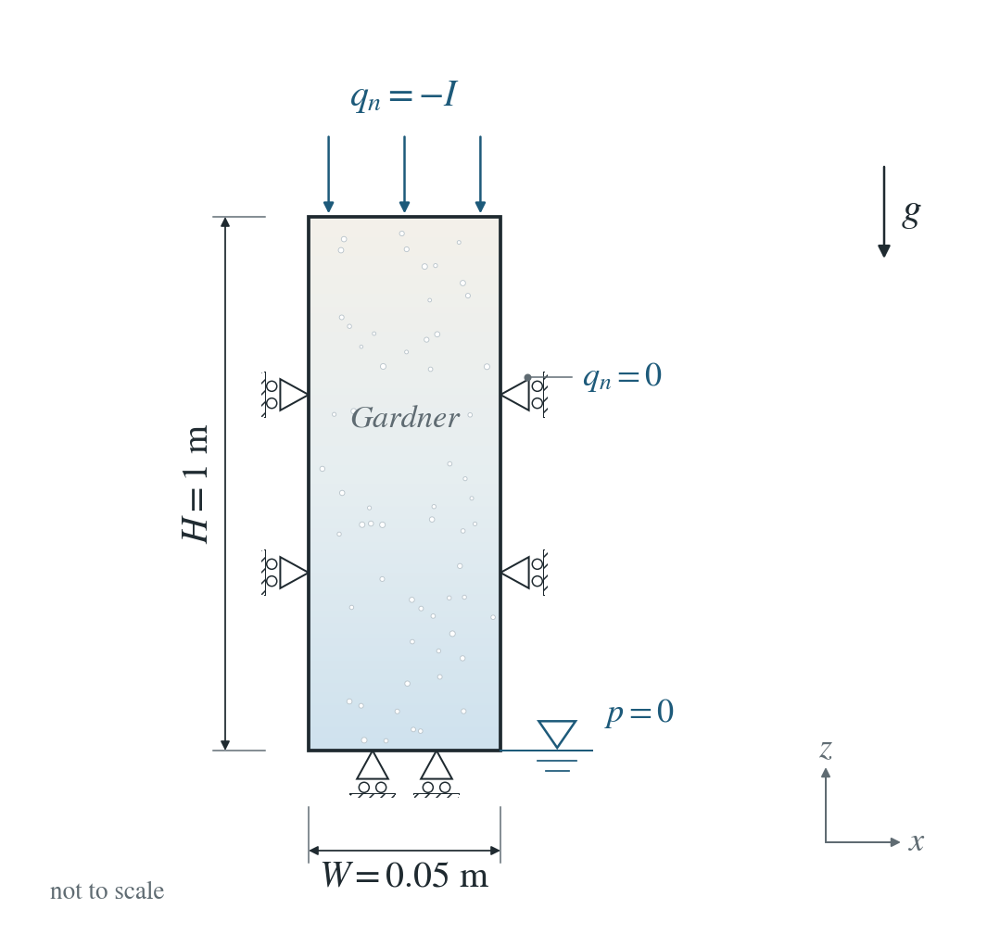
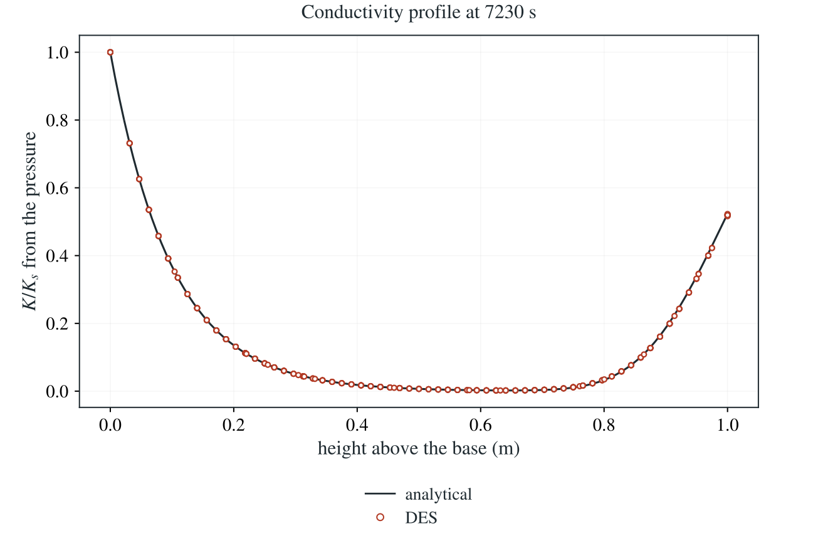

# Transient infiltration: Gardner law

Water infiltrates a partly saturated column from the top while the base stays at the water table.

**Largest error in $K/K_s$: 0.714% at 7230 s and 2.52% over all saved times.**

:::info At a glance

| | |
| --- | --- |
| Dimension | 3D |
| Build | `make ndims=3` from the poromechanics source |
| Inputs | [gardner.zip](/downloads/poromechanics/gardner.zip) |
| Reproduce with | DynEarthSol [`3774df0`](https://github.com/GeoFLAC/DynEarthSol/tree/3774df00ba1708a4f70a836d2073f845653aac64) |

:::

## Problem setup



**Water boundaries.** Constant downward inflow starts at the top at t = 0. Base pressure is zero; all side faces are sealed.

**Initial profile and gravity.** Hydrostatic initial pressure $p=-\rho_fgz$, with elevation $z$ above the base. Gravity points downward.

**Mechanical conditions.** Side-normal displacement and base vertical displacement fixed; traction-free top. Compare K/Ks derived from pressure. Bishop coupling is not tested here (see the Bishop pages).

## Input and how to run

Every file this example needs is in [gardner.zip](/downloads/poromechanics/gardner.zip). Run from that folder:

```bash
# Runs the 3D column for 2 h (7200 s) in fixed 30 s steps after the top inflow starts. DES writes column.save.* every 30 min; the page shows the last frame and checks all of them.
dynearthsol3d input.cfg
```

### Settings that define this example

| Setting | Value | What it does here |
| --- | --- | --- |
| `control.has_hydraulic_diffusion` | `true` | turns on Darcy flow, here partly saturated (Richards) flow |
| `control.has_PT` | `true` | PT solver: mechanical equilibrium is reached by iteration within each step |
| `control.gravity` | `9.81` | gravity drives the downward flow and sets the hydrostatic start |
| `control.fixed_dt` | `30.0` | fixed 30 s steps |
| `sim.max_time_in_yr` | `0.0002281591046525657 yr = 7200 s` | 7200 s (2 h) of infiltration |
| `sim.output_time_interval_in_yr` | `5.703977616314142e-05 yr = 1800 s` | a frame every 1800 s (30 min) |
| `bc.hbc_z0` | `2` | type 2: the base is held at the pressure in bc.hbc_pressure, here 0, the water table |
| `bc.hbc_z1` | `3` | type 3: the top has the prescribed flux in bc.hbc_flux |
| `bc.hbc_flux` | `[0,0,0,0,0,-2.5e-06]` | outward Darcy flux per face; the top value −2.5e-6 m/s is an inflow of 0.9 K_s, starting at t = 0 |
| `ic.water_table_z` | `-1.0` | starts hydrostatic with the water table at the base (z = −1 m) |
| `mat.retention_model` | `[3]` | 3: Gardner exponential law, S_e = k_r = exp(α_p p) |
| `mat.retention_alpha` | `[0.0010193679918450561]` | α_p = 1.019e-3 1/Pa, i.e. 0.1 per cm of head |
| `mat.porosity` | `[0.4]` | 0.4; with zero residual saturation the water content can change by Δθ = 0.4 |
| `mat.hydraulic_perm` | `[2.8372409106354064e-13]` | gives saturated conductivity K_s = 2.78e-6 m/s (1 cm/h) |

[input.cfg](/downloads/poromechanics/gardner/input.cfg) holds all 51 settings that differ from DES’s defaults; `dynearthsol3d -h` lists every option with its default.

## Output

See [Running the examples](../running.md) for output files, the Python reader and ParaView conversion.

| Field | What to look at |
| --- | --- |
| `pore pressure` | converted to K/K_s = exp(α_p p) at every node and compared with the series solution |
| `coordinate` | the height of each node above the base |


## Result: DES and the analytical solution



Relative conductivity K/K_s = exp(α_p p), computed from the DES pore pressure (circles), against the Srivastava–Yeh series (line) along the column at the end of the run (7200 s).

This checks conservative unsaturated flow against an independent transient solution. It does not test Bishop effective stress.

To reproduce the whole study behind this figure, from the DES source folder:

```bash
python3 tests/functional/hydromechanics/check_unsaturated_column.py dynearthsol3d OUT
```

The study’s full numbers: [record.json](/downloads/poromechanics/gardner/record.json).

## Analytical reference

$$
w=S_e=k_r=\exp(\alpha_p p),\quad A=\alpha_p\rho_fg,\quad Z=Az,\quad L=AH,\quad T=AK_st/\Delta\theta
$$

$$
w_b(Z)=b+(1-b)e^{-Z},\quad a=I_a/K_s,\quad b=I_b/K_s,\quad \Delta\theta=\phi(1-S_r)
$$

$$
F_n=\frac{\sin(\lambda_nZ)\sin(\lambda_nL)e^{-\lambda_n^2T}}{1+L/2+2\lambda_n^2L}
$$

$$
w=w_b-4(b-a)e^{(L-Z)/2-T/4}\sum_{n=1}^{\infty}F_n
$$

$$
\sin(\lambda_nL)+2\lambda_n\cos(\lambda_nL)=0
$$

$$
p=\log(w)/\alpha_p
$$

$K_s=\kappa\rho_f g/\mu$ is saturated hydraulic conductivity. $\alpha_p$ is the pressure retention coefficient in $\mathrm{Pa^{-1}}$ and $A$ its head-based value in $\mathrm{m^{-1}}$. Here $A=10\ \mathrm{m^{-1}}$, $I_a=0$, $I_b=2.5\times10^{-6}\ \mathrm{m/s}$, $K_s=2.77778\times10^{-6}\ \mathrm{m/s}$, $\phi=0.4$ and $S_r=0$. $\lambda_n$ is the positive root in $((n-1/2)\pi/L,n\pi/L)$.

### Derivation

For unsaturated $p\le0$, $\theta=\theta_r+\Delta\theta\,w$ and the upward water flux is $q_z=-K_s(w_z/A+w)$. Substitution into $\theta_t+\partial_zq_z=0$ and nondimensionalization give a linear drift-diffusion equation.

$$
w_T=w_{ZZ}+w_Z,\quad w(0,T)=1,\quad w_Z(L,T)+w(L,T)=b
$$

Before the flux change the column is at $w_a=a+(1-a)e^{-Z}$. Subtract the new steady solution wb and remove the drift. Separation of variables gives a sine series and the Robin eigenvalue equation; projecting the initial difference supplies the coefficient in the reference above.

$$
w-w_b=e^{-Z/2-T/4}f,\quad f_T=f_{ZZ},\quad f(0,T)=0,\quad f_Z(L,T)+f(L,T)/2=0
$$

Srivastava and Yeh (1991), homogeneous-column solution; evaluated in unsaturated_reference.py. The reference implementation is independently checked against a matrix exponential.

[Original reference](https://tian.hwr.arizona.edu/publications/data/a9ab4ba8091091d98c03d35241dcbf0c.pdf).

## Validity and limits

This exact series solves ideal Gardner Richards flow with retention storage only. DES also retains elastic/compressible storage, so it is a reference-limit comparison, not an exact solution of every active DES term. The displayed error includes that model difference. It does not validate ponding or a seepage-face switch.
