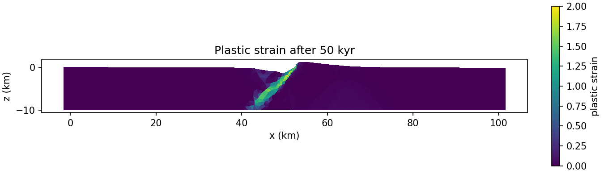

# Quickstart

This page takes you from source code to a result in a few minutes. You will
build the 2D executable, run the shipped example `examples/core-complex.cfg`,
and look at the normal fault that forms as a brittle crust is pulled apart.

## 1. Build

Clone DynEarthSol and build the 2D executable in its root directory (see
[Installation](./installation.md) for dependencies and build options):

```console
git clone --recursive https://github.com/GeoFLAC/DynEarthSol.git
cd DynEarthSol
make ndims=2
```

This creates `dynearthsol2d`.

## 2. Run

Run the example in its own folder so the output stays together:

```console
mkdir quickstart
cd quickstart
cp ../examples/core-complex.cfg .
OMP_NUM_THREADS=4 ../dynearthsol2d core-complex.cfg
```

The run takes about a minute and a half with four threads. DES prints a
status line as it goes and finishes with a timing summary.

### What the model is

| Setting | Value |
| --- | --- |
| Domain | 100 km wide, 10 km thick; elements of about 1 km, finer between x = 30 and 70 km |
| Material | elasto-plastic (Mohr–Coulomb), friction angle 30°, cohesion softening from 44 to 4 MPa over plastic strain 0.5 |
| Loading | both sides pulled outward at $10^{-9}$ m/s (3.2 cm/yr each), free surface with slow diffusion |
| Seed | a weak zone dipping 60°, centred at x = 50 km in the lower half of the layer, given plastic strain 0.5 |
| Duration | 50,000 years, a frame every 1500 years |

The weak zone seeds a fault. Cohesion softening then concentrates further
slip on it, and the mesh is rebuilt as it distorts.

## 3. Look at the output

The run writes, under the model name `result3`:

| File | Contents |
| --- | --- |
| `result3.save.000000` … `000033` | 34 saved frames of all fields |
| `result3.chkpt.*` | checkpoints for [restarting](../user-guide/running/restart.md) |
| `result3.info` | one line per frame: step, time, time step, wall time, mesh size |
| `result3.manifest` | how and where the run was built and run ([provenance](../user-guide/running/diagnostics.md#provenance)) |

Convert the frames to VTK and open them in [ParaView](https://www.paraview.org):

```console
../2vtk.py result3
```

This writes `result3.000000.vtu` to `result3.000033.vtu`. Open the series in
ParaView and colour it by `plastic strain`.

Or plot the last frame with Python, using the reader shipped with DES:

```python
import sys
sys.path.insert(0, '..')                       # the DynEarthSol directory
import matplotlib.pyplot as plt
from matplotlib.tri import Triangulation
from Dynearthsol import Dynearthsol

des = Dynearthsol('result3')
frame = des.frames[-1]
xy = des.read_field(frame, 'coordinate') / 1e3          # km
conn = des.read_field(frame, 'connectivity')
plstrain = des.read_field(frame, 'plastic strain')

fig, ax = plt.subplots(figsize=(9, 2.6), constrained_layout=True)
pc = ax.tripcolor(Triangulation(xy[:, 0], xy[:, 1], conn),
                  facecolors=plstrain, vmin=0, vmax=2)
ax.set_aspect('equal'); ax.set_xlabel('x (km)'); ax.set_ylabel('z (km)')
fig.colorbar(pc, ax=ax, label='plastic strain')
fig.savefig('plastic_strain.png', dpi=150)
```

## 4. What you should see



After 50,000 years the layer has extended by about 3 km. Almost all of that
extension is taken up by one normal fault that grew from the weak zone, from
the base of the layer near x = 43 km to the surface near x = 53 km. Its
footwall has risen about 1.3 km above the original surface. The rest of the
layer has hardly deformed.

## Next steps

- Change one setting and rerun: for example `vbc_val_x0` and `vbc_val_x1`
  in `[bc]` for the extension rate, or `cohesion1` in `[mat]` for how much
  the fault weakens. Give each run a new `modelname`.
- Read [Running DynEarthSol](./run.md) and
  [Visualizing outputs](./visualize.md) for more options.
- Continue with the
  [rifting and subduction tutorial](../tutorial/tectonics/rifting-subduction.md),
  which builds on this kind of model.
- Look up any parameter in the
  [configuration parameters](../reference/parameters.md).
