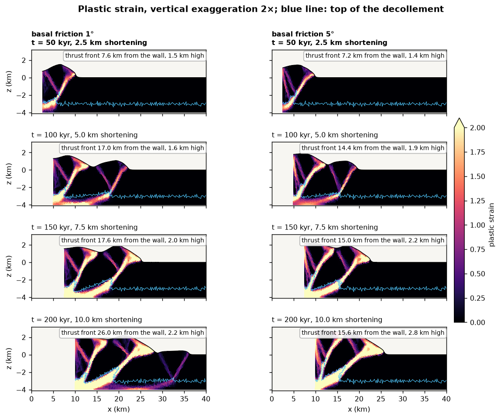
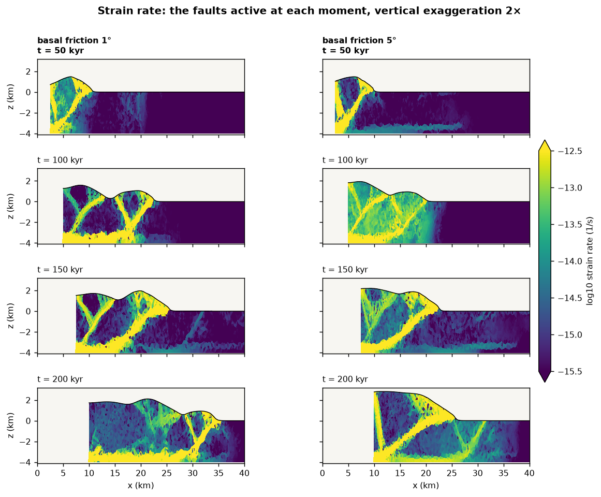
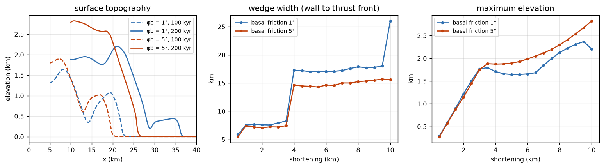
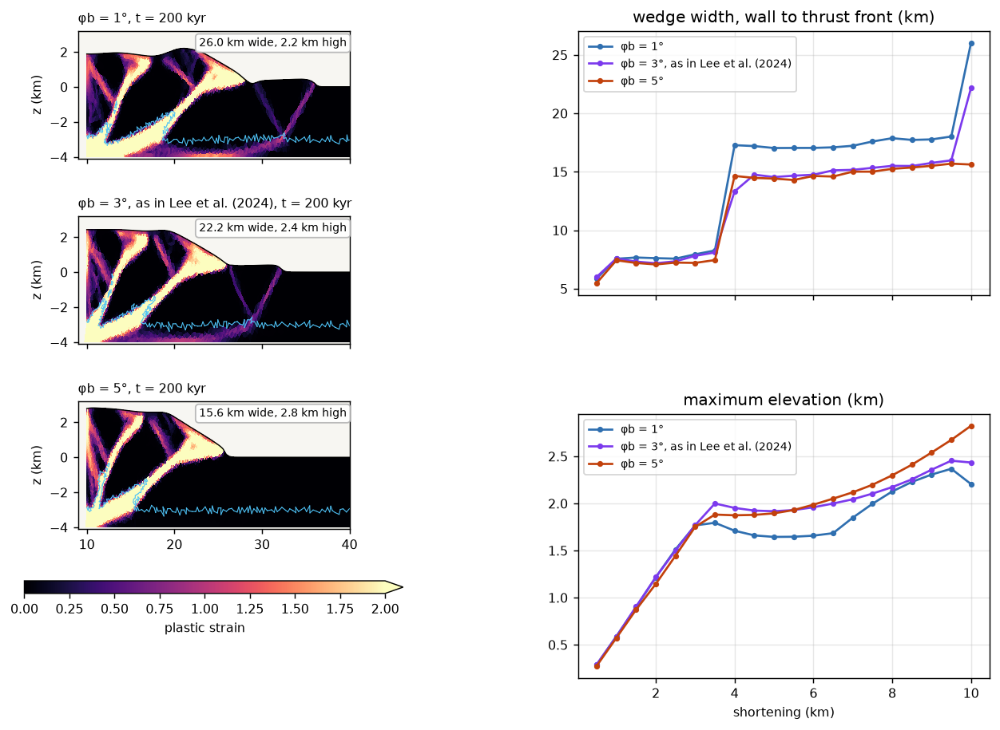
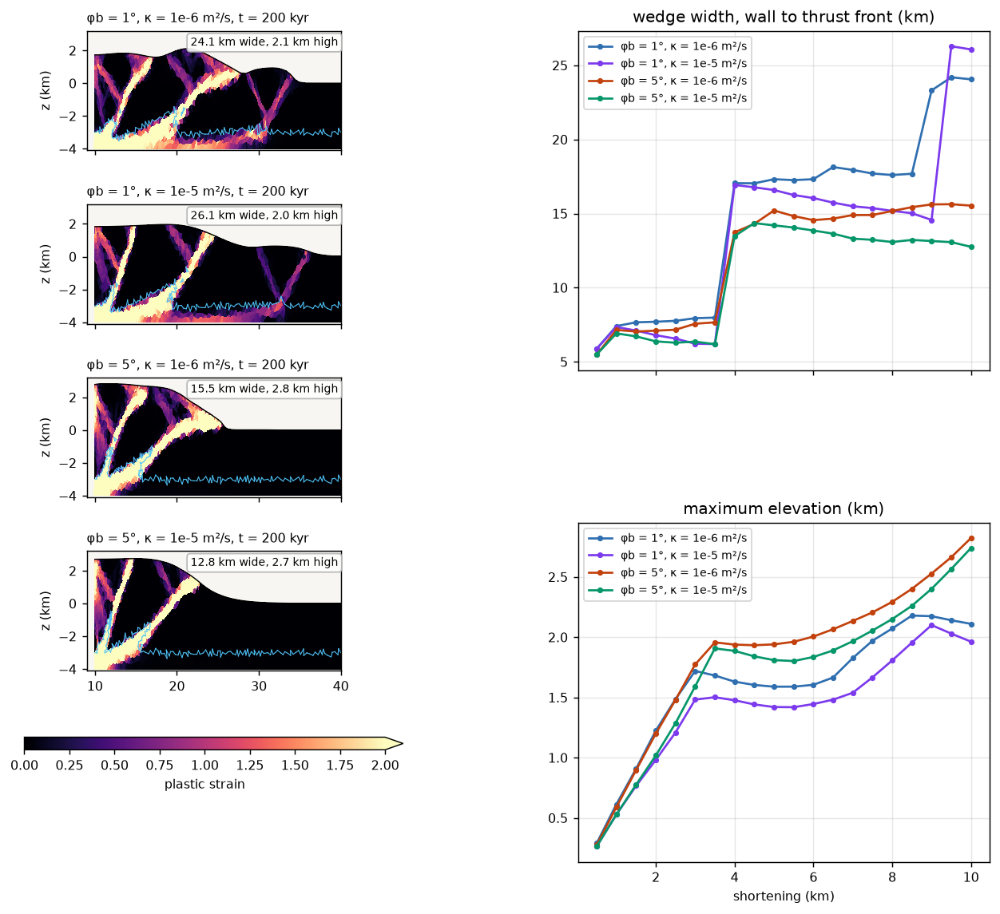
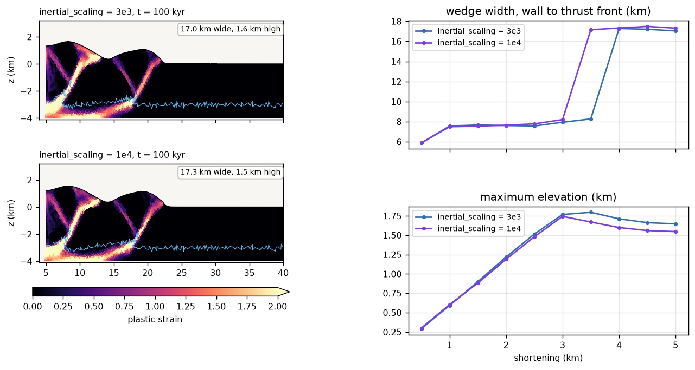

import useBaseUrl from '@docusaurus/useBaseUrl';

# Accretionary wedge and basal friction

This tutorial builds a fold-and-thrust belt, or accretionary wedge: a brittle
layer pushed against a backstop, sliding on a weak decollement. It runs the
same model twice, with a basal friction angle of 1° and of 5°, and compares
how the wedge grows. The setup is a small version of the models of
Lee, Tan & Chang (2024), cut down so that each run takes about 4 minutes on
4 threads.

Shortening thickens the layer next to the backstop until the wedge is steep
enough to push its base forward over the decollement. Then a new thrust breaks
in the undeformed layer ahead of it, and the wedge grows by adding another
thrust slice. How steep "steep enough" is depends on how strong the base is
relative to the wedge: this is the critical taper of Davis, Suppe & Dahlen
(1983). A weaker base needs a lower taper, so the same shortening builds a
lower, wider wedge.

## What you will learn

- How to set up a layered brittle model with `mattype_option = 1`, no mesh
  file needed
- How to push one wall over a fixed base without a velocity jump at the
  corner (`vbc_x0 = 3` with `bottom_shear_zone_thickness`), and how
  `remeshing_option = 12` keeps that wall vertical
- How `inertial_scaling` and the smallest element set the number of steps, and
  how to make a model cheap enough for a laptop
- How to read thrust sequences from plastic strain and strain rate, and how
  basal friction sets the width and height of the wedge
- How to measure the wedge front from the faults rather than from the
  topography

## Prerequisites

- ✅ DynEarthSol compiled in 2D **without** MMG, `make ndims=2`; see
  [Build](../usage/usage.md) and [Running DES3D](../usage/run.md). The MMG
  build does not support `remeshing_option = 12` yet: its first remesh
  corrupts the mesh (see [Troubleshooting](#troubleshooting))
- ✅ A DynEarthSol version that includes
  [PR #113](https://github.com/GeoFLAC/DynEarthSol/pull/113), which fixes
  `remeshing_option = 12`. Without it each remesh deletes interior nodes, the
  mesh coarsens and no discrete thrusts form
- ✅ Python 3 with `numpy` and `matplotlib` for the plots, and optionally
  [ParaView](https://www.paraview.org/) with `2vtk.py`; see
  [Visualizing outputs](../usage/visualize.md)
- ✅ Read Part 1 of [Tectonic rifting and subduction](./tectonics.md): this
  tutorial uses the same Mohr–Coulomb strain softening and the same output
  fields, and does not repeat them

:::tip Downloads
The two configs and the plotting script are here:
<a href={useBaseUrl('/downloads/des-wedge/wedge-phi1.cfg')}>wedge-phi1.cfg</a>,
<a href={useBaseUrl('/downloads/des-wedge/wedge-phi5.cfg')}>wedge-phi5.cfg</a> and
<a href={useBaseUrl('/downloads/des-wedge/wedge_figures.py')}>wedge_figures.py</a>.
The two configs differ only in `modelname` and the decollement friction angle.
:::

## How the model works

| | Lee, Tan & Chang (2024) | This tutorial |
|---|---|---|
| Domain | 450 km long | 40 km long |
| Brittle layer | 3, 6, 9 or 15 km | 3 km |
| Decollement | 1 km | 1 km |
| Push | 5 cm/yr, 100 km over 2 Myr | 5 cm/yr, 10 km over 200 kyr |
| Basal friction | 1° and 3° | 1° and 5° (3° is Exercise 1) |
| Surface diffusivity | 1e-6 and 1e-5 m²/s | 1e-6 m²/s (1e-5 is Exercise 2) |
| Run time | hours | about 4 minutes per run on 4 threads |

The materials are the paper's. The brittle layer softens from a friction
angle of 30° to 15° and a cohesion of 4 to 0.4 MPa over a plastic strain of
0.1; the decollement has the same cohesion but a friction angle of only 1° or
5°, held constant. Both have a density of 2600 kg/m³ and a shear modulus of
30 GPa. There is no temperature and no viscosity: `rheology_type =
elasto-plastic`.

The basal friction is set as a material property of a 1 km layer, not as a
boundary condition. Shear on the base of the wedge is carried by that layer,
whose strength is `cohesion + tan(φb) × normal stress`; under 3 km of rock the
normal stress is about 80 MPa, so after softening the base resists about
1.8 MPa at φb = 1° and 7.2 MPa at φb = 5°.

### Pushing a wall over a fixed base

The base is fixed (`vbc_z0 = 3`). If the left wall pushed at 5 cm/yr all
the way down, the node at the corner would have to move and stand still at
once. Instead `vbc_x0 = 3` with `bottom_shear_zone_thickness = 1e3` tapers the
push linearly from 5 cm/yr at the top of the decollement to zero at the base,
so the decollement next to the wall is sheared over its full thickness. Type 3
also fixes the vertical velocity on the wall, which keeps the wall nodes from
folding over each other.

The taper makes the foot of the wall lag its top, so between remeshes the
wall's lowest kilometre leans forward over a thinning sliver of decollement.
Left alone, after 10 km of shortening it would be a ramp 10 km long.
`remeshing_option = 12` cuts the sliver off at every remesh and puts the wall
back to vertical at the position of its top.


### What sets the cost

With the default quasi-static scheme, the time step is

```
dt = 0.5 × (smallest element height) / (push velocity × inertial_scaling)
```

so the number of steps for a given shortening does not depend on the push
velocity:

```
steps ≈ 2 × shortening × inertial_scaling / (smallest element height)
```

Here that is 2 × 10 km × 3000 / 150 m = 400 000 steps on the initial mesh;
the run takes about a million, because remeshing leaves some elements smaller
than that. The cost is set by three choices: shortening, `inertial_scaling`
and how small elements may get (`resolution` and `smallest_size`). The DES
default `inertial_scaling = 1e5` would need 30 million steps; this tutorial
uses 3e3 and checks the result against 1e4 in Exercise 3.

## Step 1: The configuration

```cfg title="wedge-phi1.cfg"
[sim]
modelname = wedge-phi1
max_time_in_yr = 200000             # 10 km of shortening
output_time_interval_in_yr = 10000
has_output_during_remeshing = no
is_outputting_averaged_fields = no

[mesh]
meshing_option = 1                  # uniform box mesh
xlength = 40e3
ylength = 10e3                      # unused in 2D
zlength = 4e3                       # 3 km layer + 1 km decollement
resolution = 250
largest_size = 4
smallest_size = 0.2                 # tiny-element trigger; also the floor of dt
quality_check_step_interval = 1000
min_quality = 0.3
remeshing_option = 12               # restore the pushing wall (x0) to vertical

[control]
surface_process_option = 1
surface_diffusivity = 1e-6          # hillslope diffusion, m^2/s
inertial_scaling = 3e3

[bc]
# Left wall: pushes at 5 cm/yr (1.5844e-9 m/s), shear velocity fixed at 0.
# The push tapers linearly to 0 across the lowest 1 km (the decollement).
vbc_x0 = 3
vbc_val_x0 = 1.5844e-9
bottom_shear_zone_thickness = 1e3   # in m
# Right wall: free slip. Base: no slip.
vbc_x1 = 1
vbc_val_x1 = 0
vbc_z0 = 3
vbc_val_z0 = 0
has_winkler_foundation = no
has_water_loading = no
surface_temperature = 273
mantle_temperature = 273

[ic]
mattype_option = 1                  # horizontal layers
num_mattype_layers = 2
layer_mattypes = [0, 1]             # 0: brittle layer, 1: decollement
mattype_layer_depths = [0.75]       # interface at 0.75 * zlength = 3 km
weakzone_option = 0                 # no seed: the pushing wall starts the faults

[mat]
rheology_type = elasto-plastic
num_materials = 2
rho0 = [2600, 2600]
alpha = [0, 0]
bulk_modulus = [50e9, 50e9]
shear_modulus = [30e9, 30e9]
pls0 = [0, 0]
pls1 = [0.1, 0.1]
cohesion0 = [4e6, 4e6]
cohesion1 = [4e5, 4e5]
friction_angle0 = [30, 1]           # basal friction angle: 1 degree
friction_angle1 = [15, 1]
dilation_angle0 = [0, 0]
dilation_angle1 = [0, 0]
min_viscosity = 1e24                # unused by elasto-plastic, but required
```

`wedge-phi5.cfg` is the same file with `modelname = wedge-phi5` and the
decollement angles set to 5:

```cfg
friction_angle0 = [30, 5]
friction_angle1 = [15, 5]
```

Section by section:

- **`[sim]`** runs 200 kyr, 10 km of shortening at 5 cm/yr, with a frame every
  10 kyr, 0.5 km of shortening.
- **`[mesh]`** builds a uniform 40 × 4 km mesh. With Triangle, `resolution`
  is not the element edge: the area limit is 1.5 × `resolution`², and these
  settings give 2778 elements with a median edge of 364 m. Triangle
  remeshing never refines, so the initial mesh is the finest the run will
  have; it ends with 3474 elements and a median edge of 321 m.
  `smallest_size = 0.2` remeshes when an element is squeezed below 0.2 of the
  area of an equilateral triangle with edge `resolution`, which keeps `dt`
  from collapsing.
- **`[control]`** turns on hillslope diffusion of the surface and sets
  `inertial_scaling`, which with the element size sets the step count (see
  above).
- **`[bc]`** pushes the left wall, tapered across the decollement, against a
  free-slip right wall over a no-slip base. `bottom_shear_zone_thickness` is in
  metres (`--help` said km before PR #113). The Winkler foundation is off
  because the base is fixed, and water loading is off because the surface
  stays above sea level.
- **`[ic]`** makes two horizontal layers. `mattype_layer_depths` is a fraction
  of `zlength`, so 0.75 puts the top of the decollement at 3 km depth. No weak
  zone is needed: the first faults start at the corner of the pushing wall.
- **`[mat]`** has the brittle layer (index 0) and the decollement (index 1).
  The decollement friction is constant, `friction_angle0 = friction_angle1`,
  and its cohesion softens like the layer's.

The parameters you will change most often:

| Parameter | What it sets |
|-----------|--------------|
| `friction_angle0/1` (second entry) | Basal friction; the subject of this tutorial |
| `mattype_layer_depths`, `zlength` | Layer and decollement thickness |
| `max_time_in_yr` | Total shortening, at 0.05 km per kyr |
| `surface_diffusivity` | How fast relief is smoothed |
| `resolution`, `smallest_size` | Element size and the floor of `dt`; both change the cost |
| `inertial_scaling` | Cost against how quasi-static the run is |

## Step 2: Run

```bash
cd wedge                      # a directory holding the two configs
OMP_NUM_THREADS=4 /path/to/DynEarthSol/dynearthsol2d wedge-phi1.cfg
OMP_NUM_THREADS=4 /path/to/DynEarthSol/dynearthsol2d wedge-phi5.cfg
```

On an 8-core desktop (Intel i7-10700) each run took 4 minutes alone on 4
threads, about a million steps and 130 to 180 remeshes; two at once on 4
threads each took 5 minutes. On a 4-core laptop, run them one after the
other, or both at once with `OMP_NUM_THREADS=2`. The log prints a line every
100 000 steps, an `Output #` line every 10 kyr, and a `Remeshing starts` line
at every remesh. Output goes to `wedge-phi1.save.*` and `wedge-phi5.save.*`.

## Step 3: What to look for

```bash
DES_DIR=/path/to/DynEarthSol python3 wedge_figures.py . .
```

This writes the three figures below from the output in the current directory
and prints the wall position, thrust front and height of each frame. For
ParaView, convert with `python3 /path/to/DynEarthSol/2vtk.py wedge-phi1`.



Plastic strain is where the faults are, or have been. Both runs start the same
way. The corner of the pushing wall sheds a forethrust, dipping toward the
wall, and a backthrust, dipping away from it, which together lift a pop-up of
the layer next to the wall. Through the first 3.5 km of shortening the two
runs are nearly indistinguishable: the basal friction does not matter yet,
because the wedge is still too short for its base to carry much of the push.

Then they part:

- **At 80 kyr both break a new thrust far ahead.** At φb = 1° the new pair
  roots in the decollement 17 km from the wall; at φb = 5° only 14 km. The
  weak base transmits the push farther before the layer fails.
- **At 200 kyr the 1° wedge has three thrust slices, the 5° wedge two.**
  At 1° a third pair broke at 180 kyr, 23 km from the wall; at 5° the
  second slice is still being overthrust and the front has not moved.
- **The 5° wedge is narrower and higher.** It is 15.5 km wide and 2.8 km
  high, against 24 km and 2.1 km at 1°. The same shortening has gone into
  less width and more height, a steeper taper.
- **The decollement is dragged along.** Under the wedge it is sheared and
  thickened against the wall (the bright band along the base); ahead of the
  wedge it stays undeformed.

| t (kyr) | Shortening (km) | Width at 1° (km) | Height at 1° (km) | Width at 5° (km) | Height at 5° (km) |
|---|---|---|---|---|---|
| 50 | 2.5 | 7.8 | 1.5 | 7.2 | 1.5 |
| 100 | 5 | 17.3 | 1.6 | 15.2 | 1.9 |
| 150 | 7.5 | 17.7 | 2.0 | 14.9 | 2.2 |
| 200 | 10 | 24.1 | 2.1 | 15.5 | 2.8 |

Width is measured from the wall to the thrust front, the farthest point of the
upper 2.5 km of the brittle layer where plastic strain exceeds 0.5.



Strain rate shows which of those faults are moving at each moment, and it is
fewer than plastic strain suggests. Where the two runs differ is in where the
active faults are:

- **At 1° the front does the work.** Once a new thrust has broken, 65 to 85 %
  of the plastic strain rate of the brittle layer is in the frontal slice,
  and the slices behind it are nearly locked. The decollement under the
  wedge carries 50 to 80 % of all plastic strain rate.
- **At 5° the rear comes back to life.** At 100 kyr more than half of the
  brittle-layer plastic strain rate is within 8 km of the wall, on faults that
  had been abandoned: the wedge thickens internally to steepen its taper
  before it can advance again. The decollement carries 33 to 60 %.

Lee, Tan & Chang (2024) found, over much longer runs, that the frontal thrusts
are the only active structures for over 95 % of the time, and that new thrusts
form and older ones reactivate in short episodes (here, the jumps at 80 and
180 kyr). In this small model that pattern is clearest at 1°.



The width curve is a staircase: the front stays within about a kilometre
while the wedge thickens behind it, then jumps forward by a thrust spacing
when a new thrust breaks. The height grows while the
front is stuck and pauses after each jump, when the push goes into the new
thrust slice. At 1° the jumps are bigger and the height lower; that is the
critical taper at work, a weaker base giving a lower taper.

## Exercise 1: the paper's 3°

Copy `wedge-phi1.cfg` to `wedge-phi3.cfg`, set `modelname = wedge-phi3` and
the decollement angles to 3, and run it. Then compare all three:

```bash
python3 wedge_figures.py compare basal.png "wedge-phi1:φb = 1°" \
    "wedge-phi3:φb = 3°" "wedge-phi5:φb = 5°"
```

| Run | Width at 200 kyr | Height at 200 kyr | New thrusts after the first |
|-----|------------------|-------------------|-----------------------------|
| φb = 1° | 24.1 km | 2.1 km | at 80 and 180 kyr |
| φb = 3° | 22.2 km | 2.2 km | at 80 and 180 kyr |
| φb = 5° | 15.5 km | 2.8 km | at 80 kyr |



At 3° the wedge follows the 5° one at first: the second thrust breaks 14 km
from the wall, as at 5°, and the height between jumps is in between. But at
180 kyr it breaks a third thrust at the same time as the 1° wedge. Over only
10 km of shortening the wedge has room for two or three slices, so a
difference in basal friction shows up as whether one more thrust has formed or
not. That is why the main comparison uses 5°: over this short a run, 3° and
1° end up looking alike. In the paper's 100 km runs, 1° and 3° differ clearly.

## Exercise 2: stronger erosion

Set `surface_diffusivity = 1e-5`, the paper's other value, in both configs
(and change `modelname` so the runs do not overwrite each other).



| Run | Width at 200 kyr | Height at 200 kyr |
|-----|------------------|-------------------|
| φb = 1°, κ = 1e-6 | 24.1 km | 2.1 km |
| φb = 1°, κ = 1e-5 | 26.1 km | 2.0 km |
| φb = 5°, κ = 1e-6 | 15.5 km | 2.8 km |
| φb = 5°, κ = 1e-5 | 12.8 km | 2.7 km |

Erosion takes material off the top of the wedge and spreads it as an apron in
front of the toe. The apron makes the topography look wider, which is why the
width here is measured from the thrusts and not from where the surface starts
to rise. Measured from the thrusts, the 5° wedge is *narrower* with erosion: by
keeping the taper below critical, erosion delays the next thrust, and the
front stays at the slice built at 80 kyr. At 1° the third thrust breaks at 190
kyr instead of 180 kyr, and then lands farther out.

## Exercise 3: is `inertial_scaling = 3e3` small enough?

DES reaches a quasi-static solution by solving the dynamic equations with the
density scaled up, and `inertial_scaling` controls how far. A smaller value is
cheaper but lets inertia matter more. Rerun `wedge-phi1.cfg` with
`inertial_scaling = 1e4` and `max_time_in_yr = 100000`. It takes 3.3 times as
many steps, 1.55 million against 465 000 to 100 kyr.



Up to 60 kyr the two runs are the same to within 0.3 km of width and 0.02 km
of height. Then the second thrust breaks 10 kyr earlier at 1e4, and 2 km
closer to the wall: 15.4 against 17.3 km at 100 kyr. The structure and the
height are the same. When and where a new thrust nucleates is sensitive to
small differences, including this one, while the wedge as a whole is not. Do
not read a 2 km difference in thrust spacing between two runs as a result
unless it survives a change of `inertial_scaling`.

## Troubleshooting

All rows were observed while building this tutorial.

| Symptom | Cause and fix |
|---------|---------------|
| After the first remesh, `dt` jumps to about 5e5 yr and the run ends at once, with `prepare_interpolation` warnings | `remeshing_option = 12` with an MMG build (`usemmg=1`). It is not supported with MMG; build with `make ndims=2` |
| The node count drops by half at the first remesh and plastic strain is spread over the whole wedge, with no discrete thrusts | A DynEarthSol without [PR #113](https://github.com/GeoFLAC/DynEarthSol/pull/113): each remesh deletes interior nodes. Update DynEarthSol |
| `Error: tangled mesh (post-remesh): boundary segments ... cross` on the pushing wall | The push was tapered with `vbc_x1 = 1` and the `vbc_val_x1_ratio*` table, which leaves the vertical velocity of the wall free; the wall folds over itself in the decollement. Push from the left wall with `vbc_x0 = 3`, which fixes it |
| `dt` falls tenfold within 60 kyr, with `size of element ... too small` near the base of the pushing wall | `remeshing_option = 11` instead of 12: the sliver under the slanted wall foot is never cut off, and its elements keep shrinking |
| Strain diffuse even with the fix | The mesh is too coarse: thrusts need several elements across the 3 km layer. Keep `resolution` at 250 or below; with Triangle, `resolution` 250 gives edges of about 360 m |
| The run takes much longer than 5 minutes | `inertial_scaling` left at the default 1e5 (33 times the steps), or `smallest_size` lowered |

## Next steps

- Make the layer thicker: the paper finds the front advances about 6 km/Myr
  faster for each extra kilometre of layer. Raise `zlength` and
  `mattype_layer_depths` together so the decollement stays 1 km thick, and
  expect a longer run
- Fill the foreland with sediment: `surface_process_option = 102` adds simple
  deposition to the diffusion
- Couple a landscape-evolution model with [GoSPL](./couplinggospl.md)

## References

- Davis, D., Suppe, J. & Dahlen, F. A. (1983). Mechanics of fold-and-thrust
  belts and accretionary wedges. *J. Geophys. Res.*, 88, 1153–1172.
- Dahlen, F. A. (1990). Critical taper model of fold-and-thrust belts and
  accretionary wedges. *Annu. Rev. Earth Planet. Sci.*, 18, 55–99.
- Lee, F.-Y., Tan, E. & Chang, E. T.-Y. (2024). Numerical modeling of
  fault-and-thrust belt stress evolution. *Front. Earth Sci.*, 12, 1415139.
  [doi:10.3389/feart.2024.1415139](https://doi.org/10.3389/feart.2024.1415139)
- Choi, E., Tan, E., Lavier, L. L. & Calo, V. M. (2013). DynEarthSol2D: an
  efficient unstructured finite element method to study long-term tectonic
  deformation. *J. Geophys. Res. Solid Earth*, 118, 2429–2444.
