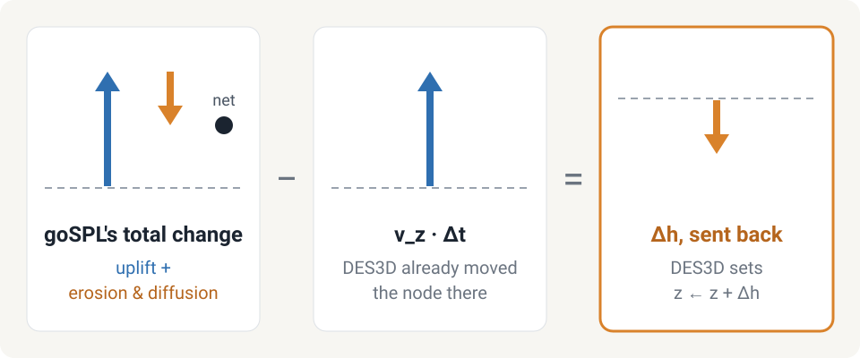
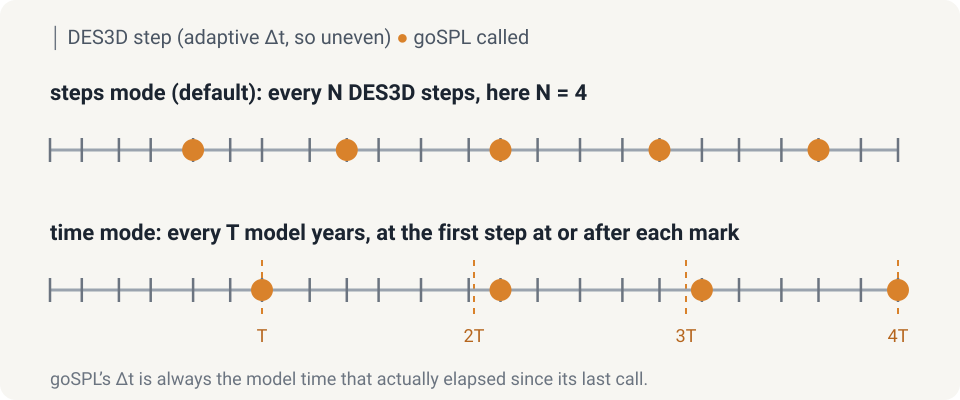
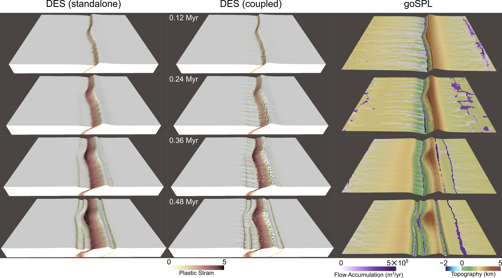

import useBaseUrl from '@docusaurus/useBaseUrl';

# Coupling DynEarthSol with GoSPL

This tutorial explains how to run DynEarthSol coupled with **GoSPL** (Global Scalable Paleo Landscape Evolution) to simulate the interaction between tectonic deformation and surface processes like erosion and sediment transport.

## What is GoSPL?

[GoSPL](https://github.com/Geodels/gospl) is a Python-based landscape evolution model that simulates:
- **Hillslope diffusion** — DES already does this natively (`surface_process_option = 1`, `surface_diffusivity`); see e.g. [Tectonic rifting and subduction](./tectonics)
- **River incision and sediment transport** — new to DES, added through the coupling
- **Marine deposition** — also added through the coupling
- **Flexural isostasy** — GoSPL's own simplified stand-in for tectonics; coupled with DES, much more sophisticated tectonic motions are available instead, through DES's own mechanical solver

When coupled with DynEarthSol, you can study how tectonic processes (uplift, extension, compression) interact with surface erosion over geological timescales.

## Prerequisites

Before starting, ensure you have:

- ✅ GoSPL 2026.6.30 or later installed through conda (earlier releases do not
  read the letter boundary codes used below)
- ✅ `gospl_extensions`
- ✅ DynEarthSol compiled with GoSPL support **and MMG** (`ndims=3
  usegospl=1 usemmg=1`; the source tree must include the `gospl_driver`
  directory), which needs a C++ toolchain and `make` — MMG isn't optional
  here, see [below](#build-dynearthsol-with-gospl-support)

:::tip Skip the setup with Docker
Everything from here through [Build DynEarthSol with GoSPL
support](#build-dynearthsol-with-gospl-support) can be skipped with one
Docker image — see [Running with Docker](#running-with-docker) at the end of
this page.
:::

### Install GoSPL
Refer to https://gospl.readthedocs.io/en/latest/getting_started/installConda.html.

**Already have conda, from whatever distribution?** Create the `gospl`
environment directly — the rest of this tutorial assumes an environment
named `gospl`, activated with `conda activate gospl`, whichever track you
took to get here:

```bash
# or `conda create` if you don't have mamba
mamba create -y -n gospl -c geodels -c conda-forge gospl python=3.11
```

**Need conda first?** The quickest way to get one is Miniforge:

```bash
curl -fsSL "https://github.com/conda-forge/miniforge/releases/latest/download/Miniforge3-Linux-$(uname -m).sh" -o /tmp/miniforge.sh
bash /tmp/miniforge.sh -b -p $HOME/miniforge3
rm /tmp/miniforge.sh
$HOME/miniforge3/bin/mamba create -y -n gospl -c geodels -c conda-forge gospl python=3.11
$HOME/miniforge3/bin/conda clean -afy
```

If your conda lives somewhere other than `$HOME/miniforge3`, remember to
update `CONDA_ENV_PATH` when [building DynEarthSol with GoSPL
support](#build-dynearthsol-with-gospl-support) below.

### Install gospl_extensions

GoSPL is written in Python and DynEarthSol in C++. `gospl_extensions` is the
bridge between them. It provides:

- a **C++ entry point**: `libgospl_extensions.so` and a header, so DynEarthSol
  can drive a Python model from compiled code;
- **`EnhancedModel`**: a GoSPL subclass that can be stepped externally, take
  imposed velocities and hand back an elevation change;
- **interpolation** between the DES mesh and the GoSPL mesh, which are built
  independently and at different resolutions.

```
git clone https://github.com/GeoFLAC/gospl_extensions.git
cd gospl_extensions/cpp_interface
conda activate gospl
make install-local
```
:::tip Check your build
You will see this message if successful:
```
Installing locally for DynEarthSol integration...
✅ Installed locally to gospl_extensions/lib and gospl_extensions/include
```
:::

### Build DynEarthSol with GoSPL support

The build itself just needs `usegospl=1` (plus `ndims=3` and `usemmg=1`,
below) — set the two paths first, if yours aren't at their defaults, so the
build command stays copy-pasteable either way:

1. `GOSPL_EXT_DIR` defaults to `$(HOME)/opt/gospl_extensions`. If
   `gospl_extensions` isn't there, `export` the real path once, in the same
   shell you'll build and run in:
   ```bash
   export GOSPL_EXT_DIR=/path/to/gospl_extensions
   ```
2. `CONDA_ENV_PATH` defaults to `$(HOME)/miniforge3/envs/gospl`, where the
   Miniforge install above puts it. If your `gospl` environment is
   elsewhere, `export` it the same way:
   ```bash
   export CONDA_ENV_PATH=/path/to/envs/gospl
   ```
   Either variable can also be edited directly in the Makefile instead —
   but exporting means the build command below never needs editing, whether
   your paths are the defaults or not: `make` reads an exported variable the
   same way it reads one passed on its own command line.
3. Check both paths before building, whether you exported them or are
   relying on the defaults (the `:-` fallback below matches the Makefile's
   own default, so this works either way):
   ```bash
   ls "${GOSPL_EXT_DIR:-$HOME/opt/gospl_extensions}"
   ls "${CONDA_ENV_PATH:-$HOME/miniforge3/envs/gospl}"
   ```
   The first should list `include` and `lib` (from `make install-local` in
   [Install gospl_extensions](#install-gospl_extensions)); the second should
   look like a Python environment (`bin/python3`, `lib/python3.11`, …). An
   empty or missing directory here means a wrong path now, not a build
   error later.
4. Build with any conda environment active or none; it doesn't matter unless
   that environment has its own Boost or compilers ahead of the system ones.
   `make config` prints what was actually picked up:
   ```bash
   make clean
   make -j4 usegospl=1 ndims=3 usemmg=1
   ```
   `ndims=3` and `usemmg=1` are both **required** for the GoSPL coupling —
   not just recommended. Plain TetGen remeshing (`usemmg=0`) doesn't fail at
   startup; it lets a coupled run start and then fails partway through, at
   the first remesh, which wastes far more time than it saves. See
   [Adaptive mesh refinement with MMG](./usingmmg) and
   [Known limitations](#known-limitations) below.

:::tip This builds whatever commit is checked out, not a specific release
A plain clone's `master` branch is typically ahead of the latest tagged release (e.g.
`v2.0.2`), not that release itself. For a specific, reproducible version, check out
its tag before building: `git checkout v2.0.2`. The running binary's own startup
output names exactly what it was built from, e.g.
`[build][code] rev=v2.0.2-136-gc96c00e, branch=master, ...` means 136 commits past
`v2.0.2`; see [Provenance](../usage/run#provenance).
:::

:::tip Check your build
When the build is successful, you should see the following message:
```
==============================================
✅ DynEarthSol built with GoSPL support!
==============================================
🚀 To run with GoSPL support:

Use the wrapper script (PYTHONPATH is set automatically):
  ./dynearthsol-gospl your_input.cfg

Or set PYTHONPATH manually and use the regular executable:
  PYTHONPATH=/home/auser/opt/gospl_extensions/cpp_interface:$PYTHONPATH ./dynearthsol3d your_input.cfg
==============================================
```
:::

### Verify the build

Run these four checks before moving on:

```bash
./dynearthsol3d --help | grep gospl                # options registered?
conda activate gospl && python -c "import gospl"   # GoSPL importable?
ldd dynearthsol3d | grep python                    # linked to Python?
cat dynearthsol-gospl                              # wrapper script written?
```

## How coupling works

One coupling event, between the previous event at $t_\mathrm{prev}$ and the
current one at $t_\mathrm{now}$ (`gospl_coupling_frequency` DES steps apart in
`steps` mode):



DES3D and GoSPL exchange data in a way inspired by the [**ASPECT-FastScape simple
coupling scheme**](https://onlinelibrary.wiley.com/doi/10.1029/2021TC007166):

1. **DES → GoSPL:** At each coupling event, DES passes time-averaged
   surface velocities to GoSPL. The velocity is $\overline{v} = \Delta
   \mathrm{coord} / \Delta t$, where $\Delta\mathrm{coord}$ is the
   displacement of each surface node since the *previous* coupling event and
   $\Delta t$ is the model time elapsed since then. Time-averaging filters
   out quasi-dynamic inertial oscillations that would otherwise perturb
   GoSPL's drainage network. The first coupling event, and the first one
   after any remesh, has no valid previous displacement to average over, so
   it uses the instantaneous velocity instead.
   
2. **GoSPL → DES:** GoSPL advances by $\Delta t$: it applies the
   velocities (horizontal advection and vertical uplift), river incision and
   hillslope diffusion, and returns an elevation change $\Delta h$ at
   every surface node.
3. **Tectonic uplift accounting:** $\Delta h$ contains *only* the erosion
   and diffusion component. GoSPL subtracts the uplift
   ($v_z \Delta t$) before returning it, because DES already applied the
   same displacement through its Lagrangian mechanical solver; returning
   the full change would count the tectonic uplift twice. DES adds
   $\Delta h$ to the z-coordinates of its surface nodes. Note that
   $\Delta h$ is not $\Delta\mathrm{coord}_z$: $\Delta\mathrm{coord}_z$
   is DES's tectonic displacement, while $\Delta h$ is the surface-process
   change added on top of it. 
4. **Persistent drainage state:** GoSPL's river network state is
   preserved across DES remeshing events so that drainage divides are
   not reset after mesh adaptation.
5. **Padded GoSPL mesh:** The GoSPL mesh extends beyond the DES domain
   by a configurable padding fraction (`gospl_mesh_padding`, default
   0.1) to avoid edge artifacts during extension. 

### What crosses the interface

| Direction | What is passed | Driver call |
|-----------|----------------|-------------|
| DES → GoSPL, once | Initial surface elevation, seeding GoSPL's `hGlobal` | `apply_elevation_data()` |
| DES → GoSPL, each event | Time-averaged surface velocity (vx, vy, vz) | `set_surface_velocity()` |
| GoSPL → DES, each event | Elevation change from erosion and diffusion only | `run_and_get_erosion()` |
| GoSPL → DES, on demand | Current elevation at any query point | `interpolate_elevation_to_points()` |

You never call these directly, but knowing the names makes the log output
readable.

### Coupling modes

| `gospl_coupling_mode` | Trigger parameter | Meaning |
|-----------------------|-------------------|---------|
| `steps` (default) | `gospl_coupling_frequency` | GoSPL runs every N DES steps |
| `time` | `gospl_coupling_interval_in_yr` | GoSPL runs every T model years |



### Known limitations

- **MMG is effectively required (`usemmg=1`), not just recommended.**
  Nothing stops you from building and starting a coupled run with plain
  TetGen remeshing (`usemmg=0`); it simply fails partway through, at the
  first remesh, rather than at startup or at input validation. A coupled
  run that gets to run for a while before failing isn't a meaningful
  result, so treat `usemmg=1` as a hard requirement alongside `ndims=3`.
- **The coupling interval is a trigger, not a clamp.** In `time` mode,
  `gospl_coupling_interval_in_yr` only decides *when* coupling fires. The
  `dt` handed to GoSPL is the time accumulated since the last event, so if
  DES's adaptive time step exceeds the interval, coupling fires every DES
  step and GoSPL's step silently becomes DES's `dt`. There is no
  sub-stepping or truncation back to the nominal interval.
- **Remeshing between coupling events.** The coupling clock is unaffected
  by remeshing: coupling occurs at the set schedule whether remeshing occurs
  during a coupled interval or not. GoSPL's elevation state is not re-seeded
  from DES afterwards, i.e. GoSPL owns the topography. Remeshing renumbers
  the nodes, so the coupling event right after any remesh uses the
  instantaneous velocity instead of the time-averaged one, even if the
  remesh happened to leave the surface node count unchanged, where comparing
  node counts alone would otherwise miss the renumbering and difference
  unrelated nodes. The log line names the case: `GoSPL: instantaneous
  velocity at t=... yr: remeshed since the last coupling (surface nodes
  N0 -> N1[, same count])`.
- **The GoSPL mesh is fixed at startup.** It is generated once, sized to the
  DES model's *initial* top surface plus `gospl_mesh_padding` on each side,
  and never regenerated (on restart an existing mesh file is reused as is).
  The padding fraction therefore bounds how much lateral extension the DES
  model can accumulate before its surface approaches the GoSPL mesh
  boundary, where edge artifacts can reappear. Nothing warns you when this
  happens, so choose a generous `gospl_mesh_padding` for strongly extensional
  models.

## Quick Start

### Step 1: Enable GoSPL in your configuration

| Parameter | Default | Description |
|-----------|---------|-------------|
| `surface_process_option` | 0 | Set to **11** to enable GoSPL |
| `surface_process_gospl_config_file` | (empty) | Path to your GoSPL YAML file |
| `gospl_coupling_mode` | `steps` | `steps` or `time` — controls what the coupling interval means |
| `gospl_coupling_frequency` | 1 | GoSPL runs every N DES steps (used when `gospl_coupling_mode = steps`) |
| `gospl_coupling_interval_in_yr` | 1000 | GoSPL runs every T model years (used when `gospl_coupling_mode = time`) |
| `gospl_velocity_coupling` | `true` | Pass surface velocities to GoSPL for smoother drainage-network evolution |
| `gospl_mesh_resolution` | -1 | GoSPL grid spacing in meters (-1 = automatic: nx = ny = floor(√n_top) + 1) |
| `gospl_mesh_padding` | 0.1 | Fractional domain padding for GoSPL mesh (avoids boundary artifacts) |
| `gospl_mesh_perturbation` | 0.3 | Grid randomization (0–1) |

:::info Coupling frequency tip
For models with slow erosion rates, you can set `gospl_coupling_frequency = 100` or higher to speed up computation. GoSPL will run less often but with accumulated time. Alternatively, use `gospl_coupling_mode = time` to couple at fixed model-time intervals regardless of step size.
:::

```cfg title="my_simulation.cfg"
[control]
surface_process_option = 11
surface_process_gospl_config_file = gospl_config.yml
gospl_coupling_mode = steps
gospl_coupling_frequency = 100      # Run GoSPL every 100th DynEarthSol time step
gospl_velocity_coupling = true      # Pass surface velocities to GoSPL
gospl_mesh_resolution = 500         # in meters
gospl_mesh_padding = 0.1            # extend GoSPL mesh 10 % beyond DES domain
gospl_mesh_perturbation = 0.3       # 30 % of random perturbations, +0.5/-0.5 x h
```

### Step 2: Create a GoSPL configuration file

Create a YAML file for GoSPL settings. The coupling uses the `EnhancedModel`
from `gospl_extensions`, not stock GoSPL, so a standard GoSPL configuration may
not work. Start from the template below or from the
[bundled example](#worked-example-a-gaussian-weak-zone-rift), and keep these
five sections: `domain`, `time`, `spl`, `diffusion` and `output`.

```yaml title="gospl_config.yml"
name: coupled_simulation

domain:
    npdata: ['./gospl_mesh','v','c','z']
    flowdir: 1
    seadepo: False
    bc: 'oooo'   # boundary conditions per edge N,E,S,W (o=open, f=fixed, w=wall)

output:
    dir: 'coupling_test' # Output directory

time:
  start: 0.0
  end: 1000000.0   # 1 Myr
  tout: 5000.0     # 5 kyr output interval
  dt: 1000.0       # 1 kyr time step (to be overwritten by DynEarthSol)

spl:
    K: 4.e-6
    d: 0.
    m: 0.4

diffusion:
    hillslopeKa: 0.2
    hillslopeKm: 1.0

sea:
    position: -10.

climate:
  - start: 0.
    uniform: 1
```

The keys you will change most often:

| Key in the YAML | What it sets |
|-----------------|--------------|
| `spl: K` | Bedrock river incision rate (erodibility) |
| `spl: m`, `spl: n` | Drainage-area and slope exponents of the stream power law |
| `diffusion: hillslopeKa` | Hillslope diffusivity, m²/yr |
| `domain: flowdir` | Flow routing (`6` is multi-direction) |
| `domain: bc` | Boundaries, in the order N,E,S,W (o=open, f=fixed, w=wall): e.g., `'wowo'` opens east and west closing north and south. The letters need GoSPL 2026.6.30 or later; earlier releases read only the digits `0` and `1`, in the order S,E,N,W |
| `domain: seadepo` | Marine deposition on or off |
| `sea: position` | Sea level in metres relative to the initial surface |

### Output timing

GoSPL writes output on its own clock, every `time: tout` years, but only at a
coupling event. Each event runs GoSPL for one step, and GoSPL checks for output
at that step's start and end. Its clock starts at `time: start` and advances by
the coupling interval, so it trails DES time by whatever has accumulated since
the last event. Three consequences:

- **Outputs snap to coupling events.** A file is written at the first coupling
  event at or after each multiple of `tout`, so outputs are exactly `tout` apart
  only when the actual coupling times land on those multiples. A configured
  interval that divides `tout` does not guarantee it. In `time` mode an event
  fires once the accumulated DES time reaches `gospl_coupling_interval_in_yr`,
  usually overshooting it by part of a DES step that is not carried over (see
  [Known limitations](#known-limitations)); in `steps` mode the interval in
  years follows DES's adaptive time step. Expect spacing near `tout`, off by up
  to one coupling interval.
- **A coupling interval longer than `tout` mislabels outputs.** Every event then
  writes, but the time stamped in the output is the nominal one,
  `start + k·tout`, which falls further behind the model time with each write.
  In `steps` mode the interval in years varies with DES's adaptive time step, so
  this can happen without you noticing.
- **`dt` and `end` still bound `tout`.** When GoSPL reads the YAML it raises
  `tout` to `dt` if smaller, and lowers it to `end − start` if
  `start + tout > end`, printing a one-line notice for each. Keep `dt ≤ tout`
  and `end` at least the DES run length, `max_time_in_yr`.

:::tip Align GoSPL and DES frames
Set `tout` equal to DES's `output_time_interval_in_yr` and couple at a divisor
of it. GoSPL frames still fall on coupling events, so they can sit up to one
coupling interval from the matching DES frame.
:::

### Step 3: Run your simulation

Run from the directory that holds the GoSPL YAML: the path in
`surface_process_gospl_config_file` is resolved relative to the working
directory, not to the `.cfg` file.

```bash
./dynearthsol-gospl my_simulation.cfg
```

DynEarthSol will automatically:
1. Generate a mesh for GoSPL at startup
2. Exchange elevation data between the two models
3. Apply erosion/deposition changes to the DynEarthSol surface

In this example, 
- the mesh is generated automatically and saved as `gospl_mesh.npz` in your working directory.
- DynEarthSol outputs will be saved in the working directory.
- GoSPL outputs will be saved in the `coupling_test` directory. 

### Console output

Left unmitigated, GoSPL's own per-step logging would bury DES's progress
lines: a run coupling every 200 steps with DES reporting progress every
200000 steps would print roughly 4000 GoSPL lines between two DES progress
lines. To keep the log readable, DynEarthSol prints the first coupling
event in full as a setup check, then collapses every coupling event since
the last progress line into a single summary printed alongside it:

```
GoSPL: 5 couplings over 8.636e+02 yr, dh [-1.866e-04, 1.848e-02] m, net mean +1.095e-04 m, vel (m/yr) ...
```

This line reports the number of coupling events, the model years they
covered, the range and mean of the surface elevation change (`Δh`,
[erosion + diffusion only](#how-coupling-works)), and the velocity ranges
sent to GoSPL. It appears at DES's own reporting cadence — set by
`sim.info_display_step_interval` (see [Progress reporting](../usage/run#progress-reporting))
— so a coarser interval means less GoSPL output too. GoSPL's `--- step done`
lines are filtered out; its `+++ Output` lines, and any errors or
instantaneous-velocity-fallback notices, are not and still print as they
happen.

## Visualizing results

A coupled run leaves two independent sets of output, in two different
formats, in two different places.

### DES3D's own output

Written to the working directory as usual. Convert it with `2vtk.py` and open
the result in ParaView or VisIt — see
[Visualizing outputs](../usage/visualize) for the full workflow.

### GoSPL's own output

GoSPL writes its own time series directly in a ParaView-readable format — no
conversion step needed. Inside the directory named by the YAML's `output:
dir` (`coupling_test` in the template above), you'll find `gospl.xdmf` plus
two subdirectories, `h5/` and `xmf/`, that hold the data the `.xdmf` file
indexes. In ParaView: **File → Open**, pick `gospl.xdmf`, **Apply**.

To see both side by side, as in the [comparison figure
above](#exercise-1-run-the-reference-case), open DES3D's converted output and
GoSPL's `gospl.xdmf` in the same ParaView session.

### A starter ParaView state

Rather than building a scene from a blank canvas, download a bundled
ParaView state file with a GoSPL visualization — elevation and
erosion/deposition color maps, representations and camera already set up:

<a href={useBaseUrl('/downloads/des-gospl/gospl-visualization.pvsm')}>gospl-visualization.pvsm</a>

In ParaView: **File → Load State**, pick the downloaded file. The state
remembers the machine it was saved on, so ParaView will ask you to locate its
missing data source the first time you load it — point it at your own run's
`gospl.xdmf`, and the rest of the visualization (colors, opacity, camera)
applies automatically.

## Worked example: a Gaussian weak zone rift

The [`gospl_driver/examples`](https://github.com/GeoFLAC/DynEarthSol/tree/master/gospl_driver/examples)
directory holds a ready-to-run pair of files: a DES config,
`gaussian-weakzone-3d-with-gospl.cfg`, and its GoSPL YAML,
`gospl_config_gaussian_weakzone_3D.yml`. The parameters were chosen to match
[an ASPECT + FastScape reference model](https://jaykeum.github.io/aspect-fastscape-coupling/docs/), so the results are comparable to
that work (in review for JGR). The weak zone's Gaussian along-strike shift (`weakzone_option
= 4`) is explained in [Weak zones](./weakzone#gaussian-along-strike-shift-weakzone_option--4).

| | Setting |
|---|---|
| Domain | 100 × 80 × 10 km, 1 km base mesh resolution, GoSPL mesh at 500 m |
| Forcing | ±1.5 cm/yr extension in x; a Gaussian weak zone seeds the rift |
| Duration | 1 Myr, output every 20 kyr, coupling every 200 steps |
| Surface law | `K = 1e-5`, `m = 0.4`, `n = 1`, hillslope `Ka = 1e-2` m²/yr |
| Boundaries | East and west open, north and south fixed base-level outlets (`bc: 'fofo'`) |
| Sea level | −2000 m, so marine processes stay inactive |

### Exercise 1: run the reference case

```bash
conda activate gospl
cd DynEarthSol/gospl_driver/examples   # the YAML path resolves from here
../../dynearthsol-gospl ./gaussian-weakzone-3d-with-gospl.cfg
```

If you prefer to manage the environment yourself, set `PYTHONPATH` and run the
executable directly:

```bash
conda activate gospl
export PYTHONPATH="$HOME/opt/gospl_extensions/cpp_interface:${PYTHONPATH}"
cd DynEarthSol/gospl_driver/examples
../../dynearthsol3d ./gaussian-weakzone-3d-with-gospl.cfg
```

Watch for the coupling messages in the log. Output is written to
`output_gaussian_weakzone_3D/` every 20 kyr.



Things to look for as the run proceeds:

- a rift valley opening above the weak zone, with uplifted flanks;
- channels organizing down those flanks as the relief grows;
- sediment accumulating in the axial low.

### Exercise 2: adjust the problem size

If the progress of the example model is found to be too slow on your computing environment, consider reducing the problem size. Three independent ways to do that:

- **Shrink the domain.** To advance significantly in model time over a reasonable amount of wall clock time, it is recommended to reduce the `y` dimension, originally 80 km, down to 10 km or so, keeping everything else the same. The Gaussian geometry of the weak zone will be lost but the action of the coupled physics will be still visible.
- **Start with larger elements.** Raise `resolution` (default `1e3`, in `[mesh]`) — it sets the base target element size for both the initial mesh and every remeshing target afterward, so a larger value means fewer, coarser elements from the very first step, across the whole domain, not just where strain localizes. This is the most direct lever on element count and wall-clock time; it leaves the domain size and the Gaussian weak zone's shape untouched.
- **Cap how finely the weak zone refines, instead.** Lower `mmg_metric_refine_coeff` (default 5, in `[mesh]`) — it sets how strongly plastic strain drives local refinement, with target element volume scaling as `1/(1 + coeff · plastic_strain)`, so a smaller value keeps the strained band coarser and the element count down without touching the domain size or losing the Gaussian weak zone's along-strike shape. See [Conservative remeshing](./usingmmg#conservative-remeshing-freeze--required-policy) for the full parameter set this belongs to.

Finish this exercise before moving on: settle on a domain size, `resolution`,
and/or `mmg_metric_refine_coeff` that finishes in a reasonable time on your
machine, and keep that `.cfg` around — the compression exercise below reuses it.

### Exercise 3: vary the erodibility

Change one line in the YAML, `spl: K`, and rerun. Nothing needs rebuilding.

| Run | `spl: K` | What you should see |
|-----|----------|---------------------|
| Reference | `1.0e-5` | Rivers keep pace with uplift; moderate flank relief |
| Weak erosion | `1.0e-6` | Tectonics dominates: higher, sharper flanks, little sediment |
| Strong erosion | `1.0e-4` | Flanks worn down as they rise; the valley fills faster |

As an optional second experiment, set `gospl_coupling_frequency = 50` in the
`.cfg` and check whether the result changes. If it does, the coupling interval
was too coarse.

Change one parameter at a time, and keep a log of what you changed.

### Exercise 4: a compression case

Everything so far has been extensional. This exercise reuses whichever
reduced-size setup you settled on in
[Exercise 2](#exercise-2-adjust-the-problem-size), so the run stays fast
enough to watch. Before running anything:

1. Make sure you have a scaled-down `.cfg` from Exercise 2 that finishes in a
   reasonable time on your machine.
2. Copy that file to a new name, e.g. `cp your-scaled-down.cfg compression.cfg`.
3. In the new file's `[bc]` section, flip the sign of `vbc_val_x0` and
   `vbc_val_x1`: whatever value was pulling the two end walls apart
   (extension) now pushes them together (convergence) at the same rate.
   Everything else — domain size, `mmg_metric_refine_coeff`, the dipping weak
   zone — stays as it was.

Only once the copy exists and both signs are flipped, run it the same way as
Exercise 1, pointing at the new file:

```bash
../../dynearthsol-gospl ./compression.cfg
```

Where the reference case opens a rift valley, this one should raise a
shortening welt along the weak zone instead, with GoSPL now eroding the
rising relief and depositing in the lows beside it rather than filling an
axial graben. See [Visualizing results](#visualizing-results) above to watch
the two cases side by side.


## Troubleshooting

### Build errors

| Message | Cause and fix |
|---------|---------------|
| `cannot find -lpython3.11` | Wrong conda path. Make sure the `gospl` environment exists (e.g. `~/miniforge3/envs/gospl`) with Python 3.11, or update `CONDA_ENV_PATH` in the Makefile |
| `cannot find -lgospl_extensions` | Extensions built elsewhere. Update `GOSPL_EXT_DIR` in the Makefile |
| `gospl-driver.hpp: No such file` | `gospl_driver` is not in the DynEarthSol source directory |

### Runtime errors

| Message | Cause and fix |
|---------|---------------|
| `GoSPL not initialized`, or an `ImportError` for `gospl` | The GoSPL Python package was not found. Activate the environment: `conda activate gospl` |
| `No module named 'gospl_python_interface'` | Add the `gospl_extensions/cpp_interface` directory to `PYTHONPATH`, or use the `dynearthsol-gospl` wrapper |
| `The input file is not found`, or `Cannot find gospl_config.yml` | Run from the directory that holds the YAML, or use an absolute path |

Most of these come from a path assumption. Nearly all are fixed by editing a
directory variable in the Makefile or by changing directory before running. To
avoid depending on the working directory, use an absolute path:
```cfg
surface_process_gospl_config_file = /full/path/to/gospl_config.yml
```

### GoSPL step failed (exit code 53)

```
Error in run_and_get_erosion: error code 77
[0] Unexpected state: bad hmax in TSAdaptChoose()
```

Any failed coupling step, this PETSc error included, stops the run with
[exit code `53`](../usage/run#exit-codes) rather than skipping that step and
continuing: a failed call leaves GoSPL's surface already partly advanced, so
retrying or ignoring the failed interval would apply it twice.

This particular PETSc error was a round-off edge case in GoSPL's hillslope
and marine-deposition solvers' adaptive time stepper, tripped by the ~1 ulp
overshoot of the coupling interval's end time. It's fixed in
`gospl_extensions` (`create_enhanced_model()` now sets
`ts_exact_final_time = interpolate`); a plain `git clone` of
`gospl_extensions` per [Install gospl_extensions](#install-gospl_extensions)
already includes the fix.

### Simulation runs slowly

**Cause:** GoSPL is being called every time step.

**Solution:** Increase the coupling frequency:
```cfg
gospl_coupling_frequency = 200
```

## Running with Docker

An alternative to the manual setup above
([Install GoSPL](#install-gospl) through
[Build DynEarthSol with GoSPL support](#build-dynearthsol-with-gospl-support)):
`GOSPL=1 ./build.sh` in the DynEarthSol repository root builds the image
`dynearthsol/gcc-11-gospl`. It has the `gospl` conda environment (activated in
every login shell), `gospl_extensions` and a 3D `dynearthsol3d` already
inside, so none of the host setup is needed. Mount a directory for your case
and run from it:

```bash
docker run --rm -it -v /path/to/case:/home/human/case dynearthsol/gcc-11-gospl bash
cd ~/case
cp ~/DynEarthSol/gospl_driver/examples/* .
~/DynEarthSol/dynearthsol-gospl ./gaussian-weakzone-3d-with-gospl.cfg
```

The `cp` above seeds the mounted directory with the bundled example — copy in
your own `.cfg` and GoSPL YAML instead once you have one.

:::tip This builds whatever commit is checked out, not a specific release
The Dockerfile copies your local working tree as-is; it doesn't pin or fetch a
specific DynEarthSol version. A plain clone's `master` branch is typically ahead
of the latest tagged release (e.g. `v2.0.2`), not that release itself. For a
specific, reproducible version, check out its tag on the host before running
`./build.sh`: `git checkout v2.0.2`. The running binary's own startup output
names exactly what it was built from, e.g.
`[build][code] rev=v2.0.2-136-gc96c00e, branch=master, ...` means 136 commits
past `v2.0.2`; see [Provenance](../usage/run#provenance).
:::

### WSL troubleshooting

If `./build.sh` fails with `docker: command not found`, install Docker
Desktop on Windows, then enable it for WSL: Settings → Resources → WSL
Integration → check "Enable integration with my default WSL distro".

If instead you see

```
ERROR: permission denied while trying to connect to the Docker daemon socket at unix:///var/run/docker.sock
```

add yourself to the `docker` group:

```bash
sudo usermod -aG docker $USER
```

then restart a new shell to take effect. When starting a plain new shell in
the same session isn't enough, you need to restart wsl (`wsl --shutdown` from
Windows, then reopen the terminal).

## Next Steps

- Copy the example pair to start your own model, rather than writing configs from scratch
- Learn about [GoSPL configuration options](https://gospl.readthedocs.io/)
- See the [example configurations](https://github.com/GeoFLAC/DynEarthSol/tree/master/gospl_driver/examples) and their README for the parameter rationale
- Read [`gospl_driver/README.md`](https://github.com/GeoFLAC/DynEarthSol/tree/master/gospl_driver/README.md) for the coupling in detail
