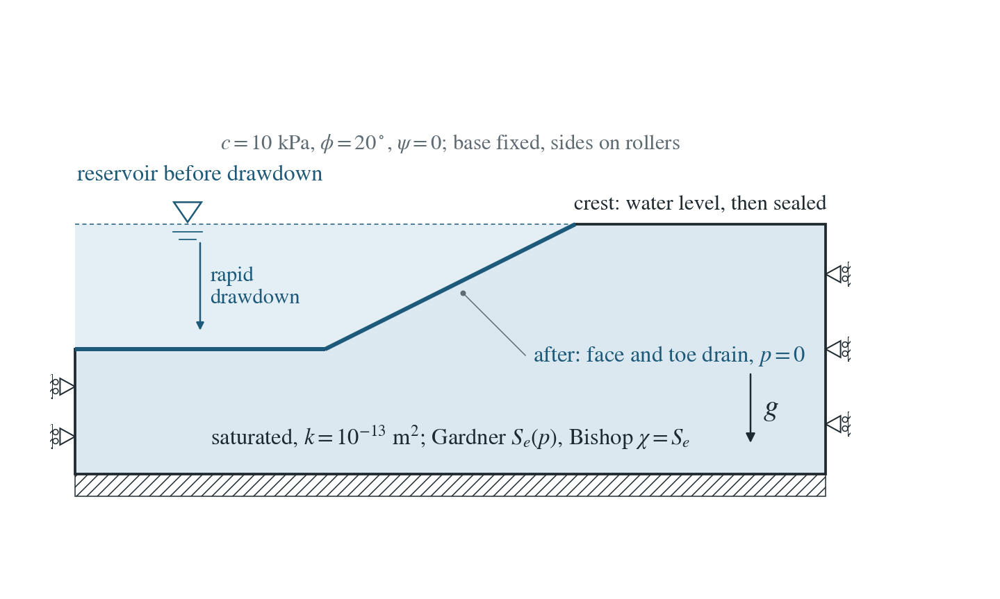
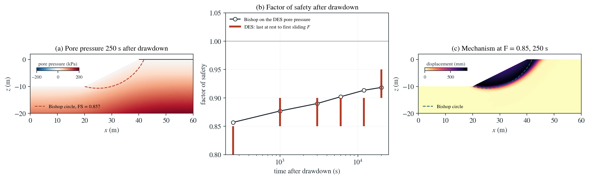

# Rapid drawdown of a reservoir against an embankment

A reservoir stands at the crest of the embankment and the slope is saturated. When the reservoir is drawn down quickly the water no longer supports the face, while the pore pressure inside falls only as the slope drains: the classic critical case for the upstream slope of a dam.

**On the selected 0.5 m mesh, 250 s after drawdown DES brackets the factor of safety at 0.8–0.85 against 0.857 from Bishop on the same pore pressure; at 20000 s, 0.9–0.95 against 0.918. The largest midpoint gap is 4.2%. Three of six brackets contain Bishop; the other three are slightly conservative. The original all-times containment criterion is not met.**

:::info At a glance

| | |
| --- | --- |
| Dimension | 2D |
| Build | `make ndims=2` from the poromechanics source |
| Inputs | [drawdown.zip](/downloads/poromechanics/drawdown.zip) |
| Checked with | DynEarthSol `4ec082f` (poromechanics branch) |

:::

## Problem setup



**Slope.** A 0.5 m mesh of the embankment of the strength-reduction page ($H=10$ m, 2:1, $c=10$ kPa, $\phi=20^\circ$, $\psi=0$), saturated: porosity 0.3, saturated unit weight $20\ \mathrm{kN/m^3}$, $k=10^{-13}\ \mathrm{m^2}$, Gardner retention ($\alpha=2.4\times10^{-4}$ Pa$^{-1}$), Bishop $\chi=S_e$.

**Reservoir.** Water stands at the crest. DES loads the face and the toe platform with its pressure, and the slope fills through the crest and the base until its pore pressure is hydrostatic.

**Drawdown.** At $t=0$ the reservoir drops to the toe platform: the water load is removed, the face and the toe platform drain at $p=0$, and the crest and base are sealed. DES computes the undrained response and the drainage that follows.

**What is compared.** At several times, the DES factor of safety by strength reduction (pore pressure held during each trial) against Bishop’s simplified method on the pore pressure and unit weight DES has then.

## Input and how to run

[drawdown.zip](/downloads/poromechanics/drawdown.zip) contains the selected
0.5 m input, mesh and hydrostatic reservoir frame. Keep the supplied
`reservoir.save.000100`, `reservoir.chkpt.000100` and `reservoir.info`
together. Use the recorded 2D source revision for this checkpoint.
Run from the extracted `drawdown` folder:

```bash
export OMP_NUM_THREADS=1
dynearthsol2d input.cfg
```

The reservoir has filled for about 25000 s. This restart removes the water
load and runs 20000 s of drainage, saving a checkpoint every 250 s.
The bundle's [manifest](/downloads/poromechanics/drawdown/manifest.json)
records the input, starting-frame and solver hashes. The complete study
command below regenerates the reservoir and strength trials from source.

For one strength-reduction trial at 250 s after drawdown, copy the input:

```bash
cp input.cfg trial.cfg
```

Edit the following settings in `trial.cfg` for a trial factor $F$:

| Setting | Trial value |
| --- | --- |
| `sim.modelname` | a fresh name, e.g. `srf250-0.850` for $F=0.85$ |
| `sim.restarting_from_modelname` | `drawdown` |
| `sim.restarting_from_frame` | `101` (250 s after drawdown) |
| `sim.max_time_in_yr` | that frame's saved time plus 2000 s, divided by 31556926 |
| `sim.output_time_interval_in_yr` | `3.168876453507857e-7` (10 s) |
| `sim.checkpoint_frame_interval` | `100000` |
| `mat.rheology_type` | `elasto-plastic` |
| `mat.hydraulic_perm` | `[1e-25]` |
| `mat.fluid_bulk_modulus` | `[1000]` |
| `mat.cohesion0`, `mat.cohesion1` | `[10000/F]` Pa, evaluated numerically |
| `mat.friction_angle0`, `mat.friction_angle1` | `[atan(tan(20°)/F)]` in degrees, evaluated numerically |

The trial settings keep pressure nearly fixed, as assumed by limit
equilibrium. Then run `dynearthsol2d trial.cfg`. The recorded rest criterion
compares the mean peak nodal speed in the last five frames with five frames
at three quarters of the trial; a ratio below one means deceleration.
Repeat factors to bracket rest and sliding. Frames 104, 112, 124, 148 and
180 give the other five comparison times.

### Settings that define this example

| Setting | Value | What it does here |
| --- | --- | --- |
| `sim.restarting_from_modelname` | `reservoir` | starts from the supplied filled-reservoir state |
| `sim.restarting_from_frame` | `100` | uses reservoir frame 100, the slope with hydrostatic pore pressure under the full reservoir |
| `sim.max_time_in_yr` | `0.001425994411974377` yr (about 45000 s) | end time counted from the start of the reservoir stage: 25000 s of filling plus 20000 s of drainage |
| `sim.checkpoint_frame_interval` | `1` | writes a restart checkpoint with every frame, so a strength-reduction trial can start at any saved time |
| `control.has_hydraulic_diffusion` | `true` | turns on Darcy flow, so the slope drains through the face after drawdown |
| `bc.has_water_loading` | `no` | removes the reservoir's pressure on the face and toe platform (it is on in reservoir.cfg) |
| `bc.hbc_z1` | `2` | drains the face and toe platform: pore pressure held at 0 (the crest is marked as a separate boundary in slope.poly and stays sealed) |
| `mat.retention_model` | `[3]` | Gardner exponential retention, so the slope desaturates where the pressure turns negative |
| `mat.retention_alpha` | `[0.00024]` | Gardner parameter: how quickly saturation falls with suction |
| `mat.residual_saturation` | `[0.05]` | saturation left at high suction |
| `mat.hydraulic_perm` | `[1e-13]` | permeability; drainage takes thousands of seconds, slow against the mass-scaled mechanics |
| `mat.bulk_modulus_s` | `[1e20]` | incompressible grains (with Biot coefficient 1) |
| `mat.rho0` | `[2483.9085481287316]` | grain density chosen so the saturated unit weight is 20 kN/m³ |
| `mat.rheology_type` | `elastic` | elastic during drainage; each trial switches to Mohr–Coulomb elasto-plasticity |

[input.cfg](/downloads/poromechanics/drawdown/input.cfg) holds the selected example’s settings; `dynearthsol2d -h` lists every option with its default.

## Output

DES writes `drawdown.info` (one line per saved frame: frame, step, time in seconds), `drawdown.save.NNNNNN` (the fields of each saved frame) and `drawdown.chkpt.NNNNNN` (checkpoints to restart from). `sim.output_step_interval` and `sim.output_time_interval_in_yr` set how often a frame is saved.

Set `DES_SOURCE` and `PYTHONPATH` as described in [Running the examples](../../benchmarks/poromechanics/running.md) before using the Python reader or converter.

| Field | What to look at |
| --- | --- |
| `pore pressure` | pressure (and suction above the zero contour) at each saved time after drawdown; panel (a) and the input to Bishop's method |
| `velocity` | in a trial, integrated in time it gives the displacement of the mechanism in panel (c); its peak over the mesh decides rest or sliding |
| `coordinate` | node positions of the fixed mesh, for the maps and for interpolating the pore pressure on Bishop's slices |

Read a frame in Python:

```python
from Dynearthsol import Dynearthsol      # in the DES source folder
model = Dynearthsol('drawdown')
frame = model.frames[-1]                 # model.time[i] is the time of frame i, in seconds
x = model.read_field(frame, 'coordinate')
value = model.read_field(frame, 'pore pressure')
```

View it in ParaView after `python3 "$DES_SOURCE/2vtk.py" -g drawdown`.

## Result: DES and the limit-equilibrium reference



[PDF figure](./img/drawdown/result.pdf)

| Time after drawdown (s) | DES strength-reduction bracket | Bishop | Within bracket |
| ---: | ---: | ---: | :---: |
| 250 | 0.80–0.85 | 0.857 | no |
| 1000 | 0.85–0.90 | 0.877 | yes |
| 3000 | 0.85–0.90 | 0.890 | yes |
| 6000 | 0.85–0.90 | 0.902 | no |
| 12000 | 0.85–0.90 | 0.913 | no |
| 20000 | 0.90–0.95 | 0.918 | yes |

The misses exceed the upper bracket by 0.00202–0.01341. All 72 trials and
six Bishop searches reproduced their recorded metrics in the remote
raw-field replay; that checks reproducibility, not exact agreement with
limit equilibrium.

(a) Pore pressure at the first comparison time after drawdown, with the zero-pressure contour and Bishop's critical circle on the same pore pressure. (b) Factor of safety against time after drawdown: Bishop's method on the DES pore pressure (line and circles) and the DES strength-reduction bracket, from the last F at rest to the first F sliding (bars). (c) Displacement in the first sliding trial at the first comparison time, with Bishop's circle.

This joins the verified pieces in the problem dam engineers check first: the undrained response to unloading, unsaturated drainage and effective-stress plasticity. Limit equilibrium needs the pore pressure as an input; DES computes it and finds the mechanism.

To reproduce the whole study behind this figure, from the DES source folder:

```bash
python3 benchmarks/poromechanics/drawdown_slope.py dynearthsol2d OUT --spacings 0.5
```

The study’s full numbers: [record.json](/downloads/poromechanics/drawdown/record.json).

## Bishop reference

$$
FS=\frac{\sum\left[c\,b+(W-\chi p\,b)\tan\phi\right]/m_\alpha}{\sum W\sin\alpha}
$$

$$
m_\alpha=\cos\alpha\left(1+\frac{\tan\alpha\tan\phi}{FS}\right)
$$

$$
W=b\int_{z_b}^{z_s}\gamma\,dz
$$

$$
\gamma=g\left[\rho_s(1-n)+\rho_f\,n\,S\right]
$$

$p$ and $S$ are DES’s pore pressure and saturation at that time, $\chi=S_e$ (Bishop), $n$ the porosity; the other symbols are those of the strength-reduction page.

### Derivation

Before drawdown the reservoir’s pressure on the face balances the pore pressure inside: only buoyant weight drives sliding. Removing the water removes that support at once, and the undrained response lowers the pore pressure by about the removed load; the remaining pressure then drains through the face. The factor of safety is lowest just after drawdown and recovers as the slope drains.

A strength-reduction trial nearly holds the pore pressure: negligible flow and a compressible pore fluid limit its change during deformation. With a stiff fluid the trial would be undrained and excess pore pressure of order 10 kPa would lower the factor of safety below limit equilibrium.

Morgenstern (1963), Géotechnique 13(2), 121–131 (stability charts for rapid drawdown); Bishop (1955), Géotechnique 5(1), 7–17.

## Validity and limits

No exact solution: Bishop’s method needs the pore pressure as an input, here taken from DES, so the comparison checks the mechanics given the hydraulics. The 0.05 trial-factor spacing and small conservative discrepancies remain part of this result. 2D, small strain; drawdown is instantaneous; the earliest comparison is a few hundred seconds after drawdown, once the mass-scaled mechanics has settled.

## Reproduction

[Commands, solver hashes and portable inputs](../../benchmarks/poromechanics/running.md).
