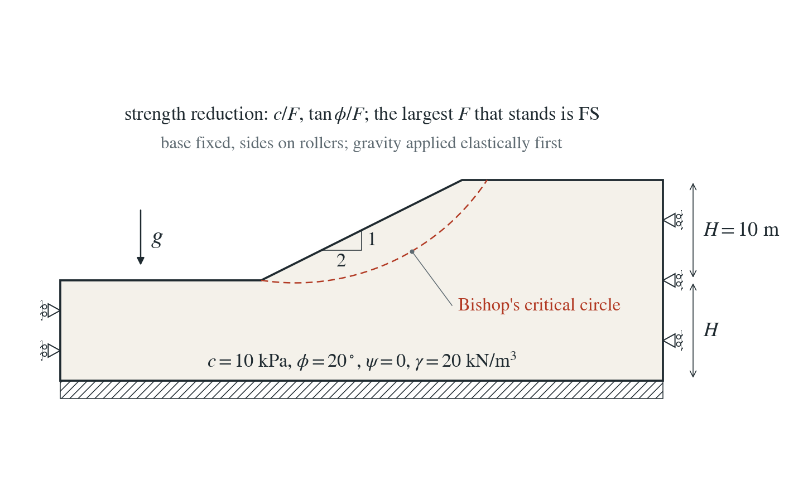
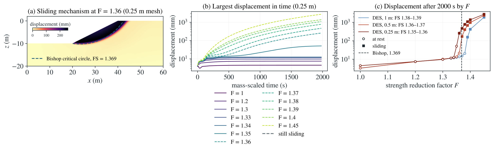

# Factor of safety of an embankment by strength reduction

The standard slope-stability problem of geotechnical practice: how far can the strength of a homogeneous embankment be reduced before it slides? Strength reduction answers it with a deforming model that finds its own mechanism; limit-equilibrium methods of slices answer it on a trial slip circle.

**On the 0.25 m mesh the slope comes to rest at F = 1.35 and keeps sliding at F = 1.36: FS = 1.355 ± 0.005, against 1.369 from Bishop’s simplified method (-1.0%). The midpoints fall by 0.020 and 0.010 as the mesh halves, toward about 1.345 (-1.7%), slightly below a circular mechanism as expected. The mechanism passes through the toe, as Bishop’s critical circle does.**

:::info At a glance

| | |
| --- | --- |
| Dimension | 2D |
| Build | `make ndims=2` from the poromechanics source |
| Inputs | [embankment.zip](/downloads/poromechanics/embankment.zip) |
| Reproduce with | DynEarthSol [`3774df0`](https://github.com/GeoFLAC/DynEarthSol/tree/3774df00ba1708a4f70a836d2073f845653aac64) |

:::

## Problem setup



**Slope.** A homogeneous slope $H=10$ m high with a 2:1 face, on a foundation $H$ deep; toe platform and crest 20 m long; plane strain. The base is fixed and the sides are rollers.

**Material.** Mohr–Coulomb, $c=10$ kPa, $\phi=20^\circ$, no dilation; $E=100$ MPa, $\nu=0.3$, $\gamma=20\ \mathrm{kN/m^3}$; dry.

**Strength reduction.** Gravity is applied elastically (from an unstressed, gravity-free checkpoint). Each trial restarts from that state with $c/F$ and $\tan\phi/F$ and runs explicitly (no PT) with DES’s default damping for 2000 s of mass-scaled time on the fixed original mesh (small strain, as the factor of safety is defined). The factor of safety lies between the largest $F$ that decelerates toward rest and the smallest that does not.

**What is compared.** The DES factor of safety, bracketed on each mesh, and the displacement as $F$ approaches it, against Bishop’s simplified method of slices on the same slope.

## Input and how to run

Every file this example needs is in [embankment.zip](/downloads/poromechanics/embankment.zip). Run from that folder:

```bash
# Optional: meshes slope.poly at 0.25 m and writes the unstressed, gravity-free state as frame seed 0 (zero steps).
dynearthsol2d seed.cfg
# Optional: restarts from seed frame 0 and applies gravity to the elastic slope in two equilibrium (PT) steps; writes gravity frames with checkpoints. The shipped gravity.chkpt.000002, gravity.save.000002 and gravity.info are this result, so both optional stages can be skipped.
dynearthsol2d gravity.cfg
# One strength-reduction trial at F = 1.36: restarts from gravity frame 2 as Mohr–Coulomb with c/F and atan(tan φ/F), runs explicitly for 2000 s of mass-scaled time and saves a frame every 10 s as srf1.360.*. At this F the slope keeps sliding.
dynearthsol2d input.cfg
# To try another factor F (here 1.30), edit the copy: set sim.modelname to a new name (srf1.300) so the outputs do not overwrite each other, cohesion0 and cohesion1 to 10000/F Pa, and friction_angle0 and friction_angle1 to atan(tan 20°/F) in degrees. Everything else, including the restart from gravity frame 2, stays.
cp input.cfg srf1.300.cfg
# Runs that trial. Judge it from the velocity history: if the peak nodal speed over the last frames is below that about three quarters through the run, the slope is coming to rest and F is below the factor of safety; otherwise it is sliding. The factor of safety lies between the largest F at rest and the smallest F sliding.
dynearthsol2d srf1.300.cfg
```

### Settings that define this example

| Setting | Value | What it does here |
| --- | --- | --- |
| `sim.is_restarting` | `yes` | starts from a saved state instead of a new mesh |
| `sim.restarting_from_modelname` | `gravity` | restarts from the elastic gravity state written by gravity.cfg |
| `sim.restarting_from_frame` | `2` | uses gravity frame 2, the slope at rest under gravity |
| `mat.rheology_type` | `elasto-plastic` | Mohr–Coulomb elasto-plasticity for the trial (the seed and gravity stages are elastic) |
| `mat.cohesion0` | `[7352.941176470587]` | reduced cohesion c/F; cohesion1 is the same, so there is no softening |
| `mat.friction_angle0` | `[14.98267722712702]` | reduced friction angle atan(tan φ/F); friction_angle1 is the same, so there is no softening |
| `mat.is_plane_strain` | `true` | plane-strain plasticity, as in the 2D slope-stability problem |
| `mat.rho0` | `[2038.735983690112]` | density giving a unit weight of 20 kN/m³ with control.gravity |
| `control.has_moving_mesh` | `false` | keeps the original geometry (small strain): the factor of safety refers to the undeformed slope |
| `control.has_poroelastic_pressure_feedback` | `false` | no pore-pressure coupling: the slope is dry |
| `bc.vbc_z0` | `3` | fixes the base in both directions; the sides are rollers |
| `control.characteristic_speed` | `1e-5` | speed used to size the stable explicit time step, since no boundary moves |
| `sim.max_time_in_yr` | `6.337752907015714e-05 yr = 2000 s` | runs each trial for 2000 s of mass-scaled time, long enough to tell rest from sliding |
| `sim.output_time_interval_in_yr` | `3.168876453507857e-07 yr = 10 s` | saves a frame every 10 s, the velocity history used to judge the trial |

[input.cfg](/downloads/poromechanics/embankment/input.cfg) holds all 49 settings that differ from DES’s defaults; `dynearthsol2d -h` lists every option with its default.

## Output

DES writes `srf1.360.info` (one line per saved frame: frame, step, time in seconds), `srf1.360.save.NNNNNN` (the fields of each saved frame) and `srf1.360.chkpt.NNNNNN` (checkpoints to restart from). `sim.output_step_interval` and `sim.output_time_interval_in_yr` set how often a frame is saved.

Set `DES_SOURCE` and `PYTHONPATH` as described in [Running the examples](../../benchmarks/poromechanics/running.md) before using the Python reader or converter.

| Field | What to look at |
| --- | --- |
| `velocity` | nodal velocity at each saved frame; integrated in time (trapezoid rule) it gives the displacement in panels (a)–(c), and its peak over the mesh decides whether a trial is coming to rest or sliding |
| `plastic strain` | shows the shear band of the mechanism and how much of the slope yields |
| `coordinate` | node positions of the fixed mesh, for plotting the mechanism |

Read a frame in Python:

```python
from Dynearthsol import Dynearthsol      # in the DES source folder
model = Dynearthsol('srf1.360')
frame = model.frames[-1]                 # model.time[i] is the time of frame i, in seconds
x = model.read_field(frame, 'coordinate')
value = model.read_field(frame, 'velocity')
```

View it in ParaView after `python3 "$DES_SOURCE/2vtk.py" -g srf1.360`.

## Result: DES and the analytical solution



(a) Displacement on the finest mesh in the first trial that keeps sliding, with Bishop's critical circle dashed: the mechanism passes through the toe. (b) Largest displacement against mass-scaled time for each strength-reduction factor on the finest mesh; dashed lines are trials still sliding at the end. (c) Final largest displacement against the factor F on each mesh, open circles at rest and filled squares sliding, with Bishop's factor of safety as a vertical dashed line.

This checks Mohr–Coulomb plasticity and explicit quasi-static equilibrium in the problem slope engineers solve every day: the mechanism is found, not assumed, and its factor of safety agrees with limit equilibrium. The hydromechanical slope cases build on it.

To reproduce the whole study behind this figure, from the DES source folder:

```bash
python3 benchmarks/poromechanics/bishop_reference.py
python3 benchmarks/poromechanics/strength_reduction_slope.py dynearthsol2d OUT --spacings 1 0.5 0.25
```

The study’s full numbers: [record.json](/downloads/poromechanics/embankment/record.json).

## Analytical reference

$$
c_F=\frac{c}{F}
$$

$$
\tan\phi_F=\frac{\tan\phi}{F}
$$

$$
FS=\frac{\sum\left[c\,b+(W-u\,b)\tan\phi\right]/m_\alpha}{\sum W\sin\alpha}
$$

$$
m_\alpha=\cos\alpha\left(1+\frac{\tan\alpha\tan\phi}{FS}\right)
$$

$b$, $W$ and $\alpha$ are the width, weight and base inclination of a slice of the sliding mass above a circular slip surface, and $u$ the pore pressure on its base (zero here). Bishop’s FS is the minimum over circles.

### Derivation

Reducing $c$ and $\tan\phi$ by the same $F$ until the slope cannot stand gives the same factor of safety as limit equilibrium defines it: the ratio of available to mobilised strength on the critical surface. Below it the explicit model dissipates the released energy and comes to rest; above it the sliding mass keeps moving.

Bishop’s simplified method takes moments about the centre of a trial circle and neglects interslice shear. For a shallow circle in cohesionless sand it reproduces the infinite-slope value $\tan\phi/\tan\beta$, and the critical value converges as the number of slices grows.

Bishop (1955), Géotechnique 5(1), 7–17; strength reduction as in Griffiths and Lane (1999), Géotechnique 49(3), 387–403.

[Original reference](https://doi.org/10.1680/geot.1999.49.3.387).

## Validity and limits

Bishop’s method satisfies moment equilibrium of a circular mechanism, so it is an engineering reference, not an exact solution; strength reduction finds the mechanism itself. Non-associated flow ($\psi=0$) and a finite mesh both shift the DES value. 2D, dry, small strain; on a moving mesh a failing slope slides, flattens and stops, which is a run-out question, not a factor of safety.

## Reproduction

[Commands, solver hashes and portable inputs](../../benchmarks/poromechanics/running.md).
