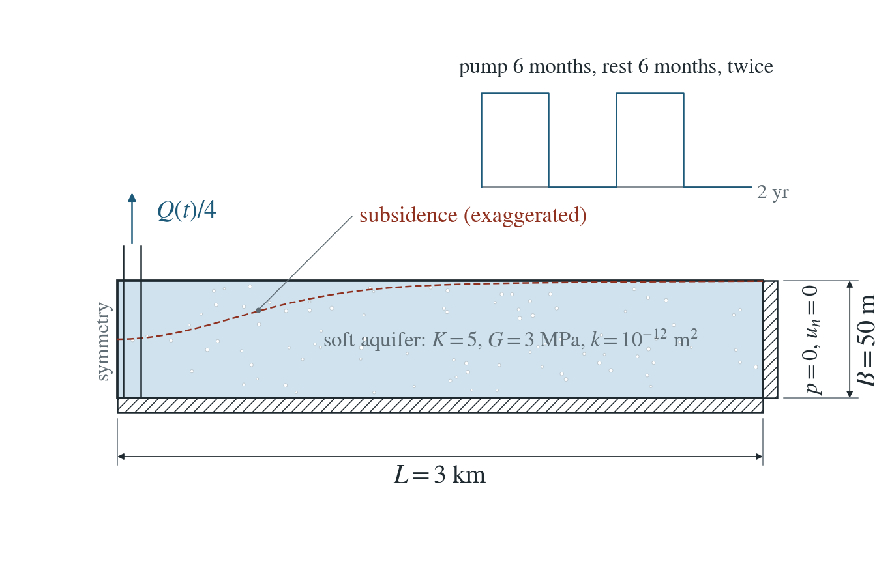
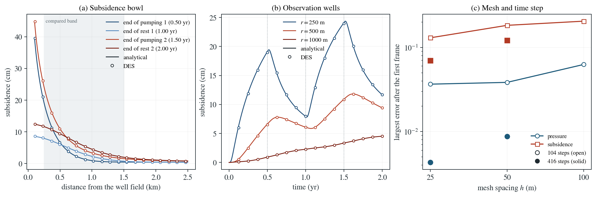

# Seasonal pumping and land subsidence

A well field pumps a soft confined aquifer for six months, rests for six months and repeats. The ground subsides around the wells, partly rebounds in each rest season and keeps a growing subsidence farther out.

**Largest subsidence error at the observation wells on the 25 m mesh (peak subsidence 24.1 cm): 0.32 cm at 250 m, 0.10 cm at 500 m, 0.01 cm at 1000 m. Over 250–1500 m after the first frame, the largest subsidence error is 7.0% of the largest subsidence in the same frame, and the largest pressure error 0.4% of the largest pressure drop; at the first frame (0.12 yr, a cone only a few elements wide) the subsidence error is 12.8%.**

:::info At a glance

| | |
| --- | --- |
| Dimension | 3D |
| Build | `make ndims=3` from the poromechanics source |
| Inputs | [regional.zip](/downloads/poromechanics/regional.zip) |
| Checked with | DynEarthSol `97f9794` (poromechanics branch) |

:::

## Problem setup



**Basin and pumping.** A confined aquifer of soft basin sediment, $B=50$ m thick, is modelled as a quarter of a 6 km square slab with a well field on its corner edge. It pumps $Q=0.02\ \mathrm{m^3/s}$ for six months, rests for six months, and repeats once.

**Boundaries.** Symmetry rollers at $x=0$ and $y=0$, a roller base and a traction-free top. The outer sides hold $p=0$ and zero normal displacement, so the basin is closed. Gravity is off: all fields are changes from the initial state.

**What is compared.** Pressure at the nodes and subsidence $B\,|\varepsilon_{zz}|$ of the elements for $250\le r\le1500$ m at 17 times, and the subsidence at three observation wells, against the averaged-aquifer model of the closed basin.

## Input and how to run

Every file this example needs is in [regional.zip](/downloads/poromechanics/regional.zip). Run from that folder:

```bash
# Runs the 3D quarter basin on a 25 m hexahedral mesh for two years (416 steps): pumping, rest, pumping, rest. DES writes frames basin.* every 26 steps (17 times) and a restart checkpoint every fourth frame. No mesh or restart file is needed; the run is long on a laptop.
dynearthsol3d input.cfg
```

### Settings that define this example

| Setting | Value | What it does here |
| --- | --- | --- |
| `sim.max_steps` | `416` | ends the run after 416 steps of control.fixed_dt, i.e. two years; sim.max_time_in_yr is set longer and is not reached |
| `control.fixed_dt` | `151715.9907692308` | time step of about 1.76 days, so each six-month season takes 104 steps and a rate change falls on a step boundary |
| `sim.output_step_interval` | `26` | writes a frame every 26 steps, about every month and a half |
| `control.has_hydraulic_diffusion` | `true` | turns on Darcy flow of the pore pressure |
| `control.has_PT` | `true` | iterates each step to mechanical equilibrium, so the basin deforms quasi-statically with the pressure |
| `control.gravity` | `0` | no gravity: pressure and subsidence are changes from the initial state |
| `bc.hbc_x1` | `2` | outer side x = 3 km held at the pressure in bc.hbc_pressure (zero change) |
| `bc.hbc_y1` | `2` | outer side y = 3 km held at the pressure in bc.hbc_pressure (zero change) |
| `bc.well_rate` | `[0.005]` | rate of the quarter well field at schedule ratio 1: one quarter of the full Q |
| `bc.well_z_bottom` | `[-50.0]` | screens the well over the whole 50 m aquifer |
| `bc.well_schedule_time_in_yr` | `[0.0, 0.5, 0.5, 1.0, 1.0, 1.5, 1.5] yr = [0, 1.57785e+07, 1.57785e+07, 3.15569e+07, 3.15569e+07, 4.73354e+07, 4.73354e+07] s` | times of the pumping schedule; a repeated time is an instant on/off switch |
| `bc.well_schedule_ratio` | `[1.0, 1.0, 0.0, 0.0, 1.0, 1.0, 0.0]` | rate multiplier at each schedule time: 1 while pumping, 0 while resting |
| `mat.bulk_modulus` | `[5000000.0]` | drained bulk modulus of the soft basin sediment |
| `mat.hydraulic_perm` | `[1e-12]` | aquifer permeability; with the storage it sets how far the drawdown spreads in a season |

[input.cfg](/downloads/poromechanics/regional/input.cfg) holds all 53 settings that differ from DES’s defaults; `dynearthsol3d -h` lists every option with its default.

## Output

DES writes `basin.info` (one line per saved frame: frame, step, time in seconds), `basin.save.NNNNNN` (the fields of each saved frame) and `basin.chkpt.NNNNNN` (checkpoints to restart from). `sim.output_step_interval` and `sim.output_time_interval_in_yr` set how often a frame is saved.

Set `DES_SOURCE` and `PYTHONPATH` as described in [Running the examples](../../benchmarks/poromechanics/running.md) before using the Python reader or converter.

| Field | What to look at |
| --- | --- |
| `pore pressure` | nodal pressure change, compared with the closed-basin reference for 250–1500 m; the pressure errors in panel (c) |
| `strain` | the zz component times the 50 m thickness is the subsidence (positive down); panels (a), (b) and the subsidence errors |
| `coordinate` | node positions, used for the distance of nodes and element centres from the well field |

Read a frame in Python:

```python
from Dynearthsol import Dynearthsol      # in the DES source folder
model = Dynearthsol('basin')
frame = model.frames[-1]                 # model.time[i] is the time of frame i, in seconds
x = model.read_field(frame, 'coordinate')
value = model.read_field(frame, 'pore pressure')
```

View it in ParaView after `python3 "$DES_SOURCE/2vtk.py" basin`.

## Result: DES and the analytical solution



(a) Subsidence against distance from the well field at the ends of the four seasons: lines are the closed-basin averaged-aquifer reference, symbols DES elements along the x axis; the shaded band is the compared range. (b) Subsidence in time at three observation wells, reference lines and DES symbols; dotted lines mark the season changes. (c) Largest pressure and subsidence errors after the first frame against mesh spacing: open markers with the longer time step, solid markers with four times as many steps.

This applies the verified pumping and averaged-aquifer physics at field scale, with a realistic schedule and rebound. The reference is the averaged model of a closed basin: fixed outer walls add a uniform areal strain $h(t)$ that deepens the drawdown everywhere, which the infinite-domain line well misses by up to about 20% in the rest seasons. Only changes from the initial state are computed; gravity, an overlying aquitard and inelastic compaction of clays, which set most real subsidence, are not modelled.

To reproduce the whole study behind this figure, from the DES source folder:

```bash
python3 benchmarks/hydromechanics/regional_subsidence.py dynearthsol3d OUT-mesh --spacings 100 50 25
python3 benchmarks/hydromechanics/regional_subsidence.py dynearthsol3d OUT-steps416 --spacings 50 --steps 416
python3 benchmarks/hydromechanics/regional_subsidence.py dynearthsol3d OUT-h25-s416 --spacings 25 --steps 416
```

The study’s full numbers: [record.json](/downloads/poromechanics/regional/record.json).

## Analytical reference

$$
S_a\,p_t-\frac{\kappa}{\mu}\nabla^2p=-\alpha\,\dot h(t)\cdot\frac{2G}{\lambda+2G}
$$

$$
S_a=S_0+\frac{\alpha^2}{\lambda+G}
$$

$$
e_h=\frac{\alpha\,p}{2(\lambda+G)}+h(t)
$$

$$
\varepsilon_{zz}=\frac{\alpha p-\lambda e_h}{\lambda+2G}
$$

$$
\delta=-B\,\varepsilon_{zz}
$$

$$
p(R,t)=0
$$

$$
u_r(R,t)=0\ \Rightarrow\ h(t)\ne0
$$

$$
Q(t)=Q\ \mathrm{for}\ 0\leq t<T\ \mathrm{and}\ 2T\leq t<3T,\ \mathrm{else}\ 0
$$

$$
T=1/2\ \mathrm{yr}
$$

$e_h$ is the areal strain, $h(t)$ the uniform areal strain of the closed basin and $\delta$ the subsidence (positive down). The square is represented by the circle of the same area, $R=2L/\sqrt\pi=3.39$ km (half side $L=3$ km). The runs use $K=5$ MPa, $G=3$ MPa, $\alpha=0.9$, $\phi=0.3$, $K_f=2.2$ GPa, $K_s=37$ GPa and $\kappa=10^{-12}\ \mathrm{m^2}$.

### Derivation

Averaging Biot poroelasticity over the thickness with zero vertical and shear stress gives the generalised Bear–Corapcioglu model; the areal strain follows the local pressure up to a uniform function $h(t)$ fixed by the outer boundary.

For a closed basin the fixed outer displacement makes $h(t)$ nonzero, and through the coupling it deepens the drawdown everywhere; averaged_aquifer_reference.py solves this finite annulus exactly in Laplace space (Talbot inversion), and the response to the schedule is superposed over the rate changes.

Bear and Corapcioglu (1981a, b), generalised to Biot coefficients and a finite basin in averaged_aquifer_reference.py.

[Original reference](https://doi.org/10.1029/WR017i004p00947).

## Validity and limits

Linear elastic, thin-slab averaged model: horizontal displacement uniform through the thickness, up to $O((B/r)^2)$. No gravity, no overlying aquitard and no inelastic compaction of clays, which dominate most real subsidence. The square basin is approximated by a circle of equal area in the reference.

## Reproduction

[Commands, solver hashes and portable inputs](../../benchmarks/poromechanics/running.md).
