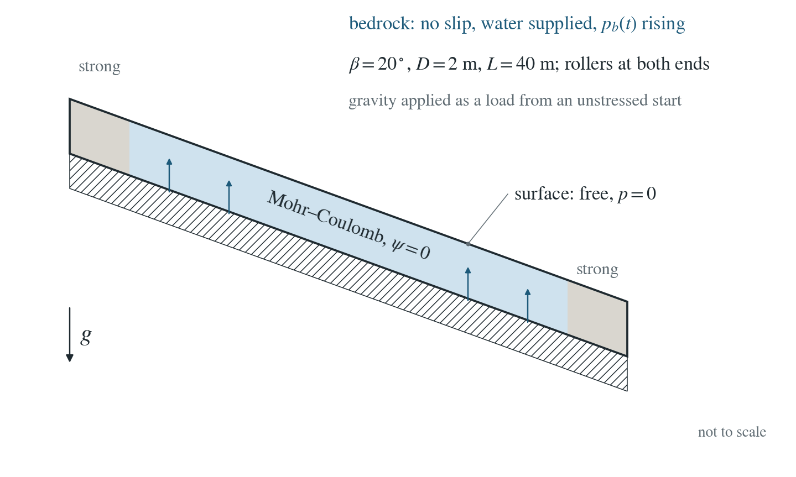
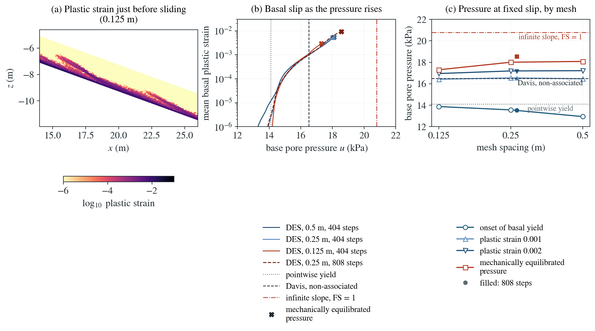

# Pore pressure triggers a translational slide

A 2 m soil layer on 20° bedrock is loaded by its own weight and then by pore pressure rising from the bedrock. Plastic flow starts at the base and spreads along it, and the basal slip accelerates as the pressure rises.

**Basal yield starts at 13.9 kPa on the 0.125 m mesh (pointwise estimate 14.1 kPa). The slip then grows along one curve on every mesh and step count: the basal plastic strain reaches 0.001 at 16.42–16.54 kPa, at Davis's non-associated estimate (16.5 kPa), and PT stops finding an equilibrium at 17.3–18.6 kPa, below the classical factor of safety (20.8 kPa).**

:::info At a glance

| | |
| --- | --- |
| Dimension | 2D |
| Build | `make ndims=2` from the poromechanics source |
| Inputs | [slope.zip](/downloads/poromechanics/slope.zip) |
| Reproduce with | DynEarthSol [`3774df0`](https://github.com/GeoFLAC/DynEarthSol/tree/3774df00ba1708a4f70a836d2073f845653aac64) |

:::

## Problem setup



**Slope.** A soil layer of vertical thickness $D=2$ m on bedrock inclined at $\beta=20^\circ$, 40 m long, plane strain. The base is fixed and supplies water; the surface is free and drained; the vertical ends are rollers. The 4 m at each end are strong (cohesion 10 MPa) so the corners stay elastic.

**Material.** Mohr–Coulomb, $c=2$ kPa, $\phi=35^\circ$, no dilation; $K=50$ MPa, $G=5.17$ MPa ($\nu=0.45$); saturated, $\rho_s=2650\ \mathrm{kg/m^3}$, $\phi_n=0.3$, $k=10^{-11}\ \mathrm{m^2}$.

**Loading.** Gravity is applied as a load: the slope restarts with gravity from an unstressed, gravity-free checkpoint. The bedrock pressure then rises linearly over 2000 s; the seepage stays quasi-steady.

**What is compared.** The bedrock pore pressure at the onset of basal yield, at fixed mean plastic strains of the basal 0.6 m in the middle third of the slope, and at the last time step for which PT still finds equilibrium, against three estimates.

## Input and how to run

Every file this example needs is in [slope.zip](/downloads/poromechanics/slope.zip). Run from that folder:

```bash
# Optional. Meshes the slope from slope.poly and writes the checkpoint seed at frame 0 without gravity and without stress (zero steps). The shipped seed.chkpt.000000, seed.save.000000 and seed.info are this output, so you can skip this step.
dynearthsol2d seed.cfg
# Restarts from seed frame 0 with gravity switched on, so the first step finds the gravitational equilibrium of the slope; after 20 s the bedrock pressure starts to rise. Saves every 5 s step as slope.*. The run ends with exit code 54 (mechanical solve did not converge) once the accelerating basal slip outruns PT, before max_steps is reached; that is the expected end of this example.
dynearthsol2d input.cfg
```

### Settings that define this example

| Setting | Value | What it does here |
| --- | --- | --- |
| `sim.is_restarting` | `yes` | starts from the unstressed seed checkpoint instead of building a new initial state, so gravity is applied as a load |
| `control.gravity` | `9.81` | gravity is on in this run; seed.cfg has it at 0 |
| `mesh.meshing_option` | `90` | reads the slope outline, and the soil and strong-end regions, from slope.poly |
| `mat.num_materials` | `2` | two materials: the soil (0) and the strong 4 m end blocks (1), assigned by the regions of slope.poly |
| `mat.rheology_type` | `elasto-plastic` | Mohr–Coulomb elasto-plasticity on the effective stress |
| `mat.cohesion0` | `[2000.0, 1e7]` | soil cohesion and the high cohesion of the strong ends, which keep the corners elastic; cohesion1 is the same, so there is no softening |
| `mat.friction_angle0` | `[35.0, 35.0]` | friction angle of the soil; dilation stays at its default of zero (non-associated flow) |
| `mat.shear_modulus` | `[5170000.0, 5170000.0]` | with bulk_modulus sets Poisson's ratio 0.45, which fixes the slope-parallel stress K0 in the pointwise estimate |
| `mat.hydraulic_perm` | `[1e-11, 1e-11]` | high permeability, so the seepage stays quasi-steady while the pressure rises |
| `bc.vbc_z0` | `3` | fixes the bedrock (base): normal and tangential velocity zero, no slip |
| `bc.hbc_z0` | `2` | bedrock pressure prescribed from hbc_pressure: water is supplied from below |
| `bc.hbc_z1` | `2` | drained surface: pore pressure held at 0 |
| `bc.hbc_pressure` | `[0,0,0,0,31176.76475321268,0]` | the bedrock pressure at schedule ratio 1 (fifth entry, z0) |
| `bc.hbc_schedule_ratio` | `[0, 0, 1]` | with hbc_schedule_time_in_yr: no bedrock pressure for the first 20 s, then a linear rise to the full value at the end time |

[input.cfg](/downloads/poromechanics/slope/input.cfg) holds all 67 settings that differ from DES’s defaults; `dynearthsol2d -h` lists every option with its default.

## Output

See [Running the examples](../../benchmarks/poromechanics/running.md) for output files, the Python reader and ParaView conversion.

| Field | What to look at |
| --- | --- |
| `plastic strain` | panel (a) maps it; its mean over the basal 0.6 m in the middle third of the slope is the slip measure in (b), and its first nonzero value marks the onset of basal yield in (c) |
| `pore pressure` | averaged over the bedrock nodes in the middle third: the base pressure on the horizontal axis of (b) and the vertical axis of (c) |
| `velocity` | downslope velocity of the surface in the middle third, recorded in summary.json to show the slip accelerating |


## Result: DES and the analytical solution



(a) Plastic strain, on a logarithmic scale, in the middle of the slope at the last time step for which PT finds equilibrium on the finest mesh; plastic flow is concentrated along the bedrock. (b) Mean plastic strain of the basal 0.6 m against the bedrock pore pressure for each mesh (solid) and for the run with twice as many steps (dashed); crosses mark the last PT equilibrium, vertical lines the pointwise-yield, Davis non-associated and classical factor-of-safety estimates. (c) Bedrock pressure at the onset of basal yield, at two fixed basal plastic strains and at the last PT equilibrium, against mesh spacing; filled symbols are the run with twice as many steps, horizontal lines the three estimates.

Onset agrees with the poroelastic infinite-slope estimate. Slip develops through Davis’s non-associated estimate and accelerates well before the classical factor of safety, as zero-dilation flow predicts: limit-equilibrium design values overestimate the stability of such a slope. The rainfall page applies the same slope to infiltration.

Current-source coupling and fluid-content checks

To reproduce the whole study behind this figure, from the DES source folder:

```bash
python3 benchmarks/poromechanics/slope_application.py dynearthsol2d OUT --spacings 0.5 0.25 0.125
python3 benchmarks/poromechanics/slope_application.py dynearthsol2d OUT-808 --spacings 0.25 --steps 808
```

The study’s full numbers: [record.json](/downloads/poromechanics/slope/record.json).

## Analytical reference

$$
\sigma_n=\gamma D\cos^2\beta
$$

$$
\tau=\gamma D\sin\beta\cos\beta
$$

$$
FS=\frac{c+(\sigma_n-u)\tan\phi}{\tau}=1\quad\mathrm{(classical)}
$$

$$
\tan\phi^*=\sin\phi
$$

$$
c^*=c\cos\phi\quad\mathrm{(non\text{-}associated,\ }\psi=0\mathrm{)}
$$

$\gamma$ is the saturated unit weight and $u$ the pore pressure on the bedrock plane. The pointwise estimate applies Mohr–Coulomb to the elastic infinite slope: slope-parallel effective stress $K_0(\sigma_n-u)$ with $K_0=\nu/(1-\nu)$, slope-normal $\sigma_n-u$, shear $\tau$.

### Derivation

For a long slope, statics fix the normal and shear stress on planes parallel to the surface. Gravity applied to an unstressed slope with zero strain along it gives slope-parallel stress $K_0\sigma_n$; a pore-pressure rise reduces the slope-normal effective stress by $u$ and the parallel one by $K_0u$. The first $u$ at which that state reaches Mohr–Coulomb is the pointwise onset, 14.1 kPa.

A zero-dilation shear band along the bedrock fails with the reduced parameters above, giving 16.5 kPa; the classical factor of safety, which assumes associated flow, gives 20.8 kPa. A non-associated (coaxial) material fails below the associated limit load.

Drescher and Detournay (1993), Géotechnique 43(3), 443–456 (limit load of translational mechanisms for non-associative materials, with Davis’s reduced parameters).

[Original reference](https://experts.umn.edu/en/publications/limit-load-in-translational-failure-mechanisms-for-associative-an/).

## Validity and limits

No exact solution: an application compared with engineering estimates. The slip curve converges with mesh and step; the pressure at the last time step for which PT still finds equilibrium does not, so it is not read as a collapse pressure. There is no dynamic run-out. 2D, saturated, zero dilation. For the classic embankment by strength reduction see the embankment page.
