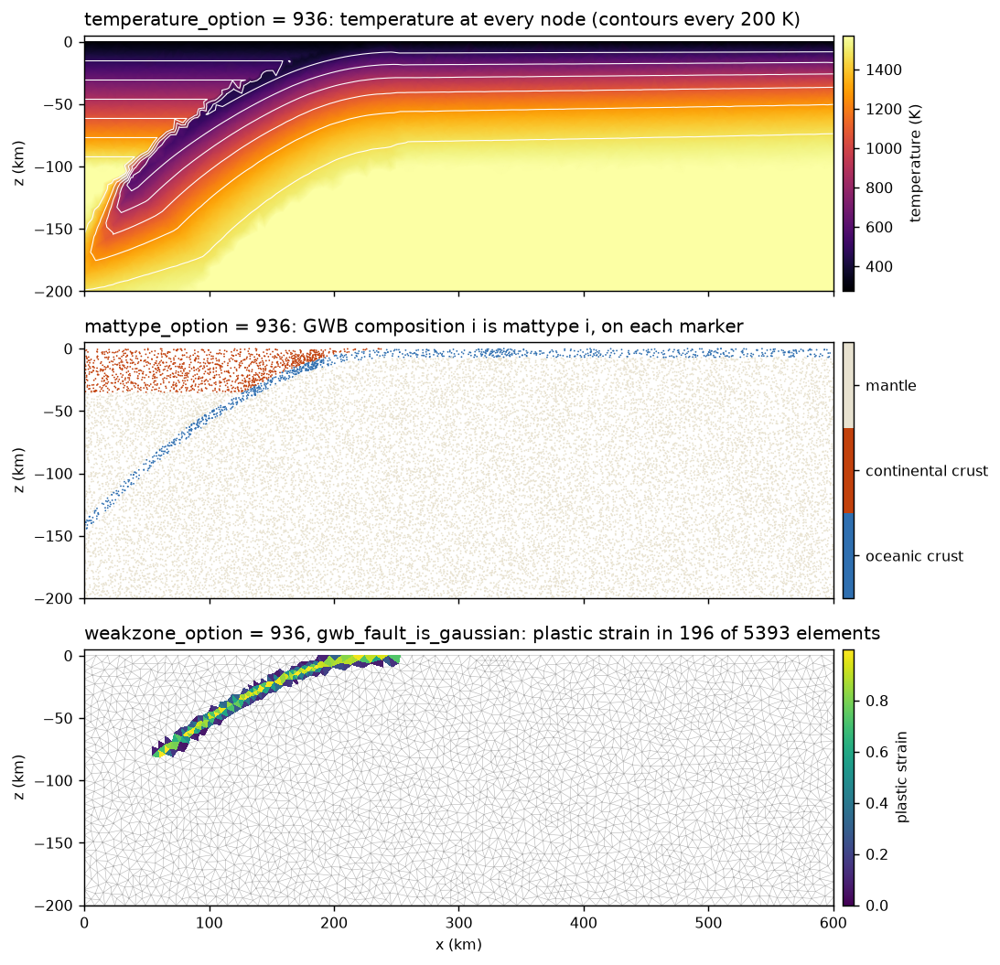
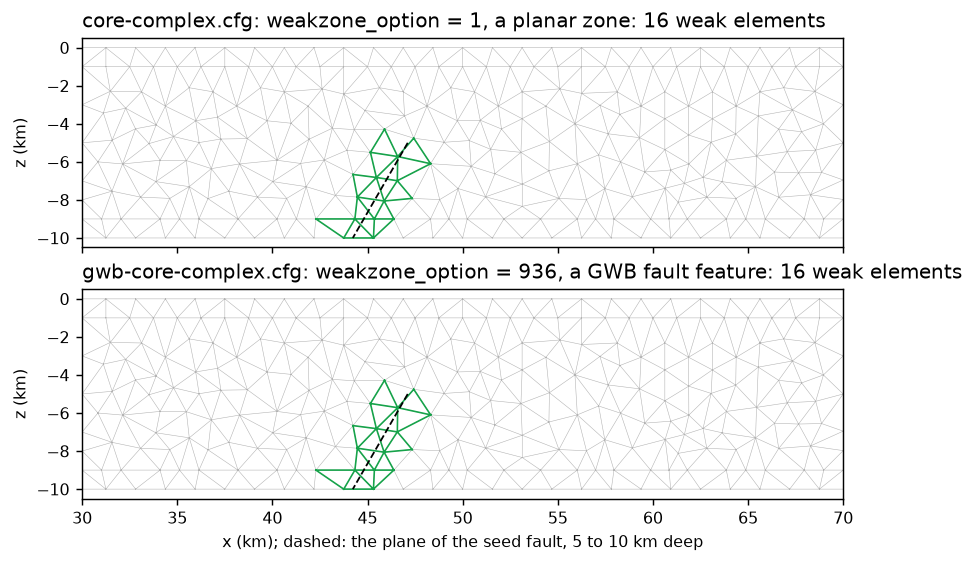
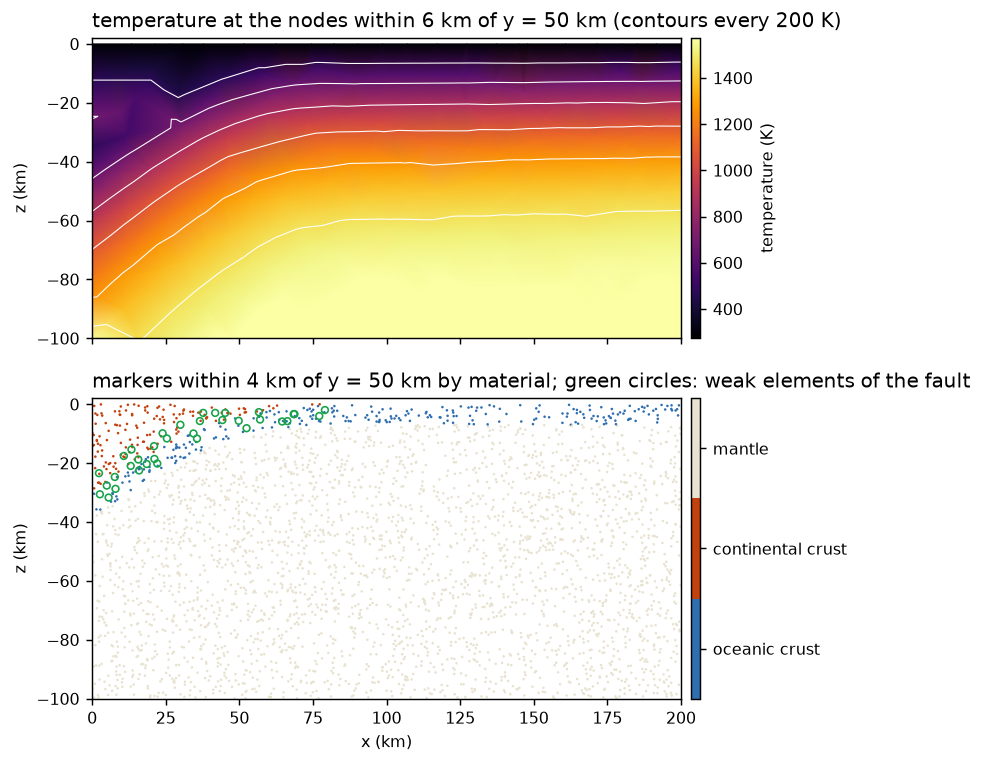

# Initial conditions from Geodynamic World Builder

The [Geodynamic World Builder](https://geodynamicworldbuilder.github.io/)
(GWB, Fraters et al. 2019) describes a model's starting state as a list of
features, continental and oceanic plates, subducting slabs, faults, mantle
layers and plumes, each with its own temperature and composition models, in
one JSON file, the *world*. DES can take three of its initial fields from a
world: the temperature, the material of every marker and the weak zone. The
same world then describes the model for DES and for other codes that read GWB,
such as ASPECT.

## What you will learn

- How to build DES with GWB, and the three input options that use a world
- How DES queries the world, and what a world must contain to set materials
- How GWB faults become DES weak zones, and two conventions of GWB faults
  that matter for that
- Three examples: a 2D subduction zone, a 3D slab, and a 2D core complex whose
  weak zone alone comes from GWB

## Prerequisites

- ✅ GWB (CMake 3.5 or newer, a C++14 compiler) built as a shared library and
  installed, in under a minute on 4 cores:
  ```bash
  git clone https://github.com/GeodynamicWorldBuilder/WorldBuilder.git
  cmake -S WorldBuilder -B WorldBuilder/build -DCMAKE_BUILD_TYPE=Release \
    -DBUILD_SHARED_LIBS=ON -DWB_ENABLE_TESTS=OFF -DWB_ENABLE_PYTHON=OFF \
    -DWB_MAKE_FORTRAN_WRAPPER=OFF -DCMAKE_INSTALL_PREFIX=$HOME/opt/WorldBuilder
  cmake --build WorldBuilder/build -j 4
  cmake --install WorldBuilder/build
  ```
  The `OFF` options skip parts DES does not use; with Python on, the install
  also runs GWB's `setup.py install` into the active Python. GWB installs its
  library in `bin/`, not `lib/`. Its `gwb-dat`, which prints a world's fields
  at given points, is not installed and stays in `WorldBuilder/build/bin/`.
- ✅ DynEarthSol with [GeoFLAC/DynEarthSol#117](https://github.com/GeoFLAC/DynEarthSol/pull/117),
  which adds option 936, built with `usegwb=1` (and `GWB_DIR` if GWB is not in
  `~/opt/WorldBuilder`); see [Build](../usage/usage.md):
  ```bash
  make ndims=2 usemmg=1 usegwb=1 GWB_DIR=$HOME/opt/WorldBuilder
  ```
- ✅ For the figures: Python 3 with `numpy` and `matplotlib`

## How it works

One input names the world, `ic.gwb_filename`. Option 936 of three `[ic]`
options takes a field from it; any of them can be used alone or together with
DES's other options. (936 reads as "gwb": 9 is a g, 3 on its side a w, 6 a b.)

| Option | Field | From the world |
|---|---|---|
| `temperature_option = 936` | temperature of every node | GWB temperature |
| `mattype_option = 936` | material of every marker | GWB composition *i* is mattype *i* |
| `weakzone_option = 936` | `weakzone_plstrain` in the weak elements, uniform or (with `gwb_fault_is_gaussian`) a Gaussian across the fault | the elements whose centroid lies in a GWB `fault` feature |

```cfg
[ic]
gwb_filename = gwb-subduction.wb
temperature_option = 936
mattype_option = 936
weakzone_option = 936
weakzone_plstrain = 1
```

- **Where the world is queried.** A point of the initial mesh lies at depth −z,
  since z = 0 is the surface. In 2D the world must have a `cross section`, and
  DES's x is the distance along it; in 3D, DES's x and y are the world's map
  coordinates and no cross section is needed.
- **When.** Only while the model is initialized; the world is then released.
  A restart cannot re-seed its weak zone from the world:
  `is_restarting_weakzone = yes` with `weakzone_option = 936` is an error.
- **Remeshing.** Materials ride on the markers, and temperature and plastic
  strain are carried over as usual. With MMG, DES refines the weak zone at
  t = 0, so a GWB fault also gets a finer initial mesh.

## Writing a world for DES

### Every point needs a material

GWB compositions are numbered 0, 1, 2, …; DES reads composition *i* as
mattype *i*, so number them in the order of the cfg's `[mat]` arrays. A marker
takes the composition that holds at least half of it. The world must give one
to every point of the domain, the mantle included: a marker with none, or with
only a composition ≥ `num_materials`, stops the run (exit 12) and names its
position and fractions.

In practice, give the mantle layer a composition of its own and fill each
plate and slab below its crust:

```json
{"model":"mantle layer", "name":"mantle", "max depth":300e3, "coordinates":[...],
 "composition models":[{"model":"uniform", "compositions":[2]}]},
{"model":"continental plate", "name":"overriding plate", "max depth":100e3, "coordinates":[...],
 "composition models":[{"model":"uniform", "compositions":[1], "max depth":35e3},
                       {"model":"uniform", "compositions":[2], "min depth":35e3, "max depth":100e3}]}
```

A later feature overrides an earlier one where they overlap, and a composition
model replaces the compositions it does not list with zero.

### Faults

Every `fault` feature is a weak zone. Two GWB conventions decide where:

- **A fault starts at its `min depth`.** Its `coordinates` are the trace of the
  fault surface at that depth, not at the surface. A fault confined to 5–10 km
  depth on a plane that crosses the surface at x = 50 km and dips 60° has its
  trace at x = 50 − 5/tan 60° = 47.113 km.
- **Segment length plus thickness must reach the deepest point.** A point
  deeper than the fault's total segment length plus its thickness lies outside
  it, even within `max depth`. Make the segments long enough, and let `max
  depth` end the fault.

A GWB fault's `thickness` is measured across the fault, while DES's
`weakzone_halfwidth` is measured horizontally: a planar DES zone of half-width
*h* dipping at θ is a GWB fault of thickness 2 *h* sin θ.

A fault without composition or temperature models changes neither, so a
plate-interface fault can be added on top of the materials and temperatures
above it.

By default every element in a fault gets the same `weakzone_plstrain`. With
`ic.gwb_fault_is_gaussian = yes`, the plastic strain falls off away from the
fault's plane as a Gaussian,

```text
plstrain = weakzone_plstrain × exp(−d² / 2σ²)
```

where *d* is the element centroid's distance from the plane (GWB measures it
across the fault, like the thickness) and σ is `ic.weakzone_standard_deviation`,
in metres. The fault's thickness still bounds the zone, so make it about 4–6 σ
for the strain to fade before the edge. An element in several faults takes the
largest value; GWB finds each fault's plane by its name, so the faults need
distinct names.

### Temperature

Set `bc.mantle_temperature` to the world's `potential mantle temperature`. DES
also takes the bottom temperature as the largest initial temperature.

### Initial stress

DES starts from a lithostatic stress, the reference pressure of
`control.ref_pressure_option`, which the side walls and the Winkler bottom also
use. The examples take it from the mantle (`ref_pressure_option = 0`,
`mat.mattype_ref = 2`). PREM's (option 1) is interpolated between table rows
35 km apart whose rounding gives each interval a slightly different density;
the excess over the model's own weight then steps at every row, which shows as
horizontal stripes, at 80, 115, 150 and 185 km depth, in a quiet model's strain
rate.

## Example 1: a 2D subduction zone

`examples/gwb-subduction.cfg` and `.wb`: a 600 × 200 km cross section of a
continental plate (35 km crust), an oceanic plate (7 km crust) and a slab
descending from x = 450 km to about 180 km depth, with GWB's plate and
mass-conserving slab temperatures, and a 12 km-thick fault along the slab top to
80 km, the plate interface. All three options are on; the materials are
0 oceanic crust, 1 continental crust and 2 mantle. The weak zone is Gaussian:

```cfg
weakzone_plstrain = 1
gwb_fault_is_gaussian = yes
weakzone_standard_deviation = 2.5e3   # the 12 km thickness is about 5 sigma
```

```bash
cd DynEarthSol/examples
../dynearthsol2d gwb-subduction.cfg
```



The initial mesh has 5372 elements and 21 488 markers: 743 of oceanic crust,
2443 of continental crust and 18 302 of mantle. 154 elements lie in the fault,
with plastic strain from 1 at the slab top down to 0.06 at the fault's edges,
6 km away.
The ragged isotherms above the slab follow a step in the world's temperature
at the slab top: at x = 330 km it drops by 285 K within 1 km at 33 km depth,
from the overriding plate's geotherm to the cold slab, and the 5 km mesh
samples that step. The example runs 100 kyr with fixed walls in about 8 s on
4 threads: it shows the initial fields rather than subduction.

## Example 2: a weak zone alone, in a core complex

`examples/gwb-core-complex.cfg` is the bundled `core-complex.cfg`, the model of
[Tectonic rifting and subduction](./tectonics.md) Part 1, with only its seed
fault taken from a world. Temperature and the single material stay DES's own:

```cfg
[ic]
weakzone_option = 936
weakzone_plstrain = 0.5
gwb_filename = gwb-core-complex.wb
```

```json
{"model":"fault", "name":"seed fault", "min depth":5e3, "max depth":10e3,
 "coordinates":[[47.113e3,-100e3],[47.113e3,100e3]], "dip point":[0,0],
 "segments":[{"length":12e3, "thickness":[2.08e3], "angle":[60]}]}
```

The fault reproduces the planar weak zone of `core-complex.cfg`: the plane
through (50 km, 0) dipping 60° toward −x, between 5 and 10 km deep, with the
1.2 km horizontal half-width as a 2 × 1.2 × sin 60° = 2.08 km thickness. Both
fault conventions above are at work: the trace is where the plane reaches the
5 km `min depth`, and the 12 km segment is longer than the 10 − 2.08 km it
must reach.



The two runs start from the same mesh, refined by MMG around the same 16 weak
elements, and stay identical: frame 3 matches bit for bit.

## Example 3: a 3D slab

`examples/gwb-slab-3d.cfg` and `.wb`: a 200 × 100 × 100 km box with a
continental plate (30 km crust) for x < 80 km, an oceanic plate (7 km crust)
beyond, a slab dipping from the trench at x = 80 km, and a 10 km-thick fault
along its top to 60 km depth. In 3D the world has no cross section.

```bash
../dynearthsol3d gwb-slab-3d.cfg
```



The mesh has 10 131 elements and 40 524 markers (3089 oceanic crust, 1807
continental crust, 35 628 mantle); 427 elements lie in the fault. The front and
back faces are free slip: left free, they bulge outward, since the plates and
the slab weigh differently and no one reference pressure holds them all. The
example runs 5 kyr in about 6 s on 4 threads. Run it longer and the dense slab
sinks along the weak interface at velocities far above the 3.15 cm/yr push, and
the mesh is remeshed often.

## Errors

| Symptom | Cause |
|---|---|
| exit 31: `... 936 needs the Geodynamic World Builder: build with usegwb=1` | DES was built without GWB |
| exit 11: `... 936 needs ic.gwb_filename` | no world named |
| exit 20: `cannot open ic.gwb_filename` | the world file is missing |
| exit 11: `ic.weakzone_option 936 cannot re-seed the weak zone of a restart` | a restart with `is_restarting_weakzone = yes` |
| exit 11: `Error: Geodynamic World Builder, world '...': ...` | GWB rejected the world; its own message follows. In 2D, a world without a `cross section` is one cause |
| exit 12: `... defines no material at x = (...)` | `mattype_option = 936` and a marker without a composition of at least 0.5 below `num_materials`; see [Every point needs a material](#every-point-needs-a-material) |
| exit 12: `ic.weakzone_option 936 needs a fault feature` | the world has no `fault` |
| exit 12: `ic.gwb_fault_is_gaussian needs the faults ... to have distinct names` | two faults share a name |
| exit 11: `ic.gwb_fault_is_gaussian needs ic.weakzone_standard_deviation > 0` | σ is 0 or negative |

## Testing

DynEarthSol's `GWB build` workflow builds GWB at a pinned commit, builds DES
in 2D and 3D with `usegwb=1`, and runs `tests/functional/gwb/check_gwb.py`. The
script compares frame 0 of a 2D and a 3D world with GWB's own `gwb-dat`
application point by point: every node temperature, every marker's material
and every weak element. It also checks the error exits above.

## References

- Fraters, M., Thieulot, C., van den Berg, A. & Spakman, W. (2019). The
  Geodynamic World Builder: a solution for complex initial conditions in
  numerical modeling. *Solid Earth*, 10, 1785–1807.
  [doi:10.5194/se-10-1785-2019](https://doi.org/10.5194/se-10-1785-2019)
