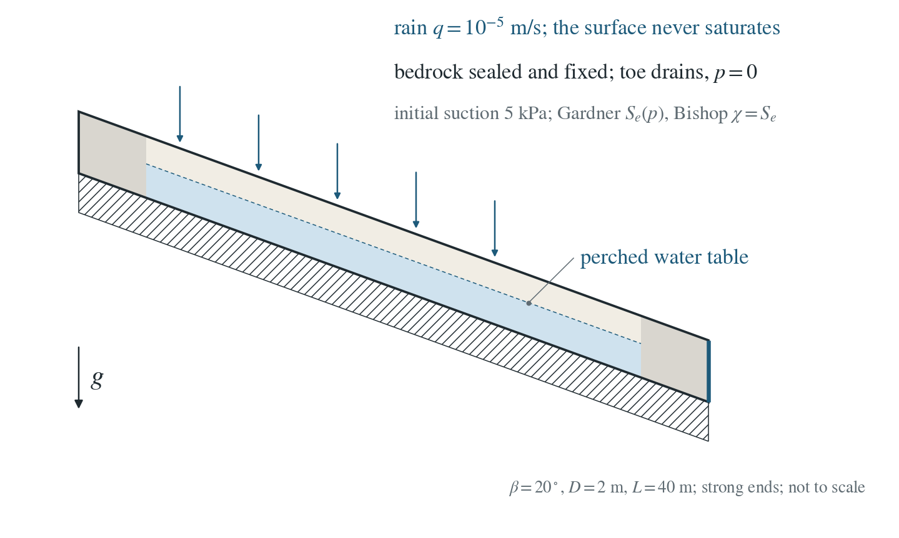
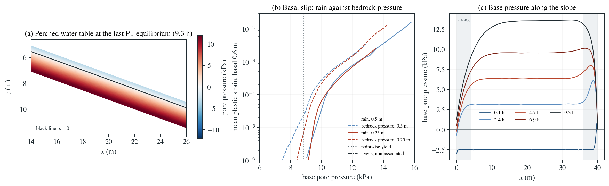

# Application: rainfall triggers a shallow slide

Rain falls on a partly saturated soil layer over impermeable bedrock. The water spreads down to the bedrock, a perched water table rises, and the slope fails when the pore pressure on the bedrock is high enough.

**Basal yield starts after 6.5 h at a base pressure of 8.9 kPa on the 0.25 m mesh, and the basal slip reaches a plastic strain of 0.001 after 8.72 and 8.71 h on the 0.5 and 0.25 m meshes, at 12.4 kPa: 0.9 kPa more than the same soil needs when the pressure comes from the bedrock. The surface never saturates.**

:::info At a glance

| | |
| --- | --- |
| Dimension | 2D |
| Build | `make ndims=2` from the poromechanics source |
| Inputs | [rainfall.zip](/downloads/poromechanics/rainfall.zip) |
| Checked with | DynEarthSol `97f9794` (poromechanics branch) |

:::

## Problem setup



**Slope.** The slope of the pressure-driven page (2 m of soil on 20° bedrock, 40 m long, strong ends, gravity applied as a load), with a weaker soil: $c=1$ kPa, $\phi=30^\circ$, no dilation.

**Water.** Gardner retention ($\alpha=2.4\times10^{-4}$ Pa$^{-1}$, $S_r=0.05$), Bishop $\chi=S_e$, initial suction 5 kPa. Rain $q=10^{-5}$ m/s (36 mm/h) enters through the surface; the bedrock is sealed; the toe drains at $p=0$.

**What is compared.** The time and the mid-slope bedrock pore pressure at the onset of basal yield and when the mean plastic strain of the basal 0.6 m reaches 0.001, against the same soil loaded by bedrock pressure.

## Input and how to run

Every file this example needs is in [rainfall.zip](/downloads/poromechanics/rainfall.zip). Run from that folder:

```bash
# Optional. Meshes the slope from slope.poly and writes the checkpoint seed at frame 0: no gravity, no stress, uniform initial suction (zero steps). The shipped seed.chkpt.000000, seed.save.000000 and seed.info are this output, so you can skip this step.
dynearthsol2d seed.cfg
# Restarts from seed frame 0 with gravity on and rain entering through the surface; 125 s steps, saved every fourth step as slope.*. The run ends with exit code 54 (mechanical solve did not converge) once the accelerating basal slip outruns PT, well before max_steps; that is the expected end of this example.
dynearthsol2d input.cfg
```

### Settings that define this example

| Setting | Value | What it does here |
| --- | --- | --- |
| `sim.is_restarting` | `yes` | starts from the seed checkpoint, so gravity is applied as a load to the unstressed slope |
| `control.gravity` | `9.81` | gravity is on in this run; seed.cfg has it at 0 |
| `mat.retention_model` | `[3, 3]` | Gardner exponential retention: the soil is partly saturated where the pore pressure is negative, with Bishop effective stress chi = S_e |
| `mat.retention_alpha` | `[0.00024, 0.00024]` | Gardner alpha: how quickly saturation and relative permeability fall with suction |
| `ic.pore_pressure_option` | `2` | uniform initial pore pressure, given by pore_pressure_value |
| `ic.pore_pressure_value` | `-5000.0` | initial suction of 5 kPa (negative pressure) everywhere |
| `bc.hbc_z1` | `3` | the surface takes a prescribed Darcy flux (hbc_flux): the rain |
| `bc.hbc_flux` | `[0,0,0,0,0,-1e-05]` | rain rate: the z1 entry is the outward flux, negative for inflow (1e-5 m/s, 36 mm/h) |
| `bc.hbc_x1` | `2` | the downslope end (toe) drains: pore pressure held at 0; the bedrock and crest end keep the default, sealed |
| `bc.vbc_z0` | `3` | fixes the bedrock (base): normal and tangential velocity zero, no slip |
| `mat.cohesion0` | `[1000.0, 1e7]` | soil cohesion (weaker than the pressure-driven slope) and the high cohesion of the strong end blocks |
| `mat.friction_angle0` | `[29.999999999999996, 29.999999999999996]` | friction angle of the soil; dilation stays zero |
| `mat.num_materials` | `2` | soil (0) and strong end blocks (1), assigned by the regions of slope.poly |
| `control.fixed_dt` | `125.0` | 125 s time step |

[input.cfg](/downloads/poromechanics/rainfall/input.cfg) holds all 68 settings that differ from DES’s defaults; `dynearthsol2d -h` lists every option with its default.

## Output

DES writes `slope.info` (one line per saved frame: frame, step, time in seconds), `slope.save.NNNNNN` (the fields of each saved frame) and `slope.chkpt.NNNNNN` (checkpoints to restart from). `sim.output_step_interval` and `sim.output_time_interval_in_yr` set how often a frame is saved.

Set `DES_SOURCE` and `PYTHONPATH` as described in [Running the examples](../running.md) before using the Python reader or converter.

| Field | What to look at |
| --- | --- |
| `pore pressure` | panel (a) maps it with the p = 0 contour as the perched water table; along the bedrock it gives the base pressure of (b) and the profiles of (c); its maximum on the surface is checked to stay negative, since DES has no ponding |
| `plastic strain` | mean over the basal 0.6 m in the middle third of the slope: the slip measure of (b) and the onset and failure times |
| `velocity` | downslope surface velocity in the middle third, recorded in summary.json |

Read a frame in Python:

```python
from Dynearthsol import Dynearthsol      # in the DES source folder
model = Dynearthsol('slope')
frame = model.frames[-1]                 # model.time[i] is the time of frame i, in seconds
x = model.read_field(frame, 'coordinate')
value = model.read_field(frame, 'pore pressure')
```

View it in ParaView after `python3 "$DES_SOURCE/2vtk.py" -g slope`.

## Result: DES and the analytical solution



(a) Pore pressure in the middle of the slope at the last time step for which PT finds equilibrium; the black line p = 0 is the perched water table, with suction above it. (b) Mean plastic strain of the basal 0.6 m against the bedrock pore pressure under rain (solid) and for the same soil loaded by pressure from the bedrock (dashed), on each mesh, with the pointwise-yield and Davis non-associated estimates. (c) Pore pressure along the bedrock at five times; the shaded ends are the strong blocks.

Rain fails the slope at a higher base pressure than pressure from the bedrock does: the perched table leaves suction (Bishop strength) above it and seepage parallel to the slope, instead of an upward seepage force through the whole layer. The time to failure is the same on both meshes. No exact solution exists; this is an application of the verified unsaturated flow, Bishop stress and effective-stress plasticity together.

[Current-source coupling and fluid-content checks](../background/rainfall-audit.md)

To reproduce the whole study behind this figure, from the DES source folder:

```bash
python3 benchmarks/hydromechanics/rainfall_slope.py dynearthsol2d OUT --spacings 0.5 0.25
python3 benchmarks/hydromechanics/slope_application.py dynearthsol2d OUT-driven --spacings 0.5 0.25 0.125 --cohesion 1000 --friction 30 --elastic-gravity
```

The study’s full numbers: [record.json](/downloads/poromechanics/rainfall/record.json).

## Analytical reference

$$
\theta_t+\nabla\cdot\mathbf{q}=0
$$

$$
\mathbf{q}=-\frac{k\,k_r(S_e)}{\mu}\left(\nabla p+\rho_fg\,\hat{\mathbf{z}}\right)
$$

$$
\boldsymbol{\sigma}'=\boldsymbol{\sigma}+\alpha S_e\,p\,\mathbf{I}
$$

$$
\frac{\sigma'_1-\sigma'_3}{2}+\frac{\sigma'_1+\sigma'_3}{2}\sin\phi=c\cos\phi
$$

Richards flow with Gardner retention and Mualem-type relative permeability; Bishop effective stress with $\chi=S_e$ (tension positive); Mohr–Coulomb yield on the effective stresses.

### Derivation

Each ingredient is verified separately: unsaturated flow against Srivastava–Yeh, Bishop coupling in the drained column, the sealed cell and the draining column, and effective-stress plasticity against the confined layer. Here they act together on a slope.

A perched water table leaves suction, hence Bishop strength, above it and drives seepage parallel to the slope. Pressure from the bedrock instead drives an upward seepage force through the whole layer. The rainfall slope therefore needs a higher bedrock pressure to fail.

Infinite-slope stability under rainfall, as in Iverson (2000), Water Resources Research 36(7), 1897–1910; here computed fully coupled rather than from an infinite-slope factor of safety.

## Validity and limits

No exact solution: an application. DES has no runoff or ponding, so the rain rate is chosen to keep the surface unsaturated, and the surface pore pressure is checked to stay negative throughout. Failure is read at a fixed basal slip: the slip curve converges with mesh, while the pressure at the last time step for which PT still finds equilibrium does not. 2D only.

## Reproduction

[Commands, solver hashes and portable inputs](../running.md).
